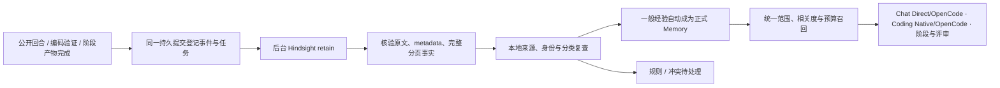

# 自动经验记忆

> 已被 [ADR 0030](../adr/0030-hindsight-project-memory.md) 替代：新的[项目记忆](project-memory.md)由 Hindsight 自动抽取和归纳，没有候选和待确认队列。本链路的代码已在 ADR 0030 第四期移除，本文只作历史记录；它的数据表保留在本地数据库中，不再读写（删除由它学到的旧记忆时仍会清空对应原文）。

实现日期：2026-10-22。对应[设计方案](../plans/memory-sharing-and-learning-2026-10-22.zh-CN.md)。这是单事件自动学习的首期实现，不代表多事件归纳和真实模型质量评测全部完成。

## 使用方式

1. 在项目的知识页面配置 Hindsight；网络调用仍遵守既有 `DEVFLOW_HINDSIGHT_PROTOCOL_VERIFIED` 开关，版本见 [Hindsight 接入说明](hindsight-integration.md)。
2. 在 Agent Memory 的“自动积累经验”中一次性允许发送该项目的公开会话与阶段材料，并设置每日提取次数。旧知识投影授权不会自动扩展为聊天上传。
3. 此后完成的聊天回合和编码验证会在后台形成学习任务。无需逐条点击保存；业务规则与冲突集中显示为待处理项。
4. 聊天消息仍有“记住这条”。可以编辑摘要、固定保留；此入口不要求 Hindsight 在线，也不要求启用自动积累。

已存在的项目不会被静默启用，也不会自动补传旧聊天。项目没有 Run 时也可以使用：宿主生成并持久化本地项目身份，后续 Run 延用该身份。有唯一历史 Run 创建者时沿用；多个历史创建者不自动合并。

## 实际保存范围

Hindsight 提取事实；DevFlow 在本地复查原始来源与策略，然后决定是否成为正式经验。首期策略采用可核验的有限语义类别，不是通用自然语言分类器。

| 内容 | 当前行为 |
| --- | --- |
| 明确语言、详略、说明顺序偏好 | 支持形式自动保存，例如“请用中文回答”“解释改动先说变化再说测试” |
| 项目环境和工作约定 | 支持 Node 等版本、平台、包管理器和测试命令；记录为用户陈述，不能冒充工具验证 |
| 成功编码验证 | Native/OpenCode 完成、真实持久测试证据通过且命令匹配时，可学习已验证命令；重新检查 Run、Diff、测试证据与用户范围 |
| 业务规则、验收条件、权限要求 | 识别出的规则进入 `rule_candidate`；不能在记忆面板批准为业务权威，仍需正式工作流审批 |
| 与当前有效经验冲突 | 保持原版本；展示新旧值及精确版本，用户确认后替换单条 |
| 模型自行声称成功、隐藏推理、一次性或无依据内容 | 不自动晋升；不把回注的 Memory、压缩摘要或助手复述当作新证据 |
| 手动记住 | 显式人工保存可补入未被自动策略识别的经验；已知语义冲突仍需确认，业务规则仍不能绕过工作流 |

同一消息中的独立支持语句可以分别学习；含条件、否定、引用、一次性标记的段落会保守跳过。大小上限为完整事件 24 KiB、最多 128 个导入事实，超限不截断成失去条件的陈述。含已识别敏感信息的公开回合不提交自动学习。

真实 Hindsight 会改写原句并附加角色信息。本地策略对已知角色尾缀和受限的偏好转述做适配，仍需与原始用户语义一致；保存原始来源文字，不直接把远端改写升级为权威。业务规则的转述只能提出待确认候选。

阶段产物和评审结果已经接入持久采集，可形成规则候选；首期不把这些模型产物自动当成一般经验的可信依据。结构化排障分类已预留，但完整“失败—修复动作—实际验证”的宿主采集尚未交付，不能据此宣称任意修复经验已全自动学习。

## 从完成事件到下一次使用

- 事件与后台任务同一次 SQLite 持久提交。重启恢复租约，保留固定文档/操作身份；复合保存和冲突替换只在最后发布一次数据库快照，失败回滚。
- 独立的经验 bank 仅用于处理；Agent 不直接 recall/reflect 暂存 bank。读取事实前后验证原文摘要、metadata、文档水位与完整数量，避免分页中途变更。
- Hindsight 来源保留为 `learning_event`，不伪造 AgentRuntime，也不反向投影成为自身的新证据；不进入团队同步。团队配对项目也只在当前配对用户明确授权后形成私有经验。
- 网络、抽取失败和重试留在后台。已存经验仍由本地账本召回；退出等待在途处理停止。更换配置、取消授权、配对变化后不沿旧授权导入，已发任务使用历史配置清理。
- 所有调用共用作用域、有效期、删除、版本和预算检查。普通经验按相关度选择；有来源的未改写沟通偏好可跨话题附带，最多 2 条且不超过记忆预算的 1/3。
- 聊天 Direct/OpenCode 将经过宿主核验的语言、详略和说明顺序转成有限枚举，紧邻本轮 `currentRequest` 附带；设置与原记忆一起裁剪并记录来源 ID。当前明确要求优先；用中文提问本身不取消英文偏好。任意记忆正文不能获得这一表达设置权限，Run 原始需求也不能替代本轮目标。
- 原有 Coding 学习与 Hindsight 学习对同一已验证测试命令双向去重，只识别仍与原候选的来源、摘要及范围一致的固定模板；正式提交事务内再次检查，防止并发双写。历史重复条目不自动迁移或删除。
- 聊天和评审记录实际装配的记忆 ID、修订、摘要及遗漏数。聊天区分准备、调用、收到响应、未发送和送达未知；OpenCode 回执只描述宿主请求边界，不宣称看到内部所有请求或证明模型采用。
- 聊天、Coding 和评审在发送前核验实际附带来源。经验是辅助上下文，不能代替当前请求、批准材料、执行权限或测试证据。

## 保留、删除与费用

- 自动经验和普通手动经验默认 30 天；固定后保留到取消固定或删除。重复召回、重复自动提取不延长有效期。明确手动固定重复内容会固定原记忆，不创建副本。
- 确认冲突只停用指定旧版本，保留新来源及替换审计；不会失效同一旧事件的其他经验。
- 真正“删除”采用单事件来源闭包：立即停止该事件的所有派生经验，清理本地学习事实/建议正文并登记远端删除。UI 提示这一范围；相同来源重放不复活。原始会话是独立记录，删除 Memory 不等于删除聊天。
- 远端暂存事件最长保留 90 天。处理已发生的远端操作后清理；未知/迟到操作保持待对账状态，不能假报已清除。未发送的过期事件不补传。本地固定经验不会因为远端暂存 TTL 被删除。
- 关闭自动积累停止新采集与晋升，保留已有正式记忆；在途任务继续对账清理。重新启用产生新授权版本。
- 每日上限是持久化的 retain 调用次数，重试也计数，默认界面值 20，可设 1–100。它不是人民币硬预算；Hindsight 内部抽取可能调用多个模型请求，金额限制应由其模型网关/提供方设置。

## 代码入口与验证

- [完成事件采集](../../apps/desktop/electron/automatic-memory-capture.ts)、[持久任务](../../apps/desktop/electron/automatic-memory-store.ts)、[后台处理](../../apps/desktop/electron/automatic-memory-service.ts)
- [可核验策略](../../apps/desktop/electron/automatic-memory-policy.ts)、[原子生效与替换](../../apps/desktop/electron/automatic-memory-host.ts)、[宿主配置及 IPC 编排](../../apps/desktop/electron/automatic-memory-runtime.ts)
- [统一召回](../../apps/desktop/electron/coding-context.ts)、[聊天](../../apps/desktop/electron/workbench-conversation-service.ts)、[评审](../../apps/desktop/electron/knowledge-review-runtime.ts)
- [已验证命令身份](../../apps/desktop/electron/verified-memory-command.ts)、[原有编码学习](../../apps/desktop/electron/coding-run-memory-learning.ts)
- [设置与待确认队列](../../apps/desktop/src/components/AutomaticMemoryPanel.tsx)、[手动记住](../../apps/desktop/src/components/RememberConversationMemory.tsx)

复现受控主链：`corepack pnpm test:automatic-memory-electron`。使用临时 Todo 仓库、独立 Electron 数据目录、本地模型与 Hindsight HTTP 测试服务，阻断外网；覆盖无 Run 自动保存、下一会话实际发送记忆、冲突/规则、离线固定、删除/重启。结果写入 `out/automatic-memory-smoke/report.json`。

完整工程检查使用 `corepack pnpm verify`；桌面构建、E2E、Electron smoke 单独记录。具体本轮结果见[验证记录](../validation/automatic-memory-20261022.md)。受控测试不证明真实 Hindsight 的抽取质量或长期任务收益。

真实 Electron 界面、Hindsight、DeepSeek、OpenCode 与 Native 的实测、发现的缺陷、修复复测和费用见[真实环境验证记录](../validation/automatic-memory-real-ui-20261022.md)。该记录同时区分实际 UI 操作、目录注册例外和零模型的真实数据副本回放。

后续仍需独立评测并决定是否开启：多事件 observations/consolidation、主动语义混合召回、自然语言“记住这个”、完整修复经验学习、阶段批准产物的经验归纳，以及真实模型保留集质量/成本验证。现有 Hindsight 正式记忆召回继续处于 shadow。
