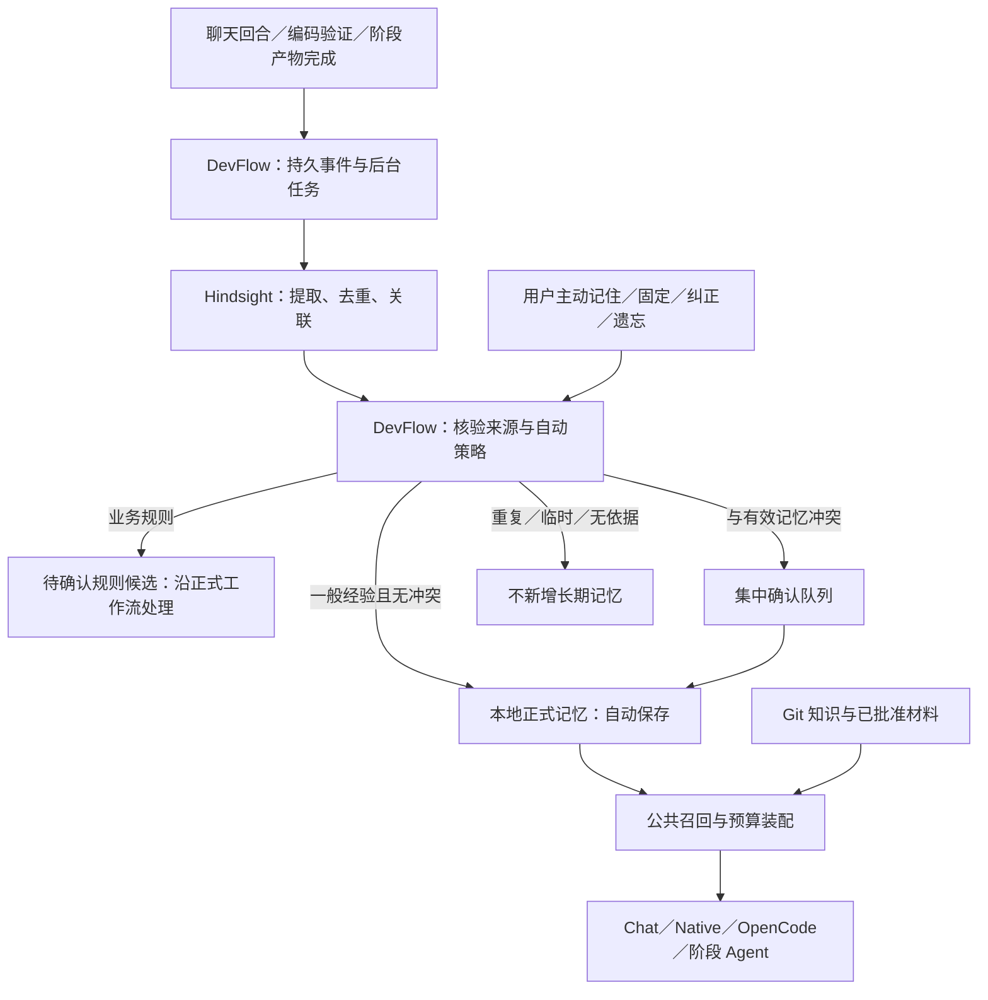

# DevFlow 自动经验记忆与跨场景复用方案

> 2026-10-28：本计划的候选、自动确认和「业务规则待确认」部分已被 [ADR 0030](../adr/0030-hindsight-project-memory.md) 替代，项目记忆改由 Hindsight 自动学习。

日期：2026-10-22。状态：**用户批准后，单事件自动学习主链已实施**。本文保留设计时的完整目标与后续阶段，不应把每项设计目标当作已交付功能。当前范围、使用方式和限制见[实现说明](../engineering/automatic-memory.md)，测试结果见[本轮验证](../validation/automatic-memory-20261022.md)。最初的方案调研未改代码；后续实施没有为既有项目静默启用上传，也没有调用付费产品模型或写入用户业务数据。

本版替代“聊天经验逐条人工确认”的旧方案。主流程改为：**自动提取、自动保存合格的一般经验；业务规则及真正的冲突再确认；主动保存是补充能力。** 无任务关联的自由聊天纳入首期。

代码基线：工作树 HEAD `a55d1f7`，包含当前未提交的 Hindsight 全阶段接入等改动。此前人工方案的 Cursor 外审因连接失败未完成；本版经过源码核对与并行独立分析，不能称为已获 Cursor 通过。旧版及旧评审记录保留供追溯，不能作为本版决策依据。

研究依据见[调研与设计取舍](../research/automatic-memory-2026-10-22/research-summary.zh-CN.md)、[Hindsight 取证](../research/automatic-memory-2026-10-22/hindsight-notes.zh-CN.md)、[Agent / harness 取证](../research/automatic-memory-2026-10-22/harness-notes.zh-CN.md)。公开网络访问存在 TLS 故障；本机技能、既有锁版本协议证据与本次成功访问的官方页面分别标注，不混作本次在线核验。

## 1. 决策摘要

1. **一般经验默认自动处理。** 项目启用自动经验后，用户不必逐条点“保存”。自动保存必须有来源、有作用域、可查看、可纠正、可撤销。
2. **复用 Hindsight 做语义处理。** 使用其事实抽取、去重、实体关联；不再自建另一套通用语义记忆引擎。DevFlow 只负责宿主事件、身份与来源、应用生效策略和现有工作流权限。
3. **保留本地记忆作为生效账本。** Hindsight 的提取结果经过自动策略后，登记为现有 SQLite 记忆候选及正式版本。符合策略的条目无需人工晋升；既有版本、墓碑、BM25 与公共召回继续使用。
4. **业务规则与冲突进入例外队列。** 分类可以由模型辅助，但“提取出来了”不等于“需求已批准”。业务规则走需求/设计/验收流程；冲突呈现旧、新内容及证据，用户处理后才替换。
5. **阶段与引擎共用宿主机制。** 右侧聊天的 Direct/OpenCode、Coding 的 Native/OpenCode、需求/设计/评审等阶段共用来源与消费接口。无需给每个引擎各安装一套可写 Hindsight 插件。
6. **自动整理分阶段开启。** 首期自动保存不依赖跨事件 observations 合并。后续验证完整来源链、删除和冲突联动后，在专用经验 bank 开启该能力；不直接修改现有知识 bank 的策略。

## 2. 当前代码与目标的差别

| 当前事实 | 本版调整 |
| --- | --- |
| Native/OpenCode Coding 已有完成后学习；只有真实验证过的 `test_command` 受限自动晋升，默认 30 天 | 保留该确定性快路径，新增聊天及阶段的一般经验自动策略 |
| 聊天持久化公开消息、工具事实及摘要，但没有通用回合结束自动长期学习 | 在宿主完成事实落盘时原子登记后台学习任务 |
| Hindsight 按选定 Git 文档/本地正式记忆做投影；当前 recall 只返回文档 ID 与 metadata | 新增读取抽取结果的适配器；不能用现有 recall 包装器假装已经得到经验正文 |
| `configureBank` 明确关闭 observations 与 auto consolidation | 专用经验处理路径与现有知识投影分开；分阶段验证并利用自动整理 |
| 无 Run 且未配对的聊天没有可靠记忆身份；现有生命周期权限依赖 Run | 稳定本地项目身份提升为首期前置条件 |
| 正式记忆的 Hindsight 召回仍是 shadow | 自动保存与语义召回分别交付、分别评测；自动保存不等于立刻打开 hybrid |

代码入口：[聊天服务](../../apps/desktop/electron/workbench-conversation-service.ts)、[Coding 运行](../../apps/desktop/electron/coding-runtime.ts)、[编码后学习](../../apps/desktop/electron/coding-run-memory-learning.ts)、[自动晋升策略](../../apps/desktop/electron/coding-run-memory-policy.ts)、[Hindsight 客户端](../../apps/desktop/electron/hindsight-client.ts)、[服务与任务处理](../../apps/desktop/electron/hindsight-service.ts)、[记忆权限](../../apps/desktop/electron/agent-memory-authority.ts)、[共享契约](../../packages/shared/src/retrieval-memory.ts)。

## 3. 职责分工与数据流

### 3.1 为什么仍保留本地生效账本

Hindsight 负责“从材料中提取和组织什么”；DevFlow 负责“什么范围的哪个 Agent 现在可以使用它，以及是否已被用户否定”。这些权限、修订和工作流规则已经在本地实现，保留它们比再引入一套以远端为权威的生命周期更小、更可控。

这不是要求用户审阅全部候选，也不是在本地再做一遍向量化和语义归纳。普通候选由后台策略直接晋升。Hindsight 不可用时暂停新的语义学习，已有正式记忆仍可本地召回，聊天和开发继续运行。

### 3.2 专用经验处理 bank

- 现有选定知识文档的 bank 与当前策略保持独立。正式业务依据仍来自 Git 原文和已批准工件。
- 新增按项目及可信用户范围隔离的经验处理 bank，接收已获该项目授权的最小事件材料。原始用户/项目身份不能由模型指定。
- 经验处理 bank 中可能包含尚未确认的业务讨论和误提取内容，**不能直接对生产 Agent 开放 recall/reflect**。只有通过本地策略的正式记忆可以进入公共召回。
- 从 Hindsight 导回的记忆持久标记派生来源；即使后续人工修订，也不重新投影回同一个经验 bank，避免“模型生成内容再次成为新证据”的循环。
- 采集材料不重复加入注入过的 Memory 区块、摘要和检索结果。助手复述已有记忆不能成为新的独立证据；仅有助手陈述、没有新增用户表达或工具依据的候选不自动晋升。
- 后续语义召回只能映射到当前有效的本地 ID、修订和摘要，再回读正文；不能绕过本地状态直接注入远程摘要。

### 3.3 抽取与归纳的阶段边界

首期：已完成的单个事件 → Hindsight retain → 读取该事件的事实结果 → 本地自动晋升。保留 Hindsight 的抽取、近似事实去重和实体关联能力；不导入无法追溯全部来源的跨事件综合结论。

第二阶段：对一般经验启用 observations / consolidation，作为合并、纠错或补充候选。只有拿到全部支持来源、检查来源仍有效且作用域相同，才允许导回。与既有有效陈述矛盾时仍进入确认；不能因为归纳模型选了新说法就自动覆盖旧说法。原始材料删除、TTL 和用户固定项也必须参与处理。

这样首期已经是自动记忆产品，并非继续要求用户手动保存后才算记住；跨事件整理是在此基础上的质量增强。

## 4. 自动保存与确认如何区分

判断依据是**内容的作用、来源和证据**，不能靠“必须”“建议”等关键词或模型自报 confidence 单独决定。抽取器给出候选与来源片段；宿主应用策略负责 disposition。首次实现若无法从 Hindsight 原生输出获得所需类别，可增加一个有界的分类适配步骤，只做分类/冲突建议，费用单列，不重新抽取整份会话。

| 情形 | 默认处理 | 例子与证据要求 |
| --- | --- | --- |
| 明确用户偏好 | 自动保存 | 用户直接说“解释改动先说行为变化，再说测试”；记录用户公开消息来源 |
| 稳定工作习惯、环境事实 | 自动保存 | 配置、工具结果或用户明确陈述支持的项目约定；标明用户陈述/工具观察，不混称验证事实 |
| 可复用的排障经验 | 自动保存 | 条件、现象、处理和实际结果可定位；“助手说已经修好”不等于真实验证 |
| 完全重复、语义一致的补充 | 幂等去重或增加支持来源 | 不能让每次被召回、助手重复转述都增加可信度或刷新期限 |
| 一次性任务状态、闲聊、未证实猜测 | 不进入正式长期记忆 | “正在安装”“也许缓存有问题”等留在会话事实中；不为低价值内容打扰用户 |
| 需求、业务逻辑、验收条件、权限与发布决策 | 自动形成待确认规则候选 | “Todo 删除必须可撤销”“管理员可删别人任务”；既有正式输入继续优先 |
| 新旧陈述含义冲突，或改变适用范围 | 待确认，保持原有效版本 | “改用 npm”与有效的“使用 pnpm”冲突；展示两份来源 |
| 模糊且可能改变业务行为的内容 | 保留提案，不自动生效 | 无需阻塞本轮回答；在阶段确认/集中队列中处理 |
| 敏感内容、来源缺失或范围不明 | 不提交自动正式记忆 | 记录不含原文的原因；不回退到别人的身份或项目 |

同一句话可以拆成不同去向，例如“删除任务须可撤销；上次撤销失败与序列化丢字段有关”：前半句是业务提案，后半句仅在有来源支撑时成为排障经验。

自动规则候选暂存为学习队列中的 `rule_candidate`，不直接冒充已完成的正式 `publish` 工件。转成正式提案仍须经过现有关键输入、覆盖完整性和语义校验；特别是 Chat OpenCode 现有的完整提案限制不能被后台学习绕过。若内容已经出现在当前有效的批准材料中，只关联既有版本，不再为同一条规则重复请求确认。

用户明确点击“纠正这条记忆”或明确要求覆盖某个已展示版本，是一次人工决定，不再要求用户二次确认同一动作。但它不代替正式业务规则审批。普通聊天中新出现的冲突陈述不视为已授权覆盖。

分类可能漏判，因此所有长期经验始终为辅助上下文。它们不能设置执行权限、修改 Gate、证明测试通过，或覆盖当前请求及已批准材料。正式业务规则必须沿正式输入完整传递，不能只靠概率召回保证。

## 5. 用户体验

### 5.1 一次启用，日常自动

项目设置中明确启用“自动积累经验”，展示数据范围、Hindsight 地址及其模型提供方、费用预算和保留策略。既有 `includeMemories=true` 只授权旧投影，不能自动扩展为上传聊天历史；新增会话/阶段来源需要单独的项目级启用记录。**这是一项设置，不是每条经验的保存弹窗。** 本轮方案评审不会执行该设置或上传资料。

建议日常界面只显示可展开的低干扰状态：“本轮自动记住 2 条；1 条规则待确认”。零条时不刷通知。支持来源查看、撤销、编辑、固定和遗忘。队列/网络失败可见但不阻塞 Agent 的任务。

“业务规则/冲突待确认”集中在队列及对应阶段入口，允许批量处理；不能每抽到一句就弹窗。未处理项不生效，也不阻止无关的聊天、编码或已有正确记忆被使用。

### 5.2 主动保存作为补充

保留消息菜单“记住这条”，并支持用户明确说“记住这个”。宿主验证当前会话、用户和项目后，创建一个人工请求事件；不让模型任意填写身份或绕过生命周期权限。指代不清时只询问这一次具体内容，不默认把整轮全保存。

手动保存可提高重要性、选择“固定保留”，也可补入自动筛选漏掉的经验。它不改变事实证据等级、团队共享权限或业务规则审批。普通手动记住仍可沿当前自动保留期；明确“固定”才延长到用户取消固定/删除，界面显示这一差别。

### 5.3 保留、更新与遗忘

建议一般自动经验初始有效期为 30 天；明确用户偏好为 90 天。这是待评测的产品初值，不声称来自 Hindsight 默认值。只有新的独立证据或明确用户确认才续期，单纯召回/重复引用不续期。固定项不自动过期，仍可纠正和删除。

正式经验的有效期与材料保留期分别设置：本地原会话遵守既有会话策略，远端事件材料建议最长 90 天，到期清理并记录状态。单条经验 30 天到期意味着停止使用，不虚称同事件的全部远端原文已删除；用户主动遗忘则按下述来源闭包立即排队清理。远端暂存结束不自动删除仍有本地合法来源的固定经验。

Hindsight 的合并/替代、源文档 upsert 和用户要求的“遗忘”是不同动作：

- 一致性补充可自动去重和关联；矛盾必须确认。远端未返回某条记忆不等于本地应该删除。
- 用户遗忘后先原子撤销本地召回资格，再安排远端清理并跟踪状态；UI 区分“已停止使用”和“远端清理完成”。
- 墓碑/忽略记录绑定来源及派生族，同一事件重放不能复活。跨来源的近似主题匹配只能建议抑制，不把一条删除扩大为任意同词内容永久禁入；用户可额外选择“以后不再自动记这个主题”。
- 首期以单事件来源处理删除：若无法证明某个派生事实已被完整清理，则撤销该事件全部派生项并清理对应远端文档。可由仍授权的其他独立来源重新生成不受删除项影响的内容，但不能静默保留被要求遗忘的陈述。
- 后续多事件归纳需要支持来源集合；其中一个来源失效就隔离受影响结果并重新计算，禁止继续使用旧综合正文。
- 已经发送给模型的文字不能撤回。后续请求停止使用；进行中 Coding 沿既有来源当前性检查停止旧上下文继续，OpenCode 内部不可见的历史不承诺可撤回。

关闭自动积累停止新采集、retain 和自动晋升，已有记忆保留可管理；已发送操作的对账、撤销与远端清理继续运行。未发送任务取消或冻结，重新启用建立新 generation，不能沿旧授权静默补传积压。清空经验与关闭功能是两个明确动作。关闭聊天 Tab 不等于删除会话来源。

## 6. 触发点、身份与异步一致性

### 6.1 四种组合与全链路阶段

| 场景 | 学习触发 | 消费方式 |
| --- | --- | --- |
| Chat × Direct | 最终公开 assistant 消息与回合完成状态成功落盘后 | 每个宿主步骤按范围召回 |
| Chat × OpenCode | 同一宿主回合完成出口；不重复挂内部插件 hook | 宿主初始背景及可观察的工具结果 |
| Coding × Native | 变更接受与规范测试结果等终态事实落盘后 | 运行开始时公共简报；继续时校验来源 |
| Coding × OpenCode | 与 Native 相同的宿主完成边界 | 同一公共简报与来源校验 |
| 需求/设计等生成 | 可持久定位的阶段产物保存后；草稿只能形成候选，批准结果记录真实批准状态 | 既有阶段公共记忆接口 |
| 各阶段评审 | 已保存的评审结果可作为材料；仅可核验、可复用的一般经验自动生效 | 统一相关经验装配，不依赖评审模型自己写记忆 |
| 测试/交付/验收 | 真实命令与工件结果提供结构化证据 | 无模型步骤不为“接入记忆”新增一次 LLM；有 Agent 的步骤沿其上下文入口使用 |

具体聊天出口为 `workbench-conversation-service.ts` 的最终 `update`（当前约 732–742 行），不是 12 步工具循环中的每一步，也不是覆盖失败/取消的 `finally`。Coding 当前约 1734、2140 行的 `learn` 出口可复用，但需从 best-effort 改为持久任务。

失败/取消的运行不能产生“成功经验”。可核验的失败现象另以结果为 failure 的事件参与排障学习；首期未支持的终态明确跳过，不能伪造成功。恢复/压缩前仅检查缺失事件和落盘水位，不重复上传整个历史。

### 6.2 无 Run 身份前置

未配对项目新增 Main 管理的稳定本地 project principal，并让聊天、权限校验与范围解析使用它。项目建立时生成，复用已存在且可唯一证明的归属时记录迁移依据。不要借用当前 UI 卡片或任意 Run 创建者。

该 principal 必须同时成为 Chat、Coding、Stage、Review 与 Hindsight 的公共 scope 解析入口；不能只改聊天，使 Coding 仍按另一套 Run.creatorId 查询。旧身份到 principal 的别名仅接受可证明的映射，不能混并两个用户；未经映射的旧记录保留旧范围并明确显示迁移状态。

有歧义的旧数据保持原归属、停止自动回填；在项目设置一次解决迁移，不能靠逐条保存规避。配对与本地身份不自动合并，用户切换、解绑或服务端范围变化使旧任务 generation 失效。首期仅当前用户、当前项目私有，团队共享及跨项目全局偏好另行设计。

### 6.3 事件与任务状态

新增真实来源 `conversation_turn` / `stage_completion`（编码沿现有真实来源），把人工/自动记为决策方式，而非把所有来源叫 `conversation_confirmation`。原会话仍在 SQLite，学习事件只保存不可变引用、摘要及必要的有界材料。

建议字段：`eventId`、scope/principal、源对象 ID 与版本、公开消息/工件 ID、`sourceDigest`、真实 outcome、启用授权 generation、抽取策略版本、采集水位与时间。输出另存 remote document/fact ID、支持来源、内容摘要、分类/证据、决策及正式记忆关联。隐藏 reasoning、凭据、完整仓库和未经选择的附件不进入采集。

状态区分：`queued → submitted → remote_processing → extracted → policy_decided → committed`；分支有 `skipped / needs_confirmation / retryable_failure / revoked / cleanup_pending / cleaned`。远程任务完成仅表示可读取抽取结果，不等于本地经验已保存。

1. 完成事实与学习任务在同一 `runDurableMutation` 中原子持久化。HTTP/LLM 在事务外，前台不等待提取。
2. 任务固定 document ID、operation ID、源摘要和策略版本；发送前再次校验范围、启用状态、来源与预算。
3. 完成后读取同一批结果并落地，提交再次校验 generation 与来源。幂等绑定事件、策略版本、远程事实标识和内容摘要。
4. 崩溃恢复重读已完成结果，不重新调用抽取；超时未知时按固定 operation 查询，不能用新 UUID 盲目重试。变更策略后的重处理须显式标记，不当成免费重试。
5. 撤销、删除、过期与处理中任务可能并发；本地先拒绝生效，等待迟到任务终结后继续清理。cancelled/404 不自动代表所有派生状态都已清除。

复用现有 Hindsight outbox 的 operation、租约、generation 和恢复做法，但新增学习任务语义，不能把“投影完成”冒充“抽取已授权”。

## 7. Hindsight 接口与数据契约

当前客户端固定 v1.0.0 契约提交 `39c65ffe2f140d0c84cee58566cad8900c5b9908`。`retain` 只返回异步 ACK，`operation` 只返回状态，`recall` 只保留文档 ID/metadata；本轮不改这些接口。

本次找到了与既有归档 SHA-256 一致的固定版官方 OpenAPI。契约已有 `GET /v1/default/banks/{bank_id}/memories/list`，支持 `document_id/type/state/limit/offset`，返回事实 ID、正文和来源等字段；`GET .../documents/{document_id}` 提供原文、hash 和 `memory_unit_count`。所以无需从头发明提取结果通道，但现有 DevFlow 尚未封装或实测它。

推荐采用一个完成事件对应一个不可变文档、一个固定操作的流程：任务完成后分页读取并按 fact ID 去重，核对数量、文档摘要和来源，再持久化结果批次。offset 分页没有快照保证，导出期间不允许该文档重处理；跨文档去重是否会改变来源归属须专项验证。schema 中正文/来源并非全部必填，缺失即隔离，不能猜测补齐。

实施第一步必须核实并封装以下能力：

- 按固定来源文档完整分页列举提取出的事实，而非用一个语义查询假装列举全部结果。
- 单次已完成批次内可标识的事实 ID、正文、类型、源文档关联，以及可核验的提取完成条件；不假设 fact ID 跨 upsert/reprocess 稳定。过滤世界事实/经验/观察等不同类型。
- 文档替换、追加和删除的确切作用；删除后 facts、links、observations 与异步任务如何处理。
- 自动合并是否保留全部源引用，是否可能跨来源/范围；不能只相信远端 metadata 中的范围字符串。
- 确切版本及输出形态、错误与分页上限；用隔离合成数据建立契约测试。官方协议文档证明接口设计，不代替运行实测。

新增适配器输出严格的 `ExtractedExperienceBatch`，由 Main 绑定真实 event/scope，模型只能提供陈述和建议分类。来源引用必须能回读当前授权版本。自动晋升存储层重新校验策略，不仅在调用方加一个 if。

当前协议还提供 dry-run extraction，可用于提取规则比较和离线评测；它没有异步操作身份，丢响应后重试可能重复收费。主流程选择可恢复的 retain → operation → list，不采用“每轮 dry-run 后再 retain 同一材料”的双重抽取。固定 operation ID 不被夸大为所有模型执行严格 exactly-once 的保证。

若锁版本接口无法提供必要来源或完整结果，先增加兼容适配/固定升级版本再发布。此项是具体的实施检查点，不假称当前客户端已经支持，也不以临时打开生产 bank 或让 Agent 直写 MCP 来绕过。

## 8. 本地契约与需要修改的模块

以下均为后续实施范围，本轮未执行。

| 工作包 | 主要涉及模块 | 交付结果 |
| --- | --- | --- |
| A：身份与协议 | `agent-memory-authority`、项目身份、`hindsight-client` 及隔离协议夹具 | 无 Run 聊天合法范围；可读取有来源的完整提取结果 |
| B：可靠事件 | `workbench-conversation-service`、`coding-runtime`、阶段保存入口、`local-store`/schema | 回合/运行完成与学习任务原子登记，重启恢复与撤销成立 |
| C：自动生效 | `retrieval-memory`、现有学习/晋升策略、Hindsight 服务与新分类适配 | 普通经验零人工保存；业务及冲突路由；无反馈循环 |
| D：用户控制 | IPC/preload/desktop-api、聊天和记忆管理面板 | 自动状态、集中确认、主动记住/固定/纠正/遗忘 |
| E：全场景消费 | `coding-context`、阶段/评审上下文、Chat 两执行器 | 同范围共用正式版本；真实发送回执与上下文预算 |
| F：质量增强 | observations 适配、来源关系、检索排序、评测脚本 | 有证据地开启多源整理与语义召回，独立开关与回退 |

A/B/C/D/E 构成第一个可用版本，不能只完成写入就宣称全链路完成。F 在可靠性与质量评估后推进。各包按当时工作树拆分小 PR；不在本轮开始改代码。

新增 provenance 涉及严格 JSON/摘要解析、候选来源回读、SQLite CHECK/迁移、忽略表、版本、renderer 和投影，不只是扩 TypeScript union。迁移版本在实施时按真实最大值分配。

现有修订保留 `sourceCandidateId`：新来源不能套用旧 Coding provenance。新增修订决策记录绑定精确结果修订和支持来源；不将聊天文本冒充测试证据。依赖真实 AgentRuntime 的附件路径必须显式处理不具备 runtime 的来源，不造假 ID。

团队/API 同步改为显式旧来源白名单；新私有会话与阶段经验不得因“不是 coding_run”而误进入团队 outbox。旧 Hindsight 正式投影白名单也需按派生族防循环；配对项目新经验来源仅在对应本地授权明确支持后启用，不能用旧 `includeMemories` 绕过。

## 9. 消费、成本与观测

沿用本地公共召回与当前硬边界：Coding 8 条/4,000 字节，Stage 6 条/3,000 字节，Chat 4 条/2,000 字节；Coding 简报 24,000 字节。完整陈述无法放下就省略，不切掉条件或否定词。批准输入、当前请求与权限信息优先。

新增两类可查看记录：

- 学习记录：采集事件、处理状态、自动保存/重复/忽略/待确认数量、原因、耗时及实际用量。不在日志复制敏感正文。
- 消费回执：最终送入请求的记忆 ID/修订/摘要、知识来源、范围、策略版本与预算。区分 `prepared / dispatch_started / response_received / completed / failed / delivery_unknown`；准备过不能称为已经采用。

回执绑定最终序列化请求；被裁掉的记忆不算发送。OpenCode 只证明宿主入口与可观察的工具结果，不能推断其所有内部请求或压缩后的保留情况。

后台学习使用独立的每项目预算、并发和积压上限，达到上限暂停处理并显示状态，不阻塞用户主要任务。实际调用前的准入必须覆盖提取、分类、embedding、reranker、归纳等实际付费路径；只做估算不称为硬金额控制。积压可合并处理相邻事件，但保留事件边界与来源，不能重新发送完整历史。

原授权的 DeepSeek 累计 5 元验证预算不因新方案重置；旧账本保持关闭。后续真实实验先核对累计用量和可用额度，范围不足时再申请具体测试预算。本轮无产品模型调用。

## 10. 如何验证“自动记忆有用”

工程正确性与效果分开。现有 2026-10-20 的 30 题知识检索中，23 道可答题 Top1 本地为 18/23，混合为 15/23；这说明不能声称当前 hybrid 已有优势，但它没有评测本次自动学习能力。见[历史验证](../validation/hindsight-fullchain-validation-20261020.md)。

### 10.1 工程与用户流程

使用隔离 Todo 工程、Electron profile 与数据库，覆盖：

1. 一次启用后，在普通聊天表达偏好、通过真实测试得出排障经验；**不点击保存**，后台自动形成可追溯记忆。
2. 新建 Chat Direct、Chat OpenCode，并分别启动 Native/OpenCode Coding；相关记忆进入实际请求，同一知识范围只对应一套本地正式版本。
3. 自由聊天无 Run 也能正确归属；多用户、多项目、配对切换不串记忆。
4. “删除需要撤销”自动成为待确认业务提案，未审批前不成为硬规则；批准后经需求/设计/开发/测试/评审正式链路执行。
5. 输入与已有记忆矛盾的新陈述：后台不覆盖，队列展示旧新证据；确认后后续请求使用新版本。
6. 用户手动固定遗漏的重要经验；自动整理不能移除该项。主动遗忘后重启、重放任务和迟到 retain 均不能使其复活。
7. 在完成落盘、发送未知、远端完成、本地提交等位置注入崩溃；不漏事件、不重复晋升，不凭未知状态重复付费。
8. Hindsight 断开时聊天/开发继续；已有记忆可召回，恢复后续处理；关闭与清空行为分别测试。
9. 预算、数据范围、提示注入、助手自述“测试通过”、重复转述、无依据归纳、源删除和过期独立验证。

### 10.2 质量与收益

冻结至少 60 个跨会话情景，按主题族划分开发集/保留集，覆盖偏好、已验证经验、临时噪声、重复、业务规则、冲突、纠正和遗忘。另用独立的知识检索集评估 Git 文档召回；不把答案或金标准导入记忆。

比较三个条件：记忆关闭、现有确定性学习、自动学习；在相同任务/模型/预算下，记录少重复调查、少重犯错误、任务测试通过率、用户纠正次数与总调用成本。人工保存路径验证可用性，不让它在自动条件里偷偷补齐漏记样本。

建议在实施前冻结发布门槛：

- 范围越界、删除复活、业务规则绕过正式批准、虚构测试证明：工程压力集必须 0 次；报告计数，不外推为现实风险绝对为零。
- 自动保存精确率目标 ≥95%，值得记却遗漏的召回率目标 ≥80%；按类别分报并给样本量，不用总分掩盖业务误分类。
- 冲突测试集不自动覆盖；完全重复的事件不增加有效条目。重复率、噪声率、过时内容进入新请求率分别报告。
- 跨会话任务效果相对现有确定性学习不退步，并在至少一类预先定义的任务上体现收益；小样本不能确定时扩大评测，不用检索命中代替任务效果。
- 每完成回合的学习成本、后台处理延迟、积压、总任务成本单列；前台完成只增加本地事件落盘，不等待远端模型。

语义 recall 与 observations 分别有自己的保留集门槛。普通记忆自动保存可以先发布，效果未证明的 hybrid/归纳继续关闭。后续工程改动运行相关测试及 `corepack pnpm verify`，真实模型、Electron 和各执行器分开报告；本轮文档检查不代表这些验证已经通过。

## 11. 迁移与回退

- 新功能以来源类别、自动晋升策略和整理策略的独立版本/开关管理。旧知识检索及 Coding 确定性学习不被默认关闭。
- 不默认回填历史全部聊天；新启用从持久水位开始。历史导入是一项单独有范围、有预算的动作。
- 原候选、修订、墓碑和审计保持可读；旧数据不能自动补一个虚构来源。回退只停新采集/处理，管理、删除和已有正式记忆读取仍可用。
- schema 升级后不承诺旧二进制可直接读取；需要降级时使用迁移前备份并说明新增数据处置，优先前向修复。
- 经验处理 bank 可撤销并清理；已正式晋升的本地经验按用户选择保留或遗忘，不因远端故障被任意删掉。

## 12. 本次取舍

- 采纳：自动积累为主、手动保存为补充；业务/冲突才确认；利用 Hindsight 已有抽取能力。
- 调整：把自由聊天身份从后续扩展提前；把“人工确认来源”改为真实事件来源加决策方式；补可靠后台处理与费用边界。
- 不照搬：完整会话无条件上传、各引擎各装写入 hook、把语义替代当作原文删除、让 remote reflect 绕过本地生效状态。
- 分阶段：先自动学习闭环，再启用可证明来源与删除正确的多事件整理和有收益的语义召回。
- 当前未做：产品实现、服务部署/配置改变、真实记忆写入、付费实验、已通过的新版 Cursor 外审。
