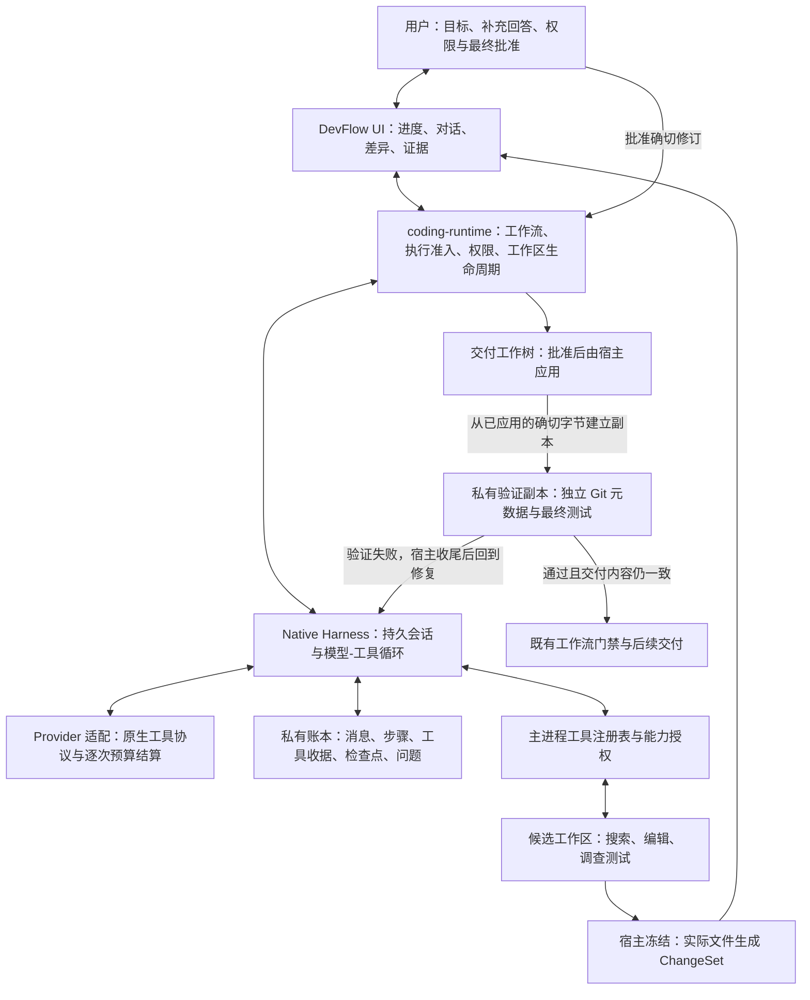

# DevFlow Native Coding v3：完整多轮 Harness 方案

日期：2026-10-11。状态：设计要求已对齐，代码与本地集成验证已落地；完整发布门槛见[实施与验收记录](native-coding-harness-v3-implementation.md)。代码基线：`b5d8344a6f093c86f51d216ee3de23301bd131c9`。下文保留原定稿的要求与研究结论，不能将目标设计当成全部通过的验收声明。

这份方案解决的是 Native 在复杂仓库中的调查、编码和验证能力。完整交付后，Native 应当能够围绕同一项任务持续搜索、阅读、修改、运行验证、分析失败、补充调查和向用户提问，最后提交有真实证据的 ChangeSet。工程可以按依赖拆分，但不把缺失的恢复、交互、验证等能力当成可发布的“第一版”。

## 1. 结论与关键决定

用户的判断基本正确：当前 Native v2 的主要瓶颈是无法根据新证据继续调查。增加输出 token、文件上限或一次修复次数，无法替代真正的模型与工具反馈循环。

但“多轮”本身不保证质量。最终需要的是：**每轮都获得可追溯的新信息，可以改变下一步行动，并通过实际执行来验证结果。** 一个不断重复同样提示的 `while` 循环不会解决问题。

本方案选择：

1. **在 DevFlow 内建设完整 Native Harness。** 复用现有原生工具协议、工具注册表、预算、内容存储与恢复原语，保持 `coding-runtime` 对工作流、权限和工作区的统一管理。
2. **用原生 tool calls 实现自适应循环。** 模型可以继续查、读、改、测、提问；不再被 `analysis → initial → repair` 的固定三段限制。
3. **用候选工作区承载充分试错。** 中间编辑无需逐份 ChangeSet 审批；候选执行受一次明确的任务授权和随后的权限规则约束。交付工作树在最终批准前维持基线。
4. **最终 ChangeSet 由宿主从实际文件生成。** 包含新增、修改、删除、重命名与模式变化，绑定文件内容、需求版本和验证证据。模型不能靠一段“已完成”的文字结束任务。
5. **同一个 Coding Run 可以暂停、问答、恢复和继续修复。** 真正取消或终止后才需要新运行；不把进程崩溃直接等同于任务失败。
6. **把完整生命周期列为一次交付的验收条件。** 包括上下文压缩、工具错误修正、预算、取消、恢复、用户插话、子任务、权限、跨平台和真实任务对照。

不把 Native 失败后的自动切换 OpenCode 作为解决办法。OpenCode 保留为用户显式选择的独立执行器和评测对照。

## 2. 当前代码实际上做了什么

| 现状 | 代码证据 | 对复杂任务的影响 |
| --- | --- | --- |
| 调用模型选择文件，宿主读取片段，再调用模型一次生成改动 | `native-coding-executor-v2.ts` 的 `start()`，约 1318–1407 行 | 第二次调用发现信息不足，也没有正常的“再搜索/再读文件”通道 |
| 文件清单最多 256 项、深度 6；片段最多 8 个文件；提示约 30,000 字符 | 同文件常量、`buildRepositoryManifest`、`collectExcerpts`、`fitChangePrompt` | 有些文件根本不会进入模型视野；扩大清单仍无法解决自适应调查 |
| 一次最多修改 6 个已有文件、12 个精确替换 | `parseChangeProposal`、`coding-change-set.ts` | 新建模块、删除废弃实现、跨目录重构受限 |
| 测试失败最多再生成一次修复，主要可改范围仍是最初文件 | `buildNativeCodingV2RepairPrompt`、`continuePermission()` | 无法持续沿失败堆栈追踪新的依赖与根因 |
| 非权限等待阶段中断，现有恢复通常把运行标为失败 | `coding-runtime.ts` 的 Native 启动恢复分支 | 缺少同一次任务中途续行的持久游标 |
| 执行器 deadline 在启动时设为 15 分钟后；权限窗口还受它截断 | `coding-runtime.ts` 请求构造、v2 的 `permissionExpiry` | 深入调查和等待用户会挤占最终审批时间 |
| 独立讨论已经存在原生多轮工具会话 | `native-conversation.ts`、[ADR 0028](../adr/0028-native-conversations-and-proposal-review.md) | 可以复用协议和存储原语，但它是只读讨论业务，不能直接变成编码运行时 |

当前不是“只调用一次模型”：通常是分析一次、生成一次，失败后可能修复一次。真正缺少的是**工具结果决定下一轮工具选择的开放循环**。现有循环读取多个文件，并不等于这种 Agent loop。

## 3. 六套 Agent/Harness 的调查结果

“Color Code”按上下文理解为 **Claude Code**。下面区分官方公开说明与实际可读源码，不推测闭源内部实现。源码快照与链接见文末。

| 工具 | 核对到的循环机制 | 本方案采用的经验 |
| --- | --- | --- |
| [Codex](https://openai.com/index/unrolling-the-codex-agent-loop/) | 模型调用工具后，工具结果进入历史，再发起模型请求；有后续工具或用户输入时继续；根据上下文压力压缩 | 工具结果驱动下一次决策；用户插话、上下文管理属于循环本身 |
| [Claude Code](https://code.claude.com/docs/en/how-claude-code-works) | 官方说明以收集上下文、采取行动、验证结果组成可重复的工作过程；可在执行过程中调整方向 | 不把调查、实现、验证锁成各执行一次的阶段；保留人随时纠偏的入口 |
| [OpenCode](https://github.com/anomalyco/opencode/blob/fcca731a96981546f1b3c61d81c21852165f3cc1/packages/opencode/src/session/prompt.ts) | 核对到的会话路径持续载入历史、处理工具、子任务和压缩；可限制最大步骤；重复工具调用有无进展保护 | 持久会话和停止条件分离；不以“模型输出一句话”或重复尝试冒充完成 |
| [Kimi Code](https://github.com/MoonshotAI/kimi-code/blob/15f3d93613ece76e5ca7096f48c468de6ceb5e72/packages/agent-core/src/loop/run-turn.ts) | 当前 TypeScript 核心的 `run-turn` 根据工具使用继续下一步；单步包含提供方调用、工具执行、消息及用量处理 | 任务轮次、模型步骤、工具调用、请求重试必须分别建模 |
| [pi](https://github.com/earendil-works/pi/blob/e86823096c5bad39e1ca282ec24bc5eb9bec745b/packages/agent/src/agent-loop.ts) | 核心 loop 处理 tool results、steering 和 follow-up；工具有批次与执行控制 | 循环内核应小而可注入；用户插话和工具调度是明确机制，不是散落的回调 |
| [DeepSeek Harness](https://github.com/deepseek-ai/deepseek-harness/blob/d743267388641bc76f17c45ce8b4c231aed1d32c/packages/core/agent-loop/src/agent.ts) | 公开源码将 Agent loop、工具调度、上下文准备与压缩分离；有步骤边界输入、工具结果归档和恢复机制 | 采用清晰的扩展点、结果配对和压缩边界；不照搬整套插件框架 |

共同点是“模型决策 → 执行工具 → 返回真实结果 → 再决策”。差异在持久化、并发、用户交互、上下文和权限边界。不能只移植最外层循环，忽略其余机制。

OpenCode 快照同时存在会话内核迁移，Kimi 也存在 v2 目录；本方案引用的是已核对的具体路径，不将并存实现拼成一个不存在的统一架构。Claude Code 部分只以官方文档为依据。

## 4. 目标架构与职责



| 层 | 拥有什么 | 不交给它的职责 |
| --- | --- | --- |
| Team API / 既有预算服务 | 身份、项目策略、预算授权和权威账本 | 本地源码和原始工具历史 |
| `coding-runtime` | Coding Run、真实权限复核、工作区与流程推进 | 推测模型下一步应读哪个文件 |
| Native Harness | 模型会话、步骤、上下文、工具调度、问题与恢复游标 | 自行批准权限、Gate、PR 发布 |
| Provider adapter | 厂商消息协议、流式解析、请求能力、用量证据 | 自己维护另一套任务预算 |
| 工具执行层 | 校验后读取、修改、执行命令、访问文档 | 从模型文字里猜命令并执行 |
| UI | 解释当前进度，接收补充、授权、暂停和审查 | 生成可信路径、执行授权或最终摘要 |

Native 的控制状态归 Electron 主进程所有；模型调用异步进行，重命令/测试由受管 worker 或子进程执行。并行只读子任务是逻辑会话，不必各自启动完整 Electron。模型服务、命令进程与控制账本不是同一个主体。

### 复用什么，新增什么

| 现有模块 | 处理方式 |
| --- | --- |
| `native-conversation-protocol.ts` | 提取/复用 tool call 信封、ID 配对、参数与历史校验；不复制一套编码专用协议 |
| `native-conversation.ts` | 抽取请求构造、压缩、历史恢复等不含业务语义的原语；讨论工具和检查点继续留在讨论域 |
| `agent-runtime.ts`、`agent-runtime-runtime.ts` | 复用检查点、能力授权和动作审计；它们不是已完成的通用模型 loop |
| `native-tool-registry.ts`、MCP authority | 复用注册、短期授权、范围校验、取消与审计，增加编码工具 |
| `governedModelCall`、request policy、budget continuation | 每次真实模型请求都经过现有权威；增加持久的步骤/请求身份 |
| SQLite 与 `.contents` 存储 | 复用单写入通道、长内容引用、哈希检查与原子发布；新增 Coding session 记录 |
| `coding-runtime.ts` | 扩展非终态继续、问答、暂停、恢复；承接统一结果和工作流验证 |
| `coding-change-set.ts` | 保留 v2 解析与恢复；新增独立版本的文件操作契约及事务应用器 |
| `source-tree-digest.ts` | 保留旧证据解释；新增可跨候选/交付位置比较的版本化内容清单 |

建议新增 `native-coding-session`、`native-coding-loop`、`native-coding-tools`、`coding-candidate-workspace`、`coding-change-set-v3`、`coding-evidence-v3` 等内部模块。名称可在实现时调整，职责不能重新混回一个巨大 executor 文件。

## 5. 真正的多轮循环如何运行

一个典型任务会这样推进：

```text
用户要求修复“取消后仍继续写文件”
  → 模型搜索 cancel、abort 与写文件入口
  → 读取找到的实现、调用者和相关测试
  → 发现真正写入在另一模块，再搜索并读取
  → 运行一个复现测试，看到具体失败
  → 修改候选代码并补回归测试
  → 运行测试，发现并发路径仍失败
  → 继续读状态机与事件顺序，修改第二批文件
  → 重新验证，检查真实 diff 与原任务的覆盖关系
  → 请求冻结 ChangeSet
  → 用户批准，宿主应用并运行最终验证
  → 全部证据一致后交给原有工作流
```

模型可以来回切换调查、修改和验证，不要求先完整计划再永不调整。一个“计划工具”只帮助记录进度，不成为禁止补充调查的门禁。

每次模型步骤由宿主执行以下规则：

```text
取得 session 写入租约，检查版本/取消/权限/剩余预算
吸收已落盘的用户输入；必要时让旧目标及证据失效
恢复未完成工具；对副作用不确定的操作先对账
构建完整且可容纳的请求，必要时按工具配对边界压缩
持久化请求身份 → 预算准入 → 发送 → 保存回复与用量

若有 tool_calls：
    校验整批；把工具意图和待执行状态持久化
    只读可并行；写入/命令串行；问题/完成请求必须单独成步
    按稳定顺序保存结果和检查点；继续下一次模型请求
若请求用户回答或额外权限：
    保存等待状态并释放执行资源；收到回答后继续同一 session
若请求提交候选：
    宿主检查候选与证据 → 冻结 → 进入审查，不接受文字自报成功
若只有普通文本：
    作为进度说明；没有提交请求或明确停止原因，不标记完成
若达到限制：
    保存可恢复暂停或明确终止原因，不伪装成测试通过
```

普通工具错误以结构化结果返回模型，允许它改变参数、路径、方法或继续调查。无权限的调用给出明确原因；新增权限交给授权路径。传输重试与“模型看见失败后采取新行动”分别计数。

## 6. 工具能力：不再只给一份文件清单

| 能力 | 目标接口与行为 |
| --- | --- |
| 仓库发现 | `list_directory`、`glob_files`、`repo_status`，分页和游标；可继续探索初始清单之外的路径 |
| 文本检索 | `search_text`，字面量/正则、路径过滤、上下文行、结果截断说明及续查游标 |
| 文件读取 | `read_file`、`read_ranges`，返回路径、行号、内容摘要和 workspace revision；大文件按范围续读 |
| 符号关系 | `find_symbol`、`find_references`，通过版本化索引或语言服务；未安装相应语言能力时明确显示不可用，可继续文本调查 |
| 上游材料 | 按引用读取需求、设计、历史讨论、项目规范、已有测试证据；保留来源版本 |
| 编辑 | 宿主执行 `apply_patch`、`write_file`、`delete_file`、`rename_file`，含前置摘要；在候选区操作，回传实际变化 |
| 验证 | `run_test_plan`、经授权的 `run_command`；持续输出可分页、可取消，超时为独立状态 |
| 审查变化 | `inspect_diff`、`read_evidence`；可回看某个修订和测试，而不是反复向模型粘贴全量日志 |
| 外部资料 | `web_search` / `fetch_document` 经配置的网络适配器，只读访问与对外写入分开授权；来源与时间进入证据 |
| 用户交互 | `request_user_input`，保存问题/选项并等待；用户也可主动追加说明 |
| 子任务 | `delegate_task`、`await_task`、`cancel_task`；支持只读调查与独立私有候选仓库中的编码，见第 12 节 |
| 完成请求 | `propose_changeset` 只请求宿主冻结；`report_blocked` 解释无法继续的事实，二者都不是模型自行批准 |

所有工具共用名称/版本/schema/范围/副作用/超时/取消/输出分页/审计定义。整批先校验，再按可并行性调度；结果保留调用顺序与 ID。一个写工具失败后，依赖其结果的后续操作不能继续猜测执行。

不再以“最多 8 个文件”代表任务调查范围。单次读取、结果包、并发数仍有容量边界，但模型可以分页，直至任务预算或上下文策略要求暂停。大文件、无命中、截断、权限不足必须区分。

启动上下文包含已批准的需求/设计来源、当前用户目标、适用目录的 `AGENTS.md` 与项目规范、仓库结构概况、构建/依赖/测试配置和可用工具。目录概况负责导航，不作为封闭文件集合。关键要求始终保留，长材料可按引用展开；后续进入新目录时继续加载适用规范并记录版本。

文件、网页和工具返回内容作为证据处理，其中出现的指令不自动获得执行权限。Skills 是有来源和版本的工作说明；加载 Skill 本身不会扩大工具授权。

## 7. 候选、ChangeSet 与交付：明确三份事实

### 7.1 工作区身份

1. **基线快照 B**：启动时确认的 `baseCommitSha`、项目绑定与完整内容清单。若用户想纳入未提交改动，先由宿主明确制作并展示输入快照，不能静默漏掉或覆盖。
2. **候选工作区 C**：从 B 生成，模型可在任务授权内反复编辑、运行命令。采用独立 Git 元数据的私有候选仓库，不通过可写 `.git` 链接共享用户主仓库的引用；不配置 push remote。Git 历史查询由宿主只读代理提供。
3. **交付工作树 D**：由既有受管工作区机制管理，批准前保持 B；模型的编辑工具无法取得 D 的写句柄。批准后只由宿主应用冻结的文件操作。

B 是不可变事实，C 与 D 是不同的可写位置。普通用户 checkout 不被模型直接编辑。工作区隔离保护代码版本关系，**不能等同于操作系统沙箱**；命令执行边界见第 9 节。

若用户明确选择纳入未提交内容，B 保存 `baseCommitSha + inputOverlay`，overlay 包含已展示确认的文件字节和清单。C、D 都先由宿主物化相同的 B，不能一边从 HEAD 开始、一边带脏内容。Agent 的 ChangeSet 表示 B→目标的变化；后续总交付 diff 另外标识继承的用户改动。当前代码只从 HEAD 创建工作树，这也是需要实现的契约变化。

### 7.2 冻结与 ChangeSet v3

模型发出 `propose_changeset` 时，宿主等待所有写入和命令结束，确认子任务已经合入、取消或明确剔除，再取得排他租约生成冻结修订。被剔除的子结果不进入本次 R，也不能迟到后自动合入。模型不能提交自己编造的 diff 或测试标识。

```text
ChangeSetRevision
  schemaVersion / id / revision / parentRevisionId
  codingRunId / sessionId / objectiveVersion / policyVersion
  baseSnapshotId / baseCommitSha / baseContentDigest
  candidateRevision / targetContentDigest
  operations[]:
    create | update | delete | rename | mode_change
    path / sourcePath? / beforeHash? / afterHash? / blobRef?
    beforeMode? / afterMode? / provenance
  includedPaths / excludedArtifacts（含排除原因）
  testPlanVersion / candidateEvidenceIds / environmentDigest
  summary / openConcerns / createdAt / changesetDigest
```

宿主从真实磁盘与基线生成差异。重命名可用显式操作记录，不依赖 Git 相似度猜测；无法确认时用删除+新增表达同样字节结果。路径大小写、Unicode、换行、可执行位和重命名环都有确定规则。

普通文本新增/修改/删除/重命名必须完整支持。二进制使用受限大小的内容寻址 blob，明确显示无法逐行审查及实际大小；不能伪装成文本。符号链接、子模块边界和设备文件不从普通文件工具穿透，需明确类型与专门能力；当前目标不以支持任意操作系统对象作为完成条件。

**不能简单排除所有未跟踪文件或命令产生的文件。** 新文件、格式化结果、必要的生成源码可能是合法改动；应按路径、来源、项目产物规则与人工可见清单分类。缓存、覆盖率、依赖目录等不进入产品补丁。测试若改了产品源码，原测试证据失效；把该改动正式纳入下一修订后重新验证，不能偷偷过滤后仍保留“通过”。

### 7.3 审批、应用和最终验证

1. 冻结 R 后，展示全部文件操作、重要差异、测试计划、实际结果和未解决点。
2. 批准绑定 R 的摘要、目标版本、项目身份、策略和审批到期时间；不是批准后面任意新改动。
3. 主进程在实际应用前再次检查：审批有效、目标/策略未变、D 与 B 一致、R 未被替换、没有活跃写者。
4. 通过带预写日志和可恢复备份的文件事务把 R 应用到 D。这里是应用级事务，不宣称多文件写入是文件系统天然原子的。
5. 从已应用的 D 建立私有验证副本 V，宿主确认 V 的产品内容与 R 一致，在 V 运行最终测试计划；核对 V 前后内容和 D 当前内容后保存交付证据。测试进程不直接运行在 D 上。
6. 通过后才能写入编码成功结果；工作流仍执行原有独立门禁。此时不自动 commit、push、merge 或 deploy。
7. 最终测试失败则保存证据，恢复 D 到本轮应用前状态；若发现外部漂移，停止自动恢复并保留冲突。C 与历史保留，失败证据返回模型继续调查。下一份 R 必须重新批准。

冻结、审批、应用和验证期间，C 的写入与子任务合入队列关闭。用户改变目标使旧批准失效；先收尾/取消已有副作用再恢复调查。清理或回滚没有完成时，不能直接放行下一轮应用。

审批 TTL 限制开始应用的时刻。一次已合法应用的修订，不会仅因验证耗时超过 TTL 就被追溯判为未批准；但目标/权限撤回、策略变化和内容漂移仍立即触发停止与收尾。失败后再应用属于新动作，需要新审批，不能重用已消费的批准。

外部主分支更新不自动证明固定 B 已损坏。方案以 B 的身份为准；**交付树/输入快照内容漂移**必须拦截。若项目策略要求基于最新主分支，则显式重新基线化，生成新修订并使旧证据和审批失效，而不是暗中 rebase。

## 8. 测试证据与完成条件

循环中区分两类测试：

| 类别 | 谁发起 | 作用 | 能否直接完成工作流 |
| --- | --- | --- | --- |
| 调查/候选测试 | 模型通过授权工具发起 | 复现、缩小问题、验证中间修改 | 不能 |
| 最终交付验证 | 宿主按保存的测试计划发起 | 验证已批准的确切改动，产生交付证据 | 满足其他条件后可以 |

测试计划在执行前固定其命令、参数、工作目录映射、环境配置与工具版本。模型可建议额外测试，但不能用“删掉失败测试/换成空命令”取代已批准的验证。修改测试配置、依赖锁文件或测试本身要在差异中突出显示；测试通过不是自动证明业务正确。

命令分成“生成/格式化”和“检查/验证”。会修改产品文件的格式化、代码生成、快照更新在 C 的冻结前完成，并进入 R；最终计划使用检查模式或保证对产品输入可重复观察的命令。若一个验证命令总会改写产品输入，则进入 `invalid_test_plan` 暂停，要求修订计划，不能不断生成相同修订来消耗预算。

每份证据至少包含：测试类型、任务/修订身份、来源内容清单摘要、测试计划摘要、命令身份、环境摘要、开始/结束时间、退出码、实际状态、stdout/stderr 引用、超时/取消、完整性和测试后文件变化。

内容清单基于规范路径、文件类型、模式和字节摘要，不能依赖临时绝对路径；它覆盖构建输入与本次新增文件。缓存/覆盖率等输出在版本化规则中排除，依赖由 lockfile、运行环境和安装结果摘要约束。过大或无法完整计算时显示“无法建立有效证据”，不能退化成仅检查退出码。

编码技术完成的机械条件是：D、V 的产品内容清单与已批准的 R 目标一致；清单完整可计算；最终计划实际执行并通过；V 测试前后产品内容不变；审批仍绑定 R；没有未收口的子任务、写操作或取消。检查与终态提交在宿主的串行边界重新核对版本，后续交付仍须检查新漂移。

验收覆盖单独记录为 `AcceptanceCriterion { id, objectiveVersion, sourceRef, confirmation, evidenceRefs, resolution }`。条目来自已确认的需求/设计，或由用户确认新增。模型提供对应关系建议，状态只能是建议、测试证据已验证、人工确认、未解决；不能用模型摘要直接宣称语义全部满足。有结构化条目时，待解决的必要条目阻止相应流程推进；没有条目时标明“未结构化验收”，依靠既有业务验收 Gate，而不是猜一份全部勾选的清单。

费用记录与技术结果分开：已发生用量及已通过验证不能因结算上传失败而丢失或重跑。未知/待结费用如实保留，后续付费调用和交付仍按既有预算规则决定是否可继续；不把未知记成零，也不把已验证的技术成果改写为测试失败。

验证明确有四个出口：

| 验证结果 | 宿主处理 |
| --- | --- |
| 全部机械条件满足 | 保存 `technical_completed`，向既有工作流提供证据，不直接批准业务 Gate |
| 测试失败/超时 | 保存失败，事务恢复 D；恢复成功后回到调查/修复，旧审批不再可应用；基础设施故障可暂停 |
| 退出码为 0，但 V 改写产品输入或清单不完整 | 保存 `evidence_invalid`，绝不算通过；收尾恢复 D，调查原因或暂停修正测试计划 |
| D 被外部改写，或应用/回滚无法证明一致 | 进入 `delivery_conflict`，阻止新应用；C 和全部事实保留，先完成对账或由用户解决冲突 |

任务若已被现有代码满足，允许提交空修订并得到 `verified_no_change`，必须有对应的检查证据和范围说明，不强迫模型为了生成补丁而修改无关文件。

没有适用测试的任务必须事先选择明确的替代验收方式，并在结果中标记“人工验收/无自动测试”，不能写成测试通过。可加入独立模型审查，但它是补充证据，不能替代真实测试与人工批准。

## 9. 权限、命令与网络：能力可用，边界可解释

任务开始前显示一次执行授权：候选工作区、允许的工具类别、测试计划、网络范围、预算和命令运行配置。授权之后，范围内的搜索、读文件、候选编辑和保存测试可以自动进行；不要求每个小补丁都打断用户。

| 情况 | 行为 |
| --- | --- |
| 在已授权候选范围内搜索、读取、修改、执行既定测试 | 自动执行并记账 |
| 查询允许的公开文档站点 | 经网络工具执行，记录来源；不因为是网络查询就一概 deny |
| 新增命令、额外网络目标、安装依赖、扩大可写范围 | 提交具体权限请求，说明目的、命令/目标与影响 |
| 用户对业务含义有疑问需澄清 | 普通问答卡，不能拿权限批准代替用户回答 |
| 跨项目、读取凭据、修改宿主 Git 管理目录、绕过明确禁止 | 拒绝并说明可用替代路径 |
| 发布、批准 Gate、远端写入 | 使用对应独立产品流程，普通编码权限不能代替 |

权限来源是用户/团队策略及主进程签发的授权。模型只提出请求。保留 ADR 0027 的明确命令匹配、会话范围、撤销与到期规则；新增“候选工作区内编辑”授权需要新的权限版本，不能扩大旧批准的含义。

### 命令运行配置

完整产品提供两种明确的执行配置，并在就绪检查中验证：

- **可信本地项目**：本地受管进程、独立候选仓库、最小环境、受控 cwd、超时及进程树取消。适用于用户信任的仓库和测试。它具有当前用户的操作系统能力，不宣称仅靠路径校验能隔离任意 shell 或项目测试代码。
- **隔离运行**：候选内容挂载到受管容器/运行环境，宿主目录与凭据不可见，网络由配置控制。用于不可信仓库、陌生依赖或需要更强隔离的命令。依赖的运行环境必须通过探测和跨平台测试；缺少环境则阻止该配置启动，不静默切换为本地执行。

批准候选代码执行是一项真实授权：测试本身会执行新代码。它与批准最终接收改动是两回事。宿主最终验证也使用相同等级的执行配置；不能把不可信候选测试放进容器、再在宿主直接跑最终测试。

所有命令的 cwd 是具有独立 Git 元数据的执行视图：调查命令使用 C，交付验证使用从 D 的确切字节构建的一次性 V。C、V 使用同一基线历史/虚拟分支约定与依赖准备计划，不共享用户主仓库的 gitdir、可写 refs、alternates 或凭据。D 仅由宿主文件事务操作，不挂进测试容器；容器只看见 V/C 和明确授予的依赖、输出目录。宿主在执行视图外计算内容清单，确认 V 输入=R、V 输出未改产品内容、D 仍=R；验证日志记录执行环境和 Git 上下文摘要。

依赖准备复用 `dependency-bootstrap-runner.ts` 的规则并扩展到 C、V/子工作区：记录 lockfile、安装命令、环境与安装结果，不共享可写的 `node_modules`。可复用经身份核对的下载缓存；安装脚本仍属于所选执行配置和授权。不能靠 V 偷用主工作区依赖来获得候选阶段没有的环境。

没有通用 Shell 命令字符串白名单能证明一个仓库测试完全无副作用。权限解释与产品声明必须与实际运行配置一致。

## 10. 持久会话、状态机与恢复

### 10.1 身份和记录

| 记录 | 用途 |
| --- | --- |
| Coding Run / session | 一项编码任务与内部会话；任务身份稳定 |
| objective revision / user turn | 需求变更、回答和用户主动插话，各自有版本 |
| acceptance criterion | 已确认的验收条目、来源版本与实际覆盖证据；模型建议和人工确认分开 |
| model step / request attempt | 一次决策与一次实际网络发送；重试不冒充同一次付费请求 |
| tool call / effect receipt | 模型调用 ID、参数摘要、执行阶段、效果证据、结果引用 |
| workspace revision | 任何产品文件变化都增加修订；用于缓存、并发与测试失效 |
| question / permission | 分别保存业务问题和权限请求，明确谁可以回答/批准 |
| ChangeSet revision / evidence | 冻结改动与验证结果，只追加历史，不覆盖旧事实 |
| checkpoint / lease | 游标、事件序号、版本与单写入者 fencing token |

原始消息、工具结果、必要的 Provider 协议字段保存在私有本地记录。Team 仅接收既有允许列表内的进度和审计摘要。UI 分页读取长内容，不把全部源码和日志塞进每次 IPC。

### 10.2 状态

```text
ready → running ⇄ waiting_input / waiting_permission / paused
            ↓
      awaiting_changeset_approval
            ↓
       applying → verifying → technical_completed
                      ↓
                  reverting → running / paused
                      ↓
                delivery_conflict（先对账，不继续应用）

中断的非终态 → recovering → 复核后回到安全状态
任意活动态 → cancelling → 收尾/对账 → cancelled
不可恢复错误 → failed
```

预算、步骤或无进展限制优先保存为带原因的可恢复暂停；继续需要符合当前策略和明确授权，不能重置累计计数。用户选择终止后才进入不可继续的终态。审批过期生成新的审批请求，不重新收费生成同一份候选。

### 10.3 恢复规则

| 中断位置 | 恢复行为 |
| --- | --- |
| 模型请求确定未发送 | 可创建新 attempt，正常预算准入 |
| 已发送、结果已保存 | 重放本地结果；不再调用模型 |
| 已发送但结果/用量未知 | 保留不确定状态，优先查询提供方可用回执；无回执时不自动重发。用户可授权新 attempt，旧费用仍保留占用/待核实 |
| 只读工具结果已落盘 | 校验来源版本后复用；来源已变则重新读取并记录新事实 |
| 文件写入已开始但未记录完成 | 对照前置/目标哈希和事务日志；目标一致则补收据，基线一致才可重新执行，混合状态先恢复/保留冲突 |
| 任意命令/MCP 副作用不确定 | 先对账进程和外部状态；无法确认时标记待人工处理，不假装“没有执行” |
| 测试中断 | 不记录通过；确认旧进程结束后，以新测试 ID 重跑 |
| 最终应用/回滚中断 | 根据持久事务恢复；无法证明一致时禁止继续交付 |

数据库记录与磁盘副作用不能凭一次 SQL 事务获得全局原子性。采用先写意图、再执行、再写收据、恢复时对账。内容 blob 先原子发布再提交数据库引用；崩溃留下的孤立 blob 可清理，不能留下引用不存在的正文。

每个 session 同时只有一个有效写者。主进程排队加持久版本 CAS；启动/接管先处理旧 worker，失效租约的迟到回复只留诊断，不提交新改动。只读并发不能跨越有依赖的写入边界。

fencing token 只能拒绝旧消息，不能自行终止已运行的 shell。恢复写租约前必须核对并停止旧 worker/命令进程树，检查工作区变化并对账收据。无法证明旧进程已结束时停在恢复/对账状态，不能让第二个写者启动。子工作区的结果在对账完成前不得合入。

取消是单调状态：拒绝启动新调用，向模型连接、命令进程树和子任务传播取消；等待确认停止或记录不确定效果后再清理。保留已用费用与已发生改动的事实，不能用清空目录代替取消对账。

## 11. 时间、预算、上下文与无进展控制

### 四类时间分开

1. 单次模型请求超时：由 Provider 能力与请求策略决定。
2. 单次命令超时：由测试/命令定义决定，可申请延长。
3. 审批 TTL：从冻结并发起审批时计算，绑定该修订。
4. 任务活动时长：只累计实际执行；等待回答、权限和持久暂停不消耗活动时长。另保留审计用自然时间，不把它伪装成暂停的墙钟。

根任务活动时长按“任一所属执行单元仍在工作”的时间区间并集计算；父任务等用户而子任务仍执行时继续累计。整体暂停向所有子任务传播，确认全部进入安全检查点后才停止活动计时。另记录各子任务用时用于诊断，不把并发三任务的同一分钟误记成根任务三分钟。

旧 `deadline` 不能继续作为涵盖一切的 15 分钟绝对值。外层契约提供活动预算和本次执行租约；问答后继续时重验权限，不扩大任务总预算。

### 预算只有一套权威

每次实际 Provider 调用，包括压缩、子任务、独立审查和失败重试，都经过 `governedModelCall`。项目/月度与操作级额度继续由现有服务控制。

操作身份采用持久的 `sessionId + objectiveVersion + stepId`，实际发送另有 `attemptId`；请求摘要包含真实序列化内容、工具定义、模型、输出上限及策略版本。继续确认卡绑定具体操作及额度，不沿用整个 Coding Run 的第一段提示哈希。重启不靠内存重新随机生成同一个操作的身份。

实现时必须改造 `governed-provider.ts` 当前的进程内 `operations Map`/随机 `operationFor`：允许注入宿主持久操作身份，且按本次实际请求重新绑定版本。只有增加 stepId 而继续使用旧缓存是不够的；重试扩大输出或改变请求时，旧的小额度确认卡不能复用。

运行级额度是整项任务的总上限，子额度是其子集，二者都不是额外重复收费。每个 attempt 只在权威账本产生一次预留，结算后换成实际费用；根任务、子任务及项目余额在准入事务中共同校验。并发子任务不能各自读到同一份可用余额而超额发起请求。这需要同步修改 API 的 `model-call-budget`/continuation 存储与准入，不能只在 Electron 保存一个计数器。

用户界面展示已确认费用、进行中预留、待核实占用、未计价用量。未知费用不能转成 0，也不能因为结算上传失败而重复请求模型。继续授权不能抹去旧账或更换模型费用证据。

### 上下文管理

- 实际发送前度量完整序列化请求，而非只数正文字符；为输出和协议开销留余量。
- 工具大结果保留全文引用，模型得到摘要、相关片段与续读入口。不能静默截断后让模型以为已读完。
- 压缩仅在已闭合的工具调用/结果边界进行。保留目标、约束、当前计划、关键文件/行号/摘要、失败证据、待解决点和现有修订。
- 原始历史不删除；压缩摘要可回指原记录。重新读取时检查 workspace revision，不能把改动前的片段当成现状。
- 对尚未配对、部分流式输出、Provider 要求保留的协议字段采用明确恢复规则；不把半条回答拼成完成消息。
- 更换 Provider/模型是明确动作。检查协议兼容、预算和上下文，重新建立合法请求；不在一次错误后静默改用另一套模型或正文 JSON 命令。

### 何时暂停，何时继续

建议初始产品默认值为：单次调度批 12 个模型步骤，读工具并发 4，子任务并发 3/深度 1；任务默认活动额度 60 分钟、80 个模型步骤，并受用户金额授权约束。**这些是待验证的默认策略，不是已证明最优的数字，也不是硬编码的任务能力上限。** 调度批结束自动持久化并让出 UI，额度充足可继续；不要求用户每 12 步点击一次。

连续 3 次相同工具/参数/相同来源版本且无新证据时，给模型一条无进展反馈；再次重复则暂停，提供已尝试方法与明确继续选项。合法轮询按工具定义另设间隔和期限，不能误报为死循环。修复轮数不固定为 1；持续积累新证据且额度足够时可继续。

## 12. 用户问答、插话、子任务与扩展

**问答**：`request_user_input` 保存问题、选项、上下文和版本，本步结束，不保持一个付费请求等用户。回答按 question ID 幂等写入，再恢复会话。问题已经失效时说明原因，不把旧回答塞进新需求。

**主动插话**：用户随时补充。消息先落盘，在安全步骤边界注入；取消指令立即传播。改变目标、范围或验收条件时提升 objective version，使不再适用的测试和审批失效；普通解释不需要重建整个运行。

**子任务**：完整版本支持两种，不采用“先一概禁用、以后再说”的设计。

| 类型 | 工作方式 | 汇总条件 |
| --- | --- | --- |
| 只读调查 | 读取父候选某一修订的不可变视图；并行搜索、读代码、分析失败；返回文件证据和结论 | 父任务核对来源版本后使用，不凭子任务一句“已验证”接受 |
| 隔离编码 | 从父候选确切修订建立另一个私有仓库，拥有独立 Git 元数据；获得预算子额度和范围子集，输出子 ChangeSet | 父宿主串行检查基础/范围/冲突后合入候选；合入后父级测试失效并重新验证 |

不允许多个子 Agent 直接写同一候选树。子额度计入父预算；取消和暂停向子任务传播；子任务不能批准权限或发布结果。子任务问题汇入父会话排队展示，父模型不能代替用户回答涉及真实意图的问题。父任务冻结前必须收齐、取消或明确剔除所有子任务。

子任务权限由宿主签发真正的子集：只读任务仅有发现、读取、检索和证据阅读，没有编辑、命令、冻结父改动、对外写入或再委托。编码任务在独立私有仓库内取得必要读写/验证能力；其创建、额度和可执行代码范围必须包含在开工授权中，否则申请额外授权。编码子任务继承父任务执行配置，不能从容器降级成本地运行。

父子并行时，父任务可以继续处理其他文件；子任务始终针对创建时的不可变基础。子结果没有自动写回权限。正常合入由父模型/宿主显式请求，绑定 `childChangeSetId + childBaseDigest + expectedParentRevision`；宿主在父写租约下计算基础、子结果、当前父候选的三方合并。无冲突才生成并应用一份**绑定当前父修订的新合入操作**；冲突作为证据交回父任务解决，不能直接应用旧子补丁。合入意图、逐文件前后哈希和结果收据持久化，按子 ChangeSet ID 幂等；已合入的 ID 不因父任务继续修改而再次合入。

恢复时先停止/核对旧执行单元并对账全部待合入效果。子任务仍有未知效果，或合入已发生但收据缺失时，不允许自动重新合入；必须按实际哈希补收据或进入冲突。取消、目标已变、父任务不再等待该任务的迟到结果只作为历史资料。这里的恢复屏障不等于正常运行中整个父会话都等待子任务，独立工作区允许安全地并行调查和编码。

默认深度 1 防止无意扩张；这是可见的任务策略，不是依靠 OpenCode `task` 内部行为蒙混管理。Native 子任务由 DevFlow 自身追踪；不自动把外部 OpenCode 会话当成 Native 子任务。

**MCP 与 Skills**：复用 [ADR 0016](../adr/0016-tool-mcp-execution-authority.md) 的本地安装、身份、schema 和短期授权。工具目录动态按任务范围提供；启用 Skill 只增加说明，不创建新权限。远程 MCP 不借本项目悄悄扩展已有传输承诺，已配置的 Web 查询走专门网络适配器。

## 13. Provider 支持和外部内核选择

原生 tool calls 是执行协议。必须明确验证：流式增量工具参数、多个调用及 ID、取消、工具错误回传、思考字段、上下文超限、用量完整性、超时后状态及模型切换。只通过静态 schema 测试不等于真实端点兼容。

当前已有真实兼容证据的是 ADR 0028 记录的官方 `deepseek-flash` 组合。v3 在此基础上还需验证编码循环所需场景。其他 Provider 通过同一适配器一致性套件及真实端点验收后，才在 UI 宣布支持；未知兼容服务不能伪装成已支持，也不回退到解析自然语言中的 JSON。

目标 Provider 接口应覆盖模型能力探测、完整请求序列化、原生流式事件、用量/错误分类、取消和可选查询回执。产品不绑定单一厂商，但不能写下“兼容一切 OpenAI-like API”的空承诺。

对上游复用的判断：

| 选择 | 结论 |
| --- | --- |
| 直接扩大 Native v2 常量/repair 次数 | 不采用；仍缺少自适应取证、恢复和交互 |
| 整段复制讨论会话实现 | 不采用；业务状态、只读权限与编码副作用不等价 |
| 直接包装 OpenCode 作为 Native | 不采用；现有 OpenCode 已是独立选项，无法解决自有运行时的语义与可控性 |
| 内嵌 pi 核心 loop | 技术上可行，不以“pi 必然拥有另一套权限”否定它；但仍需补齐 DevFlow 的持久账本、工作区、审批和预算适配。目前复用本项目原语的语义落差更小 |
| 直接引入完整 DeepSeek Harness/另一框架 | 不采用为默认方案；引入它的生命周期、插件与存储模型会增加适配面。吸收经过核对的循环与压缩机制 |

如果将来实测表明维护自有 loop 的成本明显高于嵌入内核，可以独立评估替换内部 driver；前提是工具、请求预算、持久事件和恢复均可由 DevFlow 注入，外层契约无需随之重写。本方案不把这种可能性当作当前待定项。

## 14. 契约、数据迁移与回滚

Native 实现版本 v3、Coding Executor 契约版本、ChangeSet schema version 是三件事，不使用同一个数字假装它们同步演进。

现有外层 turn 只有权限等待与终态，必须增加可版本协商的 `waiting_input`、`paused`、可继续检查点和明确的 resume/reply 操作；问题不能塞进 permission metadata。descriptor 公布实际支持的多轮继续、用户问答和证据能力。

目标接口的语义如下，具体 TypeScript 类型在契约工作包中落实：

```text
start(request, trustedRuntimeContext) → Yield | Terminal
resume(sessionId, expectedCheckpoint, hostResumeReason) → Yield | Terminal
replyInput(questionId, answer, expectedObjectiveVersion) → 持久幂等回执
continuePermission(permissionDecision, expectedCheckpoint) → Yield | Terminal
cancel(sessionId, expectedCheckpoint) → 取消/收尾回执

Yield = 调度让出 | 等待用户 | 等待权限 | 待审查 | 暂停 | 待对账
Terminal = 技术完成/无需改动 | 已取消 | 不可恢复失败
```

只有主进程可以构造 `trustedRuntimeContext` 和实际 resume 原因。UI 回答/批准只形成受验证的命令；消息持久化、状态更新和事件追加走同一串行边界。重复请求根据 ID 返回已有回执，不能启动第二条 loop。短批次 Yield 让出主进程并持久化后可自动续调度；它不是用户必须点击的暂停。

新结果表达至少包括：真实停止原因、最后检查点、最终 ChangeSet/交付内容摘要、测试证据、子任务完成情况、费用完整性和清理/保留状态。`no_progress`、额度暂停、等待用户、未知副作用与完成必须在 UI 和 API 上区分。

迁移规则：

1. 新运行显式绑定 v3 协议；既有 Native v1/v2 记录由旧解析器解释，不重算旧摘要。
2. 升级期间活动的旧运行沿旧契约完成或由用户取消，不在执行中偷换执行器。
3. v3 内部非终态中断可恢复；旧终态“失败后新建运行”的语义不追溯改写。
4. 新增表/字段先可向前读取，再启用执行入口。备份包含 SQLite、内容目录、事务收据与保留工作区。
5. 关闭 v3 停止新步骤，保留所有资料可读；不把 v3 历史重放成 v2 的固定 JSON 调用。
6. OpenCode 用兼容适配器继续现有契约；未实现新能力则不宣称支持，不凭新增字段破坏它的既有审批路径。
7. 新 ADR 明确替代 ADR 0015 中 Native 刻意收窄的能力定义，以及失败后一律创建新 Run 的适用范围；保留工作流和权限权威。

## 15. 界面与日常使用

用户看到一条连续的任务流：当前正在调查什么、刚发现什么、改了哪些文件、测试失败在哪里、下一步计划是什么。正文说明和工具证据关联，用户可展开来源，不以内部字段名堆满主界面。

必须同时交付：

- 可随时补充和纠偏的输入区；问题、权限、最终改动审查三种卡片清楚区分。
- 停止、暂停、继续、查看恢复诊断；说明继续是否产生新的模型费用。
- 任务预算、累计用量和未结费用状态；不要求用户理解内部 attempt 才能判断花费。
- 候选修改和最终冻结修订的差异视图；新增/删除/重命名/二进制与测试文件变化可辨。
- 测试记录区分调查测试、最终验证、过期证据和未执行项目。
- 崩溃重启后显示已有成果和需要处理的事实，不默认从头开始。
- 子任务进度及结果来源；取消后仍未停止的进程或未知操作明确可见。
- 日志清理/保留策略：活跃运行、待审查、待核账或恢复所需内容不能自动删除。删除入口展示将失去哪些恢复能力。

## 16. 工程工作包：一个完整发布目标

以下是依赖顺序，不是分期降低能力的发布路线。可以内部逐包验证，面向用户的“Native v3 完整能力”要通过全部验收后再宣布完成。

| 包 | 内容与主要落点 | 完成证据 |
| --- | --- | --- |
| A 契约与数据 | shared coding contract、session/attempt/tool/evidence/ChangeSet schema、迁移、独立时间模型 | 新旧记录解析、事件顺序、幂等与迁移测试 |
| B Provider 与历史原语 | 抽取原生协议、精确请求构造、账本身份、长内容和压缩 | 同一序列化用于准入与发送；真实端点一致性 |
| C 自适应循环与工具 | loop、分页检索、编辑工具、提问、插话、暂停、无进展检测 | 多次新取证后完成任务；参数错误可修正 |
| D 候选与事务 | 候选仓库、快照、文件操作、冻结、应用/回滚、命令配置 | 新增/删除/重命名、测试修改源码、崩溃注入 |
| E 验证与预算整合 | 调查/交付证据、私有验证视图、测试计划、防陈旧证据；API `model-call-budget`/continuation 与总额度/子额度 | 精确修订通过；所有真实请求可逐次对账，并发准入不超预算 |
| F 恢复与并发 | 租约、检查点恢复、命令进程、迟到结果、取消、重启 | 每个副作用边界注入崩溃，证明不会误完成 |
| G 子任务与扩展 | 只读/隔离编码子任务、MCP、Skills、网络读取 | 父子预算、取消、冲突、问答、授权一致 |
| H 产品集成 | Workbench/Agents 投影、审批 UI、版本兼容、保留与诊断 | 完整 Electron 用户流程，不只有后端单测 |
| I 发布验收 | 跨平台、真实模型、任务集对照、恢复演练、文档 | 统一验收报告，无未解决阻塞项 |

这是涉及执行契约、存储、工具、UI 和预算的正式架构升级，不能把工作量估成“改一个循环”。在各模块设计与任务盘点前不报一个缺少依据的工期；实现时以工作包及其证据核算进度。

## 17. 验证：证明能力提高，也证明没有破坏已有规则

### 确定性与故障测试

| 场景 | 必须观察到的结果 |
| --- | --- |
| 关键文件不在初始列表，第一次调查不足 | 模型可继续搜索/阅读新文件；不被旧 8 文件范围截断 |
| 第一次修复引出新的失败位置 | 重新调查并修改新路径，不被一次 repair 上限拦住 |
| 请求中途需要用户信息 | 同一 session 暂停、重启后回答并继续，无重复用户消息 |
| 工具 ID 重复、结果缺失、流式参数不完整 | 明确诊断/恢复；不执行半条命令 |
| 测试返回 0 但修改了产品源码 | 该证据无效，需要新修订与重新验证 |
| 审批前后有外部改动、目标或策略变化 | 旧批准不可应用，不覆盖用户变化 |
| 模型/工具/命令/应用/结算各边界崩溃 | 保留事实；不能重复执行未知副作用、伪造用量或把失败写为通过 |
| 重复点击回答、批准、继续；多个窗口同时操作 | 版本与幂等校验只接受一次有效动作 |
| 取消后迟到的模型、命令或子任务结果 | 不能推进流程或追加未授权改动 |
| 历史长到需要压缩 | 工具配对完整，必要引用可回读，已变文件被重新核对 |
| 子任务冲突、超预算、等待用户 | 父级可见且可处理；不共享写者、不绕过预算 |
| 父候选已变化、子结果迟到；合入后崩溃 | 三方合并绑定新父修订；冲突可见，已合入子 ID 不重复应用 |
| 验证副本执行 Git 命令、生成输出或改写源码 | 不访问宿主 gitdir；产品内容变化使证据无效，生成输出按清单规则归类 |
| 旧版运行、回滚、新旧契约并存 | 不改变旧摘要；OpenCode 原有行为回归通过 |

还必须验证 Windows/macOS/Linux 的路径大小写、Unicode、换行、文件锁、可执行位、进程树取消、文件事务恢复，以及两种命令运行配置的真实行为。没有某平台运行证据，就不能宣称该配置在该平台已经可用。

### 真实任务对照

建立固定、可复验的任务集，建议首个完整验收集不少于 30 项，覆盖：局部修复、跨模块依赖、新增文件、重命名/删除、并发问题、测试驱动定位、大仓库检索、需求澄清和失败恢复。保留未参与开发调参的任务；为关键任务准备独立验收测试。

对照 Native v2、Native v3、OpenCode。先固定模型/可比模型组合、仓库基线、任务输入、金额或 token 上限、运行环境和验收规则。无法做到同模型时必须单独标注，不能把模型差异归功于 Harness。结果有波动的任务重复运行，报告区间而非只挑一次成功。

记录完成率、独立测试通过率、错误成功率、人工干预次数、费用、时长、上下文使用、有效调查步骤、修复次数与恢复成功情况。

发布门槛应在跑实验之前冻结。建议设计目标是：确定性权限/恢复/证据用例全部通过、错误成功为 0、复杂任务成功率明确优于 v2，费用/时长处于预先批准的范围。**30 项测试不能证明真实世界错误率为零；结果必须报告样本和不确定性。** 若能力收益不成立，继续改到满足目标，不通过缩小任务集或把核心能力移出范围来宣布完成。

项目检查仍使用仓库当前 Node.js 24 / pnpm 9.15.0 及 `corepack pnpm verify` 等适用入口。真实 Provider、Electron、进程与跨平台验证单独记录；单测通过不代表这些已经验证。

## 18. Cursor 讨论与独立取舍

顾问：Cursor Agent，`grok-4.7-xhigh`，只读咨询。同一会话逐轮讨论；原始顾问输出保存在本次任务的本地工作资料中。

第一轮基于候选方向与真实代码，提出三项实质缺口：候选/交付/证据身份未固定、现有契约无法中途恢复、15 分钟 deadline 与等待用户冲突。均接受，并在本方案明确设计。

另外接受：按步骤持久化模型操作身份；未知费用不可为零；ChangeSet 版本分离；原生会话不能整段移植；工具配对、压缩与 UI 必须一起交付。

独立调整：

- 不采用“所有未跟踪文件或命令产物都排除”。新增源码和格式化结果可以是合法改动，要分类并重新验证。
- 不把主仓库 HEAD 前进直接等同于固定输入 B 被污染；按实际快照与项目的更新策略判断。
- 不接受“pi 核心必然引入另一套权限/存储”这一笼统理由。它有可注入的核心；不选择内嵌是当前 DevFlow 接缝和维护成本的判断。
- 子任务不局限为只读：最终方案同时设计独立私有候选仓库中的编码子任务，保持父级串行合入和证据重验。
- 不承诺网络故障下模型调用 exactly-once。未知交付要显式保留，允许用户知情授权新请求，不能声称绝不会再次付费。

第二轮确认第一轮三项缺口已经闭合，并提出最终验证出口、子任务授权/恢复、命令执行视图三项交界问题。已接受并补充四种验证出口、技术完成与业务验收分离、独立验证副本 V、子任务能力子集和持久合入收据。

对“父任务必须始终等所有子任务完成再写入”的建议作了限缩：恢复时必须对账，正常运行可在独立工作区并行；子结果通过绑定当前父修订的三方合并进入父候选。发生冲突就停止合入，不以共享写入来换取并行。

第三轮聚焦复核确认第二轮三项交界问题及父子并行合入规则已经闭合，返回 `pass`，没有提出新的阻塞或风险项。另指出“候选分支”和“等待所有子任务合入”的用语可能歧义，定稿已统一为独立私有仓库，以及合入/取消/明确剔除后冻结。

三轮都使用同一 Cursor 会话：第一轮核对代码与方向，第二轮审查完整方案，第三轮检查修订后的交界。评审过程使用 [cursor-collab-review](/Users/erich/.codex/skills/cursor-collab-review/SKILL.md) 的只读方式。本次未执行产品测试或真实模型编码实验；顾问结论只评价方案，不能替代第 17 节的实施验收。

## 19. 来源与可追溯性

本仓库基线：[`b5d8344`](https://github.com/erich04/ai-devflow-studio/tree/b5d8344a6f093c86f51d216ee3de23301bd131c9)。关键本地实现：

- [Native Coding v2](../../apps/desktop/electron/native-coding-executor-v2.ts)、[ChangeSet](../../apps/desktop/electron/coding-change-set.ts)、[编码宿主](../../apps/desktop/electron/coding-runtime.ts)。
- [原生讨论循环](../../apps/desktop/electron/native-conversation.ts)、[原生工具协议](../../packages/shared/src/native-conversation-protocol.ts)、[受治理 Provider](../../packages/shared/src/governed-provider.ts)。
- [工具权限 ADR 0016](../adr/0016-tool-mcp-execution-authority.md)、[请求恢复与费用 ADR 0027](../adr/0027-request-recovery-and-budget-continuation.md)、[原生会话 ADR 0028](../adr/0028-native-conversations-and-proposal-review.md)。

外部来源为官方文档/源码，调查日期 2026-10-11；其中本地语料是固定快照，不声明等于各项目此刻主分支：

| 项目 | 官方来源与核对位置 |
| --- | --- |
| Codex | [官方 Agent loop 说明](https://openai.com/index/unrolling-the-codex-agent-loop/)；[源码 `session/turn.rs`](https://github.com/openai/codex/blob/f297b9f07de10c7d8b9ed284b674d06cc5ff7723/codex-rs/core/src/session/turn.rs)，`run_turn`、模型采样后续行与压缩 |
| Claude Code | [How Claude Code works](https://code.claude.com/docs/en/how-claude-code-works)，收集上下文、行动、验证与上下文说明 |
| OpenCode | [官方 Agent 配置](https://opencode.ai/docs/agents/)；[会话循环](https://github.com/anomalyco/opencode/blob/fcca731a96981546f1b3c61d81c21852165f3cc1/packages/opencode/src/session/prompt.ts)，`runLoop`；同目录 `processor.ts` 重复工具控制 |
| Kimi Code | [官方 TypeScript 核心 `run-turn.ts`](https://github.com/MoonshotAI/kimi-code/blob/15f3d93613ece76e5ca7096f48c468de6ceb5e72/packages/agent-core/src/loop/run-turn.ts)；同目录 `turn-step.ts`，工具续行、步骤与用量 |
| pi | [核心 `agent-loop.ts`](https://github.com/earendil-works/pi/blob/e86823096c5bad39e1ca282ec24bc5eb9bec745b/packages/agent/src/agent-loop.ts)，steering、follow-up 与工具执行；不套用旧仓库名猜路径 |
| DeepSeek Harness | [官方介绍](https://deepseek.com/harness/)；[固定源码 `agent.ts`](https://github.com/deepseek-ai/deepseek-harness/blob/d743267388641bc76f17c45ce8b4c231aed1d32c/packages/core/agent-loop/src/agent.ts)；同快照 `tool-calls.ts` 与 [压缩设计](https://github.com/deepseek-ai/deepseek-harness/blob/d743267388641bc76f17c45ce8b4c231aed1d32c/docs/subsystems/compaction.md) |

本文件中的模块拆分、状态扩展、默认数值与验收要求属于 DevFlow 的**目标设计**，不是对当前实现或上游产品的能力声明。
