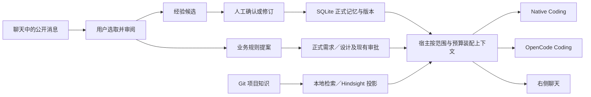

# DevFlow 跨场景记忆与知识使用改进方案

日期：2026-10-22。状态：草案，待 Cursor 只读评审及用户 review；**本轮仅形成方案，没有实施产品代码、迁移或运行时配置修改**。

代码基线：工作树 HEAD `a55d1f7`，包含本工作树已有的 Hindsight 全阶段接入、记忆与会话改动。引用指向当前工作树文件，不能用 HEAD 单独重建全部被审阅内容。历史验证日期为 2026-10-20，本轮没有重新运行这些实验。

## 1. 要解决的问题和建议决策

当前 Native Coding、OpenCode Coding、右侧聊天以及需求/设计阶段都能消费同一套按范围过滤的长期记忆；两个 Coding 执行器还可以从已完成且验证通过的任务提取经验。主要缺口是：聊天中有价值的结论缺少受控的跨会话沉淀入口，实际召回和实际发送的可见性不一致，Hindsight 的检索收益尚未证明。

建议保留现有分层，按以下顺序实施：

1. **P0：冻结评测与来源回执契约。** 明确“实际发送”与“模型采用”不同，建立四条执行组合的观测与基线。
2. **P1：打通聊天经验的人工确认及跨执行器复用。** 新增一种真实会话来源，复用现有候选、晋升、版本、删除和审计。业务规则沿现有正式流程确认。
3. **P2：改善检索及上下文分配。** 先解决无答案误召回、多语言和候选窗口问题，再按独立指标决定是否开放正式记忆语义注入。
4. **P3：条件成熟后再扩展无任务聊天身份、知识文件写入和本体关系。** 不把这些扩展放进 P1 的完成条件。

P1 不以 Hindsight 在线或检索胜出为前提；P2 不以获得 Cursor 的通过结论为前提。三个入口共用事实来源与生命周期，按各自任务选择上下文，不复制三份记忆。

## 2. 当前能力与缺口

| 层次 | 当前实现 | 本方案新增内容 |
| --- | --- | --- |
| 会话事实与摘要 | SQLite 会话 JSON；原消息、工具事实、`extractive-v1` 摘要；摘要不覆盖原文 | 从用户选择的公开消息建立可核验的记忆来源；不从隐藏推理或摘要直接提取 |
| 长期 Agent 记忆 | 候选→人工/受限策略晋升→不可变修订；BM25；范围、期限、墓碑和审计 | `conversation_confirmation` 来源；聊天端确认/修订入口；统一消费回执 |
| 项目知识 | Git Markdown 是原始依据；L0 项目说明、阶段规范及 Hindsight 选定文档检索 | 业务结论正确分流；检索评测和排序优化；P1 不新增任意文件写入 |
| Hindsight 投影 | Electron Main 通过 HTTP 管理投影、召回候选、核验本地原文；项目显式启用 | 改进知识检索；正式记忆保持 shadow，达到独立门槛后另行打开 |
| 工作流事实 | 已批准材料、测试证据、Gate 和交付状态有独立权限与版本 | 保持既有权威；长期记忆不承担批准、测试或交付证明 |

证据入口：

- [公共长期记忆召回](../../apps/desktop/electron/coding-context.ts)：`recallScopedMemory` / `recallCodingMemory`。
- [Coding 简报和运行](../../apps/desktop/electron/coding-runtime.ts)：Native/OpenCode 在选择执行器后共用简报准备。
- [编码后学习](../../apps/desktop/electron/coding-run-memory-learning.ts)与[自动晋升策略](../../apps/desktop/electron/coding-run-memory-policy.ts)：仅验证过的 `test_command` 自动晋升，默认 30 天。
- [聊天服务](../../apps/desktop/electron/workbench-conversation-service.ts)：`recallBackgroundMemory` 每个宿主模型步骤召回；`publish` 仅保存待确认的 `log`。
- [记忆权限](../../apps/desktop/electron/agent-memory-authority.ts)、[人工动作](../../apps/desktop/electron/agent-memory-human-actions.ts)、[严格共享契约](../../packages/shared/src/retrieval-memory.ts)。
- [Hindsight 服务](../../apps/desktop/electron/hindsight-service.ts)、[知识上下文装配](../../apps/desktop/electron/hindsight-context.ts)、[ADR 0027](../adr/0027-selected-hindsight-projections.md)。

## 3. 执行场景与共享方式

产品上常说的“三个 Agent”在实现中是场景与执行器两个维度：右侧聊天也可以使用 OpenCode。验证必须覆盖下面四种组合，不能用一个 OpenCode 测试代替两种场景。

| 场景 × 执行器 | 长期记忆入口 | 知识入口 | 学习及会话特点 |
| --- | --- | --- | --- |
| Coding × Native | Coding Run 开始时召回，进入持久简报 | 宿主准备并核验摘录 | 完成并通过验证后提取经验；继续时验证旧简报来源 |
| Coding × OpenCode | 与 Native 共用上述入口 | 同一宿主简报 | Change Acceptance 与规范测试完成后学习；引擎内部会话独立 |
| Chat × Direct | 每个宿主模型步骤重新召回 | `knowledge_search/read` 按需调用 | DevFlow 保存会话、工具事实、摘要；新增人工记忆入口 |
| Chat × OpenCode | 宿主在本轮入口附加背景记忆 | MCP 调用同一宿主检索工具 | 每个用户回合使用独立临时执行环境；长期记忆由 DevFlow 提供 |

需求/设计阶段继续使用公共记忆召回；六阶段 Review 使用既有知识上下文。测试命令只附来源记录，不增加一个测试 LLM。P1 不扩展尚无模型消费者的多 Agent 协调器。

## 4. 哪些内容存到哪里

| 例子 | 推荐去向 | 成为有效内容的条件 |
| --- | --- | --- |
| “给我解释改动时，先说行为变化，再说测试” | 当前用户、当前项目的偏好记忆 | 人工审阅后确认，跨会话有效，不提升为系统指令 |
| “这个项目测试要使用 pnpm test:unit” | 项目配置与测试命令经验 | 聊天中只保存待核验经验；自动 `test_command` 仍要求真实测试证据 |
| “上次故障与浏览器存储不可用有关” | 有来源的经验候选 | 标明适用条件；缺少验证时不标作已验证的修复事实 |
| “Todo 删除必须支持撤销” | 正式需求/设计；如需跨任务复用，再维护项目知识 | 保存聊天提案只产生待确认产物，继续既有阶段生成与批准流程 |
| “本次发布暂不做批量删除” | 当前 Run 的范围约束 | 随正式任务输入流转，不默认成为永久项目规则 |
| 原始聊天、工具输出、日志 | 会话事实或原业务工件 | 不批量转成长期记忆或 Hindsight 文档 |

P1 的经验类型白名单为 `project_preference`、`working_convention`、`pitfall_note`。类型表示来源与用途，不提供权限，也不保证事实正确。界面对于需求、验收条款提示保存为提案；分类建议可以出错，所以运行时的低信任边界必须独立成立。

## 5. P1 用户流程

### 5.1 从聊天保存经验

1. 在自己当前项目的用户消息或助手最终答复上选择“保存为项目经验”。首期逐条处理，允许选取同一会话中最多三条公开消息作来源。
2. 显示来源片段、拟保存的一条完整陈述、用途、作用域和保留期限。初始内容来自选取文本；用户可以整理，但保存的内容明确标为“用户确认陈述”，不伪称模型已验证。
3. 未配对项目需要明确绑定一个当前项目 Run，以其创建者确定本地身份。配对项目使用当前有效配对用户，但首期也保留 Run 关联以复用既有生命周期权限入口。聊天可继续自由调查，记忆写入不依赖 UI 当前选中的卡片来猜身份。
4. 点击“确认记住”触发 Main 的受控写入。一次确认即可完成候选创建和人工晋升；不要求用户连续点击两个含义相同的确认按钮。复杂冲突停在候选，用户选择修订已有记忆或取消。
5. 提交后显示记忆编号、范围和管理入口；之后新建聊天或启动另一编码执行器都可按相关度召回。界面明确“可供召回”不等于“每次都会发送”。

这一路径不由助手 JSON、MCP 调用、自然语言“记住了”或提案保存事件自动执行。模型可提示操作，但只有用户界面操作进入确认 IPC。自动化测试从同一 IPC 测试宿主权限。

### 5.2 业务规则沿正式流程传递

“保存为业务提案”复用现有 `publish`，保留“待确认”文案和源消息链接。用户在对应需求/设计节点形成正式产物并完成现有审批后，编码简报将该规则作为必保输入，而非依靠概率召回。

P1 不新建 Git 写入或知识发布通道。需要跨 Run 复用的正式规则，先提供来源清楚的可复制片段及目标知识目录提示，由既有文件编辑/评审流程纳入 Git；之后仍需明确选入 Hindsight。自动生成知识变更提案列入 P3。P1 的业务规则验收只承诺在对应正式 Run 中传递，不把单次批准自动解释为整个项目的永久规则。

### 5.3 修改、冲突和遗忘

- 完全相同且同范围的有效记忆：返回已有记录，不制造重复候选；重复点击返回同一确认结果。
- 相近语句：复用已有相似度提示；不自动合并矛盾事实。
- 明确选择更新已有记忆：要求当前 `revision`、`headVersion` 和摘要，使用既有人工修订权限；旧版本仍可审计。文字相似不作为替换授权。
- 删除：复用墓碑和派生状态清理；新回合及新任务不再召回。已进入模型的上下文无法撤回，进行中的 Coding Run 按原有当前性校验停止继续，重新开始才构建新简报。
- 关闭聊天 Tab 不删除其来源。将来增加物理删除会话时，必须同时设计候选及记忆来源失效；本方案不以“关闭 Tab”触发遗忘。

## 6. P1 数据、权限和事务契约

### 6.1 新来源，不伪造 Coding Run 或 AgentRuntime

在 `AgentMemoryCandidateProvenance` 中新增 `conversation_confirmation` 分支，计划字段为：

| 字段 | 来源与约束 |
| --- | --- |
| `confirmationId` | Main 生成并持久化的确认记录 ID |
| `conversationId` | 必须属于当前本地项目 |
| `runId` | 既有、当前项目内的身份锚点；不能从另一项目借用 |
| `messageIds` | 同一会话中 1–3 条已保存公开 user/assistant 消息，顺序规范化 |
| `sourceDigest` | Main 对角色、ID、公开正文等稳定字段计算的 SHA-256；不含 reasoning、问题状态等易变展示字段 |
| `statementKind` | 第 4 节白名单；不允许冒充 `coding_run.test_command` |

候选继续携带精确 `scope`、`contentDigest`、`provenanceDigest` 和时间戳。确认记录另存确认时的 scope、actor、公开来源摘要、最终陈述摘要、命令幂等键和结果候选/记忆 ID。正文只保留在原消息与候选/修订，不为审计再复制完整聊天。

新增表暂名 `conversation_memory_confirmations`，只含 Main 验证的不可变确认记录及关联 ID；最终 schema 版本必须在实施时根据当前最大迁移号分配，不能照历史文档硬编码 v40。

### 6.2 IPC 和人工动作

拟新增窄命令 `confirmConversationMemory`，参数为项目、会话、Run、消息 ID、预期来源摘要、最终陈述、类型及幂等键；可选“修订已有”携带准确的记忆版本。参数不接受 `userId`、组织 ID、任意 scope、权限对象、promotion policy 或 Hindsight bank。

Main 在预览与提交都重新解析有效配对、Run 与项目，校验公开来源和摘要。用户确认只代表当前可见陈述，不授权模型生成其他条目。新增陈述上限直接使用现有聊天单条限额常量（当前 1,800 UTF-8 字节），超限要求用户缩短，不在确认后截断。敏感文本检测改变陈述时拒绝持久化并请用户自行脱敏。

新来源默认 `user_project + private + until_deleted`，与现有人工晋升一致；界面明确显示“直到手动删除”。暂不借此改造全套保留期选择器；现有测试命令自动晋升的 30 天规则保持独立。

### 6.3 原子提交与重放

新增 Main 存储组合操作，在一次现有 `runDurableMutation` 中完成：重新核验来源/权限 → 幂等检查 → 确认记录 → 候选 → 人工晋升或修订 → 审计。外部 HTTP、LLM 或 Git 操作均不在此事务中。

- 复用现有晋升/修订的校验核心；不能通过直接插表绕过存储层权限，也不能以嵌套 durable mutation 破坏回滚语义。实施时将必要的事务内核心提取为受控内部方法。
- 幂等键绑定 scope、来源摘要、陈述摘要和目标操作。同键同内容返回原结果；同键不同内容拒绝。来源变更或身份变化后不能凭旧预览提交。
- 持久化失败整体回滚；进程重启后不自动再次批准、不重新请求模型。
- 撤销删除、候选忽略与同幂等键重试不能让记忆复活。重复请求只返回“该确认曾完成但现已删除”等受限状态。

### 6.4 需要同时改到的既有约束

增加 provenance 不是只扩一个 TypeScript union：

- `retrieval-memory.ts` 的精确键解析、摘要、来源标识和候选创建辅助函数。
- `local-store-schema.ts` 的 `provenance_kind` 检查、条件非空列、JSON 校验及候选忽略表；迁移保留全部原 ID、摘要、版本、墓碑和审计。
- `local-store.ts` 中候选源核验、回放、忽略、晋升、来源回读和索引关联；旧来源分支不变。
- `agent-memory-authority.ts`、人工动作、renderer 投影、记忆卡片来源链接和删除后的正文隐藏。
- 所有依赖 `agentMemoryCandidateSourceRuntimeId` 的 Runtime 附件路径：会话来源没有真实 AgentRuntime。首期公共 Coding/Chat/Stage 召回支持新来源；独立 Runtime/协调器附件显式拒绝该来源，不制造假 runtimeId 绕过校验。
- Team/API 投影只允许原本支持的来源。当前仅排除 `coding_run` 的分支应改为明确允许 `agent_observation`，否则新增来源可能误走团队同步。新会话来源及消费回执始终本地，不扩大团队字段白名单。
- Hindsight 的 `enqueueHindsightMemory`、源刷新和发送前核验明确排除新会话来源。既有 `includeMemories=true` 不自动授权上传新增聊天派生内容。以后开放需新增来源选择及独立验证。

### 6.5 归属和信任

首期不新增“所有本地用户”“跨项目个人记忆”或用户全局偏好。配对、项目、用户范围沿用现有交集规则；无可靠身份时返回明确的不可用原因，不回退到其他 Run 的创建者。已确认记忆仍属于低信任辅助上下文，不能覆盖当前请求、已批准输入、项目执行权限和 Gate。

## 7. P0/P1 消费回执和可见性

已有 Coding 回执较完整，聊天当前主要记录预算、包含消息数量和摘要边界。新增一个小的共享消费回执结构，各入口适配，不把所有执行器的会话协议合并。

拟议字段：`consumer`（coding/chat/stage/review）、`executor`、`requestId`、可信范围摘要、`queryDigest`、`retrievalPolicyVersion`、`packingPolicyVersion`、候选模式（lexical/shadow/hybrid）、实际发送的记忆 ID/版本/摘要、实际知识引用、各部分字节/估算 Token、裁减原因及耗时。诊断记录不保留原始查询、完整正文、隐藏推理或其他用户的存在性信息。

回执只在最终装配后计算，与真实派发的 prompt 对应；压缩时移除的条目不记为已发送。分别表示 `prepared / dispatched / completed / failed`，不能把准备成功写成模型调用成功。派发前的本地回执保存失败则不调用模型；调用失败/取消保留已发送事实及真实用量。

界面展示“本次提供给 Agent 的记忆与知识”，不使用“Agent 已采纳”这样的不可验证措辞。可展开来源、修订、匹配理由、被省略原因，并跳转既有记忆管理。新回合重新读取原文权限；历史回执不提供绕过删除后的正文回读通道。

OpenCode 特别说明：Chat 的宿主发送回执覆盖初始提交与可观察的 MCP 工具结果，不能宣称覆盖其所有内部提示或知道内部压缩后是否仍保留记忆；Coding 回执证明宿主简报和引擎请求边界检查，不推断模型因果使用。知识工具返回了来源和实际送给引擎的最终结果需要分别记录。

## 8. P2 检索改进及可开启条件

### 8.1 先固定基线

2026-10-20 六文档、30 题的结果：[完整记录](../validation/hindsight-fullchain-validation-20261020.md#30-题检索结果)。其中可回答 23 题，Top1 本地 18/23、混合 15/23；普通无答案 4 题误召回本地 3/4、混合 4/4；p95 本地 230ms、混合 1,085ms。该结果不支持混合检索已经更好，也不能外推成所有项目上 Hindsight 更差。

两类内容分别评测：项目知识文档的 hybrid 效果不能代替长期记忆语义召回的质量证明。生命周期/权限正确性与检索质量分别计分。

### 8.2 有限的优化顺序

1. 范围、删除、期限、当前源版本继续先过滤再排序。检查本地普通检索 256 条窗口：增加超过窗口的夹具，验证早期相关记忆不会仅因存储返回窗口被长期遗漏；如失败，再在上限 2,048 有效修订内有界分页或范围内索引检索。
2. 保留 BM25 基线，比较领域词别名、中文/英文表达和按问题意图组合查询。只使用受控词表/现有模型版本；不要未经评测增加收费查询改写调用。
3. 比较本地优先与当前 RRF 候选融合；使用开发集选择配置。来源最终仍需回读当前原文，检索分数不等于正确性或批准。
4. 设计无答案决策：把“可能相关材料”和“足以回答的问题证据”分开标注；针对检索返回和最终回答分别评测。单靠 RRF 排名或固定填满 topK 无法判断有无答案。
5. 正式记忆继续 shadow。只有它自己的冻结评测通过，才考虑显式的按项目实验开关；故障回退本地，范围/源完整性错误必须显式处理。

### 8.3 评测集与建议门槛

P0 设计并冻结题目、金标准来源、切分和阈值，P2 才调参数。知识主集至少 120 题：60 题明确可答、20 题跨来源、20 题无答案、20 题规则修订/冲突；覆盖中文、英文、中英混合。按主题及问题族分开发集/保留集，避免仅换措辞泄漏。另设独立权限/删除/重启压力集，不混入无答案统计。

长期记忆另建至少 60 题，覆盖偏好、经验、重复、矛盾、修订、过期和超过 256 条窗口；至少一半作为冻结保留集。题目与金标准不导入 Hindsight。比较系统使用相同已授权语料、查询集合、最终提示预算、模型配置和运行顺序；冷/热启动分别报告。

| 维度 | 建议验收标准（实施前冻结） |
| --- | --- |
| 范围、来源、撤销、墓碑 | 压力集中 0 越界/陈旧来源进入新请求；与检索质量分开硬判定 |
| 引用有效性 | 100% 能回读对应授权版本；这不代表答案正确 |
| Top1 / NDCG@5 / 必需来源覆盖 | 分语言和类型报告，不靠单一总分掩盖退步 |
| 正式记忆 hybrid 开启 | 保留集 Top1 相对本地绝对提升至少 5 个百分点，NDCG@5 与必需来源覆盖不低于本地；若小样本置信区间不足以排除退步，继续 shadow 并扩集 |
| 无答案 | 无关来源当作答案依据的比例不高于本地，目标 ≤5%；小样本需同时给出计数与区间，不能用 1/20 的点估计宣称稳定达标 |
| 最终回答 | 对相同问题单独评分约束遵循、引用支撑、正确拒答；答案含义由事先 rubric 和盲评核验，不从检索命中推断 |
| 性能 | 同机注明冷/热状态；知识召回热态 p95 目标 ≤1.5 秒，保留现有 5 秒截止/取消；超时率单列 |
| 成本 | 抽取、检索、回答分别报告实际用量；不把本地运行直接等同于免费，也不用估算 Token 代替账单 |

P0/P1 使用确定性模型和隔离数据即可完成工程验收。真实 Hindsight/模型实验单独执行，并对 DeepSeek 的原累计人民币 5 元授权核账；已有关闭账本不能重开或重置。若实验规模超过剩余额度，形成缩小采样方案与费用估计供后续批准。本次方案评审不运行产品模型实验，也不启动服务。

## 9. 上下文预算优化

先保留现有硬边界：Coding 简报 24,000 字节；长期记忆 Coding 8 条/4,000 字节、Stage 6 条/3,000 字节、Chat 4 条/2,000 字节；知识已有单篇、总正文和渲染后上限。利用已有 `PromptSection` 的估算 Token、字节和字符计量，不另造一套 tokenizer 假设。

P1 中新记忆使用 1,800 字节单条上限，使完整语句可供聊天使用；不为适配预算切掉否定词、条件或期限。P2 在同一总预算内按任务相关度分配可选记忆/知识的空间，规则仍是：当前请求、执行权限、必保批准正文优先；容量不足则可选来源省略并说明，必要输入放不下则发送前失败。

业务硬约束通过正式输入保护，不通过把所有长期记忆变成常驻系统提示来保证。提示结构尽量稳定以支持提供方前缀缓存，但缓存命中不能优先于来源新鲜度。若要扩大任何硬上限，必须另有边界测试和证据，不能捆绑到本次功能默认放大。

## 10. 计划改动清单与依赖

以下是后续实施清单，本轮没有执行。

| 工作包 | 主要文件/模块 | 交付条件 |
| --- | --- | --- |
| P0-A 基线与评测协议 | `scripts/hindsight-todo-evaluation.*`、隔离评测夹具、验证文档 | 可重放的三种基线：现有调查工具、本地词法、Hindsight 混合；明确未运行项 |
| P0-B 消费回执 | `execution-context.ts`、`workbench-conversation-contract.ts`、`coding-context.ts`、`knowledge-retrieval-context.ts` | 四组合的最终发送来源可观测，旧记录缺字段仍可读 |
| P1-A 会话来源与存储 | `retrieval-memory.ts`、`local-store-schema.ts`、`local-store.ts`、`agent-memory-authority.ts` | 严格解析、来源验证、原子确认、迁移及重放；团队/Hindsight 排除新来源 |
| P1-B 用户动作 | `agent-memory-human-actions.ts`、`workbench-conversation-service.ts`、IPC/preload/desktop-api、聊天与 `AgentMemoryPanel` | 一次明确确认；来源预览、重复处理、版本冲突、删除及提示 |
| P1-C 跨场景闭环 | Coding/Chat/Stage 的公共召回与回执适配 | 新来源在四组合和阶段生成中可消费；正式业务规则走批准输入 |
| P2-A 检索与门槛 | `memory-relevance.ts`、`hindsight-service.ts`、本地候选获取 | 开发集调参、保留集验证；分别决定知识和长期记忆模式 |
| P2-B 可选上下文分配 | Coding brief、conversation packing、stage/review packing | 必保输入不丢失，实际发送与回执一致，硬上限不回退 |
| P3 后续独立提案 | 本地身份模型、知识变更提案、本体关联、团队共享 | 单独设计并批准，不计入 P1/P2 完成承诺 |

P0 先于 P2；P1-A 先于 P1-B/C；P0-B 与 P1-A 可独立开发但同一轮联调。每个包先添加能证明边界的失败测试，再实现。可分成 4–6 个小 PR；具体拆分在用户 review 后结合当时工作树确定，不在当前混合工作树直接批量实施。

## 11. 测试矩阵与 Todo 验收场景

使用既有 Todo 夹具生成独立 Git 工程、Electron profile 和专用数据库。任务对象是 Todo，DevFlow 作为被验证的运行器；不修改用户演示 Todo 或复用已有用户数据库。

| 层次 | 必测内容 |
| --- | --- |
| 纯契约 | 新来源精确字段、摘要规范、字节上限、不得引用 reasoning/工具/其他会话、重复与冲突 |
| SQLite/事务 | 原候选两类迁移保真；新增来源；双击/并发/崩溃/写盘失败回滚；忽略/删除后重放；已有索引/版本/墓碑不变 |
| 权限/投影 | 本地/配对、多用户/多项目、Run 归属、预览后解绑/换身份；新来源不进入 Team/API 或 Hindsight；既有来源正常 |
| 提示/回执 | 四组合的真实最终请求或宿主提交；预算排除后回执不残留；工具返回、prepared、dispatched 与 completed 区分 |
| 当前性 | 召回后删除/到期/修订；Coding 继续必须停止旧上下文；Chat 新宿主步骤不带旧记录；旧 OpenCode 内部上下文不宣称可撤回 |
| 知识 | 保存 log 不等于批准；批准后才成为对应 Run 的硬约束；知识原文变化必须重新检索和核验 |
| UI/Electron | 选择来源→编辑→确认→查看→修订→删除；取消零写入；重启后状态一致；走真实 IPC |
| 检索与回答 | 第 8 节各数据集；现有调查/词法/混合相同条件；答案、来源和费用分别计分 |

核心端到端剧本：

1. 在右侧聊天提出“解释改动先列行为变化、再列测试”，显式确认成当前项目偏好；另保存一条“测试环境不提供真实浏览器存储”的适用条件经验。
2. 新建 Chat Direct 与 Chat OpenCode，使用能检索上述经验的问题；检查相同记忆 ID/版本出现在实际发送回执。无关问题允许零条，不要求所有入口每次命中相同集合。
3. 讨论“删除支持撤销”，保存提案。断言此时没有正式批准记忆、没有新增 Gate 权限，业务规则只处于待确认状态。
4. 通过现有需求/设计与审批完成正式输入。分别从相同基线创建 Native Coding 与 OpenCode Coding 的独立运行，检查批准规则完整进入简报、相关经验可被召回，实际 Todo 测试验证撤销行为。
5. 确认新版偏好，证明之后新运行使用新版本；删除经验、重启，再验证不复活。在已启动 Coding 中修改来源时验证旧运行不能静默替换简报继续。
6. 切换到隔离的另一个项目和用户，验证看不到原私有记忆；关闭 Hindsight 后验证 P1 的本地链路仍成立。

最小发布前检查：相关契约/存储/运行时/组件测试，`corepack pnpm verify`、`corepack pnpm build`、适用 E2E 与 Electron smoke。只有修改团队/API 契约时才扩展对应 Postgres 检查；本方案设计为不新增团队内容，仍需证明投影排除。真实模型测试单独标明执行器、模型、数据范围、费用和失败，不把假模型集成当成真实模型全链路。

## 12. 迁移、启用和回退

- 新来源与表采用显式 schema 迁移，旧记录保持原形；没有会话来源的历史记忆不能自动补来源或重新分类。迁移失败保持旧数据库和备份可恢复。
- 先以内部功能开关关闭新的确认入口；确定性验证通过后在隔离 profile 打开，再考虑默认开启人工入口。回退开关只阻止新建，不隐藏已有新来源的管理与删除能力。
- 运行时代码仍须理解新 schema/新来源；不能把“关开关”称作任意旧二进制可读新数据库。旧版降级必须恢复迁移前备份，并明确迁移后的记录不会自动保留；优先前向修复。
- 知识检索与正式记忆 hybrid 分别有配置/策略版本及回退；回到 lexical 不删除原文或正式记忆。会话来源首期不进 Hindsight，故不引入其远端清理依赖。
- 当前工作树已有大量实现改动；用户 review 后实施时先确认基线与未提交差异，避免将他人正在进行的设计修订工作混入提交。

## 13. 建议 review 的四个决策

本草案给出默认建议，用户可以直接批注，不要求逐项回答后才能完成本轮文档：

1. **经验人工确认，业务规则走正式流程。** 同意后，聊天“记住”不会直接成为项目审批依据。
2. **首期限定当前用户、当前项目，要求 Run 作为身份锚点。** 无任务自由聊天继续可用，记忆写入等待明确身份；跨项目个人偏好后置。
3. **Hindsight 先优化知识检索，长期记忆继续 shadow。** 用分别冻结的评测决定开启，聊天来源暂不外送。
4. **先 P0/P1，再决定 P2 中哪些改动有实测价值。** 完成第一阶段的标准是跨场景读写、生命周期与可观测性，而非必须证明外部检索优于本地。

## 附录：Cursor 本轮只读评审范围

用户已经授权 Cursor 只读审阅方案与相关源码。本轮要求 Grok 4.7 Extra High 非 Fast；不更换模型。仅阅读本方案、AGENTS.md、CONTEXT.md、ADR 0018/0021/0024/0025/0026/0027、Hindsight 全链路验证记录，以及下列相关文件及其对应测试：

- `apps/desktop/electron/{coding-context,coding-runtime,coding-run-memory-learning,coding-run-memory-policy,workbench-conversation-service,workbench-conversation-contract,conversation-context,agent-memory-authority,agent-memory-human-actions,agent-memory-renderer-access,local-store,local-store-schema,hindsight-service,hindsight-store,hindsight-context,workbench-mcp-bridge,workbench-opencode-executor,ipc-contract,preload,main}.ts`。
- `packages/shared/src/{retrieval-memory,memory-learning,memory-relevance,agent-memory-projection,agent-memory-team-projection,execution-context,knowledge-retrieval-context,coding-brief,knowledge-context}.ts`。
- `apps/desktop/src/AgentMemoryPanel.tsx`、`apps/desktop/src/desktop-api.ts`，必要时仅检索定位聊天界面相关组件。

不得读取 `.env`、凭据、用户数据库、会话文件、`.tmp` 验证原始数据或无关目录；不得修改文件、运行测试/构建/迁移、调用业务模型、启动服务或联网搜索。允许有界 `rg`/`sed`/Git 只读定位。重点评审：业务规则与经验的分流、会话身份来源、单次确认的原子性、新 provenance 的完整影响面、隐私投影边界、OpenCode 观测限制、评测门槛及方案能否按阶段交付。建议由 Codex 独立采纳、拒绝或延期。
