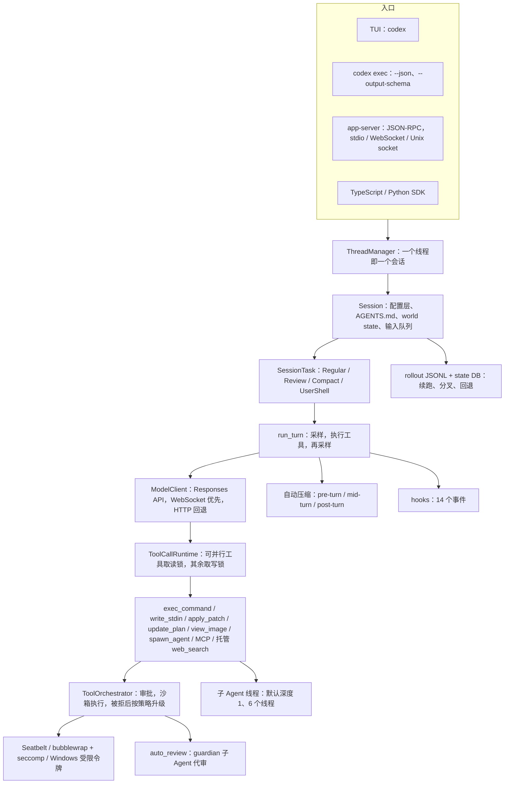

# 外部 harness 源码调研：Codex、Gemini CLI、Kimi 与 DeepSeek 官方要求

调研时间 2026-10-31。只读源码与官方文档，代码为本地浅克隆，未构建、未运行、未调用模型，也未读 DevFlow 代码。版本：Codex `rust-v0.166.0`（`6ff1e1c`，2026-10-29）、Gemini CLI `v0.66.0`（`9704132`，2026-10-27）、Kimi Code CLI `2.4.1`（`2c73f3f`，2026-10-30；旧 Python 版 kimi-cli 已归档，最后版本 `1.52.0`）、DeepSeek Harness 预发布 `dsh-v0.2.1-rc.5`（`b830ec9`，2026-10-29）。引用编号：Cn 为 Codex 源码固定链接，Gn 为 Gemini CLI，Kn 为 Kimi，Dn 为 DeepSeek，Wn 为 Codex 官方文档与 PR；S7–S12、S118–S121 沿用 multi-agent 调研（landscape.md、mechanics.md）的编号。

## 一句话结论

- Codex 的 harness 由五块组成：一个"模型还要调工具或用户插话就继续采样"的 turn 循环；按工具声明的读写锁并行；"沙箱 + 审批策略 + exec policy 规则"三层权限；Lark 语法约束的 apply_patch；窗口 90% 触发的自动压缩和 JSONL rollout。它没有任务图和 CLI 定时任务，MCP 服务端模式已在 2026-09-05 删除 [C1][C3][C8][C12][C30][C70][C78][W4]。
- DeepSeek 有官方 harness：DeepSeek Harness（`dsh`，MIT，2026-08-13 起开发者预览，GitHub 上只有预发布版）[D1][D11]。对自建 harness 影响最大的 API 规则有三条：带 tools 的请求必须原样回传之前所有 assistant 消息的 `reasoning_content`，否则返回 400 [D3]；前缀缓存只认完整匹配的缓存单元，flash 的命中价是未命中价的 1/50 [D6][D2]；官方模型名是 `deepseek-flash`（V4.1-Flash-1017）和 `deepseek-v4-pro`（V4-Pro-0813），`deepseek-v4-flash` 是被路由到 V4.1-Flash-1017 的旧名 [D1][D2]。

## Codex 总体结构

图中一个 turn 指一次用户输入直到模型不再要求工具为止，turn 内的每次模型请求是一次 sampling request（DeepSeek Harness 称为 step）[C1][D12]。所有入口共用同一个 Session 和 turn 循环，app-server 是 VS Code 扩展等富客户端的后端 [W3][C99]。

## 逐项对照

各单元格只写源码或文档里核实过的内容；"无"表示在源码和文档中都没有找到该机制，"未核实"表示没有查到足够证据。

| ID | Codex（机制、默认值、出处） | Gemini CLI v0.66.0 | Kimi（Kimi Code 2.4.1；旧 kimi-cli 1.52.0） |
|---|---|---|---|
| S01 Agent Loop | `run_turn`：每次采样后，模型要求续跑或队列里有用户插话就再采样，否则跑 Stop hook 后结束；出错时发事件并结束 turn [C1][C2][C3][C5]；任务分 Regular、Review、Compact、UserShell [C6] | 循环检测：同一工具调用连续 5 次、50 字片段重复 10 次即判为循环，30 轮后每 5–15 轮再请 LLM 判断（置信度 0.9）[G1] | `loop_control`：每轮步数默认不限，单步失败最多尝试 10 次 [K3] |
| S02 Tool Use | 工具默认不可并行，需显式声明；可并行的取读锁，其余取写锁独占；`exec_command`、`write_stdin` 可并行；请求固定 `parallel_tool_calls=true`、`tool_choice="auto"` [C7][C8][C9][C10][C11] | 调度器从队首起把连续的可并行调用合成一批，先统一过策略再执行 [G2] | 只读工具默认自动放行，写和执行默认要审批；`AgentSwarm` 必须是该次响应唯一的工具调用 [K1] |
| S03 Permission | 审批策略 untrusted（项目未信任时的内部策略）/ on-request（默认）/ granular / never；沙箱 read-only / workspace-write / danger-full-access；沙箱拒绝后只在策略允许时申请脱离沙箱重跑；exec policy 前缀规则 [C12][C13][C14][C15][W1] | TOML 策略引擎：allow / deny / ask_user，按 Default、Workspace（暂停用）、User、Admin 分层，层内按 0–999 排序；非交互时 ask_user 按 deny 处理；Conseca 按用户提示生成最小权限策略，默认关 [G3][G4][G5] | Always Ask（默认）/ Ask When Needed / Never Ask；`[[permission.rules]]` 首条命中，作用域 turn-override / session-runtime / project / user；内置危险命令与敏感文件守卫 [K2][K3] |
| S04 Hooks | 14 个事件：Pre/PostModelRequest、PreToolUse、PermissionRequest、PostToolUse、Pre/PostCompact、SessionStart/End、UserPromptSubmit、SubagentStart/Stop、Stop、Interrupt；处理器 command 与 mcp_tool，prompt、agent 类型跳过并告警"尚未支持"；非托管 hook 按定义哈希信任后才运行；默认超时 600 s，SessionEnd、Interrupt 默认 1 s、上限 3 s；输出超 2500 token 落盘 [C16][C17][C18][C19][C20][W2] | 11 个事件：Before/AfterTool、Before/AfterAgent、Before/AfterModel、BeforeToolSelection、PreCompress、SessionStart/End、Notification；`trusted_hooks.json` 按项目记录已信任的 hook [G6][G7] | 20 余个事件，另有 UserPromptQueued、PostToolUseFailure、PermissionResult、SessionHeartbeat、TaskStarted、StopFailure；UserPromptSubmit、PreToolUse、Stop 可阻断 [K6] |
| S05 TodoWrite | `update_plan(explanation, plan[{step, status}])`，status 为 pending / in_progress / completed，至多一个 in_progress；处理器只发 `PlanUpdate` 事件；Plan 模式下调用报错 [C21][C22] | `write_todos`（旧）；实验性 `tracker_*` 取代它 [G8] | `TodoList`：pending / in_progress / done，不传参即查询 [K1] |
| S06 Subagent | V1（默认开）：spawn_agent、send_input、resume_agent、wait_agent、close_agent；V2（默认关）：spawn_agent、send_message、followup_task、wait_agent、list_agents、interrupt_agent；默认深度 1、6 个线程（V2 每会话并发 4）[C23][C24][C25][C27][S7][S118] | `.gemini/agents/*.md`；`max_turns` 默认 30、`timeout_mins` 默认 10；不写 tools 时继承父会话全部工具；子 Agent 不能再调子 Agent；必须调用 `complete_task` 才能结束 [G9][G10] | `Agent`：默认 coder 类型，可后台、可 resume，默认 2 小时超时，被停止时仍回传已写文本；`AgentSwarm` 需用户开启，模板加 items，最多 128 个 [K1][K8] |
| S07 Skill Loading | 根目录有仓库 `.agents/skills`、用户目录、内置系统技能；技能清单按上下文的 2% 计预算（默认 8000 字符，单条描述 ≤1024 字符），正文用到时再读 [C28][C29] | `activate_skill` 工具按需激活 [G11] | `Skill` 工具只能调用 inline 型技能，嵌套最多 3 层 [K1] |
| S08 Context Compact | 自动阈值为窗口的 90%；pre-turn、mid-turn、post-turn（默认关）三处触发；本地压缩写交接摘要，保留最近用户消息 ≤20k token；提供方支持时走远程压缩 [C30][C32][C33][C34][C35][C37] | 历史达模型上限 50% 时压缩，保留最近 30%；摘要后再发一次"探针"请求让模型自查遗漏；压缩后 token 反增则放弃；旧工具输出单独遮蔽（保护最新 50k token，可裁剪部分攒到 30k 再批量处理并落盘）[G12][G13][G14] | 接近窗口上限自动压缩，`/compact <提示>` 手动；由 `reserved_context_size` 触发，压缩失败最多试 5 次 [K3][K4]；旧 kimi-cli 的 D-Mail 让模型回到检查点给过去的自己留言，不回滚文件 [K14][K15] |
| S09 Memory | `memories` 扩展（Stable，默认关）：根会话启动时后台两阶段，先从空闲的 rollout 抽取记忆并正则脱敏，再全局合并到 `~/.codex/memories`（git 基线）[C38][C39][C106] | memory 工具 [G34]；实验性 Auto Memory 从转录中提炼补丁和 SKILL.md 候选，人工批准后生效 [G15] | 未核实独立记忆功能；指令文件见 E13 [K8] |
| S10 System Prompt | 基础指令按模型选择（未知模型用 `prompt.md`）；开头的 developer 消息由 developer_instructions、权限与沙箱模板、协作模式、插件和扩展片段拼成；之后按 world-state 分节只发变化 [C40][C41][C42][C43] | `GEMINI.md` 分层加载，并按访问目录即时补充 [G16] | 可用 `SYSTEM.md` 覆盖主 Agent 系统提示 [K8] |
| S11 Error Recovery | 流错误按服务端 Retry-After 或退避重试：流重试默认 5 次、请求重试 4 次、上限各 100，流空闲 300 s；次数用尽可从 WebSocket 切到 HTTP 再试；上下文超限、用量超限不重试 [C44][C45][C46] | 429、499、5xx 重试，初始 5 s、最长 30 s [G17]；有回退处理 [G18] | 只重试连接错误、超时、429、5xx；额度或余额不足导致的 429 立即失败 [K3] |
| S12 Task System | 无（`update_plan` 是扁平清单，goal 只有一个目标）[C21][C47] | 实验性 tracker：epic / task / bug，open / in_progress / blocked / closed，依赖构成 DAG，存于 `.gemini/tmp/tracker/<session-id>` [G8] | 无依赖图；TodoList 是扁平清单，Tower 按 mission 拆分 [K1][K7] |
| S13 Background Tasks | `exec_command` 超过 yield 时间（250 ms–30 s）就返回 session_id，进程在后台继续，用 `write_stdin` 轮询；每会话最多 64 个进程，后台终端默认超时 300 s [C50][C51] | shell 后台进程工具 [G19] | Bash `run_in_background`，前台超时自动转后台；TaskList、TaskOutput（预览 32 KB，全量落盘）、TaskStop、WaitFor（≤90 s，插话会提前结束等待）[K1] |
| S14 Cron | CLI 无；桌面 App 有 Scheduled tasks，可在项目目录或独立 worktree 运行 [W6] | 无（文档未见） | CronCreate / CronList / CronDelete：5 段 cron，绑定会话，最多 50 个，带确定性抖动，错过多次只补一次，循环任务 7 天后过期 [K1] |
| S15 Agent Teams | 无；V2 的 `agent_message_board` 仍在开发，默认关 [C52] | 无；远程 Agent 经 A2A 接入 [G20] | Tower（实验）：主 Agent 担任 tower，worker 并行做 mission，reviewer 只读审查 [K7] |
| S16 Team Protocols | 子线程消息以 `InterAgentCommunication` 记入 rollout；子 Agent 完成后以通知片段注入父上下文；mailbox 消息投递到当前 turn [C53][C54][C55][S119] | A2A [G20] | tower 转发消息和完成报告；后台子 Agent 的结果以合成 User 消息送回 [K7][K1] |
| S17 Autonomous Agents | goal：目标未完成时线程一空闲就自动续跑；同一阻塞连续 3 轮才允许标 blocked [C47][C48]；从看板领活由 Symphony 规范承担 [S11] | 无 | `/goal`：跨轮追目标，complete / paused / blocked，可排队下一目标；非交互退出码 0 / 3 / 6 [K2] |
| S18 Worktree Isolation | `git worktree add --detach --no-checkout` 到 `$CODEX_HOME/worktrees/<4 位随机>/<仓库名>`；`codex --worktree`、`codex exec --worktree` [C56][C57] | 实验性 `--worktree`，建在 `.gemini/worktrees/<name>` [G21] | Tower 每个 mission 一个分支和 worktree，只合并通过检查的分支；文档明说 worktree 不是安全沙箱 [K7] |
| S19 MCP Tools | 客户端：工具名 `mcp__<server>__<tool>`，启动超时 30 s、调用超时 300 s，`enabled_tools` / `disabled_tools`，按 destructive / read-only 注解决定审批；服务端：`codex mcp-server` 2026-08-20 起弃用告警，2026-09-05 删除 [C58][C59][C60][C61][W4][W5] | MCP 客户端；策略可按 MCP 服务器名匹配；子 Agent 可内联专属 MCP 服务器 [G3][G9] | `~/.kimi-code/mcp.json` 或项目 `.kimi-code/mcp.json`；权限规则对 MCP 工具只能按名字匹配 [K3] |
| S20 Comprehensive | TUI、exec、app-server、SDK 共用同一 Session 与 turn 循环（见上图）[C1][C99][W3] | 包：cli、core、a2a-server、sdk、vscode-ide-companion、devtools [G37] | agent-core-v2（循环、权限、工具、压缩、undo 等子模块）加 acp-server、kap-server、node-sdk [K13] |
| E1 沙箱与 OS 隔离 | macOS 只认 `/usr/bin/sandbox-exec`，基础策略 deny default；Linux 默认 bubblewrap（只读挂 `/`，可写根再 bind）加 no_new_privs 与 seccomp（限制网络 syscall、禁 io_uring），Landlock 已弃用；Windows 分受限令牌与提权（独立沙箱用户）两档，含 WFP 模块；可写根内 `.git`、`.agents`、`.codex`、`.aws` 只读 [C62][C63][C64][C65][C66][C67][C69] | macOS Seatbelt（默认 permissive-open）、Docker / Podman、gVisor、LXC、Windows 原生（icacls 低完整性级别）[G22] | 文档未见 OS 级沙箱；Tower 文档说 worktree 不是安全边界 [K7] |
| E2 编辑格式 | apply_patch：Lark 语法约束的 freeform 工具；解析宽松；上下文匹配逐级放宽到 Unicode 标点归一；应用前检查写入路径 [C70][C71][C72][C73][C74] | edit 依次尝试 exact、flexible、regex、fuzzy，失败可交 LLM 修正；拦截"其余代码不变"一类省略占位 [G23][G36][G24] | Edit 精确替换且须唯一匹配；Write、Edit 要求本会话先 Read 过该文件，读后文件被改则拒绝 [K1] |
| E3 代码检索 | 无专用 grep、LSP、repo map；提示词要求用 `rg`；nucleo 模糊文件搜索用于 @ 提及；tree-sitter 只用来解析 shell 命令 [C75][C76][C77] | grep、ripGrep、glob、read_many_files 工具 [G38]；codebase_investigator 子 Agent [G9] | Grep（ripgrep，分页，默认 250 条，过滤 `.env` 和私钥）、Glob [K1] |
| E4 会话、恢复、撤销 | rollout JSONL（可压成 .zst）存于 `$CODEX_HOME/sessions`；条目含 ResponseItem、Compacted、TurnContext、TokenUsage、InterAgentCommunication 等；resume / fork / archive / delete；`thread/revert` 只改历史、不回滚文件；原 `undo`（ghost commit）已移除 [C78][C53][C79][C80][C81][C82] | 会话自动存于 `~/.gemini/tmp/<hash>/chats`，`--resume` [G28]；checkpointing（需在 settings.json 开启）在改文件前向 `~/.gemini/history/<hash>` 影子仓库提交，`/restore` 还原 [G25][G26][G35]；`/rewind` 可分别回滚对话和代码 [G27] | `sessions/<目录键>/<id>/agents/*/wire.jsonl`；`--continue`、`--session`、`/fork`；`/undo` 只撤销提示，不回滚代码；可导入 Claude Code 和 Codex 会话 [K4][K5] |
| E5 模型与提供方适配 | 只支持 Responses API，`wire_api="chat"` 直接报错；内置 openai、ollama、lmstudio、Bedrock 等；未知模型用回退元数据（窗口 272k、截断 10k 字节）；请求带 `reasoning.encrypted_content`、`store=false`，WebSocket 复用 `previous_response_id` [C83][C84][C41][C86][C11][C85] | Gemini API；模型路由（含分类器策略）与回退 [G39][G18] | 提供方类型 kimi、anthropic、openai、openai_responses、google-genai、vertexai；OpenAI 兼容接口自动识别 `reasoning_content` / `reasoning_details` / `reasoning` 并按同名字段回传 [K10][K9] |
| E6 缓存、成本、预算 | `prompt_cache_key` 默认按会话派生，可自定义或不发；逐项比较请求属性以复用增量请求，并记录失效原因；TokenUsage 记 cached_input_tokens；无金额统计，goal 可设 token 预算 [C87][C88][C89][C47] | 请求转换中带 `cachedContentTokenCount` 字段 [G33] | 向 OpenAI 类提供方发送会话级 prompt cache key；切换模型或推理强度时提示缓存失效 [K11] |
| E7 工具输出管理 | exec 输出用 1 MiB 头尾缓冲，`max_output_tokens` 默认 10k；进入历史时按模型截断策略做中间截断，rollout 保留全文；hook 输出超限落盘 [C50][C90][C91][C20] | 旧工具输出遮蔽后存入 `tool-outputs` 目录 [G14] | Read 单次 ≤100k 字符、约 25k token，附续读参数；大结果写文件，再用 Read 分页 [K1] |
| E8 人工介入与插话 | 运行中的用户消息进入队列，在两次采样之间并入当前 turn；app-server 有 `turn/steer`、`turn/interrupt`、`thread/queue/*`；`request_user_input` 提 1–3 个带选项的问题，Default 模式开放仍在开发；Plan 模式的只读要求写在模板里 [C2][C95][C92][C93][C94] | `ask_user`；enter / exit_plan_mode，Plan 模式由策略引擎拒绝非只读工具 [G29] | 只有用户能开 Plan 模式，Write、Edit 只能写计划文件，退出须用户确认；WaitFor 期间回车即插话；AskUserQuestion 可后台等待 [K1][K2] |
| E9 完成判定与验证 | 无工具调用且无待处理输入即结束；Stop hook 可阻断并注入续跑提示；goal 只有目标达成且无剩余必要工作时才能标 complete；review 输出含 `overall_correctness` 的 JSON；`codex exec --output-schema` 约束最终输出 [C3][C4][C47][C96][C98] | 子 Agent 只能通过 `complete_task` 结束，可带结构化输出 [G10] | goal 三种终态；Stop hook 可阻断并续跑 [K2][K6] |
| E10 不受信内容与密钥 | 未信任项目不加载项目 AGENTS.md、项目配置和项目 hooks；web_search 默认 cached 以减少注入面；子进程环境默认全继承且 `ignore_default_excludes=true`，即默认不过滤 `*KEY*` / `*SECRET*` / `*TOKEN*`；记忆抽取正则脱敏；guardian 策略专审外泄 [C101][W2][C103][C104][C105][C106][C107] | 项目级（Workspace）策略暂停用；hook 按项目信任；Conseca 默认关 [G3][G7][G5] | Grep、Glob 过滤 `.env` 与私钥；Ask When Needed 模式下访问敏感文件仍要确认 [K1][K2] |
| E11 观测与评测 | OTel 导出；rollout-trace 追踪包与 reducer；`codex debug prompt-input` 输出模型可见输入；仓库内无 eval / bench 目录，依赖 `core/tests/suite` 的请求形状快照 [C108][C99] | 行为 evals：验证模型是否"选对动作"，区别于集成测试 [G30] | wire.jsonl 附请求追踪（工具 schema、请求参数、MCP 工具列表）；telemetry 包 [K4][K13] |
| E12 运行模式与集成 | TUI；`codex exec`（`--json` JSONL 事件、`--output-schema`、`--ephemeral`、`resume`）；`codex review`；app-server JSON-RPC；TypeScript 与 Python SDK；子命令中无 ACP [C98][C99][W3] | 交互、`-p` 无头（`--output-format`）、`--acp`、a2a-server [G31][G32][G37] | TUI、`kimi -p`、`kimi web`、ACP、server API、node-sdk [K1][K12][K13] |
| E13 指令与配置层 | 优先级：内置默认 < MDM < 系统 < 企业 < 用户（profile 更高）< 项目 `.codex` < 会话参数 < 旧托管配置；AGENTS.md 从项目根到 cwd 逐层拼接，`AGENTS.override.md` 优先，总预算 32 KiB [C109][C100][C24][C102][S8] | GEMINI.md：全局 `~/.gemini/GEMINI.md`、工作区目录、即时（JIT）子目录 [G16]；策略分 Default / Workspace / User / Admin 层 [G3] | `~/.kimi-code/config.toml` 加项目 `.kimi-code/`；AGENTS.md 有 `$KIMI_CODE_HOME/AGENTS.md`、`~/.agents/AGENTS.md`、项目内三处 [K3][K8] |

## Codex 重点机制详述

### 1. turn 循环与任务

- 层次是线程（Session）、任务（`SessionTask`：Regular、Review、Compact、UserShell）、turn、若干次采样。`TurnDiffTracker` 以任务为生命周期汇总文件 diff [C6][C2]。
- 每次采样前：取出排队的用户插话，跑 hook 并记录输入；捕获一次 `StepContext`，让上下文、告诉模型的工具和实际可调的工具出自同一快照；记录 world-state 变化；把历史投影成本次输入 [C2]。
- 采样后：继续条件是"模型要求续跑，或有待处理输入"；需要续跑且超出压缩阈值时先压缩再继续。不需要续跑时跑 Stop hook：hook 阻断并给出续跑提示，就把提示写入历史再循环；只阻断不给提示则告警并忽略 [C3][C4]。
- 错误：上下文超限在 guardian 场景下压缩一次后重试；无效图片提示用户删除；其他错误发 `Error` 事件后结束 turn，源码注释是"让用户继续对话" [C5]。

### 2. 工具

- shell：`exec_command(cmd, workdir, tty, yield_time_ms, max_output_tokens, shell, login)` 在 PTY 里运行，超过 yield 时间就返回 session_id，进程继续在后台跑，再用 `write_stdin(session_id, ...)` 交互或轮询。审批参数 `sandbox_permissions`、`justification`、`prefix_rule` 让模型在调用时申请升级，并提出可复用的命令前缀 [C51][C50]。
- apply_patch：注册为 freeform 工具，格式由 19 行 Lark 语法约束。补丁以 `*** Begin Patch` 开始、`*** End Patch` 结束；每个 hunk 是 `*** Add File:`（每行以 `+` 开头）、`*** Delete File:` 或 `*** Update File:`（可带 `*** Move to:`，用 `@@ <上下文>` 定位，变更行以空格、`-` 或 `+` 开头，可选 `*** End of File`）[C70][C71]。解析器对所有模型开启宽松模式，源码注释说明只有 gpt-4.1 真正需要 [C72]。定位上下文时依次尝试：精确匹配、忽略行尾空白、忽略首尾空白、把 Unicode 破折号、引号和特殊空格归一为 ASCII [C73]。应用前 `assess_patch_safety` 检查写入路径是否都在可写根内，据此自动通过、问人或拒绝 [C74]。
- `update_plan` 只校验参数并向 UI 发 `PlanUpdate` 事件，返回固定文本 [C21][C22]。`view_image` 读取本地图片，返回 data URL [C110]。`web_search` 是托管工具，模式有 disabled、cached（默认，OpenAI 维护的预索引结果）、indexed、live；full-access 沙箱下默认 live [C103][W1]。

### 3. 审批、沙箱、exec policy、网络

- 官方定义：沙箱决定技术上能做什么，审批策略决定何时停下问人 [W1]。默认 `on-request`：沙箱允许的命令直接执行，写工作区外或需要网络时才问；`never` 下失败直接回给模型；`granular` 可按类别（沙箱升级、规则 prompt、技能脚本、request_permissions、MCP elicitation）放行或自动拒绝 [C12][W1]。文档称 `approval_policy="untrusted"` 已不再支持，改为对项目设 `trust_level="untrusted"`，此时命令除非被 exec policy 放行都要审批，项目本地配置也被禁用 [W1]。
- 沙箱拒绝后的处理集中在 `ToolOrchestrator`：网络被策略拦截且没有可审批的上下文、工具不支持失败后升级、或策略是 `never` / `on-request`（网络审批除外）时直接返回拒绝；否则请求审批后脱离沙箱重跑，并且升级后的重试要重新审查 [C14]。
- exec policy：Starlark 风格的 `prefix_rule(pattern, decision, justification, match, not_match)`，decision 取 allow / prompt / forbidden；`match` / `not_match` 是加载时校验的样例；`host_executable` 限定哪些绝对路径可以回退到按命令名匹配；`codex execpolicy check` 可离线检查命令 [C15]。
- 受保护路径：可写根里的 `.git`（含 gitdir 指向的目录）、`.agents`、`.codex`、`.aws` 递归只读 [C67][W1]。网络：CLI 默认无网；可选本地代理（HTTP 127.0.0.1:3128、SOCKS5 8081）做 allow / deny，`limited` 模式是只读网络并自动启用 HTTPS MITM；该代理不过滤 web_search、MCP、连接器和模型请求 [C68][W1]。
- `approvals_reviewer="auto_review"` 时由独立的 guardian reviewer 代替人审批，其策略以数据外泄为主：未经授权把敏感数据发往不受信目的地一律拒绝 [C107][S121][W1]。

### 4. AGENTS.md 发现与限额

- 从 cwd 向上找 `project_root_markers`（默认 `.git`，空列表则不向上找）；从项目根到 cwd 每层按 `AGENTS.override.md`、`AGENTS.md`、`project_doc_fallback_filenames` 的顺序取文件并拼接，不越过项目根；用户级指令与项目文档之间插入 `--- project-doc ---` [C100][S8]。
- 总预算 `project_doc_max_bytes` 默认 32 KiB，跨文件、跨执行环境共用，超出部分截断并告警；未信任项目只加载用户级指令 [C24][C102][C101]。

### 5. 压缩与 token 计量

- 自动阈值 `auto_compact_token_limit = min(配置值, 上下文窗口 × 90%)`，可用窗口默认按 95% 计 [C30][C31]。触发点有三个：新输入记录前（pre-turn）[C32]、还要续跑时超限或异步预压缩已就绪（mid-turn）[C3]、turn 结束后按 `model_post_turn_compact_threshold_percent`（默认 0，即关闭）[C4][C37]。提供方声明支持时走远程压缩 v2，否则本地压缩 [C33]。手动压缩有 `CompactTask` 和 app-server 的 `thread/compact/start` [C6][C95]。
- 本地压缩提示词要求写一份"给接手的另一个 LLM 的交接摘要"（进展与决定、约束与偏好、剩余步骤、关键数据）；新历史是最近的用户消息（不超过 20k token）加固定前缀和摘要 [C36][C34][C35]。
- 计量：`TokenUsage` 记 input、cached_input、output、reasoning_output、total，`TokenUsageInfo` 区分累计值与最近一次，并带窗口大小 [C89]。没有金额统计；goal 可带 token 预算，用完后状态转为 BudgetLimited，目标描述上限 4000 字符 [C47][C49]。

### 6. 子 Agent（补充已有调研）

- 默认值写在代码里：深度 1、线程 6、V2 每会话并发 4、`wait_agent` 超时 10 s–1 h（默认 30 s），V2 工具命名空间默认 `collaboration` [C24]。派生前检查深度，超限返回"Agent depth limit reached. Solve the task yourself."；V1 达到深度上限时不再向模型暴露协作工具 [C25][C26]。issue #32027 曾报告 0.144.1 中深度 1 仍能派生孙线程 [S120]。
- V1 的 `send_input` 支持 `interrupt=true` 立即打断子 Agent，V2 改用 `interrupt_agent`；V2 的 `spawn_agent` 必填 `task_name` 与 `message` [C23]。

### 7. MCP 客户端与服务端

- 客户端：`codex mcp` 子命令管理外部服务器；工具默认以 `mcp__<server>__<tool>` 命名；默认启动超时 30 s、单次调用超时 300 s；先按 `enabled_tools` 筛选，再删去 `disabled_tools`；工具声明 destructive 注解时总要审批，同时声明 read-only 时以 read-only 为准 [C99][C59][C58][C60][C61][W1]。
- 服务端：PR #39657（2026-08-20）让 `codex mcp-server` 启动时打印弃用警告，PR #42993（2026-09-05）删除该子命令和 `codex-mcp-server` crate [W5][W4]。现在要把 Codex 嵌入其他系统，应使用 app-server 或 SDK；官方文档建议 CI 自动化用 SDK [W3]。

### 8. rollout、续跑、分叉

- 每个线程一份 JSONL rollout，存于 `$CODEX_HOME/sessions`，归档后移到 `archived_sessions`；条目类型有 SessionMeta、ResponseItem、Compacted、TurnContext、TokenUsageRecord、WorldState、InterAgentCommunication、EventMsg 等 [C78][C53]。
- 启动历史分 New、Cleared、Resumed、Forked 四种；`codex resume`、`codex fork` 支持选择器或 `--last`，另有 archive、delete、unarchive、`migrate-rollouts` [C79][C80]。
- `thread/revert` 用某个 turn 之前的前缀替换持久化历史，明确不回滚本地文件；旧的 ghost-commit 撤销功能（feature 键 `undo`）已标记为 Removed [C81][C82]。截断只作用于送给模型的内存历史，rollout 保留完整工具输出 [C90]。

### 9. hooks

- 配置来自各配置层旁的 `hooks.json` 或 `config.toml` 的 `[hooks]` 表，插件也可携带 hook；同一事件的多个匹配 command hook 并发启动；项目 hook 只在项目 `.codex/` 层被信任时加载 [W2]。
- 信任按规范化后的 hook 定义计算哈希，新增或修改的 hook 须在 `/hooks` 中审阅后才运行；系统、MDM、云端、requirements.toml 等托管来源视为已信任；`--dangerously-bypass-hook-trust` 可单次跳过 [C19][W2]。Stop hook 可阻断结束并给出续跑提示，可用来在结束前跑校验 [C4]。

### 10. codex exec、app-server、review

- `codex exec`：`--json` 输出 JSONL 事件，`--output-last-message` 写最终消息，`--output-schema` 约束最终 JSON，`--ephemeral` 不落盘，`--ignore-user-config` / `--ignore-rules` 忽略用户配置和规则，`resume` 接会话 ID 或 `--last` [C98]。
- app-server：JSON-RPC 2.0（线上省略 jsonrpc 字段），传输有 stdio（默认，JSONL）、WebSocket（实验，官方称不支持生产）、Unix socket；非回环 WebSocket 默认未鉴权，需要配置 `--ws-auth`；请求队列满时返回 -32001 [W3]。方法包括 `thread/start`、`thread/resume`、`thread/fork`、`thread/revert`、`thread/compact/start`、`turn/start`、`turn/steer`、`turn/interrupt`、`review/start`、各类 `item/*/requestApproval`、`thread/goal/*`、`thread/queue/*` [C95]。
- review：`codex review --uncommitted / --base / --commit` 或 `review/start` 启动一个一次性子线程：关闭 web search 和多 Agent，审批固定为 never，基础指令换成 review rubric，可用 `review_model` 换模型 [C97][C98]。rubric 要求输出 JSON：每条 finding 带 [P0]–[P3] 标签、confidence_score、code_location，最后给 overall_correctness 与理由 [C96]。

### 11. 提示缓存与重试

- 缓存：`prompt_cache_key` 默认由会话派生（内部会话与 fork 也按此路由），宿主可自定义或省略，冷启动续跑时需重新应用 [C87]。WebSocket 增量模式下，后续请求不重发工具和基础指令；客户端逐项比较 model、tools、reasoning、prompt_cache_key 等属性，变化时记录 `tools_changed` 之类的原因 [C10][C88][C85]。
- 重试：`handle_response_stream_error` 先按服务端建议的时间等待；次数用尽且可以切换时，从 WebSocket 回退到 HTTP 并重置计数，但仍遵守服务端给的重试截止时间；UI 显示"Reconnecting... n/max" [C44]。上下文超限时把 token 计数标满后上报，用量超限时更新速率限制信息后上报 [C46]。

## DeepSeek：官方 harness 情况与 API 对 harness 的要求

### 官方 harness：有，DeepSeek Harness（dsh）

- DeepSeek API 文档首页写明 DeepSeek Harness 面向全球 harness 开发者开放开发者预览 [D1]。仓库 `deepseek-ai/deepseek-harness`（MIT，2026-08-13 创建），`npx @deepseek-ai/dsh web` 在 `127.0.0.1:3080` 启动 Web UI，另有桌面应用；README 提示会有破坏兼容的变更，SAFETY.md 说明沙箱和审批只能降低风险，不保证隔离 [D11][D18]。GitHub 上没有正式 release，只有预发布标签，最新为 `dsh-v0.2.1-rc.5`（2026-10-30 发布）和 `dsh-v0.2.2-alpha.2` [D11]。
- 关于用户说的"DeepSeek Harness Pi"：DeepSeek 官方的 harness 项目只有 dsh。dsh 内有一个基于 pi-ai 的备用适配器 `dsh-llm-pi-ai`，包说明称其为主适配器的"设计验证孪生" [D16]。Pi 本身由另一份调研覆盖，本报告不判断其归属。
- 架构：基于 Cordis 的"一切皆插件"；turn 由零到多个 step 组成，每个 step 是一次模型请求加它调用的工具；会话日志是模型上下文的唯一来源，原则是"模型可见即已记录"，每次请求都要能从日志重建 [D12]。工具目录覆盖 bash、pwsh、str_replace_editor、edit、read、write、glob、grep、lsp、terminal_*、create/get/update_goal、schedule_*、subagent、send_message、wait_agent、spawn_teammate 与 team_task_*、todo_write、create_worktree、workflow、web_fetch、web_search [D15]。
- 它如何调 DeepSeek：官方适配器 `dsh-llm-deepseek` 只走 Anthropic Messages（根地址 `https://api.deepseek.com/anthropic`，协议不可配置），thinking 与工具调用作为内容块发送，回放时保留 thinking 签名，effort 用 `output_config.effort`；错误归类为 AUTH、QUOTA、RATE_LIMIT、CONTEXT_WINDOW_EXCEEDED、INVALID_REQUEST、SERVER 等 [D13]。重试插件默认对空响应、限流、服务端错误、超时和传输错误重试 5 次，退避 500 ms–10 s，每次重试先写入会话日志 [D14]。pi-ai 适配器的目录字段 `requiresReasoningContentOnAssistantMessages` 用于在 Chat Completions 形态下给回放的 assistant 消息补空的 `reasoning_content` [D17]。
- 官方 changelog：V4 系列代码 Agent 基准用 DeepSeek Harness minimal mode 测试；V4.1-Flash-1017 针对 DeepSeek Harness 等平台做了优化，建议使用 dsh 0.2.1-rc.1 及以上 [D10]。

### 模型名（2026-10）

| 名称 | 状态 | 实际服务 |
|---|---|---|
| `deepseek-flash` | 官方现行 | DeepSeek-V4.1-Flash-1017，支持视觉 [D1][D2] |
| `deepseek-v4-pro` | 官方现行 | DeepSeek-V4-Pro-0813，不处理图片 [D2][D7] |
| `deepseek-v4-flash`、`deepseek-v4-flash-vision-exp` | 旧名仍接受，原模型已退役 | 路由到 V4.1-Flash-1017，按 Flash 计价 [D1][D10] |
| `deepseek-chat`、`deepseek-reasoner` | 2026-04-24 宣布 2026-07-24 停用 | 停用前分别指 v4-flash 的非思考与思考模式 [D10] |

两个现行模型上下文都是 1M，最大输出 384K；都支持 JSON 输出、工具调用、Responses API 和 Anthropic API；FIM 补全只在非思考模式可用 [D2]。

### API 对 harness 的要求

1. 思考模式：默认开启，默认 effort 为 high。OpenAI 格式用 `thinking.type` 开关和 `reasoning_effort`（low / high / max；minimal 映射为 low，medium 和 xhigh 映射为 high，ultra 映射为 max）；Responses 格式用 `reasoning.effort`（none 表示关闭）；Anthropic 格式用 `output_config.effort`。思考模式下 temperature、presence_penalty、frequency_penalty 不报错也不生效 [D3]。
2. reasoning_content 回传：请求带 tools 时，之前所有轮次的 `reasoning_content` 都要回传并拼进上下文，包括没有调用工具的轮次；漏传返回 400。不带 tools 时回传的内容会被忽略 [D3]。Anthropic 格式下，思考模式中继续工具调用时要原样回传 assistant 的完整 content 数组（thinking 与 tool_use 块）；服务端可能按工具调用 ID 恢复，但文档要求不要依赖这种恢复 [D7]。
3. 工具调用：Chat Completions 不支持在对话中途插入非模型生成的工具调用（可以插入 system 消息），需要时改用 Anthropic 或 Responses 接口 [D4]。strict 模式（Beta）要用 `https://api.deepseek.com/beta`，所有函数设 `strict: true`，每个 object 的属性全部 required 且 `additionalProperties: false`；支持 object、string、number、integer、boolean、array、enum、anyOf 以及 `$ref` / `$def`，不支持 minLength、maxLength、minItems、maxItems；schema 不合规时服务端报错 [D4]。Anthropic 格式下 `tool_choice: any` 等同于 auto、不强制调用，思考模式里指定具体工具会返回 400，`disable_parallel_tool_use` 和 tool_result 的 `is_error` 都被忽略 [D7]。
4. JSON 输出：`response_format: {"type": "json_object"}`，官方示例在 system prompt 里给出 JSON 样例 [D5]。
5. 上下文缓存：磁盘缓存默认开启。每次请求在"用户输入结尾"和"模型输出结尾"各持久化一个缓存前缀单元，另有公共前缀检测和长文本按固定 token 间隔切分；由于滑动窗口注意力，只有完整匹配某个单元才算命中（先发 A+B 再发 A+C 不命中，但会促成 A 成为新的单元）；usage 返回 `prompt_cache_hit_tokens` 与 `prompt_cache_miss_tokens`；缓存是尽力而为，构建需数秒，闲置数小时到数天后清除 [D6]。Anthropic 格式忽略 `cache_control`，`input_tokens` 不含命中部分，命中计入 `cache_read_input_tokens` [D7]。传 `user_id` 可按业务用户隔离 KV cache、内容安全处理和调度 [D8]。
6. 价格（每百万 token，美元，非高峰 / 高峰）：flash 命中 0.003 / 0.006、未命中 0.15 / 0.3、输出 0.6 / 1.2；v4-pro 命中 0.022 / 0.044、未命中 0.66 / 1.32、输出 1.98 / 3.96。高峰为工作日 UTC 01:00–04:00 与 06:00–10:00（中国法定节假日除外），非高峰价为高峰价一半。Search / Fetch 每千次成功请求 0.75 美元，经 DeepSeek Harness、Claude Code、Codex 发起的服务端调用自 2026-11-01（北京时间）起计费 [D2]。
7. 限流与错误：账号级并发上限 flash 2500、v4-pro 500，超出返回 429 [D8]。错误码为 400 格式错误、401 鉴权失败、402 余额不足、422 参数错误、429 限流、500 服务错误、503 过载，文档对 500 和 503 建议稍后重试 [D9]。等待期间非流式响应返回空行，流式响应返回 `: keep-alive` 注释；10 分钟仍未开始推理则断开连接 [D8]。
8. 兼容接口：Anthropic 格式在 `/anthropic`，`claude-opus*` 映射到 v4-pro，其他 `claude*` 映射到 flash，`budget_tokens` 被忽略；对 Claude Code、OpenCode 的部分主 Agent 请求，实际 max_tokens 可能高于请求值；流式不发 `data: [DONE]`，以最后的 `message_delta.usage` 为准 [D7]。Responses API 自 2026-07-31（Flash）和 2026-08-13（Pro）起原生支持并专门适配 Codex [D10]，这是 Codex 能接 DeepSeek 的前提，因为 Codex 已删除 chat wire API [C83]。

## 对自建 harness 的启示

以下是对 Native Coding v3 的检查建议。本次未读 DevFlow 代码，哪些已经做到需对照另一份审计报告确认。

1. **把 `reasoning_content` 存成会话日志的正式字段。** 每条 assistant 消息连同 tool_calls、content 一起持久化并逐字回放，压缩后仍保留的 assistant 消息也要带上。建议加一条回归测试：带 tools 的多轮请求缺少 reasoning_content 时应能复现 400。Kimi 按响应识别字段名并以同名字段回传，可作参考 [D3][K9][D17]。
2. **评估改走 Anthropic Messages 接口。** DeepSeek 官方 harness 只用 Messages；Chat Completions 不能在中途插入非模型生成的工具调用，Messages 和 Responses 可以 [D13][D4]。若继续用 Chat Completions，把 `deepseek-v4-flash` 换成 `deepseek-flash`，并只在 schema 满足 strict 限制（属性全 required、无长度约束）的工具上开启 strict [D1][D4]。
3. **按 DeepSeek 的缓存规则排布请求。** system 与工具 schema 保持固定且顺序稳定；历史只追加；时间、git 状态、计划进度等动态内容放在末尾的新消息里，不改写前缀。每次请求记录 hit / miss token 并按峰谷价算成本；团队服务端按用户传 `user_id`。Codex 用 world-state 差异避免改写前缀，并在请求属性变化时记录失效原因，可以照做 [D6][D2][D8][C43][C88]。
4. **把终止和插话规则写进循环。** 继续条件是"模型要求工具，或队列里有插话"；Stop 钩子或校验器可以阻断并注入续跑提示，但要限制连续阻断次数；插话在两次采样之间并入，不打断正在执行的工具 [C3][C4][C2]。
5. **工具并发用读写锁。** 每个工具声明能否并行，读类共享、写和执行独占，未声明的默认不可并行 [C7][C8][G2]。
6. **权限分三层并在代码里强制。** 沙箱（能做什么）、审批（何时问人）、命令前缀规则（附 match / not_match 自测样例）分开实现；可写根中的 `.git` 和配置目录只读；Plan 模式用策略拒绝写工具（Gemini、Kimi 的做法），不要只靠提示词；子进程默认剥离 `DEEPSEEK_API_KEY` 等密钥类环境变量，Codex 的默认值不做过滤，不宜照搬 [C14][C15][C67][G29][K1][C105]。
7. **编辑前做"先读后写"校验。** 没读过或读后被改动的文件拒绝写入（Kimi）；补丁定位按"精确、忽略空白、标点归一"逐级放宽，失败时返回能据以修正的错误；拦截省略占位（Gemini）[K1][C73][G24]。
8. **压缩留余量并自检。** 阈值设在窗口的 90% 左右；摘要写成给接手者的交接文档，并保留最近的用户原话；摘要后可加一次自查，摘要反而更长就放弃 [C30][C36][C34][G13]。按 DeepSeek 的完整前缀匹配规则，压缩改写历史后其后的内容都会按未命中计价，触发时机需要结合命中率和成本实测决定 [D6][D2]。
9. **按 DeepSeek 错误码分类处理。** 400、422 修正请求后再发，不盲目重试；401、402 立即停止并提示用户（402 是余额不足，与限流不同）；429、500、503 退避重试并遵守 Retry-After；解析 SSE 时跳过 keep-alive 注释，设置首包超时（服务端 10 分钟未开始推理会断开）；每次重试写进日志，便于回放 [D9][D8][C44][D14][K3]。
10. **对话回退和文件回滚分开实现，并在界面上讲清楚。** Codex 的 `thread/revert` 只改历史、不回滚文件，Kimi 的 `/undo` 也不回滚代码；文件回滚可以用 Gemini 式的影子 git 检查点，或在 worktree 里每步提交 [C81][K5][G25][G26]。

## 来源

### 仓库与版本

| 项目 | 标签 | 提交 SHA | 日期 |
|---|---|---|---|
| openai/codex | `rust-v0.166.0`（标签对象 `593389380740f7b4762771573c447ccfdc59742f`） | `6ff1e1ca3b30fc8b914720681fcf5fe62e95f856` | 提交 2026-10-29T14:44:30-03:00，发布 2026-10-29T19:47:53Z |
| google-gemini/gemini-cli | `v0.66.0` | `970413207732f5d4d8c50540c7fc359c44fdaaf2` | 提交 2026-10-27T20:19:20Z，发布 2026-10-27T20:26:28Z |
| MoonshotAI/kimi-code | `@moonshot-ai/kimi-code@2.4.1`（标签对象 `1fc1d165c83b175873a46897e1e9db73dc70c984`） | `2c73f3f50af4fa7f2540ca0d2e33b07a1408e3a7` | 提交 2026-10-30T17:44:19+08:00，发布 2026-10-30T09:50:16Z |
| MoonshotAI/kimi-cli（已归档） | `1.52.0` | `9ab1286b8fe4e6bcd116949a27ce5e0ac3389c82` | 提交 2026-09-22T09:29:17Z，发布 2026-09-22T10:02:17Z |
| deepseek-ai/deepseek-harness | `dsh-v0.2.1-rc.5`（预发布；另有 `dsh-v0.2.2-alpha.2` = `f3803c96974ad4a94195fb97e5c637e9c2a3afe3`；无正式 release） | `b830ec950faba0a46dda564be3e2d854afed94f1` | 提交 2026-10-29T21:01:28+08:00，发布 2026-10-30T02:12:26Z |

本地克隆位置：本机环境细节未入库。

### Codex 源码（前缀 `https://github.com/openai/codex/blob/6ff1e1ca3b30fc8b914720681fcf5fe62e95f856/codex-rs/`，以下只写其后的路径；C66、C76 等无行号的为整文件）

- C1 `core/src/session/turn.rs#L161-L196` run_turn 说明与签名
- C2 `core/src/session/turn.rs#L465-L620` 循环：插话并入、StepContext、采样
- C3 `core/src/session/turn.rs#L621-L740` 续跑判断与 mid-turn 压缩
- C4 `core/src/session/turn.rs#L741-L850` Stop hook 与 post-turn 压缩
- C5 `core/src/session/turn.rs#L851-L926` turn 级错误处理
- C6 `core/src/tasks/mod.rs#L65-L200` 任务类型与 SessionTask
- C7 `tools/src/tool_executor.rs#L105-L124` 工具默认不可并行
- C8 `core/src/tools/parallel.rs#L155-L320` 读写锁调度
- C9 `core/src/tools/handlers/unified_exec/exec_command.rs#L121-L123` exec_command 可并行
- C10 `core/src/session/turn.rs#L1699-L1728` build_prompt（parallel_tool_calls、增量工具）
- C11 `core/src/client.rs#L1154-L1171` Responses 请求体
- C12 `protocol/src/protocol.rs#L1145-L1196` AskForApproval 与 GranularApprovalConfig
- C13 `protocol/src/config_types.rs#L104-L113` SandboxMode
- C14 `core/src/tools/orchestrator.rs#L394-L476` 沙箱拒绝后的升级判断
- C15 `execpolicy/README.md` prefix_rule 与 host_executable
- C16 `protocol/src/hooks.rs#L8-L39` 14 个 hook 事件
- C17 `protocol/src/hooks.rs#L149-L188` hook 处理器类型
- C18 `hooks/src/engine/discovery.rs#L782-L800` prompt、agent hook 尚未支持
- C19 `hooks/src/engine/discovery.rs#L917-L967` 信任门槛与超时
- C20 `hooks/src/output_spill.rs#L12-L23` hook 输出落盘
- C21 `core/src/tools/handlers/plan_spec.rs#L7-L60` update_plan 定义
- C22 `core/src/tools/handlers/plan.rs#L66-L98` Plan 模式拒绝与 PlanUpdate 事件
- C23 `core/src/tools/handlers/multi_agents_spec.rs#L70-L380` 多 Agent 工具定义
- C24 `core/src/config/mod.rs#L259-L270` AGENTS.md 32 KiB 与多 Agent 默认值
- C25 `core/src/tools/handlers/multi_agents/spawn.rs#L74-L80` 深度检查
- C26 `core/src/tools/spec_plan.rs#L733-L746` 协作工具开关
- C27 `features/src/lib.rs#L1557-L1568` multi_agent 与 multi_agent_v2 默认值
- C28 `ext/skills/src/render.rs#L23-L27` 技能清单预算
- C29 `ext/skills/src/host_roots.rs#L27-L150` 技能根目录
- C30 `protocol/src/openai_models.rs#L522-L545` 可用窗口与自动压缩阈值
- C31 `protocol/src/openai_models.rs#L398-L400` 有效窗口默认 95%
- C32 `core/src/session/turn.rs#L1405-L1437` pre-turn 压缩
- C33 `core/src/session/turn.rs#L1540-L1640` run_auto_compact（本地与远程 v2）
- C34 `core/src/compact.rs#L60-L64` 保留用户消息 20k token
- C35 `core/src/compact.rs#L401-L412` 压缩后的新历史
- C36 `prompts/templates/compact/prompt.md` 压缩提示词
- C37 `core/src/config/mod.rs#L4536-L4546` post-turn 阈值默认 0
- C38 `memories/README.md` 记忆流水线
- C39 `features/src/lib.rs#L1367-L1371` memories 默认关闭
- C40 `models-manager/prompt.md` 回退基础指令
- C41 `models-manager/src/model_info.rs#L98-L130` 未知模型回退元数据
- C42 `core/src/session/mod.rs#L4704-L4790` 初始上下文拼装
- C43 `core/src/context/world_state/mod.rs#L301-L320` world-state 分节
- C44 `core/src/responses_retry.rs#L58-L176` 重试与传输回退
- C45 `model-provider-info/src/lib.rs#L71-L80` 重试与空闲超时默认值
- C46 `core/src/session/turn.rs#L1783-L1891` 采样重试循环
- C47 `ext/goal/src/spec.rs#L9-L94` goal 工具
- C48 `ext/goal/src/runtime.rs#L436-L495` 空闲自动续跑
- C49 `protocol/src/protocol.rs#L4309-L4318` goal 状态与 4000 字符上限
- C50 `core/src/unified_exec/mod.rs#L66-L75` exec 常量
- C51 `core/src/tools/handlers/shell_spec.rs#L27-L150` exec_command、write_stdin 定义
- C52 `features/src/lib.rs#L1605-L1609` agent_message_board
- C53 `history/src/lib.rs#L216-L235` RolloutItem
- C54 `core/src/context/subagent_notification.rs` 子 Agent 完成通知
- C55 `core/src/session/input_queue.rs#L182-L240` mailbox 投递
- C56 `worktree/src/lib.rs#L62-L100` git worktree add
- C57 `worktree/src/settings.rs#L40-L46` worktree 根目录
- C58 `codex-mcp/src/rmcp_client.rs#L121-L122` MCP 超时
- C59 `codex-mcp/src/tools.rs#L22` mcp__ 前缀
- C60 `config/src/types.rs#L1182-L1190` enabled_tools、disabled_tools
- C61 `core/src/mcp_tool_call.rs#L1815-L1890` MCP 审批与注解
- C62 `sandboxing/src/seatbelt.rs#L58-L62` sandbox-exec 路径
- C63 `sandboxing/src/seatbelt_base_policy.sbpl#L7-L13` deny default
- C64 `linux-sandbox/README.md#L10-L62` bubblewrap 与 seccomp
- C65 `protocol/src/config_types.rs#L297-L302` Windows 沙箱等级
- C66 `windows-sandbox-rs/src/wfp.rs` WFP 模块
- C67 `protocol/src/permissions.rs#L40-L54` 受保护元数据路径
- C68 `network-proxy/README.md` 网络代理
- C69 `features/src/lib.rs#L1451-L1455` legacy Landlock 弃用
- C70 `core/assets/tools/apply_patch.lark#L1-L19` 补丁语法
- C71 `core/src/tools/handlers/apply_patch_spec.rs#L1-L25` freeform 注册
- C72 `apply-patch/src/parser.rs#L1-L53` 宽松解析
- C73 `apply-patch/src/seek_sequence.rs#L1-L100` 逐级匹配
- C74 `core/src/safety.rs#L19-L123` 补丁安全判断
- C75 `models-manager/prompt.md#L258-L275` 工具指引（rg）
- C76 `file-search/src/lib.rs` nucleo 模糊搜索
- C77 `shell-command/Cargo.toml#L20-L22` tree-sitter 依赖
- C78 `rollout/src/lib.rs#L86-L87` sessions 目录
- C79 `history/src/lib.rs#L394-L399` InitialHistory
- C80 `cli/src/main.rs#L205-L227` resume、queue、fork 等子命令
- C81 `app-server-protocol/src/protocol/v2/thread.rs#L1294-L1322` thread/revert
- C82 `features/src/lib.rs#L1111-L1115` undo 已移除
- C83 `model-provider-info/src/lib.rs#L108-L143` WireApi 只剩 responses
- C84 `model-provider-info/src/lib.rs#L741-L771` 内置提供方
- C85 `core/src/client.rs#L1-L26` 传输与复用说明
- C86 `core/src/client.rs#L1117-L1120` encrypted reasoning
- C87 `core/src/thread_manager.rs#L281-L289` PromptCacheKey
- C88 `core/src/client.rs#L417-L488` 请求属性变化原因
- C89 `protocol/src/protocol.rs#L2471-L2531` TokenUsage
- C90 `core/src/context_manager/history.rs#L507-L577` 历史截断
- C91 `utils/output-truncation/src/lib.rs#L51-L61` 中间截断
- C92 `core/src/tools/handlers/request_user_input_spec.rs#L123-L126` request_user_input
- C93 `features/src/lib.rs#L1953-L1957` Default 模式提问仍在开发
- C94 `collaboration-mode-templates/templates/plan.md#L1-L40` Plan 模式模板
- C95 `app-server-protocol/src/protocol/common.rs` app-server 方法表
- C96 `prompts/templates/review/rubric.md#L56-L95` review 输出格式
- C97 `core/src/tasks/review.rs#L99-L143` review 子线程
- C98 `exec/src/cli.rs#L21-L330` exec 与 review 参数
- C99 `cli/src/main.rs#L147-L278` 子命令列表（含 mcp、debug prompt-input、trace-reduce）
- C100 `core/src/agents_md.rs#L1-L49` AGENTS.md 发现规则与文件名
- C101 `core/src/agents_md.rs#L57-L68` 未信任项目跳过项目文档
- C102 `core/src/agents_md.rs#L150-L165` 超预算截断
- C103 `protocol/src/config_types.rs#L376-L382` WebSearchMode 默认 Cached
- C104 `protocol/src/config_types.rs#L231-L270` 环境变量策略
- C105 `config/src/shell_environment_policy.rs#L135-L136` ignore_default_excludes 默认 true
- C106 `secrets/src/sanitizer.rs#L1-L22` 正则脱敏
- C107 `prompts/templates/guardian/policy.md` guardian 策略
- C108 `rollout-trace/src/lib.rs#L1-L7` 追踪包
- C109 `config/src/config_layer_source.rs#L30-L52` 配置层优先级
- C110 `core/src/tools/handlers/view_image_spec.rs#L40-L70` view_image

### Codex 官方文档与 PR

- W1 《Agent approvals & security》https://learn.chatgpt.com/docs/agent-approvals-security （`https://developers.openai.com/codex/security` 308 跳转至 learn.chatgpt.com；2026-10-31 访问）
- W2 《Hooks》https://learn.chatgpt.com/docs/hooks （2026-10-31 访问）
- W3 《Codex App Server》https://learn.chatgpt.com/docs/app-server （2026-10-31 访问）
- W4 PR #42993《Remove the deprecated `codex mcp-server` command》https://github.com/openai/codex/pull/42993 （合并于 2026-09-05，合并提交 `531f3836a1e38ea61eaaba3dccda6711eb6c0dca`）
- W5 PR #39657《Warn when launching the deprecated MCP server》https://github.com/openai/codex/pull/39657 （合并于 2026-08-20）
- W6 Scheduled tasks：https://openai.com/ja-JP/academy/codex-automations/ 与 https://learn.chatgpt.com/docs/app/windows （仅检索摘要，前者直接访问返回 403）

### Gemini CLI（前缀 `https://github.com/google-gemini/gemini-cli/blob/970413207732f5d4d8c50540c7fc359c44fdaaf2/`）

- G1 `packages/core/src/services/loopDetectionService.ts#L29-L66` 循环检测阈值
- G2 `packages/core/src/scheduler/scheduler.ts#L505-L555` 并行批次调度
- G3 `docs/reference/policy-engine.md` 策略引擎
- G4 `packages/core/src/safety/conseca/policy-generator.ts#L18-L22` Conseca 策略生成
- G5 `packages/cli/src/config/settingsSchema.ts#L2007-L2013` enableConseca 默认 false
- G6 `packages/core/src/hooks/types.ts#L43-L55` hook 事件
- G7 `packages/core/src/hooks/trustedHooks.ts#L19-L42` trusted_hooks.json
- G8 `docs/tools/tracker.md` tracker 任务图
- G9 `docs/core/subagents.md` 子 Agent
- G10 `packages/core/src/tools/complete-task.ts#L25-L45` complete_task
- G11 `packages/core/src/tools/activate-skill.ts` activate_skill
- G12 `packages/core/src/context/chatCompressionService.ts#L42-L274` 压缩常量
- G13 `packages/core/src/context/chatCompressionService.ts#L600-L710` 摘要、探针自查、失败状态
- G14 `packages/core/src/context/toolOutputMaskingService.ts#L25-L70` 工具输出遮蔽
- G15 `docs/cli/auto-memory.md` Auto Memory
- G16 `docs/cli/gemini-md.md` GEMINI.md
- G17 `packages/core/src/utils/retry.ts#L20-L206` 重试
- G18 `packages/core/src/fallback/handler.ts` 回退处理
- G19 `packages/core/src/tools/shellBackgroundTools.ts` 后台 shell
- G20 `docs/core/remote-agents.md` 远程 Agent（A2A）
- G21 `docs/cli/git-worktrees.md` worktree
- G22 `docs/cli/sandbox.md` 沙箱
- G23 `packages/core/src/tools/edit.ts#L82-L332` edit 匹配策略
- G24 `packages/core/src/tools/omissionPlaceholderDetector.ts` 省略占位检测
- G25 `docs/cli/checkpointing.md` checkpointing
- G26 `packages/core/src/utils/checkpointUtils.ts#L80-L130` 检查点创建
- G27 `docs/cli/rewind.md` rewind
- G28 `docs/cli/session-management.md` 会话管理
- G29 `packages/core/src/policy/policies/plan.toml#L77-L81` Plan 模式拒绝规则
- G30 `evals/README.md` 行为评测
- G31 `docs/cli/headless.md` 无头模式
- G32 `docs/cli/acp-mode.md` ACP 模式
- G33 `packages/core/src/utils/apiConversionUtils.ts` cachedContentTokenCount
- G34 `docs/tools/memory.md` memory 工具
- G35 `packages/core/src/services/gitService.ts#L55-L200` 影子 git 仓库
- G36 `packages/core/src/utils/llm-edit-fixer.ts` LLM 编辑修正
- G37 https://github.com/google-gemini/gemini-cli/tree/970413207732f5d4d8c50540c7fc359c44fdaaf2/packages 包列表
- G38 https://github.com/google-gemini/gemini-cli/tree/970413207732f5d4d8c50540c7fc359c44fdaaf2/packages/core/src/tools 工具列表
- G39 https://github.com/google-gemini/gemini-cli/tree/970413207732f5d4d8c50540c7fc359c44fdaaf2/packages/core/src/routing/strategies 模型路由策略

### Kimi（Kimi Code 前缀 `https://github.com/MoonshotAI/kimi-code/blob/2c73f3f50af4fa7f2540ca0d2e33b07a1408e3a7/`；旧版前缀 `https://github.com/MoonshotAI/kimi-cli/blob/9ab1286b8fe4e6bcd116949a27ce5e0ac3389c82/`）

- K1 `docs/en/reference/tools.md` 内置工具（含后台任务、Cron、AgentSwarm）
- K2 `docs/en/guides/interaction.md` 审批模式、Plan 模式、Goal 模式
- K3 `docs/en/configuration/config-files.md` loop_control、token_counting、permission
- K4 `docs/en/guides/sessions.md` 会话存储、压缩、fork、导入
- K5 `docs/en/reference/slash-commands.md` /undo
- K6 `docs/en/customization/hooks.md` hook 事件
- K7 `docs/en/guides/tower.md` Tower
- K8 `docs/en/customization/agents.md` 子 Agent、SYSTEM.md、指令文件
- K9 `packages/agent-core-v2/src/human/llm/requester/bases/openai/reasoning-key.ts` 推理字段识别与回传
- K10 `docs/en/configuration/providers.md` 提供方类型
- K11 `docs/en/release-notes/changelog.md` prompt cache key 与缓存失效提示（L608、L639、L675）
- K12 https://github.com/MoonshotAI/kimi-code/tree/2c73f3f50af4fa7f2540ca0d2e33b07a1408e3a7/docs/en/reference （kimi-acp.md、server-api.md）
- K13 https://github.com/MoonshotAI/kimi-code/tree/2c73f3f50af4fa7f2540ca0d2e33b07a1408e3a7/packages （agent-core-v2、acp-server、kap-server、node-sdk、telemetry）
- K14 旧版 `src/kimi_cli/tools/dmail/dmail.md` D-Mail 工具说明
- K15 旧版 `src/kimi_cli/soul/denwarenji.py#L6-L35` D-Mail 检查点实现
- K16 https://github.com/MoonshotAI/kimi-cli （仓库已归档，说明指向 Kimi Code）

### DeepSeek（官方文档 2026-10-31 访问）

- D1 《Your First API Call》https://api-docs.deepseek.com/
- D2 《Models & Pricing》https://api-docs.deepseek.com/quick_start/pricing
- D3 《Thinking Mode》https://api-docs.deepseek.com/guides/thinking_mode
- D4 《Tool Calls》https://api-docs.deepseek.com/guides/tool_calls
- D5 《JSON Output》https://api-docs.deepseek.com/guides/json_mode
- D6 《Context Caching》https://api-docs.deepseek.com/guides/kv_cache
- D7 《Using the Anthropic API》https://api-docs.deepseek.com/guides/anthropic_api
- D8 《Rate Limit & Isolation》https://api-docs.deepseek.com/quick_start/rate_limit
- D9 《Error Codes》https://api-docs.deepseek.com/quick_start/error_codes
- D10 《Change Log》https://api-docs.deepseek.com/updates
- D11 https://github.com/deepseek-ai/deepseek-harness/blob/b830ec950faba0a46dda564be3e2d854afed94f1/README.md （仓库元数据与标签列表经 `gh api` 于 2026-10-31 读取）
- D12 https://github.com/deepseek-ai/deepseek-harness/blob/b830ec950faba0a46dda564be3e2d854afed94f1/docs/architecture.md#L79-L130 turn 流程与会话日志
- D13 https://github.com/deepseek-ai/deepseek-harness/blob/b830ec950faba0a46dda564be3e2d854afed94f1/packages/llm/llm-deepseek/README.md#L81-L122 Messages 接法与错误分类
- D14 https://github.com/deepseek-ai/deepseek-harness/blob/b830ec950faba0a46dda564be3e2d854afed94f1/packages/llm/llm-retry/README.md#L50-L54 重试策略
- D15 https://github.com/deepseek-ai/deepseek-harness/blob/b830ec950faba0a46dda564be3e2d854afed94f1/docs/tool-catalog.md 工具目录
- D16 https://github.com/deepseek-ai/deepseek-harness/blob/b830ec950faba0a46dda564be3e2d854afed94f1/packages/llm/llm-pi-ai/package.json#L2-L3 pi-ai 适配器说明
- D17 https://github.com/deepseek-ai/deepseek-harness/blob/b830ec950faba0a46dda564be3e2d854afed94f1/packages/llm/llm-pi-ai/src/catalog.ts#L412-L416 reasoning_content 补空字段
- D18 https://github.com/deepseek-ai/deepseek-harness/blob/b830ec950faba0a46dda564be3e2d854afed94f1/SAFETY.md#L11-L13 沙箱局限说明

### 沿用的早期来源（见 multi-agent/landscape.md、mechanics.md）

- S7 OpenAI Codex 文档《Subagents》https://learn.chatgpt.com/docs/agent-configuration/subagents
- S8 OpenAI Codex 文档《AGENTS.md》https://learn.chatgpt.com/docs/agent-configuration/agents-md
- S11 OpenAI Symphony《SPEC.md》https://github.com/openai/symphony/blob/main/SPEC.md
- S118 openai/plugins superpowers 插件《codex-tools.md》https://github.com/openai/plugins/blob/main/plugins/superpowers/skills/using-superpowers/references/codex-tools.md （非产品文档）
- S119 serialx《Codex Multi-Agent System Architecture》https://gist.github.com/serialx/f842f7b41d0f74ff5f64845e4afbc260 （二手源码分析）
- S120 openai/codex issue #32027 https://github.com/openai/codex/issues/32027
- S121 Codex《Configuration Reference》https://learn.chatgpt.com/docs/config-file/config-reference
