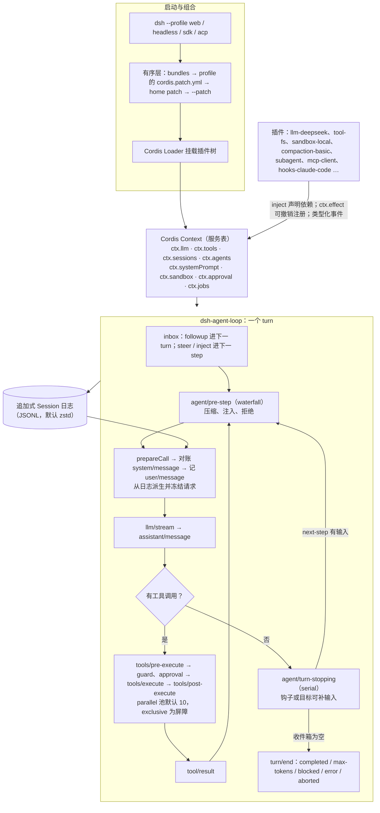

# DeepSeek Harness（dsh）源码调研，附 Qwen Code、Trae Agent、DeerFlow

调研日期 2026-10-31。dsh 的代码引用统一钉在 `dsh-v0.2.2-alpha.2`（`f3803c9`），其余三个仓库钉在各自默认分支 HEAD。本次只读：未安装、未构建、未运行，也未调用模型。所有来源内容均为转述。

## 一句话结论

dsh 是 DeepSeek 官方在 2026-08-13 公开的 MIT 开源 harness，目前仍是 v0.x 开发者预览。它的 loop、工具注册表、模型适配和会话日志都是 Cordis 插件，扩展全部通过类型化事件和可撤销注册完成。多 Agent 能力分四层：spawn/fork 子代理、外部 CLI 子代理、模型编写的 `workflow` 脚本、实验性 Agent Team（共享任务 DAG）。针对 DeepSeek 的适配集中在三处：按模型回放 thinking 签名，用历史内追加的提示更新和只增不删的工具变更保住前缀缓存，以及默认开启的会话日志上传。官方仓库没有长期记忆，第三方插件 `dsh-mnemon` 可以接入 Hindsight（本机环境细节未入库）。BENCHMARK.md 里没有任何分数。

## DeepSeek Harness 是什么

**官方身份**

- 仓库 `deepseek-ai/deepseek-harness`，默认分支 master，MIT 许可。GitHub 描述为 "Everything is a Plugin"，主页字段是 deepseek.com/harness，文档站在 deepseek-harness.github.io（[GitHub API][gh-dsh]、[README][d-readme]）。10-31 查询时星标数为 267,534。
- README 自称开发者预览，并提示会有不兼容变更 [d-readme]。SAFETY.md 说明项目未经安全审计，沙箱和审批不能保证隔离 [d-safety]。
- 仓库不接受外部 PR，Issues 已关闭（API 返回 `has_issues=false`），反馈走 Discussions 和 Discord，官方鼓励社区发布打 `dsh-plugin` 标签的第三方插件 [d-contrib]。
- README 引用的 Cordis 论文 arXiv 2608.25512 确实存在（v1 于 2026-08-26 提交，92 页，cs.PL）。论文用"可撤销 effect"保证组件卸载时副作用能完全回滚，用"响应式 coeffect"管理组件间依赖，Cordis 是它的实现 [paper]。

**核对第三方说法**（来源为 [digitalapplied 文章][da]，约 2026-08-14 发布）

| 说法 | 结论 | 依据 |
|---|---|---|
| 2026-08-13 发布 | 成立。仓库 `created_at` 为 2026-08-13T11:56:32Z；git 历史的首个提交是 2026-06-10（`b67e81a`），说明公开前已内部开发约两个月 | [GitHub API][gh-dsh]，本地完整克隆 |
| 与 DeepSeek-V4-Pro GA 同日 | 成立。DeepSeek 官方 API 更新日志 2026-08-13 条目宣布 V4-Pro GA | [API 更新日志][ds-updates] |
| MIT 许可 | 成立 | LICENSE、[GitHub API][gh-dsh] |
| v0.x 开发者预览 | 成立。35 个 Release 全部标为 prerelease，`releases/latest` 返回 404；Releases 列表中最早的是 `dsh-v0.1.0-rc.7`（2026-08-17） | [rc.7][rc7] |

**最新版本**

- 按发布时间最新：`dsh-v0.2.1-rc.5`，2026-10-30T02:12Z 发布，指向 `b830ec9`（提交于 2026-10-29），位于发布分支，只改进了思考内容的显示 [rc5]。
- 按版本号最新（主干线）：`dsh-v0.2.2-alpha.2`，2026-10-28T02:50Z 发布，提交 `f3803c96974ad4a94195fb97e5c637e9c2a3afe3`（2026-10-27T18:17Z）。它比 rc.5 多 2,161 个提交，本报告以它为准 [alpha2]。
- master 在 2026-10-29 为 `ce7073d`，比 alpha.2 又多 351 个提交。
- alpha.2 的新增内容包括：实验 `subagent_oar`（把任务交给本机 Codex 或 Claude CLI）、实验统计插件（按轮次和步骤查看上下文、缓存和耗时）、实验"变更请求与工作树"。修复包括：全局与项目 AGENTS.md 分开计预算；切换到更小上下文的模型前先压缩 [alpha2]。

**www.open-harness.net 不是官方站点**

- 官方 README 和仓库主页字段都没有指向它。它用第三人称介绍 dsh，自注"按 0.1.0-rc.6 核对"，内容已经过时：例如它说没有桌面应用，而仓库现在已有 `apps/desktop` [oh]。未找到它与 DeepSeek 的官方关联声明，本报告按第三方指南处理（官方关系未核实）。

**本机情况**：本机环境细节未入库。

## 总体结构

## 逐项对照

参比对象：

- **Qwen Code**：`main@835b080`，2026-11-01，最新 release 为 v0.26.5。README 说明它最初基于 Gemini CLI v0.8.2，从 Qwen Code v0.1 起停止同步上游，独立开发 [q-ack]。相对当时的 Gemini CLI，主要改动有：多协议接入（OpenAI、Anthropic、Gemini、Qwen API）和 Qwen OAuth；五档审批，其中 auto 档带分类器；子代理和 Agent Teams；Auto-Memory 和 Auto-Skills；cron、worktree、plan 工具；TS、Python、Java 三种 SDK；`qwen serve` 守护进程；IM 渠道 [q-why][q-modes]。当前 Gemini CLI 是否已有同类功能，由另一轮调研覆盖。
- **Trae Agent**：`main@e839e55`，2026-02-05。仓库没有 GitHub Release，最近约 9 个月无提交。
- **DeerFlow**：`main@35656d6`，2026-11-01，最新 release 为 v2.1.0。2.0 版改写为基于 LangGraph/LangChain 中间件的 "super agent harness" [f-readme]。

| ID | DeepSeek Harness（插件 / 永久链接） | Qwen Code | Trae Agent | DeerFlow |
|---|---|---|---|---|
| S01 Agent Loop | `dsh-agent-loop` 注册为 `ctx.agents` 的工厂。一个 turn 含 0 到 n 个 step；工具结果还欠模型一次请求、或 next-step 收件箱有输入时继续，否则经 `agent/turn-stopping` 后结束 [agent.ts#L327][d-turn]、[#L344][d-cont]；无内建 turn 预算 [README][d-loopreadme] | 沿用 Gemini CLI 的 turn 结构（未深入）；同一工具调用重复 5 次判定为死循环 [loopDetection][q-loop] | 按步数循环（示例配置 `max_steps: 200`），模型调用 `task_done` 即结束 [trae_agent.py][t-done]、[config][t-cfg] | LangGraph agent，外加约 50 个中间件组成的链 [agent.py#L485][f-mw]、[middlewares/][f-mwdir] |
| S02 Tool Use | `dsh-tools` 按 agent 作用域注册，每个 step 用 `resolve()` 得到工具集 [index.ts#L128][d-reg]。工具声明 parallel 或 exclusive：exclusive 调用作为屏障，其余进滚动池（默认 10），结果按模型给出的顺序写回 [batch.ts#L80][d-batch]、[contracts.ts#L209][d-mode]、[agent.ts#L588][d-par]。可换成 PTC 执行器，由模型写 `run_code` 程序调用工具 [PTC][d-ptc]；工具可声明 `deferLoading` [schema.ts#L500][d-defer] | `tools/` 下有大量内置工具，含 tool-search、code-mode [tools/][q-tools] | 6 类工具：编辑、bash、sequential_thinking、task_done、json_edit、ckg [tools.md][t-tools] | 沙箱工具、社区提供的搜索与抓取工具、MCP；另有延迟工具过滤中间件 [community/][f-community] |
| S03 Permission | 三层检查：`tools/pre-execute` 给出 allow/deny/ask；ask 时转 `ctx.approval` 一次性审批（ask/never，无人应答即拒）；之后再过单调 guard[pipeline.ts#L200][d-pipe]、[#L449][d-approve]、[guard][d-guard]。`permission-presets` 把沙箱模式和审批绑成三档，默认 workspace-write 加 ask [cordis.patch.yml#L240][d-perm]。实验 Auto review 由同一模型预审 [auto-review][d-auto] | 五档审批：plan、default、auto-edit、auto、yolo [approval-mode.ts][q-approval]；auto 档有安全工具白名单和分类器 [autoMode.ts][q-auto] | 无 | 本地沙箱默认禁止宿主 bash [config][f-sbxcfg]；guardrails provider [provider.py][f-guard]；README 提醒 Gateway 管理员权限等同可执行代码 [README][f-gwsec] |
| S04 Hooks | 事件本身就是钩子：`agent/*`、`tools/*`、`llm/stream` 是 waterfall（必须调 `next()` 才往下传），`agent/turn-stopping` 是 serial [architecture][d-events]、[primer][d-primer]。实验插件可直接读取 Claude Code 或 Codex 的 `hooks.json`，只执行 command 类钩子 [hook-protocol][d-hookp]、[hooks-claude-code][d-hookcc] | HookSystem，支持 command、http、function 三种钩子 [hookSystem.ts][q-hooks] | 无 | 中间件链就是扩展点 [agent.py#L485][f-mw] |
| S05 TodoWrite | `tool-todo` 提供 `todo_write`，每次整表替换，跨 turn 和重开会话保留；可配置是否允许多个任务同时进行中 [tool-todo][d-todo] | `todoWrite` 工具 [tools/][q-tools] | 无（只有 sequential_thinking）[tool][t-seq] | `TodoMiddleware`，继承 LangChain 的 TodoListMiddleware [todo_middleware.py][f-todo] |
| S06 Subagent | `dsh-subagent` 按提供者名分发：spawn、fork、ACP、DSH SDK、Codex、Claude Code。工具有 `subagent`、`subagent_fork` 和三个控制工具；`maxDepth` 限制委派深度 [subagent][d-sub]、[cordis.patch.yml#L359][d-subbase]、[manager.ts#L384][d-depth] | `SubagentManager`：在 `.qwen/agents` 下用 Markdown 加 frontmatter 定义子代理，另有内置代理和执行后端 [subagent-manager.ts][q-sub] | 无 | 内置 general_purpose 和 bash 两种子代理，并发上限 3，带批次、验收检查和报告契约 [executor.py#L2367][f-subconc]、[subagents/][f-subdir] |
| S07 Skill Loading | `dsh-skill` 注册表；`skill-filesystem` 扫描 `.dsh/skills`、`.agents/skills` 和用户级目录，并监视变更；`tool-skill` 在首个请求前把技能目录写入会话，用户可用 `/name` 调用 [index.ts#L256][d-skill]、[tool-skill][d-toolskill] | skill-manager、内置技能、Auto-Skills [skills/][q-skills]、[README][q-why] | 无 | `skills/` 含技能目录、安装器、安全扫描、审核和变更记录 [skills/][f-skills] |
| S08 Context Compact | `compaction-basic`：用量到窗口的 0.8 时触发，保留最近 0.16 的尾部。pre-step 时预防性压缩，上下文溢出报错后也会压缩并重试。先裁剪工具结果，不够再多发一次请求生成摘要；`/compact` 可手动触发 [config.ts#L20][d-compact]、[#L172][d-compact2]、[pruner][d-prune] | 默认 85% 触发，要求模型先写 `<analysis>`，再输出 `<state_snapshot>` [chatCompressionService.ts][q-compress] | 无 | summarization 中间件，任一触发条件满足即摘要，可指定便宜模型；支持手动压缩 [config][f-sum]、[README][f-compact] |
| S09 Memory | 官方没有长期记忆插件。相关能力只有 `session-query`，以及实验 session-search 提供的 5 个只读工具 [session-query][d-squery]、[session-search][d-ssearch]。Hindsight 经第三方 `dsh-mnemon` 接入 [mnemon] | Auto-Memory：每轮后提取，"dream" 整理，另有记忆管理和检索工具 [extract.ts][q-mem]、[manager.ts][q-memmgr] | 无 | 长期记忆，后端可选 deermem（默认）、mem0、honcho、openviking、noop；默认每轮后被动提取，并注入系统提示 [config][f-mem]、[backends/][f-membk] |
| S10 System Prompt | `system-prompt` 先按 order、再按名称排序拼接 section，有 persona 前后缀槽位，变量未解析时组装失败。提示以 `system/message` 写入历史 [system-prompt.md][d-sys]、[turn flow][d-turnflow] | `prompts.ts` 分层组装，含 QWEN.md 层级 [prompts.ts#L864][q-qwenmd] | 固定的提示文件 [agent_prompt.py][t-prompt] | lead agent 的提示，加上动态上下文和技能上下文中间件 [agent.py][f-mw] |
| S11 Error Recovery | `llm-retry` 默认重试 5 次，覆盖 EMPTY_RESPONSE、RATE_LIMIT、SERVER、TIMEOUT、TRANSPORT；退避从 500ms 指数增长到 10s，加 10% 抖动，遵守 Retry-After；always 模式不设上限 [README#L50][d-retry]、[index.ts#L212][d-retrysrc]。step 失败时给未回答的工具调用补结果 [agent.ts#L363][d-recover]；同一调用重复 3、5、8 次时提醒模型 [cordis.patch.yml#L443][d-repeat] | 循环保护、工具输出恢复 [tools/][q-tools] | LLM 客户端重试，示例配置 `max_retries: 10` [retry_utils.py][t-retry] | LLM 与工具的错误处理中间件，修复悬空的工具调用；同一调用 3 次警告、5 次强制停止 [loop_detection#L94][f-loop] |
| S12 Task System | 实验 agent-team 的任务 DAG：`blockedBy` 必须无环，`revision` 用于比较并交换，任务有 owner，`writeScopes` 重叠时告警 [agent-team.md][d-team]。另有 `workflow` 脚本编排 [workflow][d-wf] | task-create/list/update/stop，即团队任务板 [task-create.ts][q-task] | 无 | 子代理批次和委派台账，均持久化 [subagents/][f-subdir] |
| S13 Background Tasks | `jobs` 配合 `job_output`、`job_list`、`job_kill`。任务完成后，忙碌的 agent 在下一步收到通知，空闲的 agent 被唤醒；workflow 也可后台运行 [tool-jobs][d-jobs]、[tool-workflow][d-toolwf] | 后台任务、后台代理恢复、monitor 工具 [monitor.ts][q-monitor] | 无 | 子代理后台执行和取消 [executor.py#L2367][f-subconc] |
| S14 Cron Scheduler | `schedule` 支持一次性、固定频率、每日、每周和 cron，作为 follow-up 投回原会话。Host 重启后任务仍在，错过的只补最近一次 [schedule][d-sched] | cron-create/delete/list、loop-wakeup [cron-create.ts][q-cron]、[loop-wakeup.ts][q-wake] | 无 | Scheduled Tasks，可在对话中创建，可推送 IM 通知 [README#L3708][f-sched] |
| S15 Agent Teams | 实验 `agent-team`：一个 Lead 加具名队友，可直接发消息，可冷恢复队友，任务板持久化；每个成员拿到 9 个工具 [agent-team][d-teamsum]、[index.ts#L193][d-teamtools] | `TeamManager`、team-create/delete、team-plan-approval [TeamManager.ts][q-team] | 无 | 无（只有 Lead 加子代理的星型结构） |
| S16 Team Protocols | 消息投进目标 Agent 的 inbox；名册状态从 provisioning 到 active 或 failed；每个任务事件存完整快照并带 revision [agent-team.md][d-team] | 基于文件锁的 mailbox、asks 和任务板（未深入）[mailbox.ts][q-mailbox] | 无 | 子代理的报告契约和状态契约 [subagents/][f-subdir] |
| S17 Autonomous Agents | `goal-round-driver` 在 agent 空闲时继续推进目标，默认最多 256 轮 [index.ts#L240][d-goal]、[driver][d-goaldrv]；实验 ralph 每轮启动新的子 agent [ralph][d-ralph]；webhook 可新建会话 [webhook][d-webhook]，schedule 到期时可恢复冷会话 [schedule][d-sched]。未见自动认领任务的机制 | goals 运行时加 goal-verifier；cron 和 loop-wakeup 可自我唤醒 [goal-verifier.ts][q-goalv] | 无 | Session Goals、定时任务、IM 主动通知 [README#L2523][f-goals]、[#L3708][f-sched] |
| S18 Worktree Isolation | 实验 `worktree`：从本地提交建新分支并检出，在同一会话里继续，写入仍受沙箱约束 [worktree][d-wt] | enter-worktree / exit-worktree 工具 [enter-worktree.ts][q-wt] | 无 | 无（未见） |
| S19 MCP Tools | `mcp-client` 默认不启用任何服务器。工具名形如 `mcp__<server>__<tool>`，命名空间取本地配置；server instructions 写进系统提示；不支持 prompt 模板 [mcp-client][d-mcp]、[#L107][d-mcpns] | MCP 客户端管理、连接池、OAuth [tools/][q-tools] | MCP 工具，用 `allow_mcp_servers` 白名单 [mcp_tool.py][t-mcp]、[config][t-cfg] | MCP 路由中间件、OAuth token、MCP 任务 [mcp/][f-mcp] |
| S20 Comprehensive Agent | profile 由有序的 bundle 和 patch 组成；`dsh-base` 装配模型、工具、持久化、沙箱、审批、设置、凭据和遥测 [architecture#L13][d-profiles]；文档有一张"新功能挂在哪个扩展点"的对照表 [#L142][d-seams] | CLI 加 core，前端有 IDE、桌面、Web、SDK、IM [README][q-why] | 单进程 CLI agent，加评测脚本 [README][t-feat] | Gateway、Lead agent、中间件、沙箱、记忆和 IM 渠道 [README][f-readme] |
| E1 沙箱与系统隔离 | `sandbox-local`：Linux 依次尝试 bwrap 和 Landlock，macOS 用 Seatbelt，Windows 用 ACL 受限令牌。无法强制时报 `SANDBOX_UNAVAILABLE`，不会无约束运行；它与宿主共享内核 [index.ts#L2][d-sbx]、[sandbox][d-sbxsum]。`fs-sandbox` 约束文件写入 [fs-sandbox][d-fssbx]；被拒后可申请一个更宽的模式 [escalation.ts][d-esc] | `core/src/sandbox` 有 bwrap 和 Landlock 执行器 [sandbox/][q-sbx] | 可选 Docker 模式，命令默认超时 300s [docker_manager.py][t-docker] | `SandboxProvider` 抽象，实现有本地、AIO 容器、E2B、OpenSandbox [sandbox_provider.py][f-sbxprov]、[community/][f-community] |
| E2 编辑格式 | `tool-fs`：读取带行号，整文件原子替换，字面量编辑。`fs-observation-policy` 要求先读后改，并检测读后是否被改过；可选 `str_replace_editor` [tool-fs][d-fs]、[observation][d-obs] | edit、write-file、notebook-edit，并强制先读 [tools/][q-tools] | `str_replace_based_edit_tool`（view、create、str_replace、insert）和 `json_edit_tool` [tools.md][t-tools] | 先读后写中间件 [read_before_write][f-rbw] |
| E3 代码检索 | 内置 glob 和 grep，不依赖 rg，会包含被 ignore 的文件 [fs-search][d-search]；只读 `lsp` 工具支持定义、引用、实现和 hover [tool-lsp][d-lsp]；无 repo map | grep、ripGrep、glob、lsp 工具 [tools/][q-tools] | CKG：用 tree-sitter 解析代码，存进 SQLite 的代码知识图 [ckg_database.py][t-ckg] | 沙箱内搜索；RAGFlow 私有知识检索 [README][f-readme] |
| E4 持久化与撤销 | 追加式会话日志，JSONL 默认 zstd 压缩，有版本迁移；支持 resume，可按 turn 边界 fork。checkpoint 策略在模型请求和顶层工具执行前落盘，落盘失败就不执行 [log][d-log]、[jsonl][d-jsonl]、[checkpoint][d-ckpt]、[fork][d-fork]。没有一键撤销，`workspace-changes` 只保存每轮起止快照用于对比 [workspace-changes][d-wschg] | 文件历史和工作流检查点（未深入）[tools/][q-tools] | 只写轨迹 JSON，不能恢复会话 | 持久化层和 checkpoint 补丁（未深入）[README][f-readme] |
| E5 模型适配 | `llm-deepseek` 走 DeepSeek 的 Anthropic 兼容端点，回放 thinking 块和签名 [config.ts#L116][d-url]、[serialize.ts#L26][d-think]；`llm-pi-ai` 接入其他厂商和 OpenAI 兼容网关 [pi-ai][d-piai] | OpenAI 兼容生成器配各厂商适配，另有 Anthropic 生成器和 Qwen OAuth；转换器处理 `reasoning_content` [converter.ts][q-reason]、[qwenOAuth2.ts][q-oauth] | 7 类客户端：OpenAI、Anthropic、Azure、Doubao、Gemini、Ollama、OpenRouter [README][t-feat] | 多提供方模型配置，加内容兼容中间件 [middlewares/][f-mwdir] |
| E6 缓存与成本 | 包 README 的 Model Experience 一节通常写明它对 token 和 KV cache 的影响，由脚本检查，少数包豁免 [packages][d-pkgs]。flash 路由的系统提示在历史内追加，工具只增不删 [models.ts][d-models]；plan mode 不改动工具目录 [cordis.patch.yml#L332][d-plan]；`token-meter` 区分 cache read 和 cache write [turn-usage.ts][d-meter]；没有金额预算 | DashScope 请求加 `cache_control` 断点 [dashscope.ts][q-cache]；有会话 token 上限 | 无 | token 预算和用量中间件 [middlewares/][f-mwdir] |
| E7 工具输出 | `spill-policy` 单个结果内联最多 12,500 token，超出时给出头尾和完整结果的文件路径 [cordis.patch.yml#L407][d-spill]、[spill-policy][d-spillr]；压缩时再裁剪，原文留在日志里 [pruner][d-prune] | 结果保留、截断、输出恢复 [tools/][q-tools] | 无 | 工具输出落盘上限 64 MiB，落盘失败时回退为 30,000 字符 [tool_output_budget#L74][f-out] |
| E8 人工介入 | 三种输入：`followup`、`steer`、`inject` [agent.ts#L179][d-steer]；`ask_user_question` 可设时限 [ask-user][d-ask]；`/plan` 进入计划模式，`exit_plan_mode` 交审批 [plan-mode][d-plansum]；取消时保留已显示的文本 [agent.ts#L516][d-intr] | askUserQuestion、进入和退出 plan mode；followup 模块含建议生成和推测执行（未深入）[speculation.ts][q-spec] | 交互模式 [README][t-feat] | 澄清中间件、human_input、IM 渠道 [clarification][f-clar] |
| E9 完成判定与验证 | turn 以 completed、max-tokens、blocked、error、aborted 之一结束；`agent/turn-stopping` 可让 turn 继续 [agent.ts#L394][d-stop]。goal 有完成和阻塞状态；ralph 的报告不做独立验证 [ralph][d-ralph]；无内建验证器 | goal-verifier（请求体上限 256,000 字节）[goal-verifier.ts][q-goalv] | `task_done`；开启 `must_patch` 时，再检查去掉测试改动后的 git diff [trae_agent.py#L227][t-done] | 引用核验、子代理验收检查 [receipt_verification][f-receipt]、[acceptance_checks][f-acc] |
| E10 不可信内容与脱敏 | `web_fetch` 返回的纯文本附带"不可信内容"提示 [tool-web#L69][d-untrusted]；MCP 不信任远端自报的服务器名 [#L107][d-mcpns]；密钥遮罩只改界面显示 [secret-mask][d-mask]；默认把会话日志后缀上传到模型端点 [wire][d-wire] | web-fetch 预批准、MCP 分类器输入（未深入）[tools/][q-tools] | 无 | PII 脱敏，输入和工具结果清洗中间件 [pii_redaction][f-pii] |
| E11 观测与评测 | OTel 通道：只挂载不会发送任何数据 [otel][d-otel]；遥测默认 FEEDBACK_ONLY [cordis.patch.yml#L221][d-telemode]；Trajectory 面板 [ui-trajectory][d-traj]；可回放录制会话做测试 [llm-replay][d-replaytest]；BENCHMARK.md 没有分数 [BENCHMARK.md][d-bench] | SWE-bench Verified：七个版本的均值在 76.40% 到 77.80% 之间 [README][q-eval] | 轨迹记录，Lakeview 生成步骤摘要；SWE-bench 系列评测，Selector 做补丁集成 [trajectory_recorder.py][t-traj]、[lake_view.py][t-lake]、[evaluation][t-eval]、[selector][t-sel] | LangSmith、Langfuse、Monocle 追踪 [README#L1530][f-trace] |
| E12 运行形态 | profile 有 web、headless、sdk、sdk-minimal、acp；另有 Electron 桌面应用和 TS、Python SDK [architecture#L41][d-launch]；headless 支持 `--json` 和 `--session-id` [headless][d-headless]；ACP 服务器 [acp][d-acp] | 交互 CLI、`qwen -p`、TS/Python/Java SDK、实验 `qwen serve`（HTTP+SSE，即 ACP）、IDE 插件、IM [README#L105][q-modes]、[channels/][q-channels] | CLI 的 run 和 interactive 两种模式 [README][t-feat] | Web UI、Gateway、IM 渠道、嵌入式 Python 客户端、TUI [channels/][f-channels]、[README#L3497][f-pyclient]、[#L3920][f-tui] |
| E13 项目说明与配置层 | `agent-instructions` 读取用户全局和项目的 AGENTS.md 或 CLAUDE.md，两条链各有 64 KiB 预算 [config.ts#L12][d-instr]、[cordis.patch.yml#L303][d-instrbase]；配置分层为 bundle、profile patch、home patch、`--patch` [architecture#L13][d-profiles] | QWEN.md 层级 [prompts.ts#L864][q-qwenmd] | YAML 配置加环境变量 [config][t-cfg] | config.yaml、extensions_config.json；Projects 的项目说明 [README#L3617][f-proj] |

## dsh 重点机制详述

### 1. 插件架构：Cordis 上的"一切皆插件"

- 插件可以是带可选 `inject` 和 `apply(ctx)` 的函数或对象，也可以是 `Service` 子类。服务在上下文里占一个固定键（`ctx.tools`、`ctx.llm`、`ctx.sessions`），别的插件按键取用，不直接 import 具体实现 [primer][d-primer]。
- `inject` 声明依赖，依赖的服务出现后插件才激活。加载顺序因此由依赖关系决定，不需要手写启动顺序 [primer][d-primer]。
- 事件类型用 TypeScript 声明合并定义，派发方式是事件契约的一部分：
  - `emit`：只通知观察者。
  - `waterfall`：中间件式，监听者调 `next()` 才往下传，不调就短路。
  - `parallel`、`serial`、`bail`：并行执行、按序执行、遇到第一个返回值即停 [primer][d-primer]。
- 所有注册都是可撤销的 effect。提示 section、工具 schema、适配器、监听器都经 `ctx.effect()` 或 `ctx.on()` 安装，插件卸载或热重载时按序回滚。这就是论文中"可撤销 effect"的落地 [paper]。
- loop 本身也是插件。`dsh-agent-loop` 把自己注册为 `ctx.agents` 的工厂；扩展插件只依赖服务定义，不依赖具体实现，所以 loop 可以整体替换 [packages][d-pkgs]、[README][d-loopreadme]。
- 组合方式：
  - profile 是具名组合，列出若干 bundle；bundle 是一组 Cordis 配置行加对应代码。
  - 启动时依次叠加：bundle、profile 的 `cordis.patch.yml`、home patch、`--patch`。patch 按 id 替换整行，或插入新行。
  - `dsh --profile web --dump-config` 可打印实际挂载的插件树 [architecture][d-profiles]。
- seam（能力缝）由三种角色组成：服务定义、提供者、消费者。文件系统和子进程提供者共享同一个执行环境，换成远端沙箱时 Bash、PTY、LSP 会一起迁移 [architecture][d-seam]。用 `agent.ctx` 可以只给某一个 agent 注册能力；preset 用普通 Cordis YAML 声明某个 agent 的子插件 [architecture][d-seams]、[agent-preset][d-preset]。

### 2. Agent loop 的继续与停止条件

- 收件箱有三种输入：`followup` 进入下一个 turn；`steer` 进入下一个 step 并唤醒 agent；`inject` 进入下一个 step 但不唤醒 [agent.ts#L179][d-steer]。
- 每个 step 开始前做 pre-step：认领输入，解析本步工具集，组装系统提示，然后跑 `agent/pre-step` waterfall。监听者可以接受、改写或拒绝 [agent.ts#L283][d-prestep]。拒绝时 turn 记为 `blocked` 并结束；第一个批次为空时记为 `completed`，不发模型请求 [agent.ts#L344][d-cont]。
- step 内的顺序：`step/start`；`agent/request`（已弃用）；`prepareCall()` 绑定适配器；对账 `system/message`；写 `user/message`；必要时写 `request/header` 和 `request/context`；从日志派生请求并冻结；流式调用；写 `assistant/message`；执行工具批次；写 `step/end` [turn flow][d-turnflow]。
- 继续条件有两个：本步返回 `null`（工具结果还欠模型一次请求），或 next-step 收件箱有新输入 [agent.ts#L344][d-cont]。
- 停止条件：本步给出了结束原因，且 next-step 收件箱为空。此时先 serial 调用 `agent/turn-stopping`，钩子桥或目标驱动可以在这里补一条输入，让 turn 继续；补完仍为空才退出循环。出现过一次 `max-tokens`，turn 的结局就固定为 `max-tokens` [agent.ts#L394][d-stop]。
- turn 结束时写 `turn/end`，原因是 completed、max-tokens、blocked、error、aborted 之一。如果队列里还有 followup，立刻开始下一个 turn [agent.ts#L327][d-turn]。
- 失败处理：
  - 模型请求失败时进入 `agent/request-error` waterfall。监听者返回 retry，就在同一 step 内重试，不重新组装提示，也不重复写入用户消息 [agent.ts#L549][d-reqerr]。
  - 取消时，已经显示给用户的文本会被记为 `interrupted` 锚点，下一次请求能看到它 [agent.ts#L516][d-intr]。
  - step 失败时，给每个还没有结果的工具调用补一条结果。已记录开始的调用标为"结果未知"，提示模型只能重试只读或幂等的操作；还没开始的调用标为"未开始" [agent.ts#L363][d-recover]、[README][d-loopreadme]。
- 没有内建的 turn 预算。需要限制失控的 turn 时，只能自己在 `agent/turn-stopping` 等扩展点上取消 [README][d-loopreadme]。

### 3. 权限与沙箱

- 工具管线按以下顺序执行 [pipeline][d-pipedoc]、[pipeline.ts#L200][d-pipe]、[#L449][d-approve]、[#L488][d-post]、[guard][d-guard]：
  1. 执行前先把 `tool/call` 写进日志。
  2. `tools/pre-execute` waterfall 处理钩子、权限和沙箱；结果为 ask 时转给 `ctx.approval`。
  3. 单调 guard 只能拒绝或弃权，不能放行已被拒绝的调用。
  4. `tools/execute` waterfall 包住工具本体，负责超时、重试和指标；工具内的文件写入还要经过 `fs/write-intent` 或 `fs/edit-intent`。
  5. 依次执行 `tools/post-execute` 和 `finalizeContent`，最后发出不可变的 `tools/result`，并写入 `tool/result`。
- 审批：`ask` 把请求发给人或机器应答者，`never` 直接拒绝。没有应答者或应答失败时返回 `unavailable`，按拒绝处理。一次批准只对当次请求有效，请求和结果都写入审计日志 [user-approval][d-approval]。
- 沙箱有三档：`read-only`、`workspace-write`、`danger-full-access`。无法强制执行时报 `SANDBOX_UNAVAILABLE`，不会无约束地运行。调用被拒后，模型可以申请一个更宽的模式（从 read-only 可申请另外两档，从 workspace-write 只能申请 danger-full-access），需要人批准 [sandbox][d-sbxsum]、[escalation.ts][d-esc]。
- 本机后端：Linux 先试 bwrap 再试 Landlock，macOS 用 Seatbelt，Windows 用 ACL 受限令牌；每次执行都报告是完全还是部分强制 [index.ts#L2][d-sbx]、[sandbox-local][d-sbxlocal]。这只是同机约束，进程仍与宿主共享内核和文件系统；官方建议需要完整隔离时用容器、microVM 或远端执行器 [sandbox][d-sbxsum]、[SAFETY][d-safety]。
- 默认值：`DSH_PERMISSION_MODE` 未设置时为 workspace-write，审批为 ask。三个预设分别是 read-only 加 ask、workspace-write 加 ask、danger-full-access 加 never [cordis.patch.yml#L240][d-perm]。
- 文件层：`fs-sandbox` 在 workspace-write 下只允许写工作区和临时目录 [fs-sandbox][d-fssbx]。`fs-observation-policy` 要求先读后改，文件读后被改过就拒绝写入。读取记录不持久化，所以恢复会话后要重新读 [observation][d-obs]。
- 实验 Auto review：每次工具调用前由当前模型审查，审查通过就以 Full access 执行，不通过就问用户。它会多花 token，也可能放行不安全的操作 [auto-review][d-auto]。

### 4. 上下文、压缩与记忆

- 日志即上下文。会话日志是模型所见内容的唯一来源，原则是"模型可见即已记录"：任何新的模型输入都必须是会话事件 [architecture][d-log]。压缩用替换节点遮蔽旧消息，原文不删 [session][d-session]。
- `compaction-basic` 默认在用量达到窗口的 0.8 时触发，保留消息预算（窗口减去预留输出）的 0.16 作为尾部，两个比例都可以按模型覆盖 [config.ts#L20][d-compact]、[#L172][d-compact2]。
  - 触发来源有两个：pre-step 时的用量检测，以及上下文溢出错误。
  - 触发后先跑工具结果裁剪器，保留头尾，中间加标记；仍然不够时才多发一次模型请求生成摘要，只保留摘要文本 [lifecycle][d-lifecycle]、[pruner][d-prune]。
  - 压缩无法缩减系统提示、工具 schema，也无法拆分单个超大的不可分单元 [compaction-basic][d-compactsum]。
- 图片卸载：旧图片超出路由预算时，替换为写有附件路径的文本，这次重试不占用重试预算 [image-offload][d-imgoff]。切换到更小上下文的模型前，先用原模型压缩，压缩失败就放弃切换 [alpha2]。
- 项目说明：读取 AGENTS.md 和 CLAUDE.md，单个文件上限 1 MiB；全局链和项目链各有 64 KiB 预算，超出时先丢较外层的文件，再截断最内层的文件 [config.ts#L12][d-instr]、[agent-instructions][d-instrsum]、[cordis.patch.yml#L303][d-instrbase]。
- 记忆：在 alpha.2 源码中搜索 hindsight 和 mnemon，均无结果，即官方没有长期记忆插件。相关能力只有：会话检索服务 `dsh-session-query`（可选 SQLite 全文检索后端）[session-query][d-squery]、实验 session-search 的 5 个只读工具 [session-search][d-ssearch]，以及跨 turn 持久的 todo 和 goal。
- 第三方 dsh-mnemon 自称为 dsh 提供可组合的上下文视图、分层记忆和自我演化的技能 [mnemon]。它的 Hindsight provider 是"记忆空间"下的子模块，凭据留在 Host 上 [mnemon-hs]。本机环境细节未入库。

### 5. 子代理与多 Agent

- 子代理按提供者分发 [subagent][d-sub]、[spawn][d-spawn]、[fork][d-forksum]：
  - `spawn`：全新的子 agent，继承工作目录、模型和思考强度，所以任务描述必须能独立看懂。
  - `fork`：以父会话已完成的 turn 为种子，看不到进行中的 turn；fork 之后父会话的更新不会同步过去。
  - 外部后端：ACP、DSH SDK、Codex、Claude Code。
- 本地子 agent 的会话会持久化，之后还能继续发消息。外部后端只运行一次，只返回最终答案，中间过程不进入父会话 [subagent][d-sub]、[claude-code][d-cc]。
- base bundle 挂了两份 `tool-subagent`：`subagent`（spawn）和 `subagent_fork`（fork）。配置注释写明，fork 工具不提供选择模型的参数，以便复用父会话的 KV cache。`tool-subagent-control` 提供发消息、中断、列出可继续子代理三个工具；`maxDepth` 限制委派深度 [cordis.patch.yml#L359][d-subbase]、[manager.ts#L384][d-depth]。子代理完成后以会话内通知送达，不需要轮询 [tool-subagent][d-toolsub]。运行中的子 agent 不能调用 `ask_user_question` [ask-user][d-ask]。
- `workflow` 工具让模型写一段 JavaScript，用 `agent()`、`parallel()`、`pipeline()`、`phase()`、`log()` 把任务分发给多个子代理，最后返回一个 JSON 值。工具说明要求只在用户明确要求时使用；一两次委派用普通子代理即可。它支持 `run_in_background`，此时立即返回一个 job id [workflow][d-wf]、[tool-workflow][d-toolwf]。
- 实验 Agent Team [agent-team][d-teamsum]、[agent-team.md][d-team]、[index.ts#L193][d-teamtools]：
  - 一个 Lead 加若干具名队友。消息直接进入目标 Agent 的 inbox，存储中的队友可以冷恢复。名册和任务板持久化，要求有持久会话存储。
  - 任务板是 DAG：每次变更存完整快照；`revision` 用于比较并交换；`blockedBy` 必须无环；`in_progress` 状态必须有 owner；`writeScopes` 重叠时告警。
  - 每个成员拿到同样的 9 个工具：spawn_teammate、send_message、list_agents、wait_agent、interrupt_agent，以及 team_task_create、list、get、update。
- 长任务：`goal` 跨 turn、resume 和 fork 持久，默认最多自动续跑 256 轮，阻塞时记录策略码 [index.ts#L240][d-goal]、[goal][d-goalsum]。实验 `ralph` 每轮启动一个新的子 agent，只传入上一轮有界的报告和共享工作区，报告不做独立验证 [ralph][d-ralph]。
- 横向对比：Qwen Code 的团队有文件锁 mailbox、任务板和计划审批工具 [TeamManager.ts][q-team]。DeerFlow 是 Lead 加子代理的星型结构，子代理并发上限 3，配有批次验收检查和报告契约 [executor.py#L2367][f-subconc]、[subagents/][f-subdir]。

### 6. 面向 DeepSeek 模型的适配

- 端点与格式：默认端点是 `https://api.deepseek.com/anthropic`，会自动补上 `/v1`，按 Anthropic Messages 格式发流式请求 [config.ts#L116][d-url]、[messages-api.ts][d-msgapi]。
- 模型目录：`deepseek-flash`（DeepSeek-V4.1-Flash）和 `deepseek-v4-pro`，上下文窗口都写为 1,048,576。flash 声明系统提示可在历史内追加、工具只增不删 [models.ts][d-models]。
- 思考与工具调用 [serialize.ts#L26][d-think]、[replay.ts][d-replay]、[serialize.ts#L131][d-pair]：
  - 历史里的 reasoning 块序列化为 `thinking` 块传回模型。
  - 签名只在同一模型时回放。换了模型就丢弃签名，但保留思考文本。
  - 发送前校验 `tool_use` 与 `tool_result` 一一对应，且结果紧跟在调用之后，否则拒绝发送。
- 思考强度有 `off`、`low`、`high`、`max` 四档，默认 high。部署关闭思考时只能用 off。off 时请求里发 `thinking: disabled`，其他档发 `thinking: enabled` 加 `output_config.effort` [serialize.ts#L147][d-effort]。loop 在每个 step 开始时快照 provider、model 和思考强度，重试沿用快照。`agent/request` 钩子若试图改动这三项，该 step 会被拒绝；用户新记录的选择从下一个 step 起生效 [README][d-loopreadme]。
- 前缀缓存：包 README 的 Model Experience 一节通常含 "KV Cache effect" 小节，少数包豁免 [packages][d-pkgs]。
  - 在支持的路由上，系统提示的变更追加到历史末尾，不改写开头的节点；工具变化以 `tool_addition` 或 `tool_removal` 系统消息表达 [serialize.ts#L85][d-inhist]、[README][d-loopreadme]。
  - plan mode 刻意不改工具目录，配置注释写明理由是请求缓存稳定 [cordis.patch.yml#L332][d-plan]。
  - 压缩会让缓存从第一个被遮蔽的 token 起失效。
- 成本：`token-meter` 重放日志来估算请求大小和上下文压力，不调用模型；用量分为未缓存输入、cache read、cache write 和 reasoning token [turn-usage.ts][d-meter]、[token-meter][d-metersum]。没有金额预算。always 模式的重试没有上限，而每次重试都计费 [llm-retry][d-retry]。
- 额外上传的数据 [headers][d-wirehdr]、[wire][d-wire]、[index.ts#L53][d-logmax]、[exposure][d-wireexp]、[cordis.patch.yml#L43][d-logbase]：
  - 每个请求带 `user-agent`、匿名的 `x-deepseek-harness-user-id` 和会话 id；压缩请求还带 `x-deepseek-harness-compact: 1`。
  - 请求体额外带 `dsh_plugin_packages`（已启用的插件包清单）和 `dsh_session_log`（会话日志的一段连续后缀，单次最多 8 MiB）。
  - `dsh_session_log` 可能包含工作目录、系统提示、用户和助手内容、工具参数和结果，也会发给配置的网关。base bundle 默认挂载它。

### 7. 评测

- BENCHMARK.md 只有两句话：按 Python SDK 指南安装，运行 `jsonrpc-agent` 的 minimal 变体；独立任务要用独立的工作区和会话 id。文件里没有任何分数 [BENCHMARK.md][d-bench]。
- `benchmarks/` 目录是仓库级的性能门禁，测的是会话打开、长会话浏览、终端 IO 等，不评测模型准确率 [benchmarks][d-benchdir]。
- 分数发布在 DeepSeek 官方 API 更新日志 [ds-updates]：
  - 2026-07-31 的 V4-Flash 条目注明，代码 agent 任务用 "DeepSeek Harness minimal mode" 测试，max 强度，top_p 0.95，temperature 1.0。结果：Terminal Bench 2.1 为 82.7，NL2Repo 54.2，DeepSWE 54.4，Toolathlon Verified 70.3。
  - 2026-08-13 的 V4-Pro GA 条目：Terminal Bench 2.1 为 87.9，NL2Repo 61.5，DeepSWE 62.7，Toolathlon-Verified 74.1。该条目是否同样用 dsh minimal 模式，所取摘录中没有说明（未核实）。
  - "minimal mode" 是否就是 `sdk-minimal` profile（未核实）。
- 第三方指南称，V4-Pro 换用参考 harness Terminus 2 后只得 54.68，出处是 HN 讨论（未核实）[oh]。如属实，同一模型的分数会随 harness 大幅变化。

## 对自建 harness 的启示

以下针对用 DeepSeek 模型的 Native Coding v3。DevFlow 自身代码由另一轮审计，这里只说参考做法。

1. **日志作为唯一事实来源。** 每次模型请求都应能从追加式会话日志重建；resume、fork、遥测、压缩和回放都从同一份记录派生。dsh 把"模型可见即已记录"当作硬约束 [architecture][d-log]。
2. **把 turn 和 step 做成显式状态机，并记录结束原因。** 至少区分 completed、max-tokens、blocked、error、aborted。在"准备停止"处留一个串行检查点，让验证器、目标或钩子决定是否继续 [agent.ts#L344][d-cont]。同时补上 dsh 没有的 turn 预算（步数、token、金额）[README][d-loopreadme]。
3. **按并行安全性调度工具。** 工具自己声明 parallel 或 exclusive：exclusive 调用作为屏障，其余进入有界池，结果按模型给出的顺序写回 [batch.ts#L80][d-batch]。step 失败时给每个未回答的调用补"结果未知"，并在结果文字里提醒模型：有副作用的操作要先检查外部状态 [agent.ts#L363][d-recover]。
4. **权限做成"沙箱模式 × 审批策略"的少量预设。** 沙箱不可用时直接失败，不降级运行；被拒后只能申请一个更宽的模式，并经人批准；文件编辑要求先读后改，并检测读后是否被改过 [cordis.patch.yml#L240][d-perm]、[escalation.ts][d-esc]、[observation][d-obs]。
5. **按 DeepSeek 前缀缓存来设计提示。** 系统提示和工具目录保持字节稳定；提示变化追加到历史末尾；工具只增不删；模式切换（如 plan mode）不改工具目录。压缩会让缓存失效，所以阈值要高（dsh 用 0.8），并先裁剪工具输出再做摘要 [models.ts][d-models]、[cordis.patch.yml#L332][d-plan]、[config.ts#L20][d-compact]。
6. **思考内容随助手消息一起持久化，并按模型回放。** 记录产生它的 provider 和 model；同一模型时回放签名，换模型时丢弃签名。每个 step 开始时快照模型和思考强度，step 内不允许改变 [serialize.ts#L26][d-think]、[replay.ts][d-replay]。如果 v3 走 OpenAI 兼容格式，需要按 DeepSeek 文档回传 reasoning content，这部分由另一轮调研覆盖。
7. **超大的工具输出写入文件。** 给单个结果设内联上限（dsh 为 12,500 token），超出部分只返回头尾和完整结果的路径。压缩时的裁剪只改变模型看到的内容，原文留在日志里 [cordis.patch.yml#L407][d-spill]、[pruner][d-prune]。
8. **多 Agent 编排分层提供，不要写死成固定流程。** 可以照 dsh 的四层来做：
   - spawn 和 fork 两种子代理，fork 以父会话已完成的 turn 为种子。
   - 外部 CLI 作为同一接口下的提供者。
   - 由模型编写编排脚本（agent、parallel、pipeline、phase），处理确定性的任务分发。
   - 团队模式：持久化的名册、inbox 消息、带比较并交换和依赖边的任务 DAG，以及写入范围冲突提示 [subagent][d-sub]、[workflow][d-wf]、[agent-team.md][d-team]。

   再加上委派深度上限和完成通知，避免轮询 [manager.ts#L384][d-depth]、[tool-subagent][d-toolsub]。DeerFlow 的并发上限和验收检查、Qwen Code 的计划审批可以作为补充 [executor.py#L2367][f-subconc]、[TeamManager.ts][q-team]。
9. **评测要能复现。** dsh 回放录制的会话 JSONL 来做确定性测试，不需要 API key [llm-replay][d-replaytest]。Trae 记录每一步的 LLM 交互和工具调用，并用 Lakeview 生成步骤摘要 [trajectory_recorder.py][t-traj]、[lake_view.py][t-lake]。报告分数时要写明 harness 模式、思考强度、top_p 和 temperature，像 DeepSeek 更新日志那样 [ds-updates]。
10. **向外发送数据默认关闭，并写进文档。** dsh 默认把会话日志后缀和插件清单随请求发给模型端点 [wire][d-wire]、[cordis.patch.yml#L43][d-logbase]；它的密钥遮罩也只改界面显示，模型收到的仍是原文 [secret-mask][d-mask]。自建 harness 如有类似的上传或遥测，应默认关闭，并在发送前对密钥脱敏。

## 来源

所有内容均为转述，以符合许可限制（Content was rephrased for compliance with licensing restrictions）。正文链接都是下列提交上的永久链接。

| 仓库 | 版本 / 分支 | SHA | 日期 | 许可 |
|---|---|---|---|---|
| [deepseek-ai/deepseek-harness](https://github.com/deepseek-ai/deepseek-harness) | `dsh-v0.2.2-alpha.2`（本报告基准） | `f3803c96974ad4a94195fb97e5c637e9c2a3afe3` | 提交 2026-10-27T18:17:58Z，发布 2026-10-28T02:50:54Z | MIT |
| 同上 | `dsh-v0.2.1-rc.5`（按发布时间最新） | `b830ec950faba0a46dda564be3e2d854afed94f1` | 提交 2026-10-29T13:01:28Z，发布 2026-10-30T02:12:26Z | MIT |
| 同上 | master（参考） | `ce7073d51254c26cd63b22a60835b8f948deb447` | 2026-10-29T16:13:15Z | MIT |
| [QwenLM/qwen-code](https://github.com/QwenLM/qwen-code) | main（最新 release v0.26.5，2026-11-01） | `835b080f8567d8612effa248e1fafa11af0e244b` | 2026-11-01T10:50:41+08:00 | Apache-2.0 |
| [bytedance/trae-agent](https://github.com/bytedance/trae-agent) | main（无 GitHub Release） | `e839e559ac61bdd0e057c375dd1dee391fee797d` | 2026-02-05T19:21:00+08:00 | MIT |
| [bytedance/deer-flow](https://github.com/bytedance/deer-flow) | main（最新 release v2.1.0，2026-09-24） | `35656d6a9fe2ac76ddcf40335ede7361504ddf5b` | 2026-11-01T08:08:08+08:00 | MIT |
| [omdsh-dev/dsh-mnemon](https://github.com/omdsh-dev/dsh-mnemon)（第三方） | main | `7cbdefc64c019a073cfdb493b0b516b5b7177bb6` | 2026-10-29T10:25:49Z | MIT |

其他来源（访问日期均为 2026-10-31）：

- DeepSeek API 更新日志：https://api-docs.deepseek.com/updates （V4-Pro GA 条目日期为 2026-08-13；V4-Flash 条目为 2026-07-31）
- Cordis 论文：https://arxiv.org/abs/2608.25512 （v1，2026-08-26）
- dsh Release 说明：[alpha.2][alpha2]、[rc.5][rc5]、[rc.7][rc7]（2026-08-17）
- 第三方：[open-harness.net][oh]（非官方指南）；[digitalapplied 文章][da]（约 2026-08-14）
- Hindsight 镜像来源：https://github.com/vectorize-io/hindsight （取自镜像 label）
- 本机环境细节未入库。

[gh-dsh]: https://api.github.com/repos/deepseek-ai/deepseek-harness
[alpha2]: https://github.com/deepseek-ai/deepseek-harness/releases/tag/dsh-v0.2.2-alpha.2
[rc5]: https://github.com/deepseek-ai/deepseek-harness/releases/tag/dsh-v0.2.1-rc.5
[rc7]: https://github.com/deepseek-ai/deepseek-harness/releases/tag/dsh-v0.1.0-rc.7
[paper]: https://arxiv.org/abs/2608.25512
[ds-updates]: https://api-docs.deepseek.com/updates
[oh]: https://www.open-harness.net/
[da]: https://www.digitalapplied.com/blog/deepseek-harness-open-source-agent-framework-2026
[hindsight]: https://github.com/vectorize-io/hindsight
[mnemon]: https://github.com/omdsh-dev/dsh-mnemon
[mnemon-hs]: https://github.com/omdsh-dev/dsh-mnemon/blob/7cbdefc64c019a073cfdb493b0b516b5b7177bb6/plugins/dsh-mnemon-provider-hindsight/README.md
[d-readme]: https://github.com/deepseek-ai/deepseek-harness/blob/f3803c96974ad4a94195fb97e5c637e9c2a3afe3/README.md?plain=1#L5-L13
[d-safety]: https://github.com/deepseek-ai/deepseek-harness/blob/f3803c96974ad4a94195fb97e5c637e9c2a3afe3/SAFETY.md?plain=1#L5-L15
[d-contrib]: https://github.com/deepseek-ai/deepseek-harness/blob/f3803c96974ad4a94195fb97e5c637e9c2a3afe3/CONTRIBUTING.md?plain=1
[d-primer]: https://github.com/deepseek-ai/deepseek-harness/blob/f3803c96974ad4a94195fb97e5c637e9c2a3afe3/docs/cordis-primer.md?plain=1#L7-L27
[d-profiles]: https://github.com/deepseek-ai/deepseek-harness/blob/f3803c96974ad4a94195fb97e5c637e9c2a3afe3/docs/architecture.md?plain=1#L13-L39
[d-launch]: https://github.com/deepseek-ai/deepseek-harness/blob/f3803c96974ad4a94195fb97e5c637e9c2a3afe3/docs/architecture.md?plain=1#L41-L53
[d-events]: https://github.com/deepseek-ai/deepseek-harness/blob/f3803c96974ad4a94195fb97e5c637e9c2a3afe3/docs/architecture.md?plain=1#L67-L77
[d-turnflow]: https://github.com/deepseek-ai/deepseek-harness/blob/f3803c96974ad4a94195fb97e5c637e9c2a3afe3/docs/architecture.md?plain=1#L79-L120
[d-log]: https://github.com/deepseek-ai/deepseek-harness/blob/f3803c96974ad4a94195fb97e5c637e9c2a3afe3/docs/architecture.md?plain=1#L122-L132
[d-seam]: https://github.com/deepseek-ai/deepseek-harness/blob/f3803c96974ad4a94195fb97e5c637e9c2a3afe3/docs/architecture.md?plain=1#L134-L140
[d-seams]: https://github.com/deepseek-ai/deepseek-harness/blob/f3803c96974ad4a94195fb97e5c637e9c2a3afe3/docs/architecture.md?plain=1#L142-L170
[d-fork]: https://github.com/deepseek-ai/deepseek-harness/blob/f3803c96974ad4a94195fb97e5c637e9c2a3afe3/docs/architecture.md?plain=1#L165
[d-pkgs]: https://github.com/deepseek-ai/deepseek-harness/blob/f3803c96974ad4a94195fb97e5c637e9c2a3afe3/packages/README.md?plain=1
[d-lifecycle]: https://github.com/deepseek-ai/deepseek-harness/blob/f3803c96974ad4a94195fb97e5c637e9c2a3afe3/docs/agent-lifecycle.md?plain=1#L86-L93
[d-pipedoc]: https://github.com/deepseek-ai/deepseek-harness/blob/f3803c96974ad4a94195fb97e5c637e9c2a3afe3/docs/tool-execution-pipeline.md?plain=1#L6
[d-sys]: https://github.com/deepseek-ai/deepseek-harness/blob/f3803c96974ad4a94195fb97e5c637e9c2a3afe3/docs/subsystems/system-prompt.md?plain=1#L40-L52
[d-team]: https://github.com/deepseek-ai/deepseek-harness/blob/f3803c96974ad4a94195fb97e5c637e9c2a3afe3/docs/subsystems/agent-team.md?plain=1#L7-L74
[d-wirehdr]: https://github.com/deepseek-ai/deepseek-harness/blob/f3803c96974ad4a94195fb97e5c637e9c2a3afe3/docs/deepseek-llm-api-wire-extensions.md?plain=1#L22-L31
[d-wire]: https://github.com/deepseek-ai/deepseek-harness/blob/f3803c96974ad4a94195fb97e5c637e9c2a3afe3/docs/deepseek-llm-api-wire-extensions.md?plain=1#L74-L118
[d-wireexp]: https://github.com/deepseek-ai/deepseek-harness/blob/f3803c96974ad4a94195fb97e5c637e9c2a3afe3/docs/deepseek-llm-api-wire-extensions.md?plain=1#L158-L162
[d-bench]: https://github.com/deepseek-ai/deepseek-harness/blob/f3803c96974ad4a94195fb97e5c637e9c2a3afe3/BENCHMARK.md?plain=1#L1-L3
[d-benchdir]: https://github.com/deepseek-ai/deepseek-harness/blob/f3803c96974ad4a94195fb97e5c637e9c2a3afe3/benchmarks/AGENTS.md?plain=1#L1-L6
[d-turn]: https://github.com/deepseek-ai/deepseek-harness/blob/f3803c96974ad4a94195fb97e5c637e9c2a3afe3/packages/core/agent-loop/src/agent.ts#L327-L433
[d-cont]: https://github.com/deepseek-ai/deepseek-harness/blob/f3803c96974ad4a94195fb97e5c637e9c2a3afe3/packages/core/agent-loop/src/agent.ts#L344-L400
[d-prestep]: https://github.com/deepseek-ai/deepseek-harness/blob/f3803c96974ad4a94195fb97e5c637e9c2a3afe3/packages/core/agent-loop/src/agent.ts#L283-L317
[d-steer]: https://github.com/deepseek-ai/deepseek-harness/blob/f3803c96974ad4a94195fb97e5c637e9c2a3afe3/packages/core/agent-loop/src/agent.ts#L179-L187
[d-recover]: https://github.com/deepseek-ai/deepseek-harness/blob/f3803c96974ad4a94195fb97e5c637e9c2a3afe3/packages/core/agent-loop/src/agent.ts#L363-L385
[d-stop]: https://github.com/deepseek-ai/deepseek-harness/blob/f3803c96974ad4a94195fb97e5c637e9c2a3afe3/packages/core/agent-loop/src/agent.ts#L394-L399
[d-intr]: https://github.com/deepseek-ai/deepseek-harness/blob/f3803c96974ad4a94195fb97e5c637e9c2a3afe3/packages/core/agent-loop/src/agent.ts#L516
[d-reqerr]: https://github.com/deepseek-ai/deepseek-harness/blob/f3803c96974ad4a94195fb97e5c637e9c2a3afe3/packages/core/agent-loop/src/agent.ts#L549
[d-par]: https://github.com/deepseek-ai/deepseek-harness/blob/f3803c96974ad4a94195fb97e5c637e9c2a3afe3/packages/core/agent-loop/src/agent.ts#L588-L592
[d-loopreadme]: https://github.com/deepseek-ai/deepseek-harness/blob/f3803c96974ad4a94195fb97e5c637e9c2a3afe3/packages/core/agent-loop/README.md?plain=1
[d-reg]: https://github.com/deepseek-ai/deepseek-harness/blob/f3803c96974ad4a94195fb97e5c637e9c2a3afe3/packages/core/tools/src/index.ts#L128
[d-guard]: https://github.com/deepseek-ai/deepseek-harness/blob/f3803c96974ad4a94195fb97e5c637e9c2a3afe3/packages/core/tools/src/index.ts#L384-L396
[d-batch]: https://github.com/deepseek-ai/deepseek-harness/blob/f3803c96974ad4a94195fb97e5c637e9c2a3afe3/packages/core/tools/src/batch.ts#L80-L81
[d-mode]: https://github.com/deepseek-ai/deepseek-harness/blob/f3803c96974ad4a94195fb97e5c637e9c2a3afe3/packages/core/tools/src/contracts.ts#L209-L210
[d-pipe]: https://github.com/deepseek-ai/deepseek-harness/blob/f3803c96974ad4a94195fb97e5c637e9c2a3afe3/packages/core/tools/src/pipeline.ts#L200
[d-approve]: https://github.com/deepseek-ai/deepseek-harness/blob/f3803c96974ad4a94195fb97e5c637e9c2a3afe3/packages/core/tools/src/pipeline.ts#L449
[d-post]: https://github.com/deepseek-ai/deepseek-harness/blob/f3803c96974ad4a94195fb97e5c637e9c2a3afe3/packages/core/tools/src/pipeline.ts#L488
[d-defer]: https://github.com/deepseek-ai/deepseek-harness/blob/f3803c96974ad4a94195fb97e5c637e9c2a3afe3/packages/core/tools/src/schema.ts#L500-L501
[d-ptc]: https://github.com/deepseek-ai/deepseek-harness/blob/f3803c96974ad4a94195fb97e5c637e9c2a3afe3/packages/core/tool-executor-ptc/README.md?plain=1#L12
[d-session]: https://github.com/deepseek-ai/deepseek-harness/blob/f3803c96974ad4a94195fb97e5c637e9c2a3afe3/packages/core/session/README.md?plain=1#L12
[d-perm]: https://github.com/deepseek-ai/deepseek-harness/blob/f3803c96974ad4a94195fb97e5c637e9c2a3afe3/packages/bundle/base/cordis.patch.yml#L240-L276
[d-logbase]: https://github.com/deepseek-ai/deepseek-harness/blob/f3803c96974ad4a94195fb97e5c637e9c2a3afe3/packages/bundle/base/cordis.patch.yml#L43-L44
[d-telemode]: https://github.com/deepseek-ai/deepseek-harness/blob/f3803c96974ad4a94195fb97e5c637e9c2a3afe3/packages/bundle/base/cordis.patch.yml#L221
[d-instrbase]: https://github.com/deepseek-ai/deepseek-harness/blob/f3803c96974ad4a94195fb97e5c637e9c2a3afe3/packages/bundle/base/cordis.patch.yml#L303-L306
[d-plan]: https://github.com/deepseek-ai/deepseek-harness/blob/f3803c96974ad4a94195fb97e5c637e9c2a3afe3/packages/bundle/base/cordis.patch.yml#L332-L346
[d-subbase]: https://github.com/deepseek-ai/deepseek-harness/blob/f3803c96974ad4a94195fb97e5c637e9c2a3afe3/packages/bundle/base/cordis.patch.yml#L359-L391
[d-spill]: https://github.com/deepseek-ai/deepseek-harness/blob/f3803c96974ad4a94195fb97e5c637e9c2a3afe3/packages/bundle/base/cordis.patch.yml#L407-L413
[d-repeat]: https://github.com/deepseek-ai/deepseek-harness/blob/f3803c96974ad4a94195fb97e5c637e9c2a3afe3/packages/bundle/base/cordis.patch.yml#L443-L447
[d-approval]: https://github.com/deepseek-ai/deepseek-harness/blob/f3803c96974ad4a94195fb97e5c637e9c2a3afe3/packages/interaction/user-approval/README.md?plain=1#L12
[d-ask]: https://github.com/deepseek-ai/deepseek-harness/blob/f3803c96974ad4a94195fb97e5c637e9c2a3afe3/packages/interaction/tool-ask-user/README.md?plain=1#L12
[d-sbxsum]: https://github.com/deepseek-ai/deepseek-harness/blob/f3803c96974ad4a94195fb97e5c637e9c2a3afe3/packages/sandbox/sandbox/README.md?plain=1#L12
[d-esc]: https://github.com/deepseek-ai/deepseek-harness/blob/f3803c96974ad4a94195fb97e5c637e9c2a3afe3/packages/sandbox/sandbox/src/escalation.ts#L30-L42
[d-sbx]: https://github.com/deepseek-ai/deepseek-harness/blob/f3803c96974ad4a94195fb97e5c637e9c2a3afe3/packages/sandbox/sandbox-local/src/index.ts#L2-L3
[d-sbxlocal]: https://github.com/deepseek-ai/deepseek-harness/blob/f3803c96974ad4a94195fb97e5c637e9c2a3afe3/packages/sandbox/sandbox-local/README.md?plain=1#L12
[d-fssbx]: https://github.com/deepseek-ai/deepseek-harness/blob/f3803c96974ad4a94195fb97e5c637e9c2a3afe3/packages/fs/fs-sandbox/README.md?plain=1#L12
[d-fs]: https://github.com/deepseek-ai/deepseek-harness/blob/f3803c96974ad4a94195fb97e5c637e9c2a3afe3/packages/fs/tool-fs/README.md?plain=1#L12
[d-obs]: https://github.com/deepseek-ai/deepseek-harness/blob/f3803c96974ad4a94195fb97e5c637e9c2a3afe3/packages/fs/fs-observation-policy/README.md?plain=1#L12
[d-search]: https://github.com/deepseek-ai/deepseek-harness/blob/f3803c96974ad4a94195fb97e5c637e9c2a3afe3/packages/fs/tool-fs-search/README.md?plain=1#L12
[d-lsp]: https://github.com/deepseek-ai/deepseek-harness/blob/f3803c96974ad4a94195fb97e5c637e9c2a3afe3/packages/lsp/tool-lsp/README.md?plain=1#L12
[d-auto]: https://github.com/deepseek-ai/deepseek-harness/blob/f3803c96974ad4a94195fb97e5c637e9c2a3afe3/packages/experimental/auto-review/README.md?plain=1#L12
[d-hookp]: https://github.com/deepseek-ai/deepseek-harness/blob/f3803c96974ad4a94195fb97e5c637e9c2a3afe3/packages/experimental/hook-protocol/README.md?plain=1#L12
[d-hookcc]: https://github.com/deepseek-ai/deepseek-harness/blob/f3803c96974ad4a94195fb97e5c637e9c2a3afe3/packages/experimental/hooks-claude-code/README.md?plain=1#L12
[d-teamsum]: https://github.com/deepseek-ai/deepseek-harness/blob/f3803c96974ad4a94195fb97e5c637e9c2a3afe3/packages/experimental/agent-team/README.md?plain=1#L12
[d-teamtools]: https://github.com/deepseek-ai/deepseek-harness/blob/f3803c96974ad4a94195fb97e5c637e9c2a3afe3/packages/experimental/tool-agent-team/src/index.ts#L193-L370
[d-wt]: https://github.com/deepseek-ai/deepseek-harness/blob/f3803c96974ad4a94195fb97e5c637e9c2a3afe3/packages/experimental/worktree/README.md?plain=1#L12
[d-ralph]: https://github.com/deepseek-ai/deepseek-harness/blob/f3803c96974ad4a94195fb97e5c637e9c2a3afe3/packages/experimental/tool-ralph/README.md?plain=1#L12
[d-webhook]: https://github.com/deepseek-ai/deepseek-harness/blob/f3803c96974ad4a94195fb97e5c637e9c2a3afe3/packages/experimental/webhook/README.md?plain=1#L12
[d-ssearch]: https://github.com/deepseek-ai/deepseek-harness/blob/f3803c96974ad4a94195fb97e5c637e9c2a3afe3/packages/experimental/session-search/README.md?plain=1#L12
[d-todo]: https://github.com/deepseek-ai/deepseek-harness/blob/f3803c96974ad4a94195fb97e5c637e9c2a3afe3/packages/todo/tool-todo/README.md?plain=1#L12
[d-plansum]: https://github.com/deepseek-ai/deepseek-harness/blob/f3803c96974ad4a94195fb97e5c637e9c2a3afe3/packages/plan/plan-mode/README.md?plain=1#L12
[d-sub]: https://github.com/deepseek-ai/deepseek-harness/blob/f3803c96974ad4a94195fb97e5c637e9c2a3afe3/packages/subagent/subagent/README.md?plain=1#L12
[d-depth]: https://github.com/deepseek-ai/deepseek-harness/blob/f3803c96974ad4a94195fb97e5c637e9c2a3afe3/packages/subagent/subagent/src/manager.ts#L384-L387
[d-spawn]: https://github.com/deepseek-ai/deepseek-harness/blob/f3803c96974ad4a94195fb97e5c637e9c2a3afe3/packages/subagent/subagent-spawn-in-process/README.md?plain=1#L12
[d-forksum]: https://github.com/deepseek-ai/deepseek-harness/blob/f3803c96974ad4a94195fb97e5c637e9c2a3afe3/packages/subagent/subagent-fork-in-process/README.md?plain=1#L12
[d-cc]: https://github.com/deepseek-ai/deepseek-harness/blob/f3803c96974ad4a94195fb97e5c637e9c2a3afe3/packages/subagent/subagent-claude-code/README.md?plain=1#L12
[d-toolsub]: https://github.com/deepseek-ai/deepseek-harness/blob/f3803c96974ad4a94195fb97e5c637e9c2a3afe3/packages/subagent/tool-subagent/README.md?plain=1#L12
[d-wf]: https://github.com/deepseek-ai/deepseek-harness/blob/f3803c96974ad4a94195fb97e5c637e9c2a3afe3/packages/workflow/workflow/README.md?plain=1#L12
[d-toolwf]: https://github.com/deepseek-ai/deepseek-harness/blob/f3803c96974ad4a94195fb97e5c637e9c2a3afe3/packages/workflow/tool-workflow/README.md?plain=1#L12
[d-jobs]: https://github.com/deepseek-ai/deepseek-harness/blob/f3803c96974ad4a94195fb97e5c637e9c2a3afe3/packages/jobs/tool-jobs/README.md?plain=1#L12
[d-sched]: https://github.com/deepseek-ai/deepseek-harness/blob/f3803c96974ad4a94195fb97e5c637e9c2a3afe3/packages/schedule/schedule/README.md?plain=1#L12
[d-goal]: https://github.com/deepseek-ai/deepseek-harness/blob/f3803c96974ad4a94195fb97e5c637e9c2a3afe3/packages/goal/goal/src/index.ts#L240
[d-goalsum]: https://github.com/deepseek-ai/deepseek-harness/blob/f3803c96974ad4a94195fb97e5c637e9c2a3afe3/packages/goal/goal/README.md?plain=1#L12
[d-goaldrv]: https://github.com/deepseek-ai/deepseek-harness/blob/f3803c96974ad4a94195fb97e5c637e9c2a3afe3/packages/goal/goal-round-driver/README.md?plain=1#L12
[d-skill]: https://github.com/deepseek-ai/deepseek-harness/blob/f3803c96974ad4a94195fb97e5c637e9c2a3afe3/packages/skill/skill-filesystem/src/index.ts#L256-L264
[d-toolskill]: https://github.com/deepseek-ai/deepseek-harness/blob/f3803c96974ad4a94195fb97e5c637e9c2a3afe3/packages/skill/tool-skill/README.md?plain=1#L12
[d-compact]: https://github.com/deepseek-ai/deepseek-harness/blob/f3803c96974ad4a94195fb97e5c637e9c2a3afe3/packages/compaction/compaction-basic/src/config.ts#L20-L23
[d-compact2]: https://github.com/deepseek-ai/deepseek-harness/blob/f3803c96974ad4a94195fb97e5c637e9c2a3afe3/packages/compaction/compaction-basic/src/config.ts#L172-L198
[d-compactsum]: https://github.com/deepseek-ai/deepseek-harness/blob/f3803c96974ad4a94195fb97e5c637e9c2a3afe3/packages/compaction/compaction-basic/README.md?plain=1#L12
[d-prune]: https://github.com/deepseek-ai/deepseek-harness/blob/f3803c96974ad4a94195fb97e5c637e9c2a3afe3/packages/compaction/compaction-tool-result-pruner/README.md?plain=1#L12
[d-imgoff]: https://github.com/deepseek-ai/deepseek-harness/blob/f3803c96974ad4a94195fb97e5c637e9c2a3afe3/packages/compaction/compaction-image-offload/README.md?plain=1#L12
[d-instr]: https://github.com/deepseek-ai/deepseek-harness/blob/f3803c96974ad4a94195fb97e5c637e9c2a3afe3/packages/context/agent-instructions/src/config.ts#L12-L14
[d-instrsum]: https://github.com/deepseek-ai/deepseek-harness/blob/f3803c96974ad4a94195fb97e5c637e9c2a3afe3/packages/context/agent-instructions/README.md?plain=1#L12
[d-squery]: https://github.com/deepseek-ai/deepseek-harness/blob/f3803c96974ad4a94195fb97e5c637e9c2a3afe3/packages/session-query/session-query/README.md?plain=1#L12
[d-jsonl]: https://github.com/deepseek-ai/deepseek-harness/blob/f3803c96974ad4a94195fb97e5c637e9c2a3afe3/packages/session/session-persistence-jsonl/README.md?plain=1#L12
[d-ckpt]: https://github.com/deepseek-ai/deepseek-harness/blob/f3803c96974ad4a94195fb97e5c637e9c2a3afe3/packages/session/session-checkpoint-policy/README.md?plain=1#L12
[d-logmax]: https://github.com/deepseek-ai/deepseek-harness/blob/f3803c96974ad4a94195fb97e5c637e9c2a3afe3/packages/session/session-log-deepseek/src/index.ts#L53
[d-wschg]: https://github.com/deepseek-ai/deepseek-harness/blob/f3803c96974ad4a94195fb97e5c637e9c2a3afe3/packages/deliverables/workspace-changes/README.md?plain=1#L12
[d-mcp]: https://github.com/deepseek-ai/deepseek-harness/blob/f3803c96974ad4a94195fb97e5c637e9c2a3afe3/packages/mcp/mcp-client/README.md?plain=1#L12
[d-mcpns]: https://github.com/deepseek-ai/deepseek-harness/blob/f3803c96974ad4a94195fb97e5c637e9c2a3afe3/packages/mcp/mcp-client/README.md?plain=1#L107
[d-url]: https://github.com/deepseek-ai/deepseek-harness/blob/f3803c96974ad4a94195fb97e5c637e9c2a3afe3/packages/llm/llm-deepseek/src/config.ts#L116
[d-msgapi]: https://github.com/deepseek-ai/deepseek-harness/blob/f3803c96974ad4a94195fb97e5c637e9c2a3afe3/packages/llm/llm-deepseek/src/messages-api.ts#L14-L17
[d-models]: https://github.com/deepseek-ai/deepseek-harness/blob/f3803c96974ad4a94195fb97e5c637e9c2a3afe3/packages/llm/llm-deepseek/src/models.ts#L5-L23
[d-think]: https://github.com/deepseek-ai/deepseek-harness/blob/f3803c96974ad4a94195fb97e5c637e9c2a3afe3/packages/llm/llm-deepseek/src/serialize.ts#L26-L39
[d-inhist]: https://github.com/deepseek-ai/deepseek-harness/blob/f3803c96974ad4a94195fb97e5c637e9c2a3afe3/packages/llm/llm-deepseek/src/serialize.ts#L85-L117
[d-pair]: https://github.com/deepseek-ai/deepseek-harness/blob/f3803c96974ad4a94195fb97e5c637e9c2a3afe3/packages/llm/llm-deepseek/src/serialize.ts#L131-L146
[d-effort]: https://github.com/deepseek-ai/deepseek-harness/blob/f3803c96974ad4a94195fb97e5c637e9c2a3afe3/packages/llm/llm-deepseek/src/serialize.ts#L147-L156
[d-replay]: https://github.com/deepseek-ai/deepseek-harness/blob/f3803c96974ad4a94195fb97e5c637e9c2a3afe3/packages/llm/llm-deepseek/src/replay.ts#L33-L64
[d-piai]: https://github.com/deepseek-ai/deepseek-harness/blob/f3803c96974ad4a94195fb97e5c637e9c2a3afe3/packages/llm/llm-pi-ai/README.md?plain=1#L12
[d-retry]: https://github.com/deepseek-ai/deepseek-harness/blob/f3803c96974ad4a94195fb97e5c637e9c2a3afe3/packages/llm/llm-retry/README.md?plain=1#L50
[d-retrysrc]: https://github.com/deepseek-ai/deepseek-harness/blob/f3803c96974ad4a94195fb97e5c637e9c2a3afe3/packages/llm/llm-retry/src/index.ts#L212-L237
[d-meter]: https://github.com/deepseek-ai/deepseek-harness/blob/f3803c96974ad4a94195fb97e5c637e9c2a3afe3/packages/llm/token-meter/src/turn-usage.ts#L14-L22
[d-metersum]: https://github.com/deepseek-ai/deepseek-harness/blob/f3803c96974ad4a94195fb97e5c637e9c2a3afe3/packages/llm/token-meter/README.md?plain=1#L12
[d-spillr]: https://github.com/deepseek-ai/deepseek-harness/blob/f3803c96974ad4a94195fb97e5c637e9c2a3afe3/packages/spill/spill-policy/README.md?plain=1#L12
[d-untrusted]: https://github.com/deepseek-ai/deepseek-harness/blob/f3803c96974ad4a94195fb97e5c637e9c2a3afe3/packages/web/tool-web/README.md?plain=1#L69
[d-mask]: https://github.com/deepseek-ai/deepseek-harness/blob/f3803c96974ad4a94195fb97e5c637e9c2a3afe3/packages/client/ui-secret-mask/README.md?plain=1#L12
[d-traj]: https://github.com/deepseek-ai/deepseek-harness/blob/f3803c96974ad4a94195fb97e5c637e9c2a3afe3/packages/client/ui-trajectory/README.md?plain=1#L12
[d-otel]: https://github.com/deepseek-ai/deepseek-harness/blob/f3803c96974ad4a94195fb97e5c637e9c2a3afe3/packages/telemetry/otel/README.md?plain=1#L12
[d-replaytest]: https://github.com/deepseek-ai/deepseek-harness/blob/f3803c96974ad4a94195fb97e5c637e9c2a3afe3/packages/test-support/llm-replay/README.md?plain=1#L12
[d-headless]: https://github.com/deepseek-ai/deepseek-harness/blob/f3803c96974ad4a94195fb97e5c637e9c2a3afe3/packages/bundle/headless/README.md?plain=1#L12
[d-acp]: https://github.com/deepseek-ai/deepseek-harness/blob/f3803c96974ad4a94195fb97e5c637e9c2a3afe3/packages/acp/README.md?plain=1#L12
[d-preset]: https://github.com/deepseek-ai/deepseek-harness/blob/f3803c96974ad4a94195fb97e5c637e9c2a3afe3/packages/preset/agent-preset/README.md?plain=1#L12
[q-why]: https://github.com/QwenLM/qwen-code/blob/835b080f8567d8612effa248e1fafa11af0e244b/README.md?plain=1#L24-L29
[q-modes]: https://github.com/QwenLM/qwen-code/blob/835b080f8567d8612effa248e1fafa11af0e244b/README.md?plain=1#L105-L108
[q-eval]: https://github.com/QwenLM/qwen-code/blob/835b080f8567d8612effa248e1fafa11af0e244b/README.md?plain=1#L159-L163
[q-ack]: https://github.com/QwenLM/qwen-code/blob/835b080f8567d8612effa248e1fafa11af0e244b/README.md?plain=1#L192-L194
[q-approval]: https://github.com/QwenLM/qwen-code/blob/835b080f8567d8612effa248e1fafa11af0e244b/packages/core/src/config/approval-mode.ts#L8-L12
[q-auto]: https://github.com/QwenLM/qwen-code/blob/835b080f8567d8612effa248e1fafa11af0e244b/packages/core/src/permissions/autoMode.ts#L74-L107
[q-compress]: https://github.com/QwenLM/qwen-code/blob/835b080f8567d8612effa248e1fafa11af0e244b/packages/core/src/services/chatCompressionService.ts#L100-L110
[q-loop]: https://github.com/QwenLM/qwen-code/blob/835b080f8567d8612effa248e1fafa11af0e244b/packages/core/src/services/loopDetectionService.ts#L82
[q-reason]: https://github.com/QwenLM/qwen-code/blob/835b080f8567d8612effa248e1fafa11af0e244b/packages/core/src/core/openaiContentGenerator/converter.ts#L66-L75
[q-cache]: https://github.com/QwenLM/qwen-code/blob/835b080f8567d8612effa248e1fafa11af0e244b/packages/core/src/core/openaiContentGenerator/provider/dashscope.ts#L838-L899
[q-oauth]: https://github.com/QwenLM/qwen-code/blob/835b080f8567d8612effa248e1fafa11af0e244b/packages/core/src/qwen/qwenOAuth2.ts
[q-sub]: https://github.com/QwenLM/qwen-code/blob/835b080f8567d8612effa248e1fafa11af0e244b/packages/core/src/subagents/subagent-manager.ts#L94-L147
[q-team]: https://github.com/QwenLM/qwen-code/blob/835b080f8567d8612effa248e1fafa11af0e244b/packages/core/src/agents/team/TeamManager.ts#L205
[q-mailbox]: https://github.com/QwenLM/qwen-code/blob/835b080f8567d8612effa248e1fafa11af0e244b/packages/core/src/agents/team/mailbox.ts#L123
[q-task]: https://github.com/QwenLM/qwen-code/blob/835b080f8567d8612effa248e1fafa11af0e244b/packages/core/src/tools/task-create.ts#L140
[q-cron]: https://github.com/QwenLM/qwen-code/blob/835b080f8567d8612effa248e1fafa11af0e244b/packages/core/src/tools/cron-create.ts#L329
[q-wake]: https://github.com/QwenLM/qwen-code/blob/835b080f8567d8612effa248e1fafa11af0e244b/packages/core/src/tools/loop-wakeup.ts#L127
[q-monitor]: https://github.com/QwenLM/qwen-code/blob/835b080f8567d8612effa248e1fafa11af0e244b/packages/core/src/tools/monitor.ts#L777
[q-wt]: https://github.com/QwenLM/qwen-code/blob/835b080f8567d8612effa248e1fafa11af0e244b/packages/core/src/tools/enter-worktree.ts#L247
[q-mem]: https://github.com/QwenLM/qwen-code/blob/835b080f8567d8612effa248e1fafa11af0e244b/packages/core/src/memory/extract.ts#L131
[q-memmgr]: https://github.com/QwenLM/qwen-code/blob/835b080f8567d8612effa248e1fafa11af0e244b/packages/core/src/memory/manager.ts#L674
[q-hooks]: https://github.com/QwenLM/qwen-code/blob/835b080f8567d8612effa248e1fafa11af0e244b/packages/core/src/hooks/hookSystem.ts#L61
[q-goalv]: https://github.com/QwenLM/qwen-code/blob/835b080f8567d8612effa248e1fafa11af0e244b/packages/core/src/goals/goal-verifier.ts#L19
[q-spec]: https://github.com/QwenLM/qwen-code/blob/835b080f8567d8612effa248e1fafa11af0e244b/packages/core/src/followup/speculation.ts#L139
[q-qwenmd]: https://github.com/QwenLM/qwen-code/blob/835b080f8567d8612effa248e1fafa11af0e244b/packages/core/src/core/prompts.ts#L864
[q-sbx]: https://github.com/QwenLM/qwen-code/tree/835b080f8567d8612effa248e1fafa11af0e244b/packages/core/src/sandbox
[q-tools]: https://github.com/QwenLM/qwen-code/tree/835b080f8567d8612effa248e1fafa11af0e244b/packages/core/src/tools
[q-skills]: https://github.com/QwenLM/qwen-code/tree/835b080f8567d8612effa248e1fafa11af0e244b/packages/core/src/skills
[q-channels]: https://github.com/QwenLM/qwen-code/tree/835b080f8567d8612effa248e1fafa11af0e244b/packages/channels
[t-feat]: https://github.com/bytedance/trae-agent/blob/e839e559ac61bdd0e057c375dd1dee391fee797d/README.md?plain=1#L17-L25
[t-done]: https://github.com/bytedance/trae-agent/blob/e839e559ac61bdd0e057c375dd1dee391fee797d/trae_agent/agent/trae_agent.py#L227-L240
[t-cfg]: https://github.com/bytedance/trae-agent/blob/e839e559ac61bdd0e057c375dd1dee391fee797d/trae_config.yaml.example#L1-L43
[t-tools]: https://github.com/bytedance/trae-agent/blob/e839e559ac61bdd0e057c375dd1dee391fee797d/docs/tools.md?plain=1#L5-L66
[t-seq]: https://github.com/bytedance/trae-agent/blob/e839e559ac61bdd0e057c375dd1dee391fee797d/trae_agent/tools/sequential_thinking_tool.py#L32
[t-prompt]: https://github.com/bytedance/trae-agent/blob/e839e559ac61bdd0e057c375dd1dee391fee797d/trae_agent/prompt/agent_prompt.py
[t-retry]: https://github.com/bytedance/trae-agent/blob/e839e559ac61bdd0e057c375dd1dee391fee797d/trae_agent/utils/llm_clients/retry_utils.py
[t-mcp]: https://github.com/bytedance/trae-agent/blob/e839e559ac61bdd0e057c375dd1dee391fee797d/trae_agent/tools/mcp_tool.py
[t-docker]: https://github.com/bytedance/trae-agent/blob/e839e559ac61bdd0e057c375dd1dee391fee797d/trae_agent/agent/docker_manager.py#L10-L140
[t-ckg]: https://github.com/bytedance/trae-agent/blob/e839e559ac61bdd0e057c375dd1dee391fee797d/trae_agent/tools/ckg/ckg_database.py#L6-L18
[t-traj]: https://github.com/bytedance/trae-agent/blob/e839e559ac61bdd0e057c375dd1dee391fee797d/trae_agent/utils/trajectory_recorder.py#L20-L220
[t-lake]: https://github.com/bytedance/trae-agent/blob/e839e559ac61bdd0e057c375dd1dee391fee797d/trae_agent/utils/lake_view.py#L16-L88
[t-eval]: https://github.com/bytedance/trae-agent/blob/e839e559ac61bdd0e057c375dd1dee391fee797d/evaluation/README.md?plain=1#L1-L11
[t-sel]: https://github.com/bytedance/trae-agent/blob/e839e559ac61bdd0e057c375dd1dee391fee797d/evaluation/patch_selection/README.md?plain=1#L1-L5
[f-readme]: https://github.com/bytedance/deer-flow/blob/35656d6a9fe2ac76ddcf40335ede7361504ddf5b/README.md?plain=1#L1-L12
[f-mw]: https://github.com/bytedance/deer-flow/blob/35656d6a9fe2ac76ddcf40335ede7361504ddf5b/backend/packages/harness/deerflow/agents/lead_agent/agent.py#L485-L567
[f-mwdir]: https://github.com/bytedance/deer-flow/tree/35656d6a9fe2ac76ddcf40335ede7361504ddf5b/backend/packages/harness/deerflow/agents/middlewares
[f-loop]: https://github.com/bytedance/deer-flow/blob/35656d6a9fe2ac76ddcf40335ede7361504ddf5b/backend/packages/harness/deerflow/agents/middlewares/loop_detection_middleware.py#L94-L96
[f-subconc]: https://github.com/bytedance/deer-flow/blob/35656d6a9fe2ac76ddcf40335ede7361504ddf5b/backend/packages/harness/deerflow/subagents/executor.py#L2367
[f-subdir]: https://github.com/bytedance/deer-flow/tree/35656d6a9fe2ac76ddcf40335ede7361504ddf5b/backend/packages/harness/deerflow/subagents
[f-acc]: https://github.com/bytedance/deer-flow/blob/35656d6a9fe2ac76ddcf40335ede7361504ddf5b/backend/packages/harness/deerflow/subagents/acceptance_checks.py
[f-sbxprov]: https://github.com/bytedance/deer-flow/blob/35656d6a9fe2ac76ddcf40335ede7361504ddf5b/backend/packages/harness/deerflow/sandbox/sandbox_provider.py#L17
[f-sbxcfg]: https://github.com/bytedance/deer-flow/blob/35656d6a9fe2ac76ddcf40335ede7361504ddf5b/config.example.yaml#L1716-L1730
[f-sum]: https://github.com/bytedance/deer-flow/blob/35656d6a9fe2ac76ddcf40335ede7361504ddf5b/config.example.yaml#L2226-L2240
[f-mem]: https://github.com/bytedance/deer-flow/blob/35656d6a9fe2ac76ddcf40335ede7361504ddf5b/config.example.yaml#L2337-L2352
[f-membk]: https://github.com/bytedance/deer-flow/tree/35656d6a9fe2ac76ddcf40335ede7361504ddf5b/backend/packages/harness/deerflow/agents/memory/backends
[f-todo]: https://github.com/bytedance/deer-flow/blob/35656d6a9fe2ac76ddcf40335ede7361504ddf5b/backend/packages/harness/deerflow/agents/middlewares/todo_middleware.py#L110
[f-clar]: https://github.com/bytedance/deer-flow/blob/35656d6a9fe2ac76ddcf40335ede7361504ddf5b/backend/packages/harness/deerflow/agents/middlewares/clarification_middleware.py#L69
[f-rbw]: https://github.com/bytedance/deer-flow/blob/35656d6a9fe2ac76ddcf40335ede7361504ddf5b/backend/packages/harness/deerflow/agents/middlewares/read_before_write_middleware.py#L94
[f-out]: https://github.com/bytedance/deer-flow/blob/35656d6a9fe2ac76ddcf40335ede7361504ddf5b/backend/packages/harness/deerflow/agents/middlewares/tool_output_budget_middleware.py#L74-L82
[f-pii]: https://github.com/bytedance/deer-flow/blob/35656d6a9fe2ac76ddcf40335ede7361504ddf5b/backend/packages/harness/deerflow/agents/middlewares/pii_redaction_middleware.py#L154
[f-receipt]: https://github.com/bytedance/deer-flow/blob/35656d6a9fe2ac76ddcf40335ede7361504ddf5b/backend/packages/harness/deerflow/agents/middlewares/receipt_verification.py#L59
[f-guard]: https://github.com/bytedance/deer-flow/blob/35656d6a9fe2ac76ddcf40335ede7361504ddf5b/backend/packages/harness/deerflow/guardrails/provider.py#L10
[f-skills]: https://github.com/bytedance/deer-flow/tree/35656d6a9fe2ac76ddcf40335ede7361504ddf5b/backend/packages/harness/deerflow/skills
[f-community]: https://github.com/bytedance/deer-flow/tree/35656d6a9fe2ac76ddcf40335ede7361504ddf5b/backend/packages/harness/deerflow/community
[f-mcp]: https://github.com/bytedance/deer-flow/tree/35656d6a9fe2ac76ddcf40335ede7361504ddf5b/backend/packages/harness/deerflow/mcp
[f-channels]: https://github.com/bytedance/deer-flow/tree/35656d6a9fe2ac76ddcf40335ede7361504ddf5b/backend/app/channels
[f-trace]: https://github.com/bytedance/deer-flow/blob/35656d6a9fe2ac76ddcf40335ede7361504ddf5b/README.md?plain=1#L1530-L1568
[f-compact]: https://github.com/bytedance/deer-flow/blob/35656d6a9fe2ac76ddcf40335ede7361504ddf5b/README.md?plain=1#L2548
[f-goals]: https://github.com/bytedance/deer-flow/blob/35656d6a9fe2ac76ddcf40335ede7361504ddf5b/README.md?plain=1#L2523
[f-pyclient]: https://github.com/bytedance/deer-flow/blob/35656d6a9fe2ac76ddcf40335ede7361504ddf5b/README.md?plain=1#L3497
[f-proj]: https://github.com/bytedance/deer-flow/blob/35656d6a9fe2ac76ddcf40335ede7361504ddf5b/README.md?plain=1#L3617
[f-sched]: https://github.com/bytedance/deer-flow/blob/35656d6a9fe2ac76ddcf40335ede7361504ddf5b/README.md?plain=1#L3708
[f-tui]: https://github.com/bytedance/deer-flow/blob/35656d6a9fe2ac76ddcf40335ede7361504ddf5b/README.md?plain=1#L3920
[f-gwsec]: https://github.com/bytedance/deer-flow/blob/35656d6a9fe2ac76ddcf40335ede7361504ddf5b/README.md?plain=1#L3996
