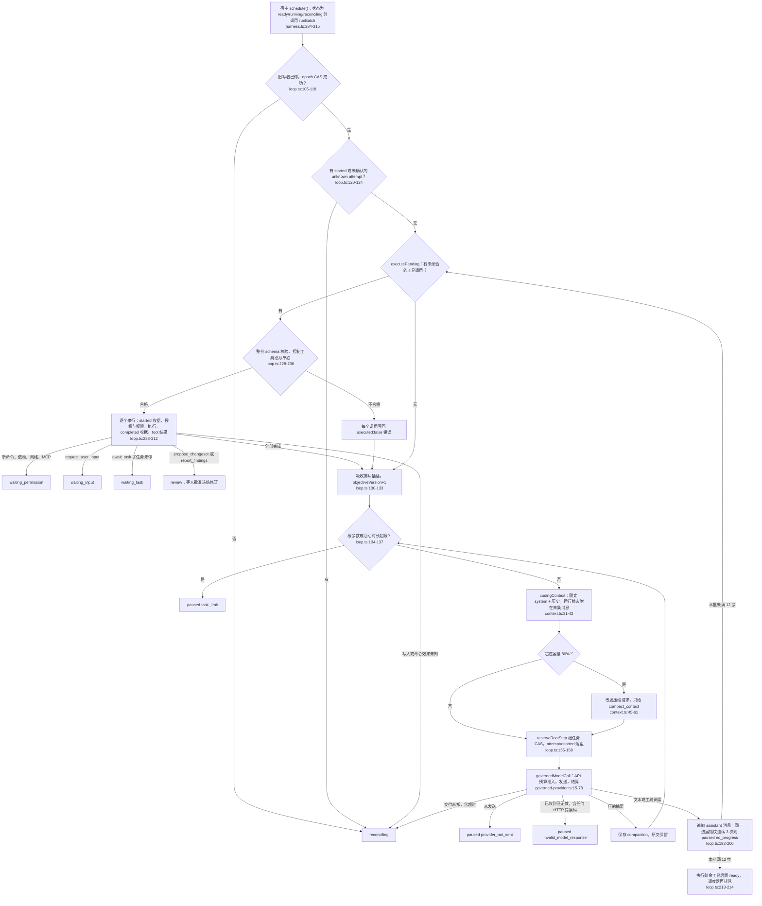
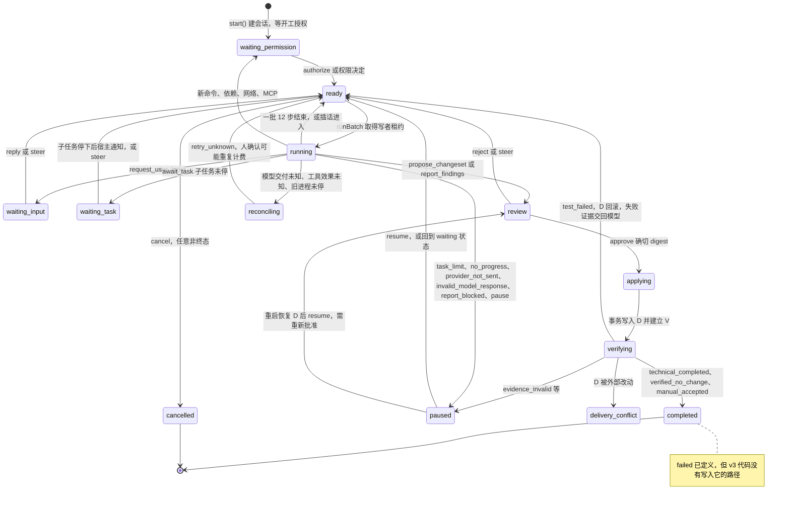

# Native Coding v3 Agent Harness：DevFlow 自身事实审计
依据：v3 为本机 v3 工作树，`git rev-parse HEAD` = `1108087`（PR #238 草稿），`git status --short` 无输出；main 为本机另一个工作树的 HEAD `56cfa7e`，与 origin/main `2fbb037` 同树。合并基点 `289a12b` 之后 v3 有 41 个提交、147 个文件、+14,034/−114 行。只读调查，没有运行测试、应用或模型。
缩写：`E/` = `apps/desktop/electron/`，`S/` = `packages/shared/src/`；loop、harness、session、tools、context、ext 指 `E/native-coding-{loop,harness,session,tools,context,extensions}.ts`；ws、evid、merge、runner 指 `E/coding-{candidate-workspace,evidence-v3,child-merge,command-runner}.ts`；live = `docs/evaluation/native-coding-v3-live-20261011.md`，plan = `docs/plans/native-coding-harness-v3-20261011.md`，impl = `docs/plans/native-coding-harness-v3-implementation.md`；out = 主 checkout 下被忽略的 `out/native-v3-evaluation/`。未标 main 的行号都指 v3。测试数是 `it(`/`test(` 的个数（`it.each` 记 1）。

## 一句话结论
v3 是 DevFlow 自己写的约 3,000 行编码 Agent 内核，没有导入、内嵌或复制 OpenCode 代码。它在副作用可信上做得很深：先写收据再执行、epoch 写者租约、批准冻结修订、B/C/D/V 四个内容身份、子任务三方合入、根/子预算同一事务准入，真实模型故障演练 interactive r4、r6 均 12/12。薄弱处是任务管理（没有计划工具和任务图，`delegate_task` 在 r1–r8 真实题中 0 次使用）、权限可用性（没有规则或白名单，每个新命令都要人批，默认 `trusted_local` 没有 OS 沙箱）、执行效率（同批工具串行、每次读文件都重新哈希整棵候选树、瞬时错误不自动重试）和完成判定（只看公开测试，r8 报告完成 5 次全部错误成功，r1–r8 共 27 次 v3 观测独立通过 0 次）。

## 架构总览
单轮执行（`NativeCodingLoop.runOwnedBatch`，loop:99-222；工具执行 loop:223-313）：

会话状态机（`NativeCodingStatus` 14 个状态，session:12）：

| 模块（v3） | 行数 | 职责与主要类型 |
| --- | ---: | --- |
| loop | 331 | `NativeCodingLoop`：批次、模型调用、工具收据、写者租约；工具接口 `CodingLoopTools`（loop:8-14） |
| harness | 585 | `createNativeCodingExecutorV3`：执行器描述符 v3、14 种 Harness 命令、委派与合入、审批与验证、重启恢复 |
| session | 145 | `NativeCodingSession`（session:16-64）、`CodingModelAttempt`、`CodingToolReceipt`、解析不变量与 CAS 变更 |
| tools | 365 | 33 个工具定义与处理、编辑效果日志、逐次能力授权 |
| context | 63 | 请求组装、运行状态附加、历史压缩 |
| ext | 109 | Skill、本地 MCP、公开文档 |
| ws | 266 | B 清单与内容 blob、C 私有仓库、冻结修订 `CodingRevision`/`CodingManifest` |
| evid | 120 | D 预写事务、V 验证、回滚；`CodingDeliveryEvidence` |
| merge | 70 | 子修订三方合入与合并日志 |
| runner | 338 | 持久命令 worker、容器参数、孤儿进程对账；`CodingCommandReceipt` |
| `E/coding-repository-query.ts`、`coding-public-documents.ts` | 67、54 | 正则 worker 与 TS 语言服务；HTTPS 文档读取 |
| `E/coding-dependency-preparation.ts`、`coding-activity-clock.ts`、`coding-input.ts` | 34、11、17 | 依赖计划；活动区间并集；输入快照 |
| `E/native-coding-{permissions,profile,projection,retention,backup}.ts`、`native-request-budget.ts` | 22、19、89、63、90、11 | 权限卡 `CodingOperationPermission`；宿主配置；UI 快照；清理；备份；请求容量度量 |
| `S/coding-harness.ts` | 70 | Harness protocol 2：`CodingHarnessCommand`（14 种）与快照类型 |
| `S/model-call-budget.ts`（v3 +37）、`apps/api/src/repositories/model-call-budget.ts`（+4） | 194、77 | `ModelTaskBudget` 与 `modelTaskBudgetBlock`；API 准入调用它 |
| `apps/desktop/src/views/NativeCodingHarnessPanel.tsx` | 102 | 面板：授权、问答、权限、审查、诊断 |

## 自写代码与复用
- 体量：v3 在 apps/packages 新增生产文件 3,080 行、测试 1,614 行，另有新增脚本 2,828 行；生产代码共增 3,426 行，即对已有文件约改 346 行（`git diff --numstat 289a12b...HEAD`）。
- npm 依赖：v3 没有新增运行时依赖，只改了根 `package.json` 的 typecheck 脚本。桌面依赖是 electron、react、sql.js 等，`S/` 没有依赖，API 只有 pg。Provider 是手写 `fetch` 调 `/chat/completions`（`S/agent-review.ts:2169,2254`），没有 OpenAI SDK 或 AI SDK。Git 走系统 `git` CLI（ws:196-202 建私有仓库，merge:40 `git merge-file`，`E/coding-runner.ts:387` 取 diff），没有 diff 库；容器走 docker CLI（runner:173-180）。语义检索在主进程打包使用根开发依赖 typescript 的 LanguageService（`E/coding-repository-query.ts:3,36`，`apps/desktop/vite.electron.config.ts` 为此新增 `__filename` 定义）。
- OpenCode：所有 package.json 都没有 `@opencode-ai/*`；v3 模块里唯一相关的引用是 runner:8 从 DevFlow 自己写的 `E/opencode-process.ts:523` 复用进程树终止函数 `terminateProcessTree`。ADR 0029 写明 v3 是“DevFlow 自己管理的持续编码会话”；plan:442 明确不采用“直接包装 OpenCode 作为 Native”，plan:38-53 只把 Codex、OpenCode、Kimi、pi、DeepSeek Harness 的源码当机制参考。“v3 建在 OpenCode 之上”与代码不符。
- DevFlow 用 OpenCode 做什么（main 与 v3 相同）：外部二进制 `opencode`（`DEVFLOW_OPENCODE_BIN` 或 PATH，只接受 1.17/1.18，main `E/opencode-discovery.ts:12-13,41,84-89`）以 `opencode serve` HTTP 运行，是与 Native 并列、由用户选择的编码执行器，也用于阶段 Agent 只读执行、门禁审查和讨论栏。DevFlow 用权限转发、私有插件 hook（main `E/opencode-task-guard.ts:118,124,173`）和预算代理约束它；评测里 OpenCode 1.18.15 是对照组（live:25）。
- v3 复用的是 DevFlow 自己已有的原语：原生工具信封与历史校验（`S/native-conversation-protocol.ts`，42 行，来自讨论栏 ADR 0028）、工具注册表（`E/native-tool-registry.ts`，860 行，ADR 0016）、V2.0 `AgentRuntime` 一次性授权（`S/agent-runtime.ts`，1,821 行）、`governedModelCall`（ADR 0027）、OpenAI 兼容 Provider、脱敏（`S/redaction.ts`）、本地 MCP 客户端（497 行）、`LocalStore`、`buildCodingBrief` 与 `coding-runtime` 的工作流接入。
- 开发方式：实施记录里的分支名是 `codex/native-coding-harness-v3`（impl:3）；方案和修复多次记录 Cursor Grok 只读评审（plan:549-571，impl:57-84）；41 个提交中 1 个带 `Co-authored-by: Cursor`。

## 逐项现状
- **S01 Agent Loop**。做法：宿主调度器反复调用 `runBatch`，每批最多 12 个模型步骤；每步先执行上一步留下的工具调用，再吸收插话、检查额度、组装请求、落盘 attempt、经预算准入调用模型、追加回复。
  - 位置与测试：loop:99-313，harness:284-315；`E/native-coding-harness-lifecycle.test.ts` 11 例，`E/native-coding-session.test.ts` 8 例。
  - 评测：r8 有调用的 8 个会话共 491 次模型调用，长任务每题 54–80 步，有效调查步中位 52（r8 `score.json`）；interactive r4、r6 12/12。
  - 限制与归属：默认 80 步、60 分钟；只在 build 节点且项目配置 `nativeVersion: 3` 时启用（`E/main.ts:629-636`）。循环内。main：Native v2 是固定的 analysis→initial→repair；讨论栏有原生多轮只读循环；OpenCode 的循环在外部进程里。
- **S02 Tool Use**。做法：33 个工具用统一 `definition()` 声明 schema、权限类、副作用类、120 秒期限、256,000 字节结果上限（tools:20-27），按角色过滤（tools:73）后注册进已有 `createNativeToolRegistry`（tools:262-266）。模型每轮可返回 ≤16 个调用（`S/native-conversation-protocol.ts:6`），宿主先整批校验，再逐个串行执行；所有调用共用一个 Promise 队列（tools:296），每次调用签一个 `callLimit: 1` 的 AgentRuntime 授权（tools:316-331）。
  - 位置与测试：loop:228-312，tools:290-333；`E/native-coding-tools.test.ts` 5 例，session.test.ts:107（同批 await_task 整批拒绝）。
  - 评测：r8 8 个会话约 607 次工具调用，490 个 assistant 轮次中 112 个（23%）一轮多调用，最多 5 个；interactive r3 曾因 await_task 与其他工具同批导致配对断裂，改为控制工具必须单独（live:63,79）。
  - 限制与归属：system 写“独立只读查询可以在同一轮发出多个调用”（loop:16），但执行仍串行；plan:399 的“读工具并发 4”没有实现。循环内。main：讨论栏同样逐个执行（main `E/native-conversation.ts:156`），OpenCode 路径提示词要求每轮最多 1 个调用（main `E/opencode-process.ts:484-490`）。
- **S03 Permission**。做法：开工前会话停在 waiting_permission，人点“授权并开始”选择 trusted_local 或 container，宿主核对输入摘要和依赖计划（harness:374-391），之后候选内编辑与保存的测试自动执行。新 argv 命令、依赖计划变化、网络 origin、MCP 调用各生成权限卡（`E/native-coding-permissions.ts:5-21`，tools:304-314，ext:32-45），批准或拒绝按内容摘要与 objectiveVersion 生效 1 小时。每次调用还核对授权有效期和编辑权（tools:300-302）；只读子任务只拿读工具（tools:73）；读路径拒绝 `.env`、`.ssh`、`.aws`、`credentials`（tools:80-83）；最终改动须人批准确切修订，子任务不能批准（harness:447-458）。
  - 位置与测试：`E/native-coding-harness.test.ts` 1 例（必须真实人工授权），`E/native-coding-prefix-boundaries.test.ts` 2 例（权限等待重启、改要求后旧授权不复活）。
  - 评测：r8 有 4 个 v3 会话申请额外命令（corepack 两次、bash、git），按冻结的操作规则全部拒绝（各会话 `permissions`）；interactive r5 因驱动没处理子任务权限卡失败，r6 通过（live:66,68）。
  - 限制与归属：没有允许/拒绝规则、命令前缀或“本任务内总是允许”，也没有风险分级。权限卡与审批来自宿主，模型只能提出。main：OpenCode 路径有命令分类策略 `classifyOpenCodePermission`（main `E/opencode-permission-policy.ts:114`）；Native v2 没有命令工具。
- **S04 Hooks**。没有：没有用户可配置的工具前后 hook 或事件脚本。
  - 宿主内部注入点只有 `NativeCodingLoop` 构造参数 `changed`、`activity`、`assertAuthority`、`reserveRootStep`、`stopPreviousWorker`（loop:28-30）和 `CodingLoopTools.reconcile/drain`（loop:8-14）；无专门测试与评测。
  - 其他路径：main 的 OpenCode 路径借 OpenCode 插件 hook `chat.params`、`tool.execute.before/after` 做额度与归属检查（main `E/opencode-task-guard.ts:118,124,173`），那是 OpenCode 的机制。
- **S05 TodoWrite**。没有：没有计划或待办工具，会话也没有计划字段（session:16-64），计划只存在于模型正文和 reasoning。
  - plan:133 设想过“计划工具只帮助记录进度”，未实现；无测试、无评测数据。
  - 其他路径：main 也没有；OpenCode 路径是否放行其自带 todo 工具未核实。
- **S06 Subagent**。做法：根任务调用 `delegate_task(title, prompt, mode, paths, maxTokens, maxCostUsd)`，宿主把当前父候选冻结为子基线，建独立会话与独立 C 并异步调度（harness:192-233）。模式只有 `read_only`（读工具 + `report_findings`）和 `isolated_coding`（必须给可写路径，写入与冻结都检查路径，tools:159,203-210）；`await_task` 等 ≤5 秒（harness:239-245），子任务停下时宿主写一条带来源标记的通知唤醒父任务（harness:277-283）；`merge_task` 三方合入，`cancel_task` 排除。
  - 位置与测试：lifecycle.test.ts:158,199,241 共 3 例，`E/coding-child-merge.test.ts` 3 例，session.test.ts:107。
  - 评测：r1–r8 对照题 0 次（devflow-assets 统计 1,461 次返回；本次抽查 r8 10 个会话同为 0）；interactive r1–r6 每轮 2–3 次（场景明确要求委派），`await_task` 2–6 次，`merge_task` 只有 r4、r6 各 1 次；children 场景 r1–r3、r5 失败，r4、r6 通过。
  - 限制与归属：深度 1，同时 ≤3，子额度须为根的子集，子任务沿用父模型，子任务的问题交给人而不是父任务（harness:244）。工具在循环内，调度、合入、预算在宿主。main：OpenCode `devflow-worker` 串行 1 个、整次 ≤4 次委派（main `docs/engineering/opencode-bounded-tasks.md:7-9`）；V2.2 协调只在诊断入口且不调模型。
- **S07 Skill Loading**。做法：`list_skills` 列出候选中 `.agents/skills/**/SKILL.md` 与 `.devflow/skills/**/SKILL.md`，`read_skill` 分页读取，结果标 `authority: 'instructions_only'`（ext:47-55）；只在模型主动调用时加载，不按描述自动匹配，也不注入 system。
  - 位置与测试：ext:17,47-55；没有任何测试引用这两个工具（`git grep list_skills -- '*.test.ts'` 无结果）。
  - 评测：r8 0 次调用；无其他真实模型数据。
  - 限制与归属：只读项目内文件；Skill 不授予权限。循环内。main：设置页 Skills 是占位，团队 `skills` 表没有桌面消费者；OpenCode 编码运行隔离用户级 skills（`E/main.ts:603-604`，ADR 0025）。
- **S08 Context Compact**。做法：每步按 Provider 的真实序列化度量请求（`E/native-request-budget.ts:4-10`，估算器 `S/prompt-context.ts:14-34`），超过字节或 token 上限 80% 时改发一次压缩请求：只给 `compact_context`，输出 ≤4,096 token，摘要 ≤16,000 字符，只在闭合的工具配对处切分，尽量保留最近 12 条（context:42-61）。之后请求由首条任务消息、摘要、单独保留的用户原话与澄清答案、未压缩尾部组成（context:33-39）；原文仍在会话中，可用 `read_history` 回读。
  - 位置与测试：`E/native-coding-context.test.ts` 3 例，prefix-boundaries 1 例（压缩后前缀再次稳定）。
  - 评测：r5–r8 所有 v3 会话 `compactions` 为 0，interactive r1–r6 返回中 `compact_context` 为 0；r8 峰值上下文中位 119,740、最大 178,955 token，而 DeepSeek 下阈值按 1,048,576 上下文减输出减 8,000、请求 ≤4 MiB 计算。真实模型从未触发压缩。
  - 限制与归属：压缩本身是一次计费调用，没有清理旧工具结果之类的低成本裁剪。循环内。main：讨论栏有滚动摘要 `buildRollingSummary`（main `E/conversation-context.ts:75`），Native v2 用 30,000 字符提示上限（main `E/native-coding-executor-v2.ts:57`），OpenCode 用自己的压缩。
- **S09 Memory**。做法：循环内没有记忆工具，跨会话不保存任何学到的内容。开工时宿主召回项目记忆（Hindsight）写进编码简报，简报约束写明召回内容是不可信背景（`E/coding-runtime.ts:3169-3183`，`S/coding-agent.ts:346`）。会话内的记忆就是完整 transcript 加 `read_history`。
  - 位置与测试：v3 没有新增记忆测试（`E/coding-run-memory.test.ts` 只改 4 行）。
  - 评测：没有相关指标。
  - 限制与归属：宿主。main：Hindsight 召回与采集已在 main（ADR 0030），v3 没有改这部分。
- **S10 System Prompt**。做法：system 是常量，根任务 422 字（loop:16），只读子任务追加两句（loop:17），压缩请求另有 system（context:49）。首条 user 消息 = 用户指令 + 宿主生成的编码简报（harness:510）；简报由 `buildCodingBrief` 拼出 Run/节点、测试命令、约束、召回记忆、已批准澄清与设计全文、知识、Gate 决定和根 AGENTS.md，上限 24,000 字节（`E/coding-runtime-configuration.ts:21`），v3 只按 `executionModel` 切换几行说明（`S/coding-agent.ts:316-347`）。每步的剩余步数、时间、角色、编辑授权以 JSON 附在最后一条消息（context:9-30）。
  - 位置与测试：session.test.ts:68（root/read_only 的 system、工具、历史作为不变前缀），prefix-boundaries 2 例。
  - 评测：r8 task 04 首个请求 system 422 字、首条 user 2,899 字、工具 JSON 18,118 字符（34 个工具）。提交 8390a26 把运行状态拼进 system 后，interactive r5/r6 缓存命中约 5%（r1–r4 为 94–96%），#239 修复后 r8 为 97.4%（时间先后对应，原因见 #239 记录）。
  - 限制与归属：提示词不可配置，没有按项目或角色的模板。system 在循环内，简报来自宿主。main：Native v2、OpenCode 各有常量提示。
- **S11 Error Recovery**。做法：模型错误按交付状态分三类：未发送→paused `provider_not_sent`；已收到但无效（HTTP 200 格式错，或任何 HTTP 错误码，包括 429、402、5xx）→paused `invalid_model_response`，保留用量；交付未知（含超时）→reconciling，只能由人 `retry_unknown`（loop:201-210，harness:435-440）。工具错误作为 `{error}` 返回模型，同批后续调用写“Earlier operation failed; replan”（loop:244-246,309）；写入或命令失败先按收据对账，不确定就进 reconciling（loop:271-279,298-307）；最终验证失败时 D 回滚，失败证据写回对话后继续修（harness:477-481）。
  - 位置与测试：lifecycle 含“无效回复保留费用”“改写措辞不算进展”（lifecycle.test.ts:48,59），session.test.ts:129（暂停/取消后的迟到回复）。
  - 评测：r8 07 第 6 步 `invalid_tool_batch`（HTTP 200）后暂停，整题结束；r6/r7 共 7 次 HTTP 402 余额不足记成 `invalid_model_response`；r8 02 首次最终验证失败后修复并二次批准通过（会话有 2 个修订）。
  - 限制与归属：对 429、5xx、超时、连接重置不自动重试，一次瞬时错误就暂停。循环内加宿主命令。main 讨论栏最多重试 2 次、1–8 秒退避，并可扩大输出上限（main `E/native-conversation.ts:321`，`S/agent-review.ts:273-283`）。
- **S12 Task System**。没有：父会话只有扁平的 `children` 列表（state 为 active/included/excluded，session:63），没有依赖边、计划版本或任务图。
  - 无测试、无评测数据。
  - 其他路径：main V2.2 有 `parseAgentTaskGraph`（`S/agent-coordination.ts:641`，≤12 节点、≤24 边、深度 1、并行 3，`:10-19`），只在设置›高级诊断入口且不调模型；工作流层是固定 8 节点模板（`S/workflow.ts:97-215`）。v3 没有接入它们。
- **S13 Background Tasks**。做法：命令在持久 worker 中运行：宿主先写收据，再 fork `command-worker.cjs`，worker 收到 `go` 才 spawn（runner:76-114,155-256）；`run_command`/`run_test_plan` 立即返回收据，`read_command` 在宿主内等待默认 10 秒、最多 30 秒，`cancel_command` 只停本任务命令（tools:186-202）。子任务调度后与父任务并行（harness:233,284-315）；活动时长按所有执行单元区间并集计（`E/coding-activity-clock.ts:3-11`），到时停止整个范围（harness:60-97）。
  - 位置与测试：`E/coding-command-runner.test.ts` 11 例，`E/coding-command-environment.test.ts` 4 例（1 例 Windows 跳过），`coding-activity-clock.test.ts` 1 例。
  - 评测：live 问题 1 是长命令快速轮询耗尽步数，改为宿主有界等待（live:75）；r8 `read_command` 51 次；deadline r1 在 20 秒截止时停止了 60 秒命令（live:70）。
  - 限制与归属：有命令在跑时不能执行写工具或第二个命令（tools:302）。宿主。main：Native v2 由宿主跑测试，OpenCode 自带 shell。
- **S14 Cron Scheduler**。没有：没有定时或周期触发 Agent 的机制。
  - 无测试、无评测数据。
  - 其他路径：main 只有 Hindsight 唤醒定时器（main `E/main.ts:4600`，15 秒），与 Agent 无关。
- **S15 Agent Teams**。做法：只有“一个根 + 至多 3 个子”的主从结构，角色固定为 root、read_only、isolated_coding，同一模型；子任务之间不能通信，子任务没有委派工具（tools:73）。
  - 位置与测试：同 S06。
  - 评测：真实题中从未组队。
  - 限制与归属：角色由宿主写死。main：V2.2 有 3 个写死的专职角色（main `E/specialist-runtime-registry.ts:10-55`），不调模型；OpenCode 路径只有 1 个 `devflow-worker`。
- **S16 Team Protocols**。做法：父子消息是宿主定义的结构化结果：`delegate_task` 输入 schema（tools:50）；`await_task` 返回 `codingRunId,status,pendingChild,sourceDigest,findings,revision{id,digest},question{text,requiresHuman}`（harness:239-245）；`report_findings` 返回摘要、每个来源文件的哈希与基线摘要（tools:110-113）；唤醒通知以“[DevFlow 宿主状态通知，并非用户的新指令]”开头（harness:282）；`merge_task` 绑定 `childChangeSetId` 与 `expectedParentRevision`（tools:53）。
  - 位置与测试：lifecycle.test.ts:158,199。
  - 评测：interactive r2 发现父任务收不到子任务完成通知而重复询问，r3 发现 await_task 同批破坏配对，均已修（live:62-63,79）。
  - 限制与归属：没有邮箱、广播或子任务之间的消息，协议没有版本号。宿主。main：V2.2 有交接记录（`S/agent-coordination.ts:883`），未接入模型。
- **S17 Autonomous Agents**。没有：Agent 不能发现或认领工作，每个 v3 会话都由人在 build 节点启动并授权。
  - 无测试、无评测数据。
  - 其他路径：main 的团队工作请求由桌面用户认领，Web Gate 命令由桌面进程领取执行，都不是 Agent 自主认领。
- **S18 Worktree Isolation**。做法：四个内容身份（ADR 0029:13-20）：B 是输入清单和内容寻址 blob；C 是私有候选，在临时目录 `git init` 后复制过来，不带宿主 gitdir、remote、alternates（ws:115-140,178-206）；D 是已有的受管 git worktree，只在批准后由宿主事务写入；V 是每次批准从冻结字节新建的验证仓库（evid:96-100）。每个子任务有自己的 C（harness:205-221）。
  - 位置与测试：`E/coding-candidate-workspace.test.ts` 7 例（含 Windows 长路径、符号链接与非规范路径拒绝）。
  - 评测：interactive file_conflict、application、verification 场景 r2 起通过；10 元重点验收的 12 项交互全过（`docs/validation/native-v3-budget10-20261025.md`）。
  - 限制与归属：快照每文件 ≤32 MiB、≤200,000 个文件、≤2 GiB（ws:97），排除 node_modules/.cache/coverage，C 与 V 各自安装依赖。宿主。main：每个 Coding Run 一个 git worktree（main `E/coding-runner.ts:128-133`），每项目同时只有 1 个活动 Coding Run（main `E/coding-runtime.ts:3012-3016`）。
- **S19 MCP Tools**。做法：`list_mcp` 列出已安装且启用的本地 MCP，`mcp_tools` 启动并核对工具目录，`call_mcp` 按核对过的 schema 调用（ext:56-100）。stdio 进程由命令 runner 托管，环境只继承登记的变量名，调用前写意图收据，未知不重放；每次调用要人批准（摘要含工具与参数，ext:39-44）；容器模式与只读子任务拒绝。协议版本 `2025-11-25`（`E/local-mcp-client.ts:21`）。
  - 位置与测试：`E/local-mcp-client.test.ts` 15 例（v3 新增 1 例走持久 worker）；没有经 v3 工具层调用 `call_mcp` 的测试。
  - 评测：r8 0 次；impl:19 记录真实 stdio 进程回归通过。
  - 限制与归属：只支持本地 stdio 与已安装的 MCP，没有远程 MCP；MCP 工具不进入模型工具表，只能经 `call_mcp` 间接调用。工具在循环内，安装与授权在宿主。main：本地 MCP 客户端与安装权限（ADR 0016）已有，设置页只能开关。
- **S20 Comprehensive Agent**。做法：v3 以 `CodingExecutor`（描述符 version 3，harness:490）挂进已有 `coding-runtime` 的 build 节点，前面是已批准的澄清/设计 Gate，后面是工作流测试、PR、验收；IPC `codingHarness`（`E/main.ts:4134-4152`）把命令交给执行器的单任务队列（harness:524-539），完成后向工作流返回 diff 与 TestEvidence（harness:317-347）；每次模型调用经 Team API 预算准入，团队策略未同步就不调用（`E/main.ts:1992-2030`）。
  - 位置与测试：impl:96-97 记录合并 main 后 `pnpm verify` 442 个文件、5,645 例通过，Electron smoke 三种模式通过（文档记录，本次未运行）。
  - 评测：见“评测事实”。发布门槛（≥30 题、错误成功 0、复杂题比 v2 高 10 个百分点、中位 ≤15 分钟、每个独立通过 ≤$10）未达到（live:29，impl:100-106）。
  - 限制与归属：PR #238 仍是草稿；只服务编码节点，会话类型是编码专用。
- **E1 沙箱与 OS 隔离**。做法：默认 `trusted_local`（harness:502）以当前 OS 用户运行，代码与 ADR 都写明不是 OS 沙箱（runner:116，ADR 0029“执行环境”），只做最小环境变量（PATH、私有 HOME、短临时目录、空 git 全局配置、CI=1，runner:184-188）和进程组终止。`container` 用 digest 固定的镜像，`docker run --rm --network none|bridge --cap-drop=ALL --security-opt=no-new-privileges --read-only --tmpfs /tmp`，只挂载 C 或 V，镜像缺失不回退本机（runner:173-180，`E/native-coding-profile.ts:7-19`）。文件工具另有路径校验（绝对路径、`..`、`.git`、符号链接、非 NFC 均拒绝，ws:22-46）。
  - 位置与测试：`scripts/native-coding-container.test.ts` 1 例（无镜像时跳过），runner/environment 测试 15 例。
  - 评测：真实模型评测都用 trusted_local；CI 有两组 Docker 检查（live:5）。
  - 限制与归属：trusted_local 下命令可以访问网络和用户的全部文件，没有 seatbelt、namespace、landlock 一类机制。宿主。main：OpenCode 与 Native v2 测试都是本机进程。
- **E2 编辑格式与补丁应用**。做法：`apply_patch` 是唯一片段精确替换，必须带读取时的文件哈希（tools:164-169）；`write_file` 整文件写入（≤120,000 字符，可 base64、可设 644/755）；另有 `delete_file`、`rename_file`。每次编辑先写含前后哈希的效果日志再落盘，重启按日志对账（tools:84-104,178-183,355-362）。最终 ChangeSet 由宿主比较 B 与 C 的真实文件生成，含新增、修改、删除、模式变化和唯一哈希匹配的重命名（ws:221-256），应用到 D 用预写事务（evid:64-120）。
  - 位置与测试：tools.test.ts:13，candidate-workspace 7 例。
  - 评测：r8 `apply_patch` 119 次、`write_file` 0 次；deep r3 曾因对工具 JSON 做文本脱敏破坏转义而失败，改为结构化叶子脱敏（live:69,84）。
  - 限制与归属：一次调用只改一处，片段必须唯一，没有多文件补丁或 unified diff。工具在循环内，冻结与应用在宿主。main：Native v2 是 JSON Change Set，≤6 个文件、≤12 处替换。
- **E3 代码检索与仓库理解**。做法：`list_directory`、`glob_files`、`search_text`（字面或正则，正则在 worker 线程里跑、1 秒超时，`E/coding-repository-query.ts:7-23`）、`find_symbol`/`find_references`（TypeScript LanguageService，`noLib`，只索引 ≤32 MiB 的 TS/JS，`:26-67`）。没有 repo map、ripgrep、向量检索，也没有 Git 历史查询工具。
  - 位置与测试：`E/coding-repository-query.test.ts` 2 例，tools.test.ts:65（区分空范围与无命中）。
  - 评测：deep r1/r2/r4（605 文件、8 层目录、3 个关联位置）v3 独立通过；r8 `read_file` 169、`search_text` 160、`read_ranges` 36、`glob_files` 22、`find_symbol` 1、`find_references` 0 次。
  - 限制与归属：每次 `read_file`、`glob_files`、`search_text` 都调用 `workspace.inspect()`，重新读取并哈希整棵候选树（tools:151,155,215；ws:81-108,158），检索也逐文件读全文。循环内。main：Native v2 宿主最多读 8 个文件、8 次搜索。
- **E4 会话持久化、恢复、检查点与撤销**。做法：会话是一份 JSON，存 SQLite 并把大内容放 `devflow.sqlite.contents`（`E/local-store.ts:4835-4857`）；每次变更版本 +1，按 expectedVersion CAS，冲突最多重试 12 次（session:79-87）。解析层强制身份不可变、transcript 只追加、收据只追加、终态不能复活（session:126-142）。重启 `recover()` 先对账命令与子任务，再恢复交付事务或重新调度（harness:540-574）；离线备份见 `E/native-coding-backup.ts`。
  - 位置与测试：session.test.ts 8 例，`E/native-coding-schema-migration.test.ts` 2 例，backup 1 例，projection 3 例。
  - 评测：interactive unknown、application、verification 场景用真实杀进程和重启，r4、r6 通过。
  - 限制与归属：没有面向用户的撤销或回到某一步；拒绝修订只回到 ready，不回滚 C；sql.js 每次变更都导出整个数据库写盘（`E/local-store.ts:14623-14635`）。宿主。main：Native v2 与 OpenCode 在重启时把进行中的运行判失败（main `E/coding-runtime.ts:2863-2898`）。
- **E5 模型与 Provider 适配**。做法：只有一个 OpenAI 兼容 Chat Completions 实现，原生工具只对 `api.deepseek.com` 上的 `deepseek-flash` 开启（`S/agent-review.ts:2418`）；SSE 流式但 v3 不把增量推给界面；reasoning_content 随 assistant 消息回传；详见“模型与 Provider”。
  - 位置与测试：`E/native-coding-provider-trace.test.ts` 10 例，`S/governed-provider.test.ts` 10 例。
  - 评测：endpoint r1 思考 high/关闭 × SSE/非流式 4 组、20 次调用全过，$0.001874（live:57）。
  - 限制与归属：v3 拒绝不支持原生工具或精确序列化的 Provider（loop:102-103）。宿主。main：同一个 Provider 实现，v3 只给 governed-provider 加了 attemptId 与 taskBudget。
- **E6 Prompt 缓存、费用与预算**。做法：依赖 DeepSeek 的隐式前缀缓存，#239 之后 system 与工具定义固定，运行状态附在末条消息。每次调用经 `governedModelCall` 先预留、再发送、再结算（`S/governed-provider.ts:15-78`），预留按最坏上界计（输入 1,048,576 token 全部未命中加输出上限，`S/model-call-budget.ts:32-39`，65,536 输出时约 $0.393）。根与子 `ModelTaskBudget` 在 API 准入中一起核算（`S/model-call-budget.ts:75-95`，`apps/api/src/repositories/model-call-budget.ts:22-23`），Postgres 用同项目 advisory lock（`apps/api/src/repositories/postgres-team-repository.ts:1963-1969`）；另有根步数 CAS（harness:165-171）。
  - 位置与测试：API `model-call-budget.test.ts` 9 例，`scripts/model-budget-postgres.test.ts` 2 例（无数据库时跳过），governed-provider 10 例。
  - 评测：按会话用量计，v3 缓存命中 r6 0.0%、r7 0.1%、r8 97.4%；#239 对照 0%→84.92%、¥0.3816→¥0.1118，均 6/6（`docs/validation/issue-239-closure-20261025.md`）；r8 每题 $0.11–0.14，r6 $0.57–2.73（live:47）；r8 10、11 题因余额低于一次预留被拒。
  - 限制与归属：根 token 上限固定 10,000,000（`E/coding-runtime.ts:3788`），缓存命中的输入也计入（`S/model-call-budget.ts:89-92`），r8 03 一题用了 8,428,817；没有显式 cache_control。宿主加 Team API。main：逐次准入已有，任务级额度只在 v3。
- **E7 工具输出管理**。做法：工具自带分页：`read_file` ≤400 行且每页 ≤120,000 字节，`search_text` 每页 ≤30 命中、每行 500 字，目录与 glob 每页 ≤200，日志、历史、来源、差异、证据、Skill、网页每页 ≤16,000 字符（tools:29-61,106-260）。注册表对结果做结构化脱敏，超过 256,000 字节报 `result_too_large`（tools:269-273，`E/native-tool-registry.ts:806-811`）；命令输出全量写盘（≤64 MiB）再分页（runner:202,258-289），网页 ≤2 MiB 存文件再分页（ext:59-68）。
  - 位置与测试：tools.test.ts:65,88。
  - 评测：live 问题 8 增加了分页、空范围与截断说明（live:82）。
  - 限制与归属：结果超限直接失败，没有通用的“大结果落盘 + 摘要 + 续读”。工具层，宿主执行。main：讨论栏用同一注册表。
- **E8 人工参与与中途纠偏**。做法：`request_user_input` 进入持久 waiting_input，带选项，回答按 questionId 与 objectiveVersion 幂等（loop:45-56）；`steer` 任意时刻排队，在步边界注入，objectiveVersion+1，取代待答问题、待批权限和活动子任务，旧修订批准失效（loop:57-74，harness:392-399）；pause 会中止进行中的请求（loop:75-80）。面板有 13 种操作命令，另有 get（`NativeCodingHarnessPanel.tsx`）。没有 plan 模式。
  - 位置与测试：session.test.ts:17,146,186，lifecycle.test.ts:158，`NativeCodingHarnessPanel.test.tsx` 2 例。
  - 评测：interactive clarification、steering 场景 r1–r6 全过；10 元验收中 clarification 11 次、steering 13 次调用通过；r8 中模型 0 次提问。
  - 限制与归属：提问后本步结束，必须等人，没有超时或默认答案。宿主加 UI。main：OpenCode 问答面板（#237）；Native v2 没有中途交互。
- **E9 完成判定与验证**。做法：普通文本不算完成。模型调用 `propose_changeset` 后宿主冻结修订进入 review（tools:203-213）；人批准时须逐条确认来自已批准澄清的验收条目（harness:447-458）；宿主随后把修订事务写入 D，从冻结字节建 V，准备依赖，跑保存的测试，核对 V 前后与 D 摘要，得出 technical_completed、verified_no_change、manual_accepted、test_failed、evidence_invalid 或 delivery_conflict（evid:64-120），测试改了源码即无效（evid:108）。
  - 位置与测试：candidate-workspace.test.ts:73,85，lifecycle.test.ts:114,139。
  - 评测：r8 5 次报告完成都通过宿主公开测试，独立验收 80/81、104/111、41/46、42/51、319/320 全部失败；文档结论是公开测试覆盖不到新行为（live:51）；r8 03 宿主验证失败后模型在第 79 步 `report_blocked`。
  - 限制与归属：没有独立于实现者的验证角色；验收条目只由人勾选，评测中由操作者代批（live:25）。宿主。main：工作流测试节点、PR、业务验收 Gate 仍在其后。
- **E10 不可信内容、注入与脱敏**。做法：system 写明文件、网页、工具文本是低信任证据（loop:16）；Skill 标 `instructions_only`，网页结果带 `untrusted: true`（`E/coding-public-documents.ts:53`），宿主通知标明不是用户指令（harness:282）。工具结果按结构化叶子脱敏（GitHub/OpenAI/Anthropic token、Authorization、JWT、AWS key、私钥、`*_API_KEY=` 等，`S/redaction.ts:27-90`）；读路径拒绝凭据目录；命令环境不带宿主密钥；网络只允许配置的 HTTPS origin，DNS 解析后拒绝私网地址，拒绝跨 origin 重定向（`E/coding-public-documents.ts:7-54`）。
  - 位置与测试：tools.test.ts:88，`E/coding-public-documents.test.ts` 1 例。
  - 评测：没有专门的注入实验。
  - 限制与归属：没有注入检测或对工具结果的隔离标记，靠提示词和权限边界。宿主。main：同一脱敏模块；OpenCode 路径 `* deny`。
- **E11 可观测性与评测**。做法：会话保存每次 attempt（请求摘要、用量、错误）、工具收据、每次工具授权与审计、权限、活动区间；面板有“恢复诊断”（`E/native-coding-projection.ts:86`）。评测脚本：`scripts/native-coding-batch-live.mjs`（冻结与运行）、`native-coding-trial-live.mts`、`native-coding-interactive-live.mjs`（整轮 SQLite 预算账本）、`native-coding-evaluation.mjs`（资格与评分）、`native-coding-cache-probe.ts`；35 题候选、31 题合格，独立验收用评测方持有的参考断言（`docs/evaluation/README.md`）。
  - 位置与测试：batch-live 6、evaluation 2、round-budget 10、cache-probe 3、interactive-cli 4 例。
  - 评测：各轮原始记录在 out/，见“评测事实”。
  - 限制与归属：没有 OpenTelemetry 或 trace 导出；评分里的 `releaseReady` 不会自动为 true。宿主加脚本。
- **E12 运行方式与集成**。做法：只在 Electron 桌面里运行（IPC `codingHarness`，`E/main.ts:4134-4152`）；评测脚本直接 import 生产模块无界面运行（`scripts/native-coding-trial-live.mts:4-18`），但不是对外接口。
  - 没有 CLI、headless 服务、SDK 或 ACP；Team API 只负责预算、同步和 Web Gate，不运行 Agent。
  - main：OpenCode 以 `opencode serve` HTTP 运行，DevFlow 是它的客户端。
- **E13 项目指令与配置层**。做法：根目录 AGENTS.md（缺失时用 CLAUDE.md）由宿主读入并放进编码简报（`E/repository-knowledge.ts:412-414`，`E/coding-runtime.ts:386-391,943-954`）；Skill 见 S07；宿主配置 userData 下的 `native-coding-profile.json`（容器、网络，`E/main.ts:630`）；项目“执行工具”选 Native v3 与 Provider；环境变量 `DEVFLOW_LONG_CONTENT_ENABLED`、`DEVFLOW_BUDGET_PENDING_HOLDS_ENABLED`（`S/model-execution-rollout.ts:4-5`）。
  - 位置与测试：`S/coding-agent.test.ts` v3 新增 14 行。
  - 评测：无。
  - 限制与归属：不读子目录 AGENTS.md（plan:181 设想过，未实现），没有用户级或会话级指令层；步数、批次、无进展阈值不能配置。宿主。main：OpenCode 自己加载 worktree 的 AGENTS.md，Native v2 由简报携带。

## 工具清单
所有工具都在开工授权之后才可用；结果统一受 256,000 字节上限和结构化脱敏约束（tools:26,269-273）。“同批”指模型能否在一轮里与其他调用并列：可以并列，但宿主一律串行执行；“单独”必须独占一轮（loop:227）。

| 工具 | 作用 | 类别 | 同批 | 输出上限 | 权限与条件 |
| --- | --- | --- | --- | --- | --- |
| list_directory、glob_files | 目录分页、按 glob 找文件 | 读 | 可 | 默认 100、每页 ≤200 项 | 排除凭据路径 |
| read_file、read_ranges | 按行读、多段读，返回内容哈希 | 读 | 可 | 400 行且 120,000 字节/页；≤16 段 | 同上 |
| search_text | 字面或正则检索 | 读 | 可 | 30 命中/页、每行 500 字；正则 1 秒 | 同上 |
| find_symbol、find_references | TS/JS 符号与引用 | 读 | 可 | ≤100/页；索引 ≤32 MiB | 引用查询需当前文件哈希 |
| repo_status、inspect_diff、read_evidence | 候选变化、单文件前后内容、测试与修订记录 | 读 | 可 | 16,000 字符/页 | 无 |
| read_history、read_source | 完整历史回读、已批准上游材料 | 读 | 可 | 16,000 字符/页 | 无 |
| write_file、apply_patch、delete_file、rename_file | 写候选 C | 写 | 可 | 写入 ≤120,000 字符；替换前后各 ≤60,000 | 开工授权含编辑权；需读取时哈希；子任务限路径；有命令在跑时拒绝 |
| run_test_plan | 准备依赖并跑保存的测试 | 命令 | 可 | 日志 ≤64 MiB，分页读 | 开工授权已含；依赖计划变化需 dependencies 权限 |
| run_command | 按 planIndex 或新 argv 运行 | 命令 | 可 | 同上；超时 ≤60 分钟 | 新 argv 每个都要人批（command 权限，1 小时） |
| read_command、cancel_command | 读日志（宿主等待 ≤30 秒）、停命令 | 读、命令 | 可 | 16,000 字符/页 | 只限本任务命令 |
| propose_changeset | 冻结修订进入人工审查 | 写 | 单独 | 摘要 ≤4,000 | 无活动命令、子任务已收口、存在 lockfile；之后须人批准 |
| delegate_task、cancel_task、merge_task | 建子任务、取消并排除、三方合入 | 命令、命令、写 | 可 | 无 | 只有根任务；≤3 活动；额度为子集；合入绑定父摘要 |
| await_task | 等子任务 ≤5 秒，取结果 | 读 | 单独 | 无 | 只有根任务 |
| report_findings | 只读子任务报告结论与来源哈希 | 读 | 单独 | 摘要 ≤12,000；≤100 来源 | 只有只读子任务 |
| list_skills、read_skill | 项目 Skill | 读 | 可 | 16,000 字符/页 | 只是说明，不授权 |
| list_mcp、mcp_tools、call_mcp | 列出、启动核对、调用本地 MCP | 读、命令、命令 | 可 | 按 MCP 工具定义 | 后两者每次要人批（mcp 权限）；容器模式与只读子任务拒绝 |
| web_search、fetch_document | 公开文档检索与读取 | 读 | 可 | 文档 ≤2 MiB，16,000 字符/页 | 须配置 network；每个 origin 要人批（network 权限）；只读子任务没有 |
| request_user_input、report_blocked | 向人提问、说明阻碍并暂停 | 控制 | 单独 | 文本 ≤12,000；选项 ≤12 | 无 |
| compact_context | 只出现在压缩请求里 | 控制 | 唯一工具 | 摘要 ≤16,000 字符 | 无 |

根任务实际发出 34 个工具（32 个宿主工具 + 2 个控制工具），只读子任务 19 个，隔离编码子任务 30 个（按 tools:73 的过滤规则计算）。
## 限额与默认值
| 项目 | 值 | 位置 | 用户能否修改 |
| --- | --- | --- | --- |
| 模型步数 | 80 | session:76 | 暂停为 task_limit 后 `extend_limits` 可加到 10,000（`S/coding-harness.ts:63`，harness:400-404） |
| 活动时长 | 60 分钟，等待人不计时 | session:76 | 同上，最多 24 小时 |
| 每批步数、无进展阈值 | 12（上限 12）、3 次 | session:76,115 | 不能 |
| 写者租约、CAS 重试 | 120 秒、12 次 | loop:39,117 | 不能；`expiresAt` 只做格式校验（session:116） |
| 每轮工具调用 | ≤16 | `S/native-conversation-protocol.ts:6` | 不能 |
| 单次工具 | 期限 120 秒，结果 ≤256,000 字节 | tools:26,319-322 | 不能 |
| 命令超时 | 保存的测试 15 分钟；新命令 ≤60 分钟；依赖准备 ≤30 分钟；MCP stdio 300 秒 | `E/coding-dependency-preparation.ts:8-11`，runner:146,167,171 | 新命令的超时由模型提出、人批准 |
| 命令输出 | ≤64 MiB | runner:202 | 不能 |
| 等待 | read_command 默认 10 秒、≤30 秒；await_task 5 秒 | tools:45，runner:261，harness:240 | 模型参数 |
| 委派 | 深度 1、同时 ≤3、子额度 ⊆ 根 | harness:191-195 | 不能 |
| 授权有效期 | 操作权限 1 小时；执行授权 24 小时可续；批准后 10 分钟内须开始应用 | `E/native-coding-permissions.ts:17`，harness:368,386,431,464 | 续期需人 |
| 验收条目 | ≤100 | harness:506 | 不能 |
| 压缩 | 阈值 80%；摘要 ≤16,000 字符；压缩输出 ≤4,096 token；尽量保留最近 12 条 | context:42,51-52,59 | 不能 |
| 请求容量 | 上下文 1,048,576（DeepSeek）或 128,000，减输出、减 8,000；请求 ≤4 MiB | `E/native-request-budget.ts:8-9`，`S/provider-request-policy.ts:8,35` | 不能 |
| 输出上限 | 思考 low/high 65,536，max 131,072，关闭或未知模型 8,192；硬顶 393,216 | `S/provider-request-policy.ts:29-34` | 改 Provider 思考设置；`DEVFLOW_LONG_CONTENT_ENABLED=0` 压到 8,192 |
| Provider 空闲超时 | 120 秒，有进展即重置 | `S/agent-review.ts:2175,2246` | 不能 |
| 根任务预算 | 10,000,000 token；金额取预算决定的 `limitUsd` | `E/coding-runtime.ts:3786-3790` | 金额由团队预算策略与批准决定 |
| 单次预留 | 输入按 1,048,576 token 全未命中，加输出上限 | `S/model-call-budget.ts:32-39` | 不能 |
| 快照与索引 | 每文件 ≤32 MiB、≤200,000 文件、≤2 GiB；语义索引 ≤32 MiB | ws:97，`E/coding-repository-query.ts:31` | 不能 |
| 网页 | ≤2 MiB、20 秒、≤3 次同源重定向 | `E/coding-public-documents.ts:28-50` | origin 由 profile 配置 |
| 问答与插话 | 问题 ≤12,000 字、≤12 个选项；插话 ≤32,000 字 | loop:19，`S/coding-harness.ts:56` | 不能 |
| 自动重试 | 模型调用 0 次 | loop:201-210 | 人可 resume 或 retry_unknown |

## 模型与 Provider
- Provider 与模型：只有 `createOpenAiCompatibleAgentProvider`（`S/agent-review.ts:2169`）。`supportsNativeTools` 只在模型为 `deepseek-flash` 且 base URL 为 `https://api.deepseek.com`（`/`、`/v1`）时为真（`S/agent-review.ts:2418`，`S/provider-thinking.ts:18-27`），v3 不接受其他 Provider（loop:102-103，harness:492-495）。所有真实评测都用 `deepseek-flash`（DeepSeek V4.1 Flash），思考 high（live:3,35）。
- 请求格式：Chat Completions `POST {baseUrl}/chat/completions`（`S/agent-review.ts:2254`），原生 `tools` + `tool_choice: 'auto'`，编码请求温度 0（`:2202-2216`）。r8 实际请求字段为 model、temperature 0、max_tokens 65536、stream、stream_options、thinking、reasoning_effort high、messages、34 个 tools。没有文本解析式工具调用。
- 流式：已知 DeepSeek 组合走 SSE 并带 `include_usage`（`S/provider-request-policy.ts:37`，`S/agent-review.ts:2209`）；v3 不传 `contentSink`/`reasoning` 回调，界面看不到逐字输出（main 讨论栏会推送，main `E/native-conversation.ts:284`）。
- 推理内容：请求带 `thinking:{type}` 与 `reasoning_effort`，未设置时应用默认开启 low（`S/provider-thinking.ts:39-52`）；`reasoning_content` 写进 assistant 消息并随历史回传（`S/agent-review.ts:2314-2331`），历史校验要求它是字符串（`S/native-conversation-protocol.ts:34`）；运行状态不开新的 user 轮次，以免改变 thinking 历史（context:10-17）。
- 缓存与 token：依赖 Provider 隐式前缀缓存，用量里解析 `cacheReadTokens`/`cacheMissTokens` 并按命中/未命中价计费（`S/cost.ts:186-237`）；容量用启发式估算（ASCII/4、非 ASCII×1.5，`S/prompt-context.ts:14-34`），不是 tokenizer；准入用最坏上界，结算用 Provider 返回的用量。
- 错误分类：所有 HTTP 错误码都标为“已收到”：407 代理、429 可重试、其他 4xx 不可重试、5xx 可重试且费用未知（`S/agent-review.ts:2516-2555`）；连接阶段与 DNS 错误为未发送，超时为可能已送达（`:2613`）；无效输出带 parserCategory（model_finish、model_content、schema、response_json，`:2557-2590`）。v3 把它们映射为三种暂停（见 S11），`retryable` 标志在 v3 里不触发任何重试。

## 评测事实
| 轮次 | 冻结代码 | v3 结果（out/ 中各轮 `runs.json` 与会话） |
| --- | --- | --- |
| comparison r1–r4（探索） | 多个提交（10-11） | 共 5 次观测，无报告完成；分别暴露命令轮询、中断后审批恢复、子任务配对、15 分钟截止未落实（live:87）；v3 费用 $0.14、$0.06、$0.18、$0.30 |
| r5 | 04aed97 | 3 次：2 次 `invalid_test_plan`、1 次 80 步；公开保存命令有环境缺陷，停调度 |
| r6 | 12b48d8 | 7 次（全轮 21/93 后 HTTP 402 停）：02 报告完成但 80/81，03 用满 80 步，04–08 为 HTTP 402；v3 $6.38；缓存命中 0% |
| r7 | 26f0cda | 2 次（全轮 5/93），均因 HTTP 402 结束；v3 $1.47 |
| r8（$3 上限） | 72524f4 | 10 次：5 次错误成功（02、04、05、08、09），03、06 到 80 步附近停止，07 无效工具批，10、11 预算拒绝；v3 $0.849，中位 6.8 分钟；全轮 650 次调用，账面 $2.6584（live:39） |
| endpoint r1 | 10-11 | 4 组、20 次调用全过，$0.001874 |
| deep r1–r4 | 8e0c4a8、85f58a8 等 | r1、r2、r4 v3 独立通过；r3 因脱敏破坏工具 JSON 失败 |
| interactive r1–r6 | 至 85f58a8 | 8、11、11、12、11、12（满分 12）；模型调用 180、118、126、138、107、116 次 |
| 10 元重点验收（10-25） | 64783f1 | 2 道小题 6/6、5/5，12 项交互全过；172 次调用，已知 ¥0.636，3 次未知按预留 ¥6.685 |
| #239 收尾（10-25） | 4926668、b720e02 | 旧/新前缀缓存 0%→84.92%，均 6/6；Electron 补充 9 次调用通过 |

- 失败分类（r5–r8 共 22 次 v3 观测）：错误成功 6（r6 02，r8 02/04/05/08/09）；80 步上限 4（r5 03、r6 03、r8 03、r8 06，其中 r8 03 在第 79 步 `report_blocked`，r8 06 暂停原因记为 `application_shutdown`）；`invalid_test_plan` 2（r5）；HTTP 402 余额不足 7（r6 5 次、r7 2 次，都显示为 `invalid_model_response`）；无效工具批 1（r8 07）；预算拒绝 2（r8 10、11）。r1–r8 全部 27 次 v3 观测独立通过 0 次。
- 完成判定：`claimedCompleted` 是会话进入 completed，即操作者批准后宿主公开测试通过；`independentPassed` 来自评测方持有的参考断言（`docs/evaluation/README.md`）。r8 独立断言：02 80/81、03 323/339、04 104/111、05 41/46、06 202/215、07 0/3、08 42/51、09 319/320。
- 委派：对照题 0 次；只在明确要求委派的 interactive 场景每轮 2–3 次（见 S06）。r8 v3 会话工具分布：read_file 169、search_text 160、apply_patch 119、read_command 51、read_ranges 36、glob_files 22、run_test_plan 15，`request_user_input`、Skill、MCP、网络工具都是 0。
- 规模与费用：r8 v3 中位每题输入 4.57M token、输出 32k、峰值上下文 119,740 token（r8 `score.json`）；截至 r7 全部轮次 2,077 条请求记录，已知 $10.498，27 条费用未知（live:11）。
- 当前状态：2026-10-12 起暂缓付费测试，r8 是单独授权的一轮（live:7,33）；31 题 × 3 执行器对照没有完成。

## 有特色的设计
- 先写收据再执行，恢复时对账而不重放：工具 started 收据（loop:280-286）、编辑效果日志（tools:84-104）、命令收据落盘后 worker 才收到 `go`（runner:76-114,249）、MCP 意图收据（ext:69-71）；重启按收据判定 completed、not_executed 或 unknown（tools:334-363）。
- 模型调用不假装 exactly-once：attempt 先落盘再发送；交付未知不自动重发，人确认可能重复计费后才 `retry_unknown`（loop:120-124,155-158,201-210，harness:435-440）；迟到回复只记用量（loop:163-170）。
- epoch 写者租约加进程存活证明：epoch CAS 取得写者（loop:113-118），接管前要求旧 PID 已不存在且命令已对账（harness:173-176）；孤儿 worker 先用命令行里的随机 token 认证再终止（runner:304-345）。
- 批准冻结修订：修订是内容寻址对象，用 `link` 发布，同 ID 不能被覆盖（ws:221-256）；批准绑定 digest、objectiveVersion、policyVersion，10 分钟内须开始应用（harness:447-464）；插话使旧批准失效。
- B/C/D/V 与预写事务：D 只在批准后写入，失败时只回滚能证明属于本事务的字节，外部改动进入 delivery_conflict（evid:25-62，ADR 0029:13-20）。
- 测试证据防篡改：V 测试前后的内容摘要都必须等于修订目标，测试改了源码就是 evidence_invalid（evid:104-111）。
- 子任务三方合入：子任务在独立 C 上从冻结基线工作，父任务显式 `merge_task`，用 `git merge-file` 对当前父字节合并，冲突不写入，合并日志保证中断后不重复应用（merge:13-70）。
- 根/子预算同一事务：根与子上限在 API 准入中一起核算，未结算和未知费用按预留计入，Postgres advisory lock 防止并发超领（`S/model-call-budget.ts:75-95`，`scripts/model-budget-postgres.test.ts:88`）；根步数另用 CAS 分配，活动时长取所有执行单元区间并集。
- 会话不变量在解析层强制：transcript 与收据只追加，身份不可变，终态不能复活（session:126-142）。
- 稳定缓存前缀：运行状态插在最后一条 JSON 工具结果的右括号前，前面的字节不变（context:26-30）；r8 缓存命中 97.4%。
- 每次工具调用都签一次性能力授权并留审计，复用 V2.0 AgentRuntime（tools:316-331）。

## 已知问题与 TODO
- 代码标记：v3 改动的 147 个文件中没有 TODO、FIXME、XXX、HACK。
- 跳过的测试：3 个条件跳过，`E/coding-command-environment.test.ts:63`（Windows）、`scripts/model-budget-postgres.test.ts:16`（无数据库）、`scripts/native-coding-container.test.ts:12`（无镜像）。
- 文档承认的缺口：发布条件未满足，包括真实模型能力证明、31×3 对照暂缓、当前提交的平台检查、最终复核（impl:100-106）；错误成功 6 次，原因是以公开测试为完成依据（live:51）；交互入口之外的评测脚本账本未迁移（`docs/evaluation/native-coding-v3-interactive-protocol.md:53`）；trusted_local 不是沙箱（ADR 0029）。
- 方案写了但没实现：读工具并发 4（plan:399，实际 tools:296 单队列）；计划工具（plan:133）；进入新目录时加载该目录 AGENTS.md（plan:181）；无进展先反馈一次再暂停（plan:401，实际 loop:199 直接暂停）。
- 读代码发现的事实：所有 HTTP 错误码（402 余额不足、429 限流、5xx）都被当作“已收到”的无效回复，暂停原因显示为 `invalid_model_response`（`S/agent-review.ts:2516-2555`，loop:209）；`failed` 状态没有写入路径；写者租约到期时间不参与任何判断；每次读文件或检索重新哈希整棵候选树；sql.js 每次会话变更导出整库；瞬时错误不重试；根 token 上限把缓存命中也算进去；压缩在真实运行中从未触发；Skill、MCP、网络工具没有经 v3 工具层的测试，真实评测 0 次调用。
- 可加强的方向（仅建议，未实现）：
  1. 任务管理：加宿主持久化的计划/待办控制工具并在面板显示；委派前让根任务产出可校验的任务图，可复用 V2.2 `parseAgentTaskGraph`。
  2. 权限：加命令前缀与目录的允许规则、“本任务内允许”，为 trusted_local 加 OS 级沙箱（macOS seatbelt、Linux bubblewrap/landlock），或把 container 设为默认。
  3. 效率与稳健：同批只读工具有限并发；用 mtime/inode 缓存增量计算候选修订；对 429、5xx、超时做有界退避重试；把余额与鉴权错误单独归类。
  4. 完成判定：开工前依据已批准澄清冻结验收检查，交给实现者看不到的只读验证子任务执行。

## 未核实的点
- 没有运行测试、应用或模型；测试数是 grep 计数，“通过”只来自文档记录。
- 缓存命中率、工具调用数、委派次数是我从 out/ 的 `session.json`、`model-*.json` 统计的，未与 Provider 账单核对；r8 06 用满 80 步却记为 `application_shutdown` 的原因没有追到评测驱动代码。
- 容器配置、Windows 恢复、经 v3 工具层的真实 MCP/网络调用都没有实测；OpenCode 路径是否放行其 todo 工具未核实。
- AGENTS.md 与召回记忆在编码简报中的位置和占比没有逐行核对；main 讨论栏 `buildRollingSummary` 是否调用模型未核实。
- interactive r5/r6 缓存命中下降与提交 8390a26 的关联是按时间先后推断，#239 记录支持这一点，但没有逐请求比对。
