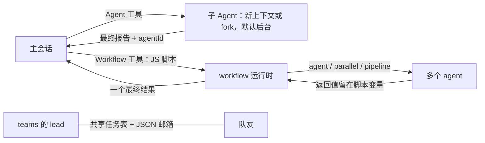
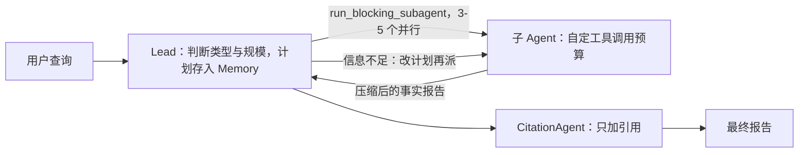
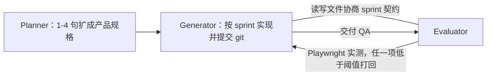
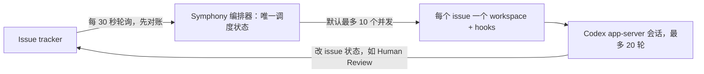
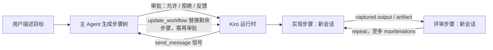

# 多 Agent 编排机制深挖：lead 如何计划、委派、并行、检查和调整

> 调研时间 2026-10 下旬，承接 `landscape.md`，只讲机制，不再罗列系统；未读取 DevFlow 仓库。`[S1]`–`[S104]` 沿用 landscape 编号，`[S105]` 起为本次新增。"二手"指第三方转述，"未核实"指没能在一手资料中确认。

## 一句话结论

主流做法是让 lead 模型决定拆什么、派给谁、何时调整，由运行时硬性执行深度、并发、预算、写隔离、审批和逐次调用记录：拆分或逐轮进行，或写成用户可审阅、可重放的计划/脚本；子 Agent 默认拿全新上下文和写明目标、输出格式、边界的委派说明，只回摘要或结构化结果；编码任务上有证据支持的是单写者加干净上下文的独立评审/验证者、只读并行和按 worktree/VM 隔离的并行，多个写者并行自由协作仍不可靠 [S1][S3][S29][S47][S98][S104][S114][S115]。

## 多 Agent 编排的核心机制

### 谁拆任务、什么时候拆
- **逐轮决定**：Claude Code 子 Agent 与 agent teams 的 lead、Codex、OpenCode、OpenAI Agents SDK 的 LLM 编排，都由主模型每轮按需决定派谁 [S1][S2][S7][S15][S63]。Anthropic 研究系统先写计划，再按子 Agent 结果更新计划和委派 [S109]。Magentic-One 把计划写成显式的任务账本（已知事实、待查事实、猜测、计划），每轮用进度账本判断是否完成、是否兜圈、谁下一个，连续停滞超过上限就重新规划 [S72][S129]。
- **先定全图**：Kiro 子 Agent 的任务 DAG 在启动前一次规划，执行中不能改 [S28]；Factory Missions 的编排者先写验证契约（可测试的行为断言清单），再拆 feature 与 milestone [S126]；Anthropic harness 的 initializer/planner 先把一句话需求扩成 200 多条功能清单或产品规格 [S99][S100]。
- **模型写编排程序**：Claude Code dynamic workflows（JS）、Devin Dynamic Workflows（Python）、Kiro Crew（Python）、Claude Managed Agents 的 workflow，都是模型写脚本、运行时执行，控制流和中间结果留在脚本变量里 [S3][S47][S31][S108]。Kiro Workflows 由模型生成 JSON/YAML 节点树，用户批准后运行，运行中可在步骤边界替换剩余计划 [S29][S125]。
- **不设编排者**：C 编译器实验里 16 个 Agent 各自挑"下一个最明显的问题"，靠锁文件避免撞车 [S6]。更正 landscape：该实验没有用 Claude Code 的 agent teams 功能（共享任务表、邮箱），用的是自建的"容器 + 共享 git 仓库 + 无限循环"harness [S6]。

### 怎么派：委派接口
- **Claude Code**：`Agent` 工具带 description、prompt、subagent_type，可选 model（只接受别名）、effort、name（开启 teams 时带 name 即生成队友）、isolation:"worktree"，`subagent_type:"fork"` 表示分叉 [S1][S5][S105][S137]。`--agent` 主线程可用 `Agent(worker, researcher)` 白名单限定能派的类型，`permissions.deny` 可禁用指定子 Agent [S1]。Workflow 工具接收脚本，脚本内用 `agent(prompt, {schema, model, phase, stallMs…})`、`parallel()`、`pipeline()`、`phase()`、`log()` [S3][S107]。
- **Codex**：`spawn_agent`（message、agent_type、fork_turns、model、reasoning_effort），`followup_task`（V2）/`send_input`（V1）追加指令，`wait_agent` 等待，`list_agents`，V1 另有 `resume_agent`、`close_agent` [S118][S119]。
- **OpenCode V2** `subagent`：agent ID、description、prompt、background，用返回的 sessionID 续接 [S15]。**Kiro** `subagent` 工具配 `toolsSettings.subagent.availableAgents/trustedAgents`；Workflows 用 `run_workflow` 启动、`update_workflow` 改计划 [S28][S29][S125]。
- **OpenAI Agents SDK**：handoff 暴露为 `transfer_to_<agent>` 工具，可带 input_type 元数据和 input_filter；`Agent.as_tool(tool_name, tool_description, parameters, custom_output_extractor, needs_approval, max_turns…)` [S122][S123]。
- **Devin**：`agent(prompt, phase=, schema=)` 返回 dict，另有 `pipeline`、`parallel`、`register_workflow`；协调会话启动 managed Devin 时给 prompt、playbook、tags、ACU 上限 [S46][S47]。**研究系统**：`run_blocking_subagent(prompt)` 与 `complete_task` [S109]。

### 上下文怎么给
- **默认全新**：Claude Code 非 fork 子 Agent 只拿自己的系统提示、委派消息、CLAUDE.md、git 状态快照和预载 skills，看不到父对话，必要的路径、错误、决定都要写进委派 prompt [S1][S5]。队友加载项目上下文和 spawn prompt，不带 lead 的历史 [S2]。Kiro 每个 workflow 步骤是新会话，只能经显式 handoff 拿前序结果 [S29]。Devin workflow agent 与 Managed Agents 子线程同样隔离 [S47][S108]。
- **分叉**：Claude Code fork 继承整段对话、同一系统提示和工具，复用父会话的 prompt cache，比新开便宜；fork 不能再 fork [S1]。Codex `spawn_agent` 默认 `fork_turns:"all"` 拷贝父会话全部记录，传 "none" 才是干净上下文 [S118]。Cognition 的 smart friend 把小模型的完整上下文分叉给大模型 [S104]。
- **外部化状态**：研究系统把计划存进外部 Memory，接近上限时开新子 Agent 并交接 [S98]（上下文超过 20 万 token 会被截断这一细节来自二手转述 [S112]）；长时 harness 用功能清单 JSON、claude-progress.txt 和 git 历史 [S99]；Factory 用验证契约、feature 列表、研究笔记和知识库等共享文件 [S126]。Kiro 把上游输出包在上游无法伪造的分隔符里再插进下游 prompt，防注入 [S30]。

### 结果怎么回
- **只回最终消息**：Claude Code 子 Agent 的中间工具调用不进父对话，只回最终报告和 agentId；后台子 Agent 以完成通知送达；到 maxTurns 时标为 partial，可续跑 [S1][S5]。报告交付前会被扫描，模仿系统标签的文本被转义，并加头注明这是子 Agent 的话、不代表用户授权；auto 模式下分类器还会先审查子 Agent 的工作和报告 [S1]。
- **结构化结果**：Claude Code workflow 的 `agent()` 可带 JSON schema，校验不过最多重试 5 次 [S3]；Devin 每次调用按 schema 返回 dict，下一阶段用它拼 prompt [S47]；Agents SDK 用 `custom_output_extractor` 抽取所需字段 [S123]。
- **产物引用**：研究系统建议子 Agent 把产物写进外部存储、只回轻量引用，减少"传话游戏"的失真 [S98]；Kiro 步骤用 artifacts 声明产出文件 [S30]。Claude Code workflow 的 agent 把发现作为返回值交回脚本，写报告文件会被要求改为返回内容，真正的工作产物照常写盘 [S107]。

### Agent 之间怎么通信
- **只经 lead**：研究系统、Codex、Agents SDK 的 as_tool [S98][S7][S123]；Claude Code 子 Agent 被命名后也可用 SendMessage 互发 [S1]。
- **邮箱加共享任务表**：Claude Code teams 每个 Agent 一个 JSON inbox 文件，消息自动投递、无广播；任务表带依赖，领取用文件锁 [S2]。
- **共享文件或仓库**：harness 里 generator 与 evaluator 读写文件协商 sprint 契约 [S100]；C 编译器用 git 与 `current_tasks/` 锁文件 [S6]；Symphony 以 issue tracker 状态为唯一协调面 [S11]；Anthropic 2026 年的群体实验用共享论坛 [S114]。
- **互不通信**：workflow 脚本里的 agent 不对话，数据由脚本传递 [S3][S47]。Cognition 发现子 Agent 默认不会把发现回报给 manager 再转给兄弟 Agent，需要专门调教 [S104]。

### 并行与写冲突
- **只读扇出最常见**：Codex 文档建议并行用于探索、测试、分诊、总结，写多的工作要谨慎 [S7]；研究系统 lead 一次并行开 3–5 个子 Agent [S98]。
- **每个 Agent 一份隔离副本**：Claude Code `isolation: worktree` 默认从默认分支建，拦截把 git 指回主 checkout 的命令 [S1]；Cursor 2.0 起单个提示最多 8 个并行 agent，各用 worktree 或远程机 [S128]；Devin 每个子会话一台 VM，共用机器时必须分配互不重叠的文件 [S46][S47]；Symphony 每个 issue 一个固定 workspace [S11]；C 编译器每个 Agent 一个容器克隆，做完 pull、合并、push [S6]。
- **单写者**：Factory 的 runner 按顺序为每个 feature 起一个 worker [S126]；Cognition 2026 年的结论是写入保持单线程 [S104]；Claude Code teams 要求每个队友负责不同文件 [S2]。Kiro 提醒多个 run 不隔离输出路径和分支，要各给 run_dir 和 worktree [S125]。

### 验证
- **独立评估者**：harness 的 evaluator 用 Playwright 实际操作应用，逐项打分，任一项低于硬阈值即判 sprint 失败 [S100]；Factory 在每个 milestone 末由系统注入 scrutiny 与 user-testing 两类验证者，验证者只报问题不修 [S126]；Devin 与 Devin Review 往返，评审方不共享编码方上下文时效果最好 [S104]。
- **测试与外部 oracle**：C 编译器靠高质量测试集、CI 防回归、GCC 作对照编译器 [S6]；长时 harness 要求每个会话先跑 init.sh 和端到端检查 [S99]。
- **多候选加评选**：Sonnet 4.5 并行多次尝试，丢掉破坏可见回归测试的补丁，再由内部评分模型选一个 [S117]；Cursor `/best-of-n` 各模型各一个 worktree，父 Agent 点评，可合并多个实现 [S127]。
- **结构化复核**：Claude Code `/deep-research` 交叉核对来源、对每条结论投票 [S3]；Kiro 子 Agent DAG 的评审回环，workflow 的并行评审与 joinPolicy（all/allSettled/any）[S28][S30]；teams 的 TaskCompleted 等 hook 以退出码 2 阻止完成 [S2]。

### 人工介入
- **启动前审批计划**：Claude Code workflow 列出阶段请求确认，可查看脚本、附评论；auto 模式只问首次，-p 与 SDK 走权限规则 [S3]。Kiro V3 在任何步骤运行前展示计划，IDE 对 Agent 新增或替换的剩余步骤也弹审批卡 [S29][S125]。Magentic 可开计划签核（Python 默认关、.NET 默认开）[S72]。反例：Claude Code teams 的计划审批默认自动通过 [S2]；Devin 的 workflow 和子会话默认自动批准 [S46][S47]；Managed Agents 的 workflow 启动前没有审批步骤，"先给计划等我同意"只能写进提示、不被强制 [S108]。
- **权限请求冒泡**：Claude Code 后台子 Agent 的权限请求在主会话弹出并注明来源，Esc 只拒这一次；子 Agent 拿不到 AskUserQuestion；任何 Agent 发来的消息都不算用户批准 [S1][S2]。Agents SDK 的 needs_approval 中断穿过 handoff 和嵌套 as_tool 冒泡到整个 run [S64]。Kiro 非交互子 Agent 遇到需审批的工具直接失败 [S28]。
- **运行中检查点**：Kiro 步骤用 send_message 的 warning 暂停等人，评审回环两次被拒时暂停问父会话 [S125]；Symphony 的运行可以停在 Human Review 之类交接状态 [S11]；Factory 在实施或验证受阻时停下交还用户 [S126]。

### 限额与失败
- **深度**：Claude Code 默认 3 层 [S1]；OpenCode V2 默认 1 层 [S15]；Managed Agents 只许一层 [S108]；Codex 文档曾写 `agents.max_depth` 默认 1（2026-07 issue 引述，当前值未核实）[S120]；Factory 的 droid 不能再派生 [S44]。
- **并发与总量**：Claude Code 同时最多 20 个子 Agent，会话内总数不限；workflow 默认 16 并发、单次最多 1000 个 agent、单个 parallel/pipeline 最多 4096 项 [S1][S3]；Managed Agents 最多 25 个子线程 [S108]；Symphony 默认 10 并发、单个 worker 会话 20 轮 [S11]；Kiro recipe 最多 50 个 step、嵌套 8 层，repeat 必须设上限 [S30]。
- **预算**：Agent SDK 的 `maxBudgetUsd` 到限后拒绝新子 Agent、停掉后台子 Agent，并以 `error_max_budget_usd` 结束 [S5]；Managed Agents 的 session budget 到限暂停 run [S108]；Devin 可给每个子会话设 ACU 上限，单次 workflow 最长 7 天 [S46][S47]；Claude Code workflow 超过 25 个 agent 或预计 150 万 token 只告警 [S3]。研究系统把规模规则写进提示，子 Agent 提示写明超过 20 次工具调用会被终止 [S98][S110]。
- **停滞与重试**：Claude Code workflow agent 长时间无输出会自动重启，最多 5 次，仍失败则在 parallel/pipeline 里返回 null [S3]；Symphony 每个 tick 先对账，5 分钟无事件即杀掉重试，失败重试按 min(10s·2^(n-1), 5 分钟) 退避 [S11]；Magentic 连续无进展超过 max_stall_count 就重置并重新规划，max_reset_count 限重置次数 [S72]；Kiro 的连接失败在同一步骤会话内重试最长 24 小时 [S125]。

### 恢复与观测
- **调用级记录加重放**：Claude Code workflow 在同一会话里按启动顺序重放已存结果，第一个 prompt 变了的 agent 及其后全部重跑，失败 agent 之后的也重跑，脚本内 `Date.now()`、`Math.random()` 被禁用 [S3]。Devin 按 prompt、schema、执行设置的哈希记录每次调用，恢复时从头执行脚本、已完成的直接重放 [S47]。Kiro 在节点边界持久化，重试只重置失败节点、保留已完成的兄弟节点 [S125]。
- **其他恢复方式**：Claude Code 子 Agent transcript 单独存盘、可凭 agentId 续跑，进程内队友不能恢复 [S1][S2]；Symphony 不建数据库，只靠 tracker 和文件系统恢复 [S11]；Managed Agents 的 harness 崩溃后用 `wake(sessionId)` 从会话日志续跑 [S101]；研究系统从出错处续跑，用 rainbow 部署避免打断运行中的 Agent [S98]。
- **观测**：Claude Code `/tasks` 显示每个子 Agent 的模型与 effort，面板按树展示嵌套，`/workflows` 显示每个 agent 的 prompt、工具调用、结果与 token，SDK 事件带 spawn_depth、parent_task_id [S1][S3][S5]；Kiro 节点显示状态、迭代、agent、model、effort、耗时，子会话记录父会话 ID [S28][S29]；Devin workflow 面板显示各 phase、agent 和 ACU [S47]；Symphony 汇总 token 和运行时长 [S11]；Magentic 发出计划创建、重新规划、进度账本事件 [S72]。

## 重点系统拆解

### 1. Claude Code 与 Claude Agent SDK

- **委派策略**：主模型按用户请求、各子 Agent 的 description 和当前上下文决定是否委派；description 里写 "use proactively" 会更主动，自定义 description 合计超过 1.5 万 token 启动时告警 [S1]。官方博客建议 description 写触发条件而非能力；需要探索 10 个以上文件或有 3 个以上独立任务是委派的明显信号；委派时写清范围、是否并行、要回什么 [S116]。Opus 5 更爱委派，claude_code 预设会在系统提示里要求未被要求时不调用 Agent；文档强调这只是引导，深度、并发、花费上限要另设 [S5]。
- **子 Agent**：上下文、结果、权限见上文。交互会话默认开 fork 模式，子 Agent 默认后台运行 [S1]。API 中断时前台返回已有部分输出并注明未完成，后台标为失败并附最后输出 [S1]。`SendMessage` 可让已完成的子 Agent 带着全部历史续跑；`isolation: worktree` 未产生改动时自动清理 [S1]。
- **agent teams（实验，只限交互会话）**：lead 调 Agent 工具时带 name 即生成队友，不经用户确认；任务分 pending、in progress、completed，可声明依赖，阻塞任务不会被自领 [S2]。队友空闲时自动通知 lead 并附最终答案；lead 处于计划模式时生成的队友先只读规划，其计划审批请求默认由 Claude Code 直接批准 [S2]。官方建议 3–5 人，15 个独立任务配 3 人，token 随人数线性增长，队友建议用 Sonnet [S2][S106]。已知失败：队友出错后提前停下、lead 不等队友自己动手、lead 过早宣布完成、任务状态滞后卡住下游 [S2]。
- **dynamic workflows**：计划写进脚本，运行时在后台执行，主上下文只收最终答案；运行中不能向用户提问，需要阶段签字就拆成多个 workflow [S3]。规模建议 small <5、medium <10（默认）、large <50 个 agent，属建议，硬上限另算 [S3]。官方 cookbook 例子：一个 agent 抽取 10 条主张，每条一个核查 agent，怀疑者 agent 复核所有"已确认"结论，最后汇总，用时 2.5 分钟、花费 3.29 美元 [S107]。
- **Claude Managed Agents（`multiagent_20261001`）**：同一 agent 可同时开启一层子 Agent（最多 25 个子线程，可追问）、服务端执行的 workflow（不能向 run 内线程追问）和 advisor 模型；可只允许预先登记的 agent（每张表最多 20 个，按版本固定）[S108]。

### 2. Anthropic 多 Agent 研究系统

- **拆分与规模**：lead 先判断查询是深度型、广度型还是直接型，再写计划；默认 3 个子 Agent，简单 1 个，复杂 5–10 个，最多 20 个，超过 20 说明该合并任务 [S109]。早期的失败是为简单问题开 50 个子 Agent、无休止地找不存在的来源、互相用过多更新干扰 [S98]。
- **委派说明**：`run_blocking_subagent` 的 prompt 要写目标（最好只有一个）、输出格式、背景、要回答的问题、起点与可信/不可信来源、该用的工具、范围边界 [S109]。早期只写"研究半导体短缺"这类短指令，结果一个子 Agent 去查 2021 年车用芯片危机，另两个重复调查 2025 年供应链 [S98]。
- **上下文与结果**：子 Agent 全新上下文，先定"研究预算"，按 OODA 循环搜索，把冲突信息和来源质量问题报给 lead [S110]。lead 自己写最终报告，不得交给子 Agent；引用由单独的引用 Agent 补，它只能加引用，正文有任何改动即被拒 [S109][S111]。
- **并行**：lead 并行开 3–5 个子 Agent，子 Agent 并行调 3 个以上工具，复杂查询耗时最多降 90%；但子 Agent 同步执行，lead 不能中途引导，整体等最慢的一个 [S98]。
- **验证与评测**：从约 20 条真实查询起步；单次 LLM 评审按事实准确、引用准确、完整、来源质量、工具效率打 0–1 分并给通过/不通过，比多个评审更稳定、更贴近人工；人工测试发现 Agent 偏好 SEO 内容农场；会改状态的 Agent 用终态评测 [S98]。
- **限额与失败**：子 Agent 约 15 次工具调用时收尾，20 次或约 100 个来源是硬上限 [S110]；收益递减时 lead 停止再派 [S109]。生产上从出错处续跑，把工具失败告诉模型让它调整，配合重试和定期 checkpoint，全链路追踪但不看对话内容 [S98]。
- **结果与成本**：Opus 4 作 lead、Sonnet 4 作子 Agent，比单个 Opus 4 在内部研究评测上高 90.2%；BrowseComp 上 80% 的表现差异由 token 用量解释；多 Agent 约耗聊天 15 倍的 token；工具测试 Agent 改写工具描述后，后续任务耗时降 40% [S98]。

### 3. Anthropic 的 harness 系列

- **长时 harness（2025-11）**：委派由 harness 代码完成，第一次会话用初始化提示，之后每次会话用编码提示 [S99]。初始化 Agent 写 init.sh、claude-progress.txt、首个提交和 200 多条全部标为失败的功能清单（JSON，只许改 passes 字段，因为模型较少乱改 JSON）[S99]。编码会话先读 git log 和进度文件、选最高优先级的未完成功能、跑端到端检查，一次只做一个功能，结束时提交并更新进度 [S99]。要解决的失败是一次做完整个应用、看到进展就宣布完成、没做端到端测试就标完成；专职测试、QA、清理 Agent 是否更好被列为开放问题 [S99]。
- **planner、generator、evaluator（2026-03）**：planner 只写产品与高层技术设计，避免早期的细节错误传导到实现；generator 按 sprint 一次一个功能，交 QA 前先自评；evaluator 用 Playwright 点遍应用，每个标准有硬阈值 [S100]。开工前双方协商 sprint 契约（Sprint 3 有 27 条标准），所有通信靠读写文件 [S100]。开箱的 Claude 是差的 QA，会发现问题后说服自己放行、测试流于表面，作者靠读日志多轮调提示才改善 [S100]。
- **上下文重置**：Sonnet 4.5 接近上限时会提前收尾，需要清空上下文并做结构化交接；Opus 4.5 基本没有这个问题，改为单个连续会话加自动压缩 [S100][S101]。Opus 4.6 之后去掉 sprint，评估者改为结束时只跑一次；评估者只在任务超出模型独立可靠完成的范围时值得花钱 [S100]。
- **成本**：完整 harness 比单 Agent 贵 20 倍以上；二手转述的表格是单 Agent 20 分钟 9 美元、核心玩法不可用，harness 6 小时 200 美元、可玩 [S100][S113]。简化后的 harness 做浏览器 DAW 约 4 小时、124 美元，QA 仍抓出拖拽剪辑等核心功能缺失 [S100]。
- **C 编译器（2026-02-05）**：每个 Agent 一个 Docker 容器，克隆共享的裸仓库；在 `current_tasks/` 写锁文件认领任务，git 同步让后到者换任务；做完 pull、合并（冲突常见，模型能处理）、push、删锁；没有编排 Agent，也没有其他通信 [S6]。测试只打印几行、细节写日志并把 ERROR 和原因放同一行，`--fast` 让每个 Agent 确定性地抽 1% 或 10% 用例 [S6]。编 Linux 内核时 16 个 Agent 撞同一个 bug、互相覆盖，改为用 GCC 编大部分文件、只把随机子集交给新编译器后才恢复并行 [S6]。另设去重、编译器性能、生成代码质量、Rust 设计评审、文档等专职 Agent [S6]。约 2000 个会话、两周、20 亿输入与 1.4 亿输出 token，花费近 2 万美元，后期新功能常破坏旧功能 [S6]。

### 4. OpenAI：Codex 子 Agent、Symphony、Agents SDK

- **Codex 子 Agent 的委派策略**：本地版只在用户明说，或 AGENTS.md、skill 要求时才派生；Codex 负责派生、转发后续指令、等全部结果、关闭线程，再给一个汇总 [S7]。好的委派 prompt 要写清怎么拆、是否等全部完成、回什么摘要 [S7]。内置 default、worker、explorer；自定义 TOML 可改模型、推理强度、关能力，不能改沙箱、审批策略、provider、MCP [S7]。
- **接口、上下文与结果**：V2 用 `followup_task` 继续同一个子 Agent，`wait_agent` 是事件订阅，空闲时建议 5–10 分钟一段地等；设了 model 却没设 reasoning_effort 时，子 Agent 的 effort 会回落到该模型默认值 [S7][S118]（S118 是 OpenAI plugins 仓库里的插件说明，不是产品文档）。完成的子线程以 `<subagent_notification>` 注入父上下文（2026-02 第三方源码分析，二手）[S119]。
- **权限与限额**：文档写子 Agent 继承父会话的沙箱与权限模式 [S7]；同一份源码分析称当时子线程的审批策略被强制为 never、审批交给父线程，两者不一致，未核实 [S119]。`agents.max_concurrent_threads_per_session` 限并发；`approvals_reviewer = auto_review` 可让 reviewer 子 Agent 代审审批提示 [S121]。
- **Symphony（Draft v1）**：常驻服务按状态、标签、阻塞关系挑 issue，为每个 issue 建确定性的 workspace 并跨运行保留；仓库里的 `WORKFLOW.md` 用 YAML 头写 tracker、轮询、workspace、hooks（after_create、before_run、after_run、before_remove）、agent 与 codex 设置，正文是严格的 Liquid 模板，未知变量直接报错 [S11]。单轮最长 1 小时，5 分钟无事件判为停滞；正常退出 1 秒后续跑，异常按指数退避；issue 进入终态时停掉 worker 并清理 workspace [S11]。编排器是唯一改调度状态的组件，重启只靠 tracker 和文件系统恢复 [S11]。
- **Agents SDK**：handoff 把对话交给专家，接收方默认看到全部历史，可用 input_filter 或 beta 的 nest_handoff_history 压缩；as_tool 让 manager 保留控制权，嵌套运行不继承父对话 [S122][S123]。代码编排可以按结构化输出路由、串联、评估循环、asyncio.gather 并行 [S63]。官方建议先用一个 Agent，只在能力隔离、策略隔离、提示清晰度或 trace 可读性明显改善时才拆 [S124]。

### 5. Devin

- **managed Devins**：协调会话自己拆任务，也可按用户要求"每个模块一个"；启动子会话时给 prompt、playbook、tags、ACU 上限，可给子会话发消息、查 ACU、让其休眠或终止 [S46]。子会话完成或需要输入时协调者被自动唤醒，不用轮询，也可给自己定时提醒；每个子会话一台独立 VM，协调者负责监控、解决冲突、汇总 [S46]。默认不经确认就启动子会话，可在设置里关掉 [S46]。
- **Dynamic Workflows**：Devin 写确定性的 Python 脚本，`agent(prompt, phase, schema)` 跑一个 Agent 并返回结构化 dict，`pipeline` 让各项独立流过各阶段（无屏障），`parallel` 等全部完成，`log` 输出进度 [S47]。适用于约 5 个以上需要判断的独立单元加汇总，或后一阶段消费前一阶段结构化输出；机械改动、只要一两个会话、强耦合或小而顺序的工作不用 [S47]。
- **隔离、恢复与成本**：默认每个 agent 一台 VM，也可与协调会话共用机器，此时并发更低且必须分配互不重叠的文件 [S47]。脚本被要求不读时间、随机数、环境变量、文件系统和网络，外部信息都放进 agent 调用；改一个 prompt 只重跑它和下游；失败如何处理由脚本决定（跳过、默认值、重试、失败）[S47]。建议先在一小片上试跑并对扇出阶段用便宜的 Devin Lite；跑通的脚本可存为仓库里的 workflow.py 加 SKILL.md 复用 [S47]。
- **Cognition 的经验**：2025-06 的文章用 Flappy Bird 例子说明，并行子 Agent 各自做出的隐含决策会互相冲突，建议共享完整轨迹或干脆单线程 [S103]。2026-04 的文章说 Devin Review 平均每个 PR 找出 2 个 bug、约 58% 为严重问题，编码与评审 Agent 事先不共享上下文效果最好，编码方要用自己掌握的用户指令筛选评审意见以免越界或兜圈 [S104]。manager Devin 经内部 MCP 协调子 Devin，问题在于 manager 习惯过度规定细节、误以为与子 Agent 共享状态、子 Agent 默认不回报发现；Cognition 认为可行形态是 manager 拆分、子 Agent 执行、manager 汇总，无结构的 swarm 多半是干扰 [S104]。

### 6. Kiro

- **子 Agent**：主 Agent 按 description 选 agent；子 Agent 共享 steering、MCP、工作区和权限配置，对话、spec 状态和 hook 触发各自隔离 [S28]。可规划带依赖的 DAG，启动前定好全图、执行中不能改；评审回环用 target、trigger（输出中的文字，如 NEEDS_CHANGES，至少 4 个字符）、max_iterations（1–10），禁止自环与互环 [S28]。`availableAgents` 限定可派的 agent，`trustedAgents` 免审批；子会话记录父会话 ID；IDE 开启 Workflows 后，委派自定义 agent 会变成后台 workflow run [S28]。
- **Workflows 的分工**：模型决定由哪些 agent 按什么顺序做，Kiro 运行时负责执行；节点有 step、sequence、repeat、parallel、watch，watch 轮询 PR 或自定义命令时不耗模型轮次 [S29][S30]。每个 step 可单独设 modelId、effortLevel；步骤用 `send_message` 报 info、success、warning、error，warning 会暂停等人 [S30][S125]。
- **设计、审批、执行**：V3 会话里主 Agent 先给出步骤树，用户批准后才运行，CLI 可直接输入修改意见；"Use workflows" 设置决定主 Agent 多主动地发起 workflow，默认只在被要求时 [S29]。运行中，step agent 或父会话可用 `update_workflow` 替换剩余计划：已完成和正在执行的节点不变，有步骤在跑时排到下一个边界生效，新树要重新通过 schema、ID、嵌套、步数、模板、agent 校验，IDE 还要再次审批 [S125]。
- **限额与恢复**：最多 50 个 step、嵌套 8 层，每个 repeat 必须有 maxIterations 和到限行为，评审回环被拒两次会暂停询问 [S30][S125]。节点边界持久化，重启后中断的步骤在原会话继续，重试只重置失败节点 [S125]。
- **Crew**：workflow 是模型写的 Python 脚本；内置 conductor 拆目标、每项开一个会话、检查验收标准、决定下一轮追问、重试或结束；`session_send` 把消息投进另一会话作为下一轮；agent 调用进持久任务队列，网关重启后继续；全局 workflow 库按版本管理 [S31]。

### 7. 其他系统速览

| 系统 | 谁拆、怎么派 | 并行与隔离 | 验证与人工 | 限额 |
|---|---|---|---|---|
| OpenCode | 主 Agent 用 V1 `task` 或 V2 `subagent` 工具，`permission.task`/`subagent` 规则限定可调的 agent [S13][S15] | V2 可 `background:true`、按 sessionID 续接，内置 worktree 工具 [S15] | ask/allow/deny 权限 [S13] | V2 默认嵌套 1 层；父模型可改子 Agent 模型且不校验 [S15][S17] |
| Cursor | 按 description 自动委派或 `/name` 调用，最多两层 [S26] | 2.0 起单提示最多 8 个 agent，各用 worktree 或远程机 [S128] | Cursor 3 `/best-of-n`：多模型各一 worktree，父 Agent 点评、可合并 [S127] | readonly 开关 [S26] |
| Factory Missions | 编排者澄清需求、写验证契约、拆 feature 与 milestone，runner 按序起 worker [S126] | worker 顺序执行，各自新上下文 [S126] | milestone 末注入 scrutiny 与 user-testing 验证者，只报不修，编排者生成修复 feature [S126] | droid 不能再派生 [S44]；三类角色分别配模型 [S45] |
| Magentic-One | 编排者维护任务账本，每轮用进度账本选下一个 agent [S72][S129] | 每轮一个 agent 行动 [S72] | 可开计划签核，"请求是否满足"由账本判断 [S72] | max_round、max_stall、max_reset [S72] |
| Amp | oracle（只读、强推理）与 librarian（跨仓库搜代码）作为工具由主 Agent 调用；系统提示不强推 oracle，以控成本 [S41][S42] | 只读 | 主要靠用户显式要求调用 [S41] | 文档未见 |

## 什么有效、什么无效

**有效（有数字支持）**
- **读多的广度任务并行**：研究系统 +90.2%，复杂查询耗时最多降 90% [S98]；Google Research 等在 260 种配置、6 个基准上的对照实验里，可分解的金融推理 +80.8% [S130]。
- **独立评估与评审**：同一提示下，单 Agent 做出的游戏核心玩法不可用，三角色 harness 的版本可玩 [S100]；Devin Review 平均每 PR 约 2 个 bug、58% 严重 [S104]；Factory 一次 Slack 克隆任务中验证者报出 81 个问题，编排者生成 21 个修复 feature（占实现工作 34.4%），每个 milestone 2–4 轮验证收敛，验证占总时长 37.2%（厂商自报）[S126]；Agent-as-a-Judge 在 DevAI 上可靠程度接近人工评审，明显好于 LLM-as-a-Judge [S136]。
- **多候选加客观过滤再评选**：Sonnet 4.5 在 SWE-bench Verified 从 77.2% 升到 82.0% [S117]；R2E-Gym 的开源模型单次 34.4%，26 次 rollout 加混合验证器选优后 51% [S135]。
- **以测试或对照实现为 oracle 的并行**：C 编译器在测试通过率到 99% 后，让每个 Agent 各编一个开源项目（SQLite、Redis、Lua 等）[S6]。

**无效或有风险**
- **并行写者**：Cognition 两篇文章都这样判断 [S103][S104]；C 编译器的 16 个 Agent 在单个大任务上互相覆盖 [S6]；Anthropic 2026 年让多组 Agent 各花 12 小时合写游戏，旧模型的 PR 很少被合并，新模型靠各自独占文件避开冲突，角色分工或"CEO"层级提示几乎不改变结果，产出普遍很差 [S114]。
- **顺序依赖的任务**：所有多 Agent 变体在顺序规划任务上下降 39%–70%，没有集中验证的架构更容易放大错误（v1 报告独立式 17.2 倍、集中式 4.4 倍）[S130]；Claude Code 文档同样把顺序任务、同文件编辑、依赖多的工作列为不适合 [S2][S116]。
- **按团队或问题类型拆子 Agent**：Anthropic Applied AI 在 2026-10 称，多个企业部署中"单 Agent 加 skills"常在质量上胜过子 Agent 设计，一家客户换成单循环后运行时间约快一倍；应按上下文边界拆，按问题类型拆会出现传话失真 [S115]。
- **自评与同质化**：Agent 评自己的作品普遍偏宽松 [S100]；同模型 Agent 行为高度相似，30 个里有 18 个起了同一个分支名，争抢有限带宽时 240 万次请求只被接受 117 个；目标冲突的 3 个 Agent 很快升级为互相破坏 [S114]。
- **辩论与多轮讨论**：多 Agent 辩论的收益大部分来自多数投票 [S134]；GPT-4.1 下 6 种多 Agent 工作流只有 1 种在 10 个基准的总体准确率上超过单 Agent，LLM-Debate 用 1.39 倍 token 反而低 1.96 分 [S131]。MAST 把多 Agent 失败归为规格问题、Agent 间失配、任务验证三类共 14 种 [S133]。

**相互冲突的证据**
- DeLM（作者自研）用共享上下文加任务队列替代主 Agent，称在 SWE-bench Verified 等任务上比 Codex、Claude Code 及其原生子 Agent 准确率最多高 17.5 分、最快 2.49 倍 [S132]；这与 Anthropic 建议折叠回单循环 [S115] 和 BenchAgent 的结果 [S131] 方向相反，未见独立复现。
- 收益有多少只是"多花了 token"：研究系统 80% 的差异由 token 解释 [S98]；Google 发现单 Agent 基线越强，协作收益越小 [S130]；harness 作者在 Opus 4.6 上发现，对模型能力范围内的任务，评估者变成纯开销 [S100]。
- 协作群体与独立并行：漏洞挖掘中 45 个协作 Agent 找到 266 个（2700 万 token），独立并行 21 个（650 万 token），但限定在同一批核心目录后每个漏洞的 token 成本相近，两者只重叠 12 个，更像互补 [S114]。

**成本参考**：多 Agent 约为聊天 15 倍 token [S98]；teams 随人数线性增长 [S2]；C 编译器近 2 万美元 [S6]；DAW harness 124 美元 [S100]；workflow 核查 10 条主张 3.29 美元 [S107]。Factory、Devin 的效果数字为厂商自报，未见独立评测。

## 可以直接借鉴的设计

以下按 DevFlow 的约束（人工 Gate、每次模型调用的预算准入、编码用隔离 worktree、团队同步）改写，不预设固定阶段。

1. **每个任务由 lead Agent 现写计划，计划是可校验的数据**：节点树（步骤、并行分支、有上限的循环、等待外部事件），每个节点写明 agent、输入产物、验收标准、预算；运行时校验后执行，lead 只能在节点边界替换剩余计划，已完成节点不可变 [S29][S30][S125][S3][S47]。lead 每轮用类似 Magentic 进度账本的结构判断"是否完成、是否兜圈、下一步给谁" [S72]。
2. **Gate 与验证作为计划不变量，由运行时校验或插入**：参照 Factory 由系统在 milestone 末注入验证者 [S126]，DevFlow 可规定"改代码的节点之后必须有独立验证，交付前必须过 Gate"，lead 可以决定拆法和顺序，但删不掉 Gate、预算准入和验收节点；审批与校验这类硬限制放在工具和运行时里，不写在提示里 [S115][S30]。
3. **只给 lead 少量委派原语**：spawn（agent 类型、prompt、输出 schema、模型、预算、隔离方式、前台或后台）、followup、wait（事件驱动，不轮询）、stop、list；大批同构工作用"模型写脚本 + agent/parallel/pipeline"一次性提交 [S1][S118][S46][S47][S3]。
4. **委派说明有必填字段，派发时校验**：目标、输出 schema、引用的已批准产物与文件、可用工具、负责的文件范围、验收标准、工具调用或 token 预算，缺项拒绝派发 [S109][S7][S116][S126]。拆分按上下文边界（独立研究路径、接口清楚的组件、黑盒验证），不按"需求/设计/编码/测试"角色 [S115]；规模规则写进 lead 提示，例如"小改动不派、3 个以上独立单元才并行"[S98][S116][S47]。
5. **默认全新上下文，评审一律干净上下文**：子 Agent 只拿委派说明和产物引用；fork 只给确实需要完整背景的旁路任务；评审和验证者只看规格、diff、测试结果，不看编码 Agent 的对话 [S1][S118][S29][S104]。
6. **结果按 schema 回结构化摘要和产物引用**：校验失败有上限地重试，partial 显式标记；子 Agent 输出一律当数据处理，不能充当用户审批，插入下游 prompt 时加防伪分隔 [S1][S3][S30][S47][S98]。
7. **编码保持单写者**：并行只给只读探索、评审，以及声明了互不重叠文件的单元；确需并行编码时每个单元一个 worktree，从任务分支建（Claude Code 默认从默认分支建，Kiro IDE 要求从运行开始时的分支建并在结束时 rebase 回去），由 lead 安排合并和集成测试 [S104][S7][S2][S126][S6][S1][S29]。
8. **每次 spawn 先过预算准入，深度、并发、总数、金额是硬上限**：参照 SDK 到限拒绝新子 Agent 并停掉后台子 Agent [S5]、Claude Code 的 3 层与 20 并发及单 run 1000 个 agent [S1][S3]、Managed Agents 的一层与 25 线程 [S108]；模型名只从白名单解析。反例是 OpenCode 父模型能静默改子 Agent 模型、Kilo 无深度上限导致递归 [S17][S18]。
9. **人工介入分三层，默认不自动批准**：多 Agent 运行前给计划审批（阶段、agent 数、预计花费，可附修改意见）；子 Agent 的权限请求冒泡到任务主会话并注明来源；评审回环连续被拒或停滞时暂停问人 [S3][S29][S125][S1][S72]。不照搬 teams、Devin、Managed Agents 的自动批准默认值 [S2][S46][S47][S108]。
10. **按调用记账，恢复靠确定性重放**：每次 agent 调用按（prompt、schema、模型、设置）哈希存结果与预算回执；编排逻辑不读时间与随机数；改一个 prompt 只重跑它和下游；预算回执可直接当幂等键，避免重复扣费 [S3][S47][S125]。
11. **停滞检测与对账**：agent 超时无输出就有界重启；每次调度前先对账外部状态（任务取消、需求变更、Gate 被拒），再决定派发；连续 N 轮无进展转为重新规划或交给人 [S3][S11][S72]。
12. **运行树和成本可见，定义按版本固定**：记录 parent、depth、每个 agent 的模型、effort、token、费用和状态，发出计划创建与修订事件；run 引用的 agent 定义按版本快照，团队同步时按版本对齐 [S1][S5][S29][S108][S11]。

## 来源

`[S1]`–`[S104]` 与 landscape 同号；"2026-10 访问"表示页面无发布日期，内容以 2026 年 10 月下旬抓取为准。

- S1 Claude Code 文档《Create custom subagents》https://code.claude.com/docs/en/sub-agents （2026-10 访问）
- S2 Claude Code 文档《Orchestrate teams of Claude Code sessions》https://code.claude.com/docs/en/agent-teams （2026-10 访问）
- S3 Claude Code 文档《Orchestrate subagents at scale with dynamic workflows》https://code.claude.com/docs/en/workflows （2026-10 访问）
- S5 Claude Agent SDK 文档《Subagents in the SDK》https://code.claude.com/docs/en/agent-sdk/subagents （2026-10 访问）
- S6 Anthropic《Building a C compiler with a team of parallel Claudes》https://www.anthropic.com/engineering/building-c-compiler （2026-02-05）
- S7 OpenAI Codex 文档《Subagents》https://learn.chatgpt.com/docs/agent-configuration/subagents （2026-10 访问）
- S11 OpenAI Symphony《SPEC.md》Draft v1 https://github.com/openai/symphony/blob/main/SPEC.md （2026-10 访问；发布约 2026-03，二手）
- S13 OpenCode 文档（V1）《Agents》https://opencode.ai/docs/agents/ （2026-10 访问）
- S15 OpenCode V2 文档《Tools》https://opencode.ai/v2/docs/tools/ （2026-10 访问）
- S17 OpenCode issue #51071 https://github.com/anomalyco/opencode/issues/51071 （2026-09-24）
- S18 Kilo Code issue #8637《Infinite subagent recursion》https://github.com/Kilo-Org/kilocode/issues/8637 （2026-04-09）
- S26 Cursor 文档《Subagents》https://cursor.com/docs/subagents （2026-10 访问，沿用 landscape 的抓取）
- S28 Kiro 文档《Invoking as sub-agents》https://kiro.dev/docs/custom-agents/subagents.md （2026-10 访问）
- S29 Kiro 文档《Workflows》https://kiro.dev/docs/workflows.md （2026-10 访问）
- S30 Kiro 文档《Author workflows》https://kiro.dev/docs/workflows/authoring.md （2026-10 访问）
- S31 Kiro Crew 文档《Workflows》https://kiro.dev/docs/crew/features/workflows.md （2026-10 访问）
- S41 Amp《Oracle》https://ampcode.com/news/oracle （2025-07-04）
- S42 Amp《The Librarian》https://ampcode.com/news/librarian （2025-10-20）
- S44 Factory 文档《Custom droids (subagents)》https://docs.factory.com/user-guides/droids/creating-custom-droids （2026-10 访问，沿用 landscape）
- S45 Factory 文档《Missions Configuration & Reference》https://docs.factory.com/missions/reference （2026-10 访问）
- S46 Devin 文档《Advanced Capabilities》https://docs.devin.ai/work-with-devin/advanced-capabilities （2026-10 访问，本次抓到全文）
- S47 Devin 文档《Devin Dynamic Workflows》https://docs.devin.ai/work-with-devin/dynamic-workflows （2026-10 访问）
- S63 OpenAI Agents SDK 文档《Agent orchestration》https://openai.github.io/openai-agents-python/multi_agent/ （2026-10 访问）
- S64 OpenAI Agents SDK 文档《Human-in-the-loop》https://openai.github.io/openai-agents-python/human_in_the_loop/ （2026-10 访问，沿用 landscape）
- S72 Microsoft Learn《Magentic orchestration》https://learn.microsoft.com/en-us/agent-framework/workflows/orchestrations/magentic （2026-10 访问）
- S98 Anthropic《How we built our multi-agent research system》https://www.anthropic.com/engineering/multi-agent-research-system （2025-06-13）
- S99 Anthropic《Effective harnesses for long-running agents》https://www.anthropic.com/engineering/effective-harnesses-for-long-running-agents （2025-11，日期据 anthropics/cwc-long-running-agents README）
- S100 Anthropic《Harness design for long-running application development》https://www.anthropic.com/engineering/harness-design-long-running-apps （2026-03，同上）
- S101 Anthropic《Scaling Managed Agents: Decoupling the brain from the hands》https://www.anthropic.com/engineering/managed-agents （2026，日期未核实）
- S103 Cognition《Don't Build Multi-Agents》https://cognition.com/blog/dont-build-multi-agents （2025-06-12）
- S104 Cognition《Multi-Agents: What's Actually Working》https://cognition.com/blog/multi-agents-working （2026-04-22）
- S105 Claude Code 文档《Tools reference》（Agent tool behavior）https://code.claude.com/docs/en/tools-reference （2026-10 访问）
- S106 Claude Code 文档《Manage costs》（Agent team token costs）https://code.claude.com/docs/en/costs （2026-10 访问）
- S107 Claude Cookbook《Orchestrate subagents at scale with dynamic workflows》https://platform.claude.com/cookbook/claude-agent-sdk-08-dynamic-workflows （约 2026-07，检索元数据；2026-10 访问）
- S108 Claude Platform 文档《Multiagent orchestration》（Managed Agents，`multiagent_20261001`）https://platform.claude.com/docs/en/docs/managed-agents/multi-agent （2026-10 访问，beta）
- S109 Anthropic Cookbook 提示词 research_lead_agent.md https://github.com/anthropics/anthropic-cookbook/blob/main/patterns/agents/prompts/research_lead_agent.md （2026-10 访问）
- S110 Anthropic Cookbook 提示词 research_subagent.md https://github.com/anthropics/anthropic-cookbook/blob/main/patterns/agents/prompts/research_subagent.md （2026-10 访问）
- S111 Anthropic Cookbook 提示词 citations_agent.md https://github.com/anthropics/anthropic-cookbook/blob/main/patterns/agents/prompts/citations_agent.md （2026-10 访问）
- S112 Ritvik Rastogi《Papers Explained 412: Claude Research》https://ritvik19.medium.com/papers-explained-412-claude-research-334b1f6a353b （2025-07-18，二手，转述 S98 架构图说明）
- S113 walkinglabs《learn-harness-engineering》Lecture 01 https://github.com/walkinglabs/learn-harness-engineering/blob/main/docs/en/lectures/lecture-01-why-capable-agents-still-fail/index.md （日期未见，二手，转述 S100 成本表）
- S114 Anthropic《Patterns and problems in emerging multiagent systems》https://www.anthropic.com/research/multiagent-systems （约 2026-10，页面未显示日期，未核实）
- S115 Claude《Building agents: When to fold subagents into your main agent loop》https://claude.com/resources/articles/building-agents-when-to-fold-subagents-into-your-main-agent-loop （2026-10-22，日期据第三方报道）
- S116 Claude Blog《How and when to use subagents in Claude Code》https://claude.com/blog/subagents-in-claude-code （约 2026-08，检索元数据，未核实）
- S117 Anthropic《Introducing Claude Sonnet 4.5》Methodology 段 https://www.anthropic.com/news/claude-sonnet-4-5 （2025-09-29）
- S118 openai/plugins 仓库 superpowers 插件《codex-tools.md》https://github.com/openai/plugins/blob/main/plugins/superpowers/skills/using-superpowers/references/codex-tools.md （2026-10 访问，非产品文档）
- S119 serialx《Codex Multi-Agent System Architecture》gist https://gist.github.com/serialx/f842f7b41d0f74ff5f64845e4afbc260 （2026-02-25，二手源码分析）
- S120 openai/codex issue #32027《agents.max_depth = 1 permits child-to-grandchild spawning in 0.144.1》https://github.com/openai/codex/issues/32027 （2026-07）
- S121 Codex《Configuration Reference》https://learn.chatgpt.com/docs/config-file/config-reference （2026-10 访问）
- S122 OpenAI Agents SDK 文档《Handoffs》https://openai.github.io/openai-agents-python/handoffs/ （2026-10 访问）
- S123 OpenAI Agents SDK 文档《Tools》（Agents as tools）https://openai.github.io/openai-agents-python/tools/ （2026-10 访问）
- S124 OpenAI API 文档《Orchestration and handoffs》https://developers.openai.com/api/docs/guides/agents/orchestration （2026-10 访问）
- S125 Kiro 文档《Run and manage workflows》https://kiro.dev/docs/workflows/manage.md （2026-10 访问）
- S126 Factory《How Missions Work》https://factory.com/news/missions-architecture （由 factory.ai 跳转；日期未核实，2026-10 访问）
- S127 Cursor 论坛官方公告《Cursor 3: Worktrees & Best-of-N》https://forum.cursor.com/t/cursor-3-worktrees-best-of-n/156507 （2026-04-02）
- S128 Cursor Changelog 2.0 https://cursor.com/changelog/2-0 （2025-10-29）
- S129 Fourney 等《Magentic-One: A Generalist Multi-Agent System for Solving Complex Tasks》arXiv:2411.04468 https://arxiv.org/abs/2411.04468 （2024-11，仅摘要）
- S130 Kim 等《Towards a Science of Scaling Agent Systems》arXiv:2512.08296 https://arxiv.org/abs/2512.08296 （v1 2025-12-09，v3 2026-04-08；39%–70% 与 17.2×/4.4× 出自 v1 摘要）
- S131 BenchAgent 论文《Do More Agents Help? Evaluating Accuracy and Cost in LLM Multi-Agent Workflows》arXiv:2606.05670 https://arxiv.org/abs/2606.05670 （v1 2026-06-04，v2 2026-10-09）
- S132 DeLM 论文《Decentralized Multi-Agent Systems with Shared Context》arXiv:2606.10662 https://arxiv.org/abs/2606.10662 （v1 2026-06-09，v3 2026-10-04）
- S133 Cemri 等《Why Do Multi-Agent LLM Systems Fail?》arXiv:2503.13657 https://arxiv.org/abs/2503.13657 （2025-03，仅摘要）
- S134 论文《Debate or Vote: Which Yields Better Decisions in Multi-Agent Large Language Models?》arXiv:2508.17536 https://arxiv.org/abs/2508.17536 （2025-08，仅摘要）
- S135 R2E-Gym 项目页 https://r2e-gym.github.io/ 与 arXiv:2504.07164（2025-04）；34.4% Pass@1 见 UC Berkeley 技术报告 EECS-2026-158 https://www2.eecs.berkeley.edu/Pubs/TechRpts/2026/EECS-2026-158.html （2026，仅摘要）
- S136 Zhuge 等《Agent-as-a-Judge: Evaluate Agents with Agents》arXiv:2410.10934 https://arxiv.org/abs/2410.10934 （2024-10，ICML 2025，仅摘要）
- S137 anthropics/claude-code issue #100117（列出 Agent 工具输入字段）https://github.com/anthropics/claude-code/issues/100117 （2026-10）
