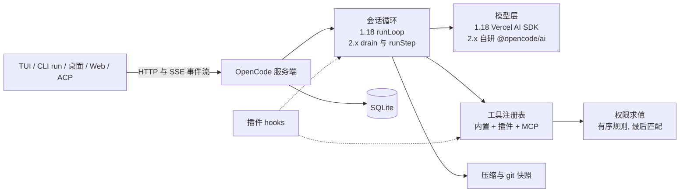
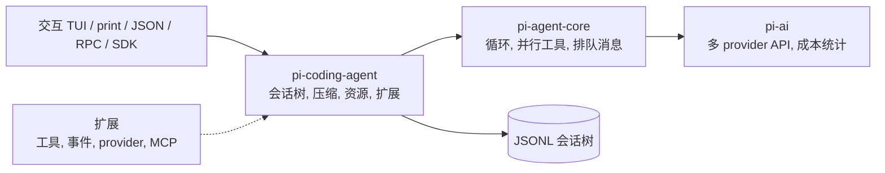

# OpenCode 与 Pi 的 harness 实现调研

只读源码调研，作为 Native Coding v3 评审的输入。读了 OpenCode v1.18.15（DevFlow 固定版本）、v2.2.5（2.x 最新）、Pi v1.4.0 的源码与随仓文档，以及 Pi 作者的设计文章。没有安装、构建或运行任何程序，没有调用模型。代码为本地浅克隆，版本与 SHA 见文末“来源”。

编号约定：表格首列 S01–S20 对应 learn.shareai.run 的 20 课 [W2]，E1–E13 是补充维度。来源编号：[A*] 为 OpenCode 1.18.15 源码，[B*] 为 OpenCode 2.2.5 源码，[P*] 为 Pi 1.4.0 源码与文档，[W*] 为网页；[S13]–[S20] 沿用 `multi-agent/landscape.md` 的编号，[D1] 指 `multi-agent/devflow-assets.md`。源码链接都是固定 SHA 的 GitHub permalink。

## 一句话结论

OpenCode 把有序权限规则、每步 git 快照、模板化压缩、子代理和插件 hook 都做进核心；2.x 又把输入、后台任务和定时任务持久化，同时删掉了 doom_loop 检测和旧工具输出裁剪，没有移植编辑后的 LSP 诊断，工作区外路径改为默认放行。Pi 只有 4 个默认工具，系统提示正文约 2.5 KB，刻意不做权限、子代理和计划模式，把会话树、排队消息和缓存保护做细，其余交给扩展。

## 两个项目的总体结构

### OpenCode

1.18 的核心是 `packages/opencode` 里的一组 Effect 服务：循环在 `session/prompt.ts`，模型调用默认走 Vercel AI SDK [A1][A27]。2.x 拆成 schema、core、protocol、server、client 等包，循环移到 `session/runner`，工具、agent、计划模式都以内置插件注册，模型调用改走自研的 `@opencode/ai` [B1][B6][B20]。两版都是客户端/服务端结构，TUI、CLI、桌面经 HTTP 和事件流连接服务端 [A26][B19]。

### Pi

pi-ai 统一模型接口，pi-agent-core 只管循环与工具调用（约 2,500 行），pi-coding-agent 负责会话、压缩、资源加载、扩展和各运行模式；交互、print、JSON、RPC、SDK 共用同一套机制 [W1][P14]。仓库已从 badlogic/pi-mono 迁到 earendil-works/pi，npm 包改名为 `@earendil-works/*` [P28][W4]。

## 逐项对照

| 维度 | OpenCode 1.18.15 | OpenCode 2.2.5 | Pi 1.4.0 |
|---|---|---|---|
| S01 Agent Loop | `runLoop` 每步重读会话消息；最后一条助手消息的结束原因不是 tool-calls 且没有待执行工具时退出；排队的子任务、压缩任务在循环里处理；`agent.steps` 默认不限，最后一步追加“已达最大步数”提示 [A1][A2] | 输入先写入 SQLite inbox，`drain` 在边界取出，`runStep` 每步前先判断是否压缩；步数用尽时追加提示并设 `toolChoice: none`，保留工具定义以免缓存失效 [B1][B2] | 内层循环处理工具调用和 steering 消息，外层循环接 follow-up；不设最大步数，作者说没找到用途 [P1][W1] |
| S02 Tool Use | 内置工具、配置目录 `{tool,tools}/*.{js,ts}`、插件工具合并注册；ID 含 `gpt-` 且不是 gpt-4 或 oss 的模型用 `apply_patch` 替换 edit/write；参数解码失败时让模型改写参数；工具由 AI SDK 在流中执行，同一回复里的多个调用并发（按 AI SDK 行为和处理器的等待逻辑推断）；工具名大小写错时修正，否则转给 `invalid` 工具 [A5][A6][A27][A2] | Location 级注册表，内置工具也以插件注册，同名后注册者生效；未标 `codemode:false` 的工具（MCP 默认如此）只能经 Code Mode 的 `execute` 用 JS 调用；流中每收到一个 tool-call 就 fork 执行，多个调用并发，结果统一截断 [B4]；tool-input-repair 插件在 schema 明确允许时修正参数，如字符串化的 JSON、数字或布尔字符串 [B11]；2.2.5 起 `bash` 调用按 `shell` 执行 [B6][B31] | TypeBox 定义参数并校验；默认并行：准备阶段（校验、`beforeToolCall`）按顺序进行，工具本体并发，结果按调用顺序写回；任一工具标 `sequential` 则整批串行；结果分为给模型的 content 和给界面的 details [P1][P3][W1] |
| S03 Permission | 规则 `{permission, pattern, action}`，合并后对每个 pattern 取最后匹配，无匹配为 ask；默认 `*` allow，doom_loop、工作区外目录、`*.env` 读取为 ask；shell 先用 tree-sitter 拆出子命令再逐条匹配 [A11][A12][A9] | 规则改为 `{action, resource, effect}`，同样取最后匹配；基础策略 `*` allow、`*.env` ask，工作区外目录默认放行；“总是允许”按项目存入 SQLite，不覆盖配置的 deny；无人值守时 ask 变 deny [B9][B10][B12][W3] | 无。默认以当前用户权限执行一切，作者认为常见防护多是“security theater”；只有加载项目资源前的 project trust；需要拦截时写 `tool_call` 扩展 [W1][P15][P22] |
| S04 Hooks | 插件 hooks 包括 `chat.message/params/headers`、`tool.execute.before/after`、`shell.env`、`tool.definition`、system 与 messages 变换、`experimental.session.compacting` 等，按加载顺序串行执行，靠改写 output 对象生效；`permission.ask` 已声明但 1.18.15 代码里没有调用点 [A24][A25] | 按域划分的类型化 hooks：aisdk、session（context、model.request、retry、`experimental.idle` 等）、permission.evaluate、shell、tool；只有 tool 的 `execute.before` 能以失败拒绝调用；不再加载 V1 插件 [B18][S19][S20] | 扩展事件：`input`、`before_agent_start`、`context`、`tool_call`（可拦截、改参）、`tool_result`（可脱敏、替换）、`session_before_compact`、`agent_before_settle`、`project_trust` 等，按加载顺序执行 [P9][P18] |
| S05 TodoWrite | `todowrite` 每次整表替换（content、status、priority），按会话存库；子代理默认禁用 [A40][A13] | 仍是 `todowrite` 工具 [B33] | 无。作者认为待办清单增加了模型要维护的状态，反而更易出错，建议写 TODO.md；有示例扩展 `todo.ts` [W1][P23] |
| S06 Subagent | `task` 工具建子会话；深度 `subagent_depth` 默认 1；按 subagent 类型求 `task` 权限；子会话只继承父会话的 deny 和外部目录规则；`task_id` 可续用子会话，但不校验是否属于当前会话；后台模式要实验开关 [A14][A13][A18] | `subagent` 工具：agent、prompt、model、sessionID、background；深度默认 1，primary agent 不能当子代理；sessionID 必须是当前会话的子会话；model 覆盖只检查模型是否可用，不经用户授权，可选范围只受 `provider.use` 策略（如 `enabled_providers`）限制 [B13][B43][S15][S17] | 无内置。作者认为子代理是“黑盒里的黑盒”，上下文交接差，需要时让 pi 用 bash 或 tmux 再起一个 pi；示例扩展用独立进程跑 scout、planner、worker、reviewer [W1][P23] |
| S07 Skill Loading | 扫描 `.claude/skills`、`.agents/skills`、`.opencode/skill(s)` 下的 SKILL.md；系统提示列出技能，`skill` 工具按需返回正文和文件列表，受 `skill` 权限约束；裁剪旧输出时保护 skill 输出 [A36][A30][A16] | 技能服务与 `skill` 工具保留，权限 resource 为技能 ID；自带 opencode、report 两个技能 [B35][W3] | 系统提示只放技能名称、描述和路径，模型用 read 读 SKILL.md，没有专用工具；项目级技能需 project trust；标了 `disable-model-invocation: true` 的技能不列入系统提示 [P10][P15] |
| S08 Context Compact | token 数达到“输入上限减 min(20k, 最大输出)”（模型没有输入上限时为“窗口减最大输出”）时自动压缩；隐藏的 compaction agent 按固定模板总结，保留最近 2 轮（2k–8k token）原文；总结时工具输出截到 2000 字符；旧工具输出裁剪（prune）默认关闭 [A15][A16][A17][A18] | 预留窗口 15%（至少 16k，2.2.5 可写百分比）；尾部保留 15k token；转录逐级缩短，请求被拒后按 85/70/50/35% 重试；可选后台预生成摘要（默认关）；支持在旧摘要上增量更新；删除 prune 与 tail_turns 配置 [B14][B15][B31] | 上下文超过“窗口减 16384”时压缩，保留最近约 20000 token，不在工具结果处切断；摘要条目记下 firstKeptEntryId，原条目留在会话树里；累计记录读过和改过的文件 [P8][P17] |
| S09 Memory | 无。跨会话只靠指令文件和会话存档，没有记忆工具 [A31] | 无。同 1.18 [B29] | 无。作者主张把要留存的东西写成文件（TODO.md、PLAN.md、上下文收集产物），下次在新会话里读 [W1]；压缩摘要累计记录读过和改过的文件，只在会话内有效 [P17] |
| S10 System Prompt | 每次请求重新组装：agent 自带 prompt，或按模型 ID 选的提示词（anthropic.txt 8.2 KB、gpt.txt 9.3 KB、beast.txt 11 KB 等），加环境块（模型、目录、是否 git、平台、日期）、指令文件、MCP 说明、技能列表；插件可改写，若首段没变，其余各段合并成第二条 system，正好对上“前两条 system 打缓存标记” [A28][A30][A29] | 基础 `system.txt` 只有 756 字节，按可用工具插入用法说明；按模型由插件追加或替换（Claude 追加 300 字节，GPT 换成 2.6 KB 版本）；指令文件是第二段 system；计划模式等后续变化以 `<system-reminder>` 插到对话尾部，不改前缀 [B30][B25] | 分段生成：preamble、tools、rules、docs、project_context、skills、cwd，各段带标签；默认正文约 2.5 KB；`SYSTEM.md` 替换前言、工具、规则、文档四段（AGENTS.md、技能、cwd 照常追加），`APPEND_SYSTEM.md` 追加；之后的提示词和工具变化写成按段打补丁的 system 消息存进会话，回放即可重建 [P4][P11][P13] |
| S11 Error Recovery | 按状态码和报错文本判断能否重试（429、5xx、网络错误等），2 秒起指数翻倍，没有 retry-after 头时单次最长 30 秒；可重试错误不设次数上限；上下文溢出不重试，改为压缩后重放；用户拒绝权限请求或问题时默认结束本轮（`continue_loop_on_deny` 可改），规则 deny 只让该次调用失败；中断时未完成的工具调用标为 aborted [A2][A3][A11] | 按错误类型决定；2 秒起、单次最多 10 秒、最多 10 次（约 84 秒），provider 要求的等待最多 15 分钟，超时类最多 3 次；流中断后插入“继续”提示续写；输出被截断最多续写 2 次；进程崩溃后最多自动恢复 10 次；用户直接拒绝会结束当前 step，附反馈的拒绝和规则 deny 只让该次调用失败 [B1][B5][B36][B6][B18] | 自动重试默认开启，最多 3 次，基准延迟 2 秒 [P24]；上下文溢出或过早的 length 结束触发一次“压缩后重试” [P17]；因输出上限截断的工具调用全部判失败，不执行 [P1] |
| S12 Task System | 无。todowrite 是扁平清单，没有依赖关系 [A40] | 无任务图。goal 插件提供“执行—评审—继续”循环（最多 50 轮），不是 DAG [B24] | 无。作者建议用 TODO.md、PLAN.md [W1]；示例扩展用提示词模板串联 scout→planner→worker [P23] |
| S13 Background Tasks | 后台子代理需 `OPENCODE_EXPERIMENTAL_BACKGROUND_SUBAGENTS`，完成后以合成用户消息把结果注入父会话；shell 没有后台参数，默认超时 2 分钟；取消会话时级联取消其后台任务 [A14][A9][A4] | shell 和 subagent 都支持 `background:true`；后台 shell 默认不超时，输出流式写入文件；任务记录存在 SQLite `job` 表，重启后可恢复通知；前台任务可中途转入后台 [B8][B13][B27] | 无。作者认为后台进程要管跟踪、缓冲、清理、输入，观测性差，建议用 tmux [W1]；bash 同步执行，超时可选、无默认值 [P32] |
| S14 Cron Scheduler | 无 | 实验功能 `experimental.schedules`：`schedule_create/list/pause/resume/delete`，支持延迟、定时、间隔、cron，以及 shell 或 Code Mode 写的 if/until 条件；间隔最少 1 分钟，条件检查最少 15 秒；同一 SQLite 只选一个 leader 触发；定时运行处于无人值守状态，ask 一律变 deny [B26][B9] | 无 |
| S15 Agent Teams | 无。只有父子会话 [A14] | 无。子会话可凭 sessionID 反复续接、在后台运行，但只向自己的父会话汇报，孙会话不会唤醒祖父会话 [B13][B24] | 无 |
| S16 Team Protocols | 子代理结果包在 `<task id state><task_result>` 标签里返回；后台完成时用同一格式注入父会话 [A14] | 结果包在 `<subagent sessionID state>` 标签里；后台完成通知由 job 系统发给父会话 [B13][B27] | 无。示例 subagent 扩展靠子进程输出传回结果 [P23] |
| S17 Autonomous Agents | 无 | 无认领机制。最接近的是 goal 插件：会话将要空闲时由评审请求判断 done、continue 或 wait，并自动续写；schedule 可定时唤醒会话 [B24][B26] | 无 |
| S18 Worktree Isolation | 服务端有 worktree 服务（在数据目录下 `git worktree add --no-checkout`），供客户端创建工作区；模型没有 worktree 工具，子代理与父会话共用目录 [A38] | 新增 `worktree_create/list/remove` 与 `session_move` 工具，删除 worktree 需要 edit 权限；会话在下一个安全边界移到新目录 [B28] | 无。文档建议把整个进程放进容器 [P15] |
| S19 MCP Tools | stdio、Streamable HTTP、SSE 三种传输，连接超时默认 30 秒；工具名为 `<server>_<tool>`（非法字符换成 `_`），以该名求权限，默认规则下放行；另有 MCP 资源工具；服务端 instructions 放进系统提示 [A37][A8][A30] | MCP 工具默认只能经 Code Mode 的 `execute` 调用，不直接声明给模型；权限 action 为 `<server>_<tool>`；2.2.5 修复超过 10 MiB 的 stdio 消息导致断连 [B6][W3][B31] | 作者文章说不会支持 MCP，理由是工具描述占上下文（Playwright MCP 21 个工具约 13.7k token）[W1]；0.99.0（2026-09-29）起内置 MCP：stdio 与 Streamable HTTP，默认 `codemode` 暴露（不声明给模型，脚本搜索后调用），可选 `deferred`（`tool_search` 命中后才声明）或 `direct`；项目级 `.pi/mcp.json` 需 project trust [P19][P31] |
| S20 Comprehensive Agent | 一个服务端进程承载会话循环、工具、权限、快照、压缩、插件，客户端经 HTTP 和 SSE 驱动，状态存 SQLite [A1][A26][A32] | 拆包且依赖单向（schema → core/protocol → server，client 不依赖 core）；内置功能都以插件注册；会话状态以事件投影进 SQLite，会话可在目录间移动 [B42][B6][B41][B28] | 四个包（ai → agent → coding-agent，加 tui）和扩展；单进程，会话为 JSONL 树；各运行模式共用同一套会话机制 [P14][P28] |
| E1 沙箱与 OS 隔离 | 无 OS 沙箱，靠权限规则、工作区外目录 ask 和 shell 解析；shell 子进程单独成组，超时或中断后 3 秒强杀 [A11][A9] | 核心源码中没找到 OS 级沙箱；工作区外路径默认放行，文档提醒只授权可信目录 [B34][W3] | 无，明确把隔离交给容器或虚拟机；提供 Docker 指南和 Gondolin 微型虚拟机扩展（只把内置工具送进 VM）；pi-env 让实验性的 pi-durable 把工具放到远程机器（通常经 SSH）执行 [P15][P16][P27] |
| E2 编辑格式与补丁 | edit 用 oldString/newString，依次试 9 种匹配器（精确、逐行去空白、首尾行锚定、空白归一、缩进宽松、转义归一等）；匹配跨度远大于 oldString 时拒绝，多处匹配时要求补上下文；部分 GPT 模型改用 `apply_patch`；写后运行格式化 [A21][A5] | edit、write、patch 共用 `edit` 权限；2.2.5 起找不到 oldString 时报出文件里最接近的行 [W3][B31]；edit 源码注释里编辑事件和 LSP 诊断仍是 TODO [B32] | `edits[]` 一次多处替换，每项都对原文件匹配，不得重叠；先精确匹配，失败后归一化模糊匹配（去行尾空白、Unicode 引号与破折号转 ASCII 等）；同一文件的修改排队串行 [P7] |
| E3 代码搜索与仓库理解 | grep（ripgrep）与 glob 各最多 100 条；read 默认 2000 行、单行 2000 字符、50 KB；LSP 工具在实验开关后；编辑后把 LSP 错误附在结果里；没有 repo map；读文件时附带沿途目录的 AGENTS.md [A45][A21][A23][A31] | grep、glob、read 保留；LSP 运行时尚未接入，编辑后没有诊断；read 时附带嵌套 AGENTS.md [B32][B29][W3] | 默认只有 read 和 bash，搜索靠 `rg`、`find`；grep、find、ls 工具默认关闭（grep 每行最多 500 字符）；无 LSP、无 repo map [P4][P6][W1] |
| E4 会话持久化、恢复、检查点、撤销 | 会话与消息存 SQLite（`opencode.db`）；fork 可从某条消息复制出新会话；每步前后用独立 git 目录 `write-tree` 拍快照，不动用户仓库，未跟踪且超过 2 MB 的文件不进快照，7 天 gc；revert 把文件还原到某条消息之前并记下回退点，下一次提问时才删除其后的消息，可 unrevert [A19][A20][A32] | 同样用独立 git 目录快照，起始快照在模型请求发出时并行拍摄；revert 分 stage、clear、commit 三步，每个文件还原到边界后第一次被改动前的树；输入、job、执行状态都持久化，崩溃后最多自动恢复 10 次 [B4][B16][B17][B36] | 会话是 JSONL 树（id/parentId）；`/tree` 在同一文件内换分支，离开分支时可生成分支摘要；`/fork`、`/clone` 另存新文件；文件系统没有内置快照或撤销，示例扩展用 `git stash create` 做检查点；实验包 pi-durable 先落盘再显示，可从中断处继续 [P12][P13][P23][P27] |
| E5 模型与 provider 适配 | 默认 Vercel AI SDK `streamText`，`maxRetries: 0`，重试由会话层负责；按 provider 改写消息与参数（缓存标记、推理参数、工具 schema、Copilot 空工具占位等）；实验 native 运行时按请求回退到 AI SDK；推理内容存为 reasoning part [A27][A29][A2] | 改用自研 `@opencode/ai`，按协议实现（Anthropic Messages、OpenAI Responses 与 Chat、Gemini、Bedrock Converse 等），配置里的 `@ai-sdk/*` 包名映射到原生实现，不在映射表里的仍经 `aisdk.ts` 适配（按导入关系推断）；支持会话级 WebSocket，连续失败退回 HTTP；2.2.5 修复切换模型或续写时推理内容被转成纯文本的问题 [B20][B37][B31] | pi-ai 直接实现各家协议（Anthropic Messages、OpenAI Responses 与 Completions、Google、Bedrock、Mistral 等）；作者不用 Vercel AI SDK，理由是它与自托管模型的工具调用配合不好；跨 provider 续接时，thinking 块可按兼容配置转成带 `<thinking>` 标记的文本（默认按接口 URL 自动判断）；全程支持 abort 并返回部分结果 [W1][P21] |
| E6 缓存、成本与预算 | Anthropic 类模型在前两段 system 和最后两条消息上打 ephemeral 缓存标记；OpenAI 等传 `promptCacheKey = sessionID`；每步按目录价格算成本（含缓存读写、200k 以上分档）；没有金额或 token 预算，只有 `steps` 步数上限 [A29][A32] | 默认 auto 缓存策略：最后一个工具定义、首末 system 段、对话尾部，最多 4 个断点；成本以目录价格兜底，子会话成本计入会话成本；没有预算上限，只能读取 OpenCode Console 的用量额度 [B21][B22][B23][S16] | 每条助手消息记录 usage 与成本，`/session` 显示累计；作者说各家 token 统计口径不一，成本只能尽力估算；工具增减、MCP 说明更新都追加到对话，不改前缀；空闲时按预期节省决定是否发请求给缓存保温；没有预算上限 [W1][P25][P19][P13] |
| E7 工具输出管理 | 统一截断 2000 行或 50 KB，全文写入数据目录（7 天清理），预览里提示用 Grep 或 Read 分页；有 task 权限时改为建议交给 explore 子代理读；shell 保留尾部 [A7][A6][A9] | 截断移到会话 runner 统一处理，阈值相同，保留开头并附 `[showing lines 1-N of M; full output saved to ...]`；shell 输出直接写文件、返回尾部 [B7][B6] | 2000 行或 50 KB，read 截头、bash 截尾，bash 超限时返回 `full_output_path`；`tool_result` 扩展可改写结果；codemode 只把脚本输出交给模型（默认上限 10000 token）[P6][P32][P20] |
| E8 人工介入与中途引导 | question 工具（只在 app、cli、desktop 客户端启用）；plan agent 只能写 plans 目录，`plan_exit` 问过用户后切到 build；权限回复有 once、always、reject，reject 可附反馈让模型继续；运行中发来的新消息入库后，当前循环在下一步读到（按代码推断）；cancel 级联取消后台任务 [A35][A34][A33][A11][A4] | inbox 区分 steer（在 step 边界插入）与 queue（空闲后再处理）；Plan agent 只能写 `~/.opencode/plan`，靠 `<system-reminder>` 提醒；`/goal` 让会话持续工作直到评审判定完成 [B3][B25][B24] | steering 消息在当前助手回合结束后插入，follow-up 在全部工作结束后插入，都可选一次一条或一次全部；abort 把排队消息退回编辑器；没有计划模式和提问工具，示例扩展有 plan-mode、question [P2][P14][P23][W1] |
| E9 完成判定与验证 | 模型不再调用工具即结束；步数用尽时强制总结；结构化输出模式必须调用 StructuredOutput 工具，否则记为错误；编辑后的 LSP 错误是唯一自动反馈 [A1][A21] | 同样以不再调用工具为结束；goal 插件用独立评审请求输出 done/continue/wait JSON，最多 50 轮，连续 3 次理由相同或没用工具即暂停 [B1][B24] | 模型不再调用工具即结束；扩展可在 `finishTurn` 结束或要求再跑一轮，`agent_before_settle` 可追加最后一轮 [P1][P18] |
| E10 不可信内容、注入与脱敏 | 默认读 `*.env` 要 ask（`.env.example` 放行）；没有注入检测或输出脱敏；`export --sanitize` 把正文换成占位符；提示词说明 `<system-reminder>` 由系统添加 [A12][A41] | 默认规则只有 `.env` 读取 ask；工作区外路径默认放行；导出或转移会话时可脱敏；提示词声明 `<system-reminder>` 不是用户内容 [B10][W3][B39][B30] | 文档明说文件、注释、命令输出都可能注入，看 transcript 和 project trust 都不是安全边界；AGENTS.md、CLAUDE.md 不受 project trust 约束，照样加载；分享会话前需人工审查；`tool_result` 扩展可做脱敏 [P15][P18] |
| E11 可观测性与评测 | 每次工具执行一个 Effect span（工具名、会话、调用 ID）；`experimental.openTelemetry` 打开 AI SDK 遥测；所有状态变化发到事件总线，经 SSE 推给客户端 [A6][A27][A26]；有 `stats` 命令 [A42] | CLI 按 `OTEL_EXPORTER_OTLP_ENDPOINT` 导出遥测 [B44]；有指标计数器（如会话 WebSocket 事件）；事件 feed 每个订阅者最多缓冲 4096 条 [B37][B19]；本次没有找到评测框架 | 作者把“看得见每一步”当成核心目标；事件可订阅，JSON 模式输出事件流，会话可导出 HTML；另有 pi-evals（基于 vitest-evals 的行为评测）和 pi-telemetry（中立遥测契约）[W1][P29][P30] |
| E12 运行模式与集成 | TUI；`run` 无头模式（`--format json`；非交互时 question 和计划工具被 deny，未加 `--auto` 时权限请求自动拒绝）；`serve`、`attach`、`acp`、web、GitHub 集成；JS SDK [A39][A42][A26] | TUI、桌面、CLI `run`（`--auto`、`--yolo`）、`serve`、多个客户端共享的托管后台服务、ACP；HTTP API 由 protocol 包定义，客户端代码生成 [B38][B40][B42] | 交互、print（`-p`）、JSON 事件流、RPC（stdin/stdout JSONL）、TypeScript SDK；OpenClaw 基于它集成 [P14][P28][P29] |
| E13 项目指令与配置分层 | 全局 `AGENTS.md`（或 `~/.claude/CLAUDE.md`），加项目里从当前目录向上找到的第一种文件名（AGENTS.md、CLAUDE.md、CONTEXT.md），加 `instructions` 配置（可含 URL）；配置合并顺序：远程 well-known → 全局 → `OPENCODE_CONFIG` → 项目 → `.opencode` 目录 → `OPENCODE_CONFIG_CONTENT` → Console 组织账号下发的配置 → 托管目录（macOS 为 `/Library/Application Support/opencode`，Linux 为 `/etc/opencode`）→ macOS MDM（最高）；`OPENCODE_DISABLE_PROJECT_CONFIG` 关掉项目层 [A31][A43] | 只认 AGENTS.md：全局加从当前目录到项目根（或 home）的各级祖先，全部叠加，全局在前、由近到远；文件变化被监听，以更新消息告知模型；配置按加载顺序合并，标量后者覆盖、权限规则追加；V1 配置自动迁移，不支持的字段报诊断 [B29][B15][S14] | 上下文文件候选名 `AGENTS.override.md`、`AGENTS.md`、`CLAUDE.md`，从全局到项目各级祖先加载；`.pi/SYSTEM.md` 替换系统提示，`APPEND_SYSTEM.md` 追加；项目 settings、扩展、技能、MCP 需 project trust（默认 ask，非交互模式默认跳过）[P11][P15][P26] |

表中 1.18 与 2.x 两列的差别就是版本变化，汇总见下一节末尾的“1.18 → 2.x 主要变化”。

## 重点机制详述

### OpenCode：会话与提示循环

1.18 的 [`runLoop`](https://github.com/anomalyco/opencode/blob/d7b115f623760e68a4749d16508a9eca350f246f/packages/opencode/src/session/prompt.ts#L1081-L1341) 是一个 `while (true)`：每步从数据库重读消息，先处理排队的 subtask 和 compaction，再检查上一步是否溢出，然后组装系统提示、解析工具、调用处理器。处理器 [`processor.ts`](https://github.com/anomalyco/opencode/blob/d7b115f623760e68a4749d16508a9eca350f246f/packages/opencode/src/session/processor.ts#L627-L683) 消费 LLM 事件流，返回 `compact`、`stop` 或 `continue` [A1][A2]。同一会话同一时刻只有一个 runner，`ensureRunning` 遇到正在运行的循环就等它结束 [A4]。

2.x 把“输入”和“执行”拆开。用户消息、合成消息、压缩请求、会话迁移都先写进 inbox 表；[`drain`](https://github.com/anomalyco/opencode/blob/9bbb8ce18c80f099e0e448775f59d965ead40a21/packages/core/src/session/runner/llm.ts#L61-L218) 在边界取出，steer 类在 step 边界插入，queue 类等空闲时处理；[`runStep`](https://github.com/anomalyco/opencode/blob/9bbb8ce18c80f099e0e448775f59d965ead40a21/packages/core/src/session/runner/llm.ts#L230-L377) 先判断是否压缩，再发请求，并按结果分为完成、重试、流中断续写、输出截断续写（最多 2 次）、压缩后重来 [B1][B3]。启动时先结算崩溃遗留的压缩和工具调用 [B1]。

### OpenCode：工具注册表与输出截断

1.18 的 [`ToolRegistry`](https://github.com/anomalyco/opencode/blob/d7b115f623760e68a4749d16508a9eca350f246f/packages/opencode/src/tool/registry.ts#L116-L250) 合并三类工具：内置工具、配置目录下 `{tool,tools}/*.{js,ts}` 导出的工具、插件的 `tool` 字段。[`tools()`](https://github.com/anomalyco/opencode/blob/d7b115f623760e68a4749d16508a9eca350f246f/packages/opencode/src/tool/registry.ts#L286-L335) 按模型过滤（GPT 系列用 `apply_patch` 替代 edit 和 write，websearch 只给特定 provider），触发 `tool.definition` hook，并把可调用的子代理列表拼进 task 工具描述 [A5]。每个工具都经 [`Tool.wrap`](https://github.com/anomalyco/opencode/blob/d7b115f623760e68a4749d16508a9eca350f246f/packages/opencode/src/tool/tool.ts#L99-L150) 包一层：先按 schema 解码，失败时返回“请改写参数”；执行后若工具自己没截断，就交给 [`Truncate.output`](https://github.com/anomalyco/opencode/blob/d7b115f623760e68a4749d16508a9eca350f246f/packages/opencode/src/tool/truncate.ts#L85-L141) [A6][A7]。截断阈值 2000 行或 50 KB（`tool_output` 可配），全文写到 `tool-output` 目录，每小时清理 7 天前的文件；提示语会根据 agent 是否有 task 权限，建议“交给 explore 子代理读”或“用 Grep 和 Read 分页” [A7]。

2.x 的 [`Tool.snapshot`](https://github.com/anomalyco/opencode/blob/9bbb8ce18c80f099e0e448775f59d965ead40a21/packages/core/src/tool.ts#L262-L340) 在每次请求时按权限过滤出可见工具：整类被 deny 的工具从目录里删掉，标了 `codemode:false` 的直接声明给模型，其余（包括 MCP）只能经 `execute` 用 JS 调用；`execute` 被 deny 时全部退回直接工具 [B6]。注册表本身不做授权，授权放在每个工具内部 [B6]。通用截断移到 runner，由 [`ToolOutput.truncate`](https://github.com/anomalyco/opencode/blob/9bbb8ce18c80f099e0e448775f59d965ead40a21/packages/core/src/tool-output.ts#L69-L120) 统一处理 [B7]。

### OpenCode：权限求值与 doom_loop

1.18 的 [`evaluate`](https://github.com/anomalyco/opencode/blob/d7b115f623760e68a4749d16508a9eca350f246f/packages/opencode/src/permission/index.ts#L28-L39) 把 agent 规则、会话规则、本进程已批准的规则拼成一个数组，用通配符同时匹配权限名和 pattern，取最后一条，没有匹配时为 ask [A11]。[`ask`](https://github.com/anomalyco/opencode/blob/d7b115f623760e68a4749d16508a9eca350f246f/packages/opencode/src/permission/index.ts#L67-L107) 对请求里的每个 pattern 求值：任一 deny 立即失败，全部 allow 直接放行，否则发 `permission.asked` 事件并挂起等回复 [A11]。回复 always 时把 `always` 模式加入内存里的已批准列表，并顺带放行同会话里已满足条件的其他请求；reject 会拒绝该会话所有挂起请求，附带文字时变成 `CorrectedError`，让模型带着反馈继续 [A11]。shell 工具用 tree-sitter 解析 bash 或 PowerShell，对每个子命令求 `shell` 权限，“总是允许”按 [`BashArity`](https://github.com/anomalyco/opencode/blob/d7b115f623760e68a4749d16508a9eca350f246f/packages/opencode/src/permission/arity.ts) 截出命令前缀（如 `git checkout *`）；参数里的工作区外路径先求 `external_directory` [A9][A10]。默认规则见 [`agent.ts`](https://github.com/anomalyco/opencode/blob/d7b115f623760e68a4749d16508a9eca350f246f/packages/opencode/src/agent/agent.ts#L119-L136)：`*` allow，doom_loop、外部目录、`*.env` 读取为 ask，question 与计划切换默认 deny（build、plan 再单独放开）[A12]。

doom_loop 在处理器的 [`tool-call` 分支](https://github.com/anomalyco/opencode/blob/d7b115f623760e68a4749d16508a9eca350f246f/packages/opencode/src/session/processor.ts#L331-L381)：取当前助手消息最近 3 个 part，如果都是同名工具、状态已不是 pending、输入 JSON 完全相同，就以 `doom_loop` 权限发起 ask [A2]。它只在同一条助手消息内比较，默认是 ask 而不是直接停止 [A2][A12]。`runLoop` 每步新建一条助手消息，`streamText` 也没有设多步参数（AI SDK 默认每次一步）[A1][A27]，所以按代码推断，它只能发现同一次回复里重复 3 次的相同调用，跨步反复调用同一工具时不会触发。

2.x 的 [`evaluateInput`](https://github.com/anomalyco/opencode/blob/9bbb8ce18c80f099e0e448775f59d965ead40a21/packages/core/src/permission.ts#L176-L203) 先只用配置规则判断 deny，之后才加入项目级已保存的“总是允许”，所以保存的批准盖不过配置的 deny；结果再交给插件 `permission.evaluate` hook；处在 `Unattended` 上下文（如定时任务）时，仍是 ask 的请求直接变 deny [B9]。“总是允许”写入 SQLite [`permission` 表](https://github.com/anomalyco/opencode/blob/9bbb8ce18c80f099e0e448775f59d965ead40a21/packages/core/src/permission/sql.ts#L7-L20)，按项目生效 [B12]。基础策略在 [`schema/agent.ts`](https://github.com/anomalyco/opencode/blob/9bbb8ce18c80f099e0e448775f59d965ead40a21/packages/schema/src/agent.ts#L39-L52)，不再有 doom_loop 和外部目录 ask；官方 V2 文档写明 doom_loop 与 lsp 不是 V2 的权限 action，外部路径默认不提示 [B10][W3]。

### OpenCode：快照与回退

1.18 的快照仓库放在 `数据目录/snapshot/<项目ID>/<worktree 哈希>`，所有 git 命令都带 `--git-dir` 指向它、`--work-tree` 指向用户工作区，因此不碰用户的 `.git` [A19]。[`track`](https://github.com/anomalyco/opencode/blob/d7b115f623760e68a4749d16508a9eca350f246f/packages/opencode/src/snapshot/index.ts#L318-L347) 把变更加入快照索引后 `write-tree` 得到树哈希；按源仓库的 ignore 规则过滤，未跟踪且大于 2 MB 的文件不进快照；`gc --prune=7.days` 清理 [A19]。处理器在流开始前和每个 `step-start` 记下哈希，`step-finish` 时算出改动文件，存成 patch part [A2]。[`revert`](https://github.com/anomalyco/opencode/blob/d7b115f623760e68a4749d16508a9eca350f246f/packages/opencode/src/session/revert.ts#L38-L89) 先拍一份当前快照用于反悔，再把回退点之后的 patch 逆向应用，记下回退点和 diff 统计；`unrevert` 用那份快照恢复；下一次提问时 `cleanup` 才真正删除回退点之后的消息 [A20]。快照只在 git 仓库里、且配置 `snapshot` 不为 false 时启用 [A19]。

2.x 的 [`Snapshot.capture`](https://github.com/anomalyco/opencode/blob/9bbb8ce18c80f099e0e448775f59d965ead40a21/packages/core/src/snapshot.ts#L128-L143) 沿用独立 git 目录，每 10 分钟 pack 一次对象 [B16]；起始快照在模型请求发出的同时并行拍摄，步结束时再拍一次，比较出改动文件 [B4]。回退改成三步：[`stage`](https://github.com/anomalyco/opencode/blob/9bbb8ce18c80f099e0e448775f59d965ead40a21/packages/core/src/session/revert.ts#L22-L56) 按文件还原到边界之后第一次被改前的树，`clear` 放弃回退，`commit` 确认 [B17]。

### OpenCode：压缩与旧工具输出裁剪

1.18 的 [`isOverflow`](https://github.com/anomalyco/opencode/blob/d7b115f623760e68a4749d16508a9eca350f246f/packages/opencode/src/session/overflow.ts) 用上一步的实际 token 数判断，预留 `min(20k, 最大输出)` [A15]。[`processCompaction`](https://github.com/anomalyco/opencode/blob/d7b115f623760e68a4749d16508a9eca350f246f/packages/opencode/src/session/compaction.ts#L325-L550) 用隐藏的 compaction agent（不给工具）按 [`SUMMARY_TEMPLATE`](https://github.com/anomalyco/opencode/blob/d7b115f623760e68a4749d16508a9eca350f246f/packages/core/src/session/compaction.ts#L16-L46) 总结（目标、重要细节、完成/进行中/阻塞、下一步、相关文件），转录里每个工具输出截到 2000 字符；最近 2 轮原文保留，预算为可用窗口的 25%，限制在 2k–8k token；插件可经 `experimental.session.compacting` 追加上下文或替换提示词 [A16][A17][A24]。因溢出而压缩时，会把最后一条用户消息重放一遍（媒体换成文字占位）；自动压缩后插一条合成消息“有下一步就继续，不确定就提问” [A16]。

裁剪在 [`prune`](https://github.com/anomalyco/opencode/blob/d7b115f623760e68a4749d16508a9eca350f246f/packages/opencode/src/session/compaction.ts#L279-L323)：循环结束后在后台运行，从最新消息往回数，跳过最近 2 轮，再保住最近 40k token 的工具输出，更早的标为已压缩（发给模型时换成 `[Old tool result content cleared]`），可裁掉的量超过 20k 才执行；skill 输出不裁；配置 `compaction.prune` 默认 false，所以默认不运行 [A16][A18]。

2.x 的 [`compaction.ts`](https://github.com/anomalyco/opencode/blob/9bbb8ce18c80f099e0e448775f59d965ead40a21/packages/core/src/session/compaction.ts#L128-L243) 改为按估算 token 判断，预留 15%（至少 16k），尾部保留 15k；转录分五级缩短（完整、截工具输出、去工具输出、只留用户文字、省略）；请求太长被拒时，按首次被拒大小的 85%、70%、50%、35% 重试；模板增加 Requirements、Decisions，规定最多列 15 个相关文件、要保留提交与推送状态；有旧摘要时改为增量更新 [B14]。prune、tail_turns 配置被标为不支持 [B15]。源码注释说，预留比例的设计是为了让越过阈值那一步仍能原样发出并复用缓存 [B14]；删掉 prune 很可能也出于同一考虑，因为改写旧消息会让缓存前缀失效（推断，源码没有说明）。

### OpenCode：编辑后的 LSP 诊断

1.18 的 edit 写入后调用 `lsp.touchFile` 和 `lsp.diagnostics()`，把本文件的错误级诊断（每文件最多 20 条）以 `<diagnostics>` 块附在结果后，要求模型修复，见 [`edit.ts`](https://github.com/anomalyco/opencode/blob/d7b115f623760e68a4749d16508a9eca350f246f/packages/opencode/src/tool/edit.ts#L185-L215) 与 [`diagnostic.ts`](https://github.com/anomalyco/opencode/blob/d7b115f623760e68a4749d16508a9eca350f246f/packages/opencode/src/lsp/diagnostic.ts) [A21][A23]。write 还会附上最多 5 个其他文件的错误，apply_patch 对每个改动文件都这样做 [A22]。等待诊断有超时（文档级 5 秒、全量 10 秒）[A23]。2.x 的 edit、write 源码里，编辑事件、快照撤销和 LSP 诊断三项都还写着 TODO，见 [`edit.ts#L256-L258`](https://github.com/anomalyco/opencode/blob/9bbb8ce18c80f099e0e448775f59d965ead40a21/packages/core/src/tool/plugin/edit.ts#L256-L258)；V2 文档也说 lsp 不是当前的权限 action [B32][W3]。

### OpenCode：插件 hooks

1.18 的 [`Hooks`](https://github.com/anomalyco/opencode/blob/d7b115f623760e68a4749d16508a9eca350f246f/packages/plugin/src/index.ts#L222-L335) 接口约 20 个钩子；[`Plugin.trigger`](https://github.com/anomalyco/opencode/blob/d7b115f623760e68a4749d16508a9eca350f246f/packages/opencode/src/plugin/index.ts#L282-L295) 按加载顺序逐个 await，插件通过修改传入的 output 对象生效 [A24][A25]。`tool.execute.before/after` 在 [`session/tools.ts`](https://github.com/anomalyco/opencode/blob/d7b115f623760e68a4749d16508a9eca350f246f/packages/opencode/src/session/tools.ts#L100-L130) 包住每次执行 [A8]。插件还能注册工具、auth 和 provider，并收到本目录的总线事件 [A25]。DevFlow 的子任务插件就挂在这一层（[D1]）。`permission.ask` 在类型里声明了，1.18.15 源码里却找不到调用点，所以插件不能用它改权限结果 [A24]。

2.x 的 [`PluginHooks`](https://github.com/anomalyco/opencode/blob/9bbb8ce18c80f099e0e448775f59d965ead40a21/packages/core/src/plugin/hooks.ts#L13-L28) 按 aisdk、session、permission、shell、tool 分域，注册返回可释放的句柄，可按 providerID 过滤；只有 `tool.execute.before` 可以用失败拒绝调用 [B18]。会话域的 [`SessionHooks`](https://github.com/anomalyco/opencode/blob/9bbb8ce18c80f099e0e448775f59d965ead40a21/packages/plugin/src/effect/session.ts#L185-L199) 有 context、model.request、http.request/response、retry、`experimental.idle` 等；goal、plan、subagent 这些内置功能就是用这些钩子实现的 [B18][B24][B25][B13]。

### OpenCode：服务端/客户端拆分与事件总线

1.18 的服务端用 Effect HttpApi 提供会话、权限、问题、文件、PTY 等接口；[`/event`](https://github.com/anomalyco/opencode/blob/d7b115f623760e68a4749d16508a9eca350f246f/packages/opencode/src/server/routes/instance/httpapi/handlers/event.ts#L25-L90) 是 SSE 流：先发 `server.connected`，按目录和 workspace 过滤事件，每 10 秒心跳 [A26]。服务内部通过 [`EventV2Bridge`](https://github.com/anomalyco/opencode/blob/d7b115f623760e68a4749d16508a9eca350f246f/packages/opencode/src/event-v2-bridge.ts) 发布事件：给事件补上所在目录，再转发到 GlobalBus；带 durable 序号的事件另发一份 sync 事件，用于同步 [A44]。权限请求也只是一个 `permission.asked` 事件，客户端回 `permission.reply`；无头 `run` 就是这样自动批准或拒绝的 [A11][A39]。

2.x 把 HTTP 接口定义放进 protocol 包，客户端代码从中生成，客户端不得依赖 core 或 server [B42]。服务端的 [`EventFeed`](https://github.com/anomalyco/opencode/blob/9bbb8ce18c80f099e0e448775f59d965ead40a21/packages/server/src/event-feed.ts#L8-L31) 每个订阅者缓冲上限 4096 条，超出时报 SubscriberOverflow [B19]。有一个托管后台服务供多个客户端共享；定时任务在共用同一 SQLite 的多个进程里选一个 leader [B42][B26]。

### OpenCode：provider 层

1.18 默认用 AI SDK 的 [`streamText`](https://github.com/anomalyco/opencode/blob/d7b115f623760e68a4749d16508a9eca350f246f/packages/opencode/src/session/llm.ts#L280-L355)，`maxRetries: 0`，重试交给会话层的 [`SessionRetry.policy`](https://github.com/anomalyco/opencode/blob/d7b115f623760e68a4749d16508a9eca350f246f/packages/opencode/src/session/retry.ts#L175-L200) [A27][A3]。`experimental_repairToolCall` 修正工具名大小写，修不了就转给 `invalid` 工具，让模型看到错误后重试 [A27]。一层 middleware 在发送前调用 `ProviderTransform.message`，按 provider 处理缓存标记、推理字段和不支持的附件 [A27][A29]。实验 native 运行时（`@opencode-ai/llm`）可逐请求选用，不支持时写明原因并回退 AI SDK [A27]。2.x 默认改走自研的 `@opencode/ai`，[`AISDKNative`](https://github.com/anomalyco/opencode/blob/9bbb8ce18c80f099e0e448775f59d965ead40a21/packages/core/src/aisdk-native.ts#L56-L77) 把配置里的 `@ai-sdk/*` 包名改写成原生实现；映射表之外的 AI SDK 包和 claude-agent provider 仍经 `aisdk.ts` 适配（按导入关系推断）；重试改用 [`ModelRetry`](https://github.com/anomalyco/opencode/blob/9bbb8ce18c80f099e0e448775f59d965ead40a21/packages/core/src/model-retry.ts#L12-L75)，次数有上限 [B20][B5]。Pi 作者 2025 年 11 月批评 OpenCode 依赖 Vercel AI SDK、自托管模型的工具调用常出问题 [W1]；2.x 的这次替换与这一批评相符，但源码没有写出替换原因。

### OpenCode：task 与 subagent 工具

1.18 的 [`TaskTool`](https://github.com/anomalyco/opencode/blob/d7b115f623760e68a4749d16508a9eca350f246f/packages/opencode/src/tool/task.ts#L92-L170) 依次做这些事：沿 parentID 数深度，达到 `subagent_depth`（默认 1）就失败；除非用户用 @ 显式点名，否则以子代理类型为 pattern 求 `task` 权限；有 `task_id` 就续用那个会话，不检查它是否是当前会话的子会话；新建子会话时，权限由 [`deriveSubagentSessionPermission`](https://github.com/anomalyco/opencode/blob/d7b115f623760e68a4749d16508a9eca350f246f/packages/opencode/src/agent/subagent-permissions.ts) 生成：只继承父会话的 deny 规则和外部目录规则，子代理自己没放开时默认禁用 todowrite 和 task [A14][A13]。模型取子代理配置的模型，没有就用父消息的模型 [A14]。前台调用等子会话结束，把最后一段文字包进 `<task>` 标签返回；后台调用立即返回，完成后用合成用户消息把结果注入父会话 [A14]。DevFlow 已据此在插件里禁嵌套、强制串行并预先锁定额度（[D1]）。

2.x 的 [`subagent`](https://github.com/anomalyco/opencode/blob/9bbb8ce18c80f099e0e448775f59d965ead40a21/packages/core/src/tool/plugin/subagent.ts#L114-L260) 补上了三处：primary agent 不能当子代理；续接的 sessionID 必须是当前会话的子会话；任务注册进持久化的 job 系统，崩溃后可恢复 [B13][B27]。但新加的 `model` 参数只经 [`resolveModel`](https://github.com/anomalyco/opencode/blob/9bbb8ce18c80f099e0e448775f59d965ead40a21/packages/core/src/tool/plugin/subagent.ts#L75-L104) 检查模型是否可用、是否是对话模型，不经用户授权，与 issue #51071 描述一致 [B13][S17]。“可用”的范围受 `provider.use` 策略约束：[`policy.ts`](https://github.com/anomalyco/opencode/blob/9bbb8ce18c80f099e0e448775f59d965ead40a21/packages/core/src/config/plugin/policy.ts#L55-L70) 会把被策略拒绝的 provider 从列表里删掉，`enabled_providers`、`disabled_providers` 会转成这种策略 [B43]。所以管理员能限制 provider，却挡不住在允许的 provider 内换模型。可调用的子代理列表在 `context` hook 里拼进工具描述，已被 deny 或 hidden 的不列出 [B13]。

### OpenCode 1.18 → 2.x 主要变化

- 加入的：输入 inbox 与 steer/queue 两种投递 [B3]、持久化 job 与崩溃恢复 [B27][B36]、`schedule_*` 定时任务 [B26]、`/goal` 评审循环 [B24]、worktree 与 session_move 工具 [B28]、项目级持久的“总是允许” [B12]、无人值守时 ask 变 deny [B9]、MCP 默认走 Code Mode [B6]、自研 provider 层与 WebSocket 传输 [B20][B37]、有上限的重试 [B5]、增量摘要与收缩重试 [B14]。
- 去掉或尚未实现的：doom_loop 检测、外部目录默认 ask、prune 与 tail_turns、编辑后的 LSP 诊断、CLAUDE.md 与 CONTEXT.md 的读取 [B10][B15][B32][B29][W3]。
- 改了形状的：权限规则键名、`task` 改为 `subagent`、插件 API、默认系统提示词大幅缩短（Claude 从 8.2 KB 降到 756 + 300 字节，GPT 从 9.3 KB 降到 2.6 KB）[B9][B13][B18][B30][S14][S19][S20]。
- 仍未解决的：子代理的 model 覆盖不经用户授权，只受 provider 策略限制 [S17][B43]；没有金额或 token 预算 [B22][B23]；没有 OS 沙箱 [B34]。

### Pi：最小工具集与系统提示词大小

默认工具只有 read、bash、edit、write，见 [`system-prompt.ts#L64`](https://github.com/earendil-works/pi/blob/4a080252f06caf63a525d7873c5d94d3c23887e0/packages/coding-agent/src/core/system-prompt.ts#L64)；另有 grep、find、ls、powershell 可用 `--tools` 打开 [P4][P5][W1]。作者的理由是模型已经会用 bash，也在类似 read/write/edit 的 schema 上训练过 [W1]。[`buildSystemPromptSections`](https://github.com/earendil-works/pi/blob/4a080252f06caf63a525d7873c5d94d3c23887e0/packages/coding-agent/src/core/system-prompt.ts#L128-L193) 生成 preamble、tools、rules、docs，之后接 AGENTS.md、技能列表和 cwd [P4]。按 v1.4.0 源码里的字符串估算：系统提示正文（前言、工具一行说明、规则、文档段）约 2.5 KB，不含 AGENTS.md、技能和 cwd；四个工具的描述与参数说明另有约 1.9 KB。合计约 4.4 KB，按每 token 3.5–4 个字符折算约 1.1k–1.3k token，比作者 2025-11 文章里的“不到 1000 token”略多；对比文章原文，文档段变长了，edit 也多了多处替换的规则 [P4][P7][W1]。对照：OpenCode 1.18 的 Claude 提示词 8.2 KB，`tool/*.txt` 工具说明合计 15 KB（含只在部分模型或开关下启用的工具）[A30]。作者认为前沿模型都经过大量 RL 训练，本身就懂编码 agent，不需要上万 token 的提示词，并用 Terminal-Bench 2.0 结果佐证 [W1]。

### Pi：循环、并行工具与排队消息

[`runLoop`](https://github.com/earendil-works/pi/blob/4a080252f06caf63a525d7873c5d94d3c23887e0/packages/agent/src/agent-loop.ts#L172-L330) 有两层：内层只要还有工具调用或 steering 消息就继续，外层在将要结束时取 follow-up 消息；`prepareNextTurn` 可在两轮之间换上下文、模型、thinking 级别（压缩就在这里做），`finishTurn` 可结束或要求再跑一轮 [P1]。[`executeToolCalls`](https://github.com/earendil-works/pi/blob/4a080252f06caf63a525d7873c5d94d3c23887e0/packages/agent/src/agent-loop.ts#L518-L670) 默认并行：逐个做参数准备、TypeBox 校验和 `beforeToolCall`（可 block，可要求终止本批），然后并发执行，结果按调用顺序写回；只要有一个工具声明 `sequential` 就整批串行 [P1][P3]。因 length 停止的回复，其工具调用全部判失败，避免执行被截断的参数 [P1]。[`Agent`](https://github.com/earendil-works/pi/blob/4a080252f06caf63a525d7873c5d94d3c23887e0/packages/agent/src/agent.ts#L149-L180) 的 steering 和 follow-up 两个队列都支持 one-at-a-time 与 all 两种取法 [P2]。

### Pi：会话树与分支

会话文件是 JSONL，每条记录有 id 和 parentId，当前叶子决定活动分支；[`buildContextEntries`](https://github.com/earendil-works/pi/blob/4a080252f06caf63a525d7873c5d94d3c23887e0/packages/coding-agent/src/core/session-manager.ts#L476-L512) 从叶子走回根，遇到压缩条目就用摘要替换 `firstKeptEntryId` 之前的内容 [P12][P13]。记录类型还有模型切换、thinking 级别切换、usage、标签、分支摘要、扩展自定义条目，以及按分支生效的 context edit（可把某条消息从模型上下文里去掉或替换）[P13]。[`branchWithSummary`](https://github.com/earendil-works/pi/blob/4a080252f06caf63a525d7873c5d94d3c23887e0/packages/coding-agent/src/core/session-manager.ts#L1591-L1640) 在离开分支时生成摘要，挂到新分支上，保住被放弃路径里的结论；`/fork` 从某条用户消息另起一个文件，`/clone` 复制活动分支 [P12][W1]。代价是它只记录对话，不记录文件状态，回到旧分支不会还原代码；示例扩展 `git-checkpoint.ts` 每轮 `git stash create`，fork 时可选择还原 [P23]。

### Pi：扩展

扩展是加载进 Pi 进程的 TypeScript 模块，可以注册工具、命令、快捷键、provider、MCP 服务器、渲染器和 UI，并订阅二十多种事件，见 [`extensions.md`](https://github.com/earendil-works/pi/blob/4a080252f06caf63a525d7873c5d94d3c23887e0/packages/coding-agent/docs/extensions.md#L140-L185) 与 [`types.ts#L1194`](https://github.com/earendil-works/pi/blob/4a080252f06caf63a525d7873c5d94d3c23887e0/packages/coding-agent/src/core/extensions/types.ts#L1194) [P18][P9]。`tool_call` 可拦截或改参数，`tool_result` 可改写结果，`context` 可过滤每次请求的消息，`session_before_compact` 可接管压缩 [P9][P17]。被刻意省掉的功能都以示例扩展给出：permission-gate、protected-paths、plan-mode、subagent、todo、question、sandbox、git-checkpoint [P23]。扩展与 Pi 同进程、同权限，项目里的扩展要先通过 project trust 才加载 [P15]。

### Pi：模型、provider 与成本

pi-ai 在 [`packages/ai/src/api`](https://github.com/earendil-works/pi/tree/4a080252f06caf63a525d7873c5d94d3c23887e0/packages/ai/src/api) 下按协议各写一个实现（Anthropic Messages、OpenAI Responses 与 Completions、Google、Vertex、Bedrock、Mistral 等），模型目录由 OpenRouter 和 models.dev 生成，带价格与能力 [P21][W1]。作者文章列举了各家对 Completions API 的不同理解（是否接受 `store`、`developer` 角色、`max_tokens` 字段名、推理内容字段名），这些都在 provider 层分别处理 [W1]。成本由 [`calculateCost`](https://github.com/earendil-works/pi/blob/4a080252f06caf63a525d7873c5d94d3c23887e0/packages/ai/src/models.ts#L1236) 按 usage 计算，存进每条助手消息；作者承认有的 provider 只在流结束时报 token，请求中断后成本不准，只能尽力估算，不适合按用户计费 [P21][W1]。缓存方面，[`cache-warmer.ts`](https://github.com/earendil-works/pi/blob/4a080252f06caf63a525d7873c5d94d3c23887e0/packages/coding-agent/src/core/cache-warmer.ts#L15-L30) 在空闲时估算再次请求的概率，预期能省钱才发保温请求，在 TTL 的 90% 处刷新 [P25]。重试默认 3 次、基准 2 秒 [P24]。没有金额或 token 预算。

### Pi：权限，以及刻意不做的功能

Pi 不做权限确认，不预检 bash 命令，以启动它的用户权限执行一切 [W1][P15]。作者的理由：只要 agent 能写代码、跑代码，权限提示就挡不住数据外泄；读数据、执行代码、联网这三种能力同时存在时无法真正防住，与其装样子不如默认放开，需要隔离就放进容器 [W1]。仓库文档沿用这一立场：观察 transcript、project trust、审 diff 都不是安全边界，最强的办法是把整个进程放进容器或虚拟机 [P15][P16]。唯一的启动关卡是 [project trust](https://github.com/earendil-works/pi/blob/4a080252f06caf63a525d7873c5d94d3c23887e0/packages/coding-agent/src/core/project-trust.ts#L78-L90)：项目里有 `.pi/settings.json`、`.pi/mcp.json`、扩展、技能、SYSTEM.md 等时，先问是否信任再加载；默认 ask，非交互模式默认跳过；AGENTS.md 不受它约束 [P26][P15]。

作者在文章里列出不做的功能和理由 [W1]：

- 待办清单：会让模型多维护一份状态，更容易出错；需要时写 TODO.md。
- 计划模式：直接让模型先和你讨论即可；写 PLAN.md 可以跨会话、进版本库；需要只读时用 `--tools read,grep,find,ls`。
- MCP：常见服务器的工具描述一上来就占 7–9% 的上下文；改用带 README 的命令行工具，用到时才读说明。0.99.0 已内置 MCP，但默认不把工具声明给模型，规避了这个开销 [P19][P31]。
- 后台 bash：要管进程跟踪、输出缓冲、退出清理、输入，观测性差；用 tmux。
- 子代理：父代理决定传什么上下文，出错难排查；中途派子代理收集上下文说明没提前规划，应在单独会话里做完并留下产物；并行派多个子代理实现功能是反模式；代码评审可以用 `pi --print` 自启动一个。
- 最大步数：没遇到需要的场景。
- 自动压缩：文章写时还没有，作者说用不上；CHANGELOG 最早在 0.12.7（2025-12-04）提到自动压缩 [P31]。

## 对自建 harness 的启示

1. **权限用有序规则、最后匹配；配置的 deny 高于任何已保存的批准；无人值守时 ask 变 deny。** OpenCode 两版都是“最后匹配，无匹配即 ask” [A11][B9]。2.x 先单独判断配置 deny，再叠加项目级“总是允许”，保存的批准因此盖不过 deny；定时任务处于 Unattended 状态，ask 直接变 deny [B9][B12]。shell 先解析出每个子命令再逐条判断，“总是允许”只保存命令前缀 [A9][A10]。另外要把目录可见性和执行授权分开：2.x 明确说从目录里隐藏工具不等于授权，每个工具执行时仍要自己检查 [B6]。
2. **循环检测要跨步统计，并加“无进展”判据。** 1.18 的 doom_loop 只比较同一条助手消息里最近 3 个调用，按代码推断跨步重复不会触发 [A2]；2.x 删掉了它 [W3]，改由 goal 插件在“连续 3 次理由相同或这一轮没用工具”时暂停 [B24]。建议在宿主侧按（工具名、规范化参数）跨步计数，再加一条“若干步内没有新的文件改动或测试结果”的规则，触发后暂停并请求人工，而不是只给模型发一条提示。
3. **预算要覆盖所有模型调用，重试也要设上限。** 两个项目都没有金额或 token 预算：OpenCode 只有可选的 `steps` [A1][B1]，Pi 连步数都不限 [W1]。主循环之外还有调用：1.18 第一步用小模型生成标题，压缩再用隐藏 agent 调一次模型 [A46][A16]；1.18 对可重试错误不限次数 [A3]，2.x 才改成最多 10 次、约 84 秒 [B5]。DevFlow 已有“额度在 I/O 前锁住”和用户授权追加额度（`extend_limits`）[D1]，自建 harness 应把标题、压缩、评审和重试都记进同一份预算。
4. **快照放进独立 git 目录，每步记录树哈希，回退可以反悔。** OpenCode 用 `--git-dir` 指向数据目录，每步前后 `write-tree`，不碰用户仓库；回退前先拍一份当前快照，所以能 unrevert [A19][A20]。2.x 按文件还原到边界之后第一次修改前的状态，分 stage、clear、commit 三步 [B17]。Pi 没有文件快照，换会话分支不会还原代码 [P12][P23]。DevFlow 已有私有候选工作区 [D1]，可在其中加每步树哈希，用于单步回滚、审计 diff 和失败重试的起点。
5. **压缩用结构化模板，原始记录不删，摘要可增量更新。** OpenCode 的模板固定为目标、要求、决定、完成/进行中/阻塞、下一步、相关文件，2.x 还要求写明提交与推送状态，并在旧摘要上增量更新、被拒后按比例收缩重试 [A17][B14]。Pi 的压缩条目只在构建上下文时替换旧消息，原条目留在会话文件里，并累计记录读过和改过的文件 [P13][P17]。
6. **前缀保持稳定，变化追加到尾部。** 2.x 的计划模式和 goal 提醒都插在对话尾部；步数用尽时保留工具定义，只设 `toolChoice: none` [B25][B24][B1]。Pi 把提示词和工具的变化写成按段打补丁的 system 消息追加，MCP 说明变了也是追加 [P13][P19]。2.x 预留 15% 窗口，也是为了越过压缩阈值的那一步仍能原样发出、复用缓存 [B14]。自建 harness 应约定不变前缀（系统提示、工具定义）和可变尾部（阶段、剩余预算、计划状态），状态变化只从尾部注入。
7. **工具输出在 harness 统一截断，全文落盘，给模型和给界面的内容分开。** 三者阈值都是 2000 行或 50 KB，全文写文件并在结果里给出路径 [A7][B7][P6]；2.x 把截断移到 runner，工具不必各自处理 [B6]；Pi 的结果分成给模型的 content 和给界面的 details [W1][P1]。截断时可以同时记下全文的哈希，审计时能对上原始输出。
8. **用户中途的输入分两类投递，并持久化。** 2.x 的 inbox 存在 SQLite，steer 在 step 边界插入，queue 等空闲后处理 [B3]；Pi 的 steering 与 follow-up 两个队列都可以一次取一条或全部，abort 时把排队消息退回编辑器 [P2][P14]。权限回复应能附文字：OpenCode 里“拒绝并说明理由”会让模型带着反馈继续，直接拒绝才结束本轮 [A11][B6]。
9. **编辑后自动反馈检查结果。** 1.18 在 edit、write、patch 的结果后附 LSP 错误，每文件最多 20 条，等待 5–10 秒 [A21][A22][A23]；2.x 尚未移植 [B32]，Pi 没有 [W1]。编辑匹配上，OpenCode 的模糊匹配在命中范围远大于 oldString 时拒绝替换 [A21]，Pi 要求一次多处替换互不重叠，并对同一文件的写入排队 [P7]。自建 harness 可在编辑后对改动文件跑增量类型检查或 lint，限条数、限时间，结果附在工具结果里。
10. **子代理结果带结构化标签，续接校验归属，权限显式派生，过程可以查看。** OpenCode 用 `<task>` 或 `<subagent>` 标签返回带会话 ID 和状态的结果 [A14][B13]；1.18 续接时不校验父子关系，2.x 补上了，并把后台任务写进持久化的 job 表 [A14][B13][B27]；1.18 的子会话只继承父会话的 deny 规则，不继承 allow [A13]。Pi 作者反对子代理，理由是看不到子代理做了什么、交接内容全由父代理决定 [W1]。因此每个子任务的完整 transcript 都应能打开查看，交接只用已批准的产物，模型覆盖必须经过宿主白名单 [S17][D1]。

对 DevFlow 外部执行器（OpenCode 1.18.15）的三点提醒，均按代码推断，未实测：
- `OPENCODE_CONFIG_CONTENT` 不是最高优先级。它之后还会合并 Console 组织账号下发的配置、托管目录和 macOS MDM [A43]；在这类机器上，DevFlow 注入的 agent 和权限可能被覆盖。
- doom_loop 只在同一次回复内触发，旧工具输出裁剪默认关闭 [A2][A18]；长任务的上下文增长只能靠压缩和 DevFlow 自己的额度兜住。
- 如果升级到 2.x：subagent 的 model 覆盖只能靠 `enabled_providers` 这类策略限制 provider，同一 provider 内换模型仍要靠 DevFlow 的模型代理拦截 [B43][D1]；工作区外目录默认放行，需要显式加 `external_directory` 的 ask 或 deny [W3]。

## 来源

### 版本

| 项目 | 仓库 | 标签 | 提交 SHA | 发布日期 |
|---|---|---|---|---|
| OpenCode（DevFlow 固定版本） | https://github.com/anomalyco/opencode （原 sst/opencode，旧地址已重定向 [W4]） | v1.18.15 | `d7b115f623760e68a4749d16508a9eca350f246f`（标签指向的 release 提交） | 2026-08-07 |
| OpenCode 2.x 最新 | 同上 | v2.2.5 | `9bbb8ce18c80f099e0e448775f59d965ead40a21` | 2026-10-30 |
| Pi | https://github.com/earendil-works/pi （原 badlogic/pi-mono，旧地址已重定向 [W4]） | v1.4.0 | `4a080252f06caf63a525d7873c5d94d3c23887e0` | 2026-10-21 |

OpenCode 同时维护 1.19.x 和 2.x 两条线，GitHub 标为 latest 的是 v1.19.5（2026-10-28），2.x 最新是 v2.2.5。Pi 作者的设计文章见 [W1]。下列源码链接都固定在上表的 SHA。

### OpenCode 1.18.15（路径在 `packages/opencode/src/` 下，另注者除外）
- [A1] `session/prompt.ts` L1081–1341，`runLoop`：https://github.com/anomalyco/opencode/blob/d7b115f623760e68a4749d16508a9eca350f246f/packages/opencode/src/session/prompt.ts#L1081-L1341
- [A2] `session/processor.ts`，doom_loop 在 L29、L331–381，快照在 L424–483，`halt` 与 `process` 在 L599–683：https://github.com/anomalyco/opencode/blob/d7b115f623760e68a4749d16508a9eca350f246f/packages/opencode/src/session/processor.ts#L331-L381
- [A3] `session/retry.ts` L26–200，重试判定与退避：https://github.com/anomalyco/opencode/blob/d7b115f623760e68a4749d16508a9eca350f246f/packages/opencode/src/session/retry.ts#L26-L200
- [A4] `session/run-state.ts` L77–151，取消与级联取消后台任务；`effect/runner.ts` L115–138，`ensureRunning`：https://github.com/anomalyco/opencode/blob/d7b115f623760e68a4749d16508a9eca350f246f/packages/opencode/src/session/run-state.ts#L77-L151 ；https://github.com/anomalyco/opencode/blob/d7b115f623760e68a4749d16508a9eca350f246f/packages/opencode/src/effect/runner.ts#L115-L138
- [A5] `tool/registry.ts` L116–335，注册与按模型过滤：https://github.com/anomalyco/opencode/blob/d7b115f623760e68a4749d16508a9eca350f246f/packages/opencode/src/tool/registry.ts#L116-L335
- [A6] `tool/tool.ts` L99–150，参数解码、截断包装、span：https://github.com/anomalyco/opencode/blob/d7b115f623760e68a4749d16508a9eca350f246f/packages/opencode/src/tool/tool.ts#L99-L150
- [A7] `tool/truncate.ts` L12–141，阈值、落盘与清理：https://github.com/anomalyco/opencode/blob/d7b115f623760e68a4749d16508a9eca350f246f/packages/opencode/src/tool/truncate.ts#L12-L141
- [A8] `session/tools.ts` L41–130 工具包装与 hooks，L390–410 MCP 工具权限：https://github.com/anomalyco/opencode/blob/d7b115f623760e68a4749d16508a9eca350f246f/packages/opencode/src/session/tools.ts#L41-L130
- [A9] `tool/shell.ts` L263–290 权限请求，L347 默认超时，L378–413 命令扫描，L540–590 超时、强杀与截尾：https://github.com/anomalyco/opencode/blob/d7b115f623760e68a4749d16508a9eca350f246f/packages/opencode/src/tool/shell.ts#L263-L413
- [A10] `permission/arity.ts`，命令前缀表：https://github.com/anomalyco/opencode/blob/d7b115f623760e68a4749d16508a9eca350f246f/packages/opencode/src/permission/arity.ts
- [A11] `permission/index.ts` L28–39 `evaluate`，L67–170 `ask`/`reply`，L204–220 整工具禁用；错误类型见 `packages/core/src/v1/permission.ts` L7–25：https://github.com/anomalyco/opencode/blob/d7b115f623760e68a4749d16508a9eca350f246f/packages/opencode/src/permission/index.ts#L28-L170
- [A12] `agent/agent.ts` L119–136 默认规则，L140–260 内置 agent：https://github.com/anomalyco/opencode/blob/d7b115f623760e68a4749d16508a9eca350f246f/packages/opencode/src/agent/agent.ts#L119-L260
- [A13] `agent/subagent-permissions.ts`，子会话权限派生：https://github.com/anomalyco/opencode/blob/d7b115f623760e68a4749d16508a9eca350f246f/packages/opencode/src/agent/subagent-permissions.ts
- [A14] `tool/task.ts` L64–78 结果标签，L92–170 深度、权限与子会话，L216–340 后台与前台：https://github.com/anomalyco/opencode/blob/d7b115f623760e68a4749d16508a9eca350f246f/packages/opencode/src/tool/task.ts#L92-L170
- [A15] `session/overflow.ts`，溢出判断：https://github.com/anomalyco/opencode/blob/d7b115f623760e68a4749d16508a9eca350f246f/packages/opencode/src/session/overflow.ts
- [A16] `session/compaction.ts` L28–34 常量，L224–275 尾部选择，L279–323 `prune`，L325–550 压缩流程；裁剪后的替换文字见 `session/message-v2.ts` L293–295：https://github.com/anomalyco/opencode/blob/d7b115f623760e68a4749d16508a9eca350f246f/packages/opencode/src/session/compaction.ts#L224-L550
- [A17] `packages/core/src/session/compaction.ts` L16–46，摘要模板：https://github.com/anomalyco/opencode/blob/d7b115f623760e68a4749d16508a9eca350f246f/packages/core/src/session/compaction.ts#L16-L46
- [A18] `packages/core/src/v1/config/config.ts` L84 `subagent_depth`，L151–167 压缩配置及默认值：https://github.com/anomalyco/opencode/blob/d7b115f623760e68a4749d16508a9eca350f246f/packages/core/src/v1/config/config.ts#L151-L167
- [A19] `snapshot/index.ts` L23–24 清理周期与大小上限，L67–75 独立 git 目录，L167–170 启用条件，L318–406 `track`、`patch`、`restore`：https://github.com/anomalyco/opencode/blob/d7b115f623760e68a4749d16508a9eca350f246f/packages/opencode/src/snapshot/index.ts#L318-L406
- [A20] `session/revert.ts` L38–125，`revert`、`unrevert`、`cleanup`：https://github.com/anomalyco/opencode/blob/d7b115f623760e68a4749d16508a9eca350f246f/packages/opencode/src/session/revert.ts#L38-L125
- [A21] `tool/edit.ts` L185–215 编辑后诊断，L682–737 九种匹配器与过大命中拒绝：https://github.com/anomalyco/opencode/blob/d7b115f623760e68a4749d16508a9eca350f246f/packages/opencode/src/tool/edit.ts#L682-L737
- [A22] `tool/write.ts` L18、L75–90 与 `tool/apply_patch.ts` L265–300，写入后的诊断：https://github.com/anomalyco/opencode/blob/d7b115f623760e68a4749d16508a9eca350f246f/packages/opencode/src/tool/write.ts#L75-L90
- [A23] `lsp/diagnostic.ts`（每文件 20 条）、`lsp/client.ts` L13–18（等待超时）、`effect/runtime-flags.ts` L45（LSP 工具开关）：https://github.com/anomalyco/opencode/blob/d7b115f623760e68a4749d16508a9eca350f246f/packages/opencode/src/lsp/diagnostic.ts
- [A24] `packages/plugin/src/index.ts` L222–335，插件 `Hooks` 接口：https://github.com/anomalyco/opencode/blob/d7b115f623760e68a4749d16508a9eca350f246f/packages/plugin/src/index.ts#L222-L335
- [A25] `plugin/index.ts` L168–295，加载、事件转发与 `trigger`：https://github.com/anomalyco/opencode/blob/d7b115f623760e68a4749d16508a9eca350f246f/packages/opencode/src/plugin/index.ts#L168-L295
- [A26] `server/routes/instance/httpapi/handlers/event.ts` L25–90，SSE 事件流：https://github.com/anomalyco/opencode/blob/d7b115f623760e68a4749d16508a9eca350f246f/packages/opencode/src/server/routes/instance/httpapi/handlers/event.ts#L25-L90
- [A27] `session/llm.ts` L226–355（native 运行时选择、`streamText`、工具名修复、遥测）与 `session/llm/AGENTS.md`：https://github.com/anomalyco/opencode/blob/d7b115f623760e68a4749d16508a9eca350f246f/packages/opencode/src/session/llm.ts#L226-L355
- [A28] `session/llm/request.ts` L56–140，system 组装与 `chat.params`：https://github.com/anomalyco/opencode/blob/d7b115f623760e68a4749d16508a9eca350f246f/packages/opencode/src/session/llm/request.ts#L56-L140
- [A29] `provider/transform.ts` L357–405 缓存标记，L470–482 适用模型，L1254–1266 `promptCacheKey`：https://github.com/anomalyco/opencode/blob/d7b115f623760e68a4749d16508a9eca350f246f/packages/opencode/src/provider/transform.ts#L357-L405
- [A30] `session/system.ts` L27–145（按模型选提示词、环境块、技能、MCP 说明）；提示词文件在 `session/prompt/`，工具说明在 `tool/*.txt`（文件大小用 `wc -c` 统计）：https://github.com/anomalyco/opencode/blob/d7b115f623760e68a4749d16508a9eca350f246f/packages/opencode/src/session/system.ts#L27-L145 ；https://github.com/anomalyco/opencode/tree/d7b115f623760e68a4749d16508a9eca350f246f/packages/opencode/src/session/prompt
- [A31] `session/instruction.ts` L60–236，全局与项目指令、读文件时附带的目录指令：https://github.com/anomalyco/opencode/blob/d7b115f623760e68a4749d16508a9eca350f246f/packages/opencode/src/session/instruction.ts#L60-L236
- [A32] `session/session.ts` L338–405 用量与成本，L693 fork；`packages/core/src/database/database.ts` L53（`opencode.db`）：https://github.com/anomalyco/opencode/blob/d7b115f623760e68a4749d16508a9eca350f246f/packages/opencode/src/session/session.ts#L338-L405
- [A33] `session/prompt.ts` L1052–1071，新消息入库后进入循环：https://github.com/anomalyco/opencode/blob/d7b115f623760e68a4749d16508a9eca350f246f/packages/opencode/src/session/prompt.ts#L1052-L1071
- [A34] `tool/plan.ts` L16–73，`plan_exit` 询问后切换到 build：https://github.com/anomalyco/opencode/blob/d7b115f623760e68a4749d16508a9eca350f246f/packages/opencode/src/tool/plan.ts#L16-L73
- [A35] `tool/question.ts`；启用条件见 `tool/registry.ts` L202：https://github.com/anomalyco/opencode/blob/d7b115f623760e68a4749d16508a9eca350f246f/packages/opencode/src/tool/question.ts
- [A36] `skill/index.ts` L21–25 与 L142–225（扫描目录），`tool/skill.ts`：https://github.com/anomalyco/opencode/blob/d7b115f623760e68a4749d16508a9eca350f246f/packages/opencode/src/skill/index.ts#L142-L225
- [A37] `mcp/index.ts` L38 与 L212–360（传输与超时），`mcp/catalog.ts` L117–119（工具命名）：https://github.com/anomalyco/opencode/blob/d7b115f623760e68a4749d16508a9eca350f246f/packages/opencode/src/mcp/index.ts#L212-L360
- [A38] `worktree/index.ts` L199–219，`git worktree add --no-checkout`：https://github.com/anomalyco/opencode/blob/d7b115f623760e68a4749d16508a9eca350f246f/packages/opencode/src/worktree/index.ts#L199-L219
- [A39] `cli/cmd/run.ts` L244–274 `--auto` 等参数，L425–447 非交互 deny 规则，L796–816 自动批准或拒绝：https://github.com/anomalyco/opencode/blob/d7b115f623760e68a4749d16508a9eca350f246f/packages/opencode/src/cli/cmd/run.ts#L796-L816
- [A40] `tool/todo.ts` 与 `packages/core/src/session/todo.ts`：https://github.com/anomalyco/opencode/blob/d7b115f623760e68a4749d16508a9eca350f246f/packages/opencode/src/tool/todo.ts
- [A41] `cli/cmd/export.ts` L163 起 `sanitize`；`session/prompt/default.txt` L78 关于 `<system-reminder>`：https://github.com/anomalyco/opencode/blob/d7b115f623760e68a4749d16508a9eca350f246f/packages/opencode/src/cli/cmd/export.ts#L163
- [A42] `cli/cmd/` 下的 serve、attach、acp、web、github、stats 等命令，ACP 实现在 `acp/`：https://github.com/anomalyco/opencode/tree/d7b115f623760e68a4749d16508a9eca350f246f/packages/opencode/src/cli/cmd
- [A43] `config/config.ts` L250–531 配置加载与合并顺序，`config/managed.ts` L23–55 托管目录与 MDM 路径：https://github.com/anomalyco/opencode/blob/d7b115f623760e68a4749d16508a9eca350f246f/packages/opencode/src/config/config.ts#L250-L531
- [A44] `event-v2-bridge.ts`，事件补目录后转发到 GlobalBus：https://github.com/anomalyco/opencode/blob/d7b115f623760e68a4749d16508a9eca350f246f/packages/opencode/src/event-v2-bridge.ts
- [A45] `tool/read.ts` L13–18，`tool/grep.ts` L80，`tool/glob.ts` L49：https://github.com/anomalyco/opencode/blob/d7b115f623760e68a4749d16508a9eca350f246f/packages/opencode/src/tool/read.ts#L13-L18
- [A46] `session/prompt.ts` L193–254，第一步用 title agent 和小模型生成标题：https://github.com/anomalyco/opencode/blob/d7b115f623760e68a4749d16508a9eca350f246f/packages/opencode/src/session/prompt.ts#L193-L254

### OpenCode 2.2.5（路径在 `packages/` 下）
- [B1] `core/src/session/runner/llm.ts` L61–218 `drain`，L230–377 `runStep`，L379 起结算崩溃遗留：https://github.com/anomalyco/opencode/blob/9bbb8ce18c80f099e0e448775f59d965ead40a21/packages/core/src/session/runner/llm.ts#L61-L377
- [B2] `core/src/session/runner/max-steps.ts`，步数用尽提示：https://github.com/anomalyco/opencode/blob/9bbb8ce18c80f099e0e448775f59d965ead40a21/packages/core/src/session/runner/max-steps.ts
- [B3] `core/src/session/inbox.ts` L52–57 steer 与 input，L470 起 `nextPromotable`：https://github.com/anomalyco/opencode/blob/9bbb8ce18c80f099e0e448775f59d965ead40a21/packages/core/src/session/inbox.ts#L52-L57
- [B4] `core/src/session/runner/step.ts` L72–76 起始快照，L118–134 工具调用 fork 执行，L232–242 结束快照：https://github.com/anomalyco/opencode/blob/9bbb8ce18c80f099e0e448775f59d965ead40a21/packages/core/src/session/runner/step.ts#L118-L134
- [B5] `core/src/model-retry.ts` L12–75，退避与次数上限；`core/src/session/runner/retry.ts`：https://github.com/anomalyco/opencode/blob/9bbb8ce18c80f099e0e448775f59d965ead40a21/packages/core/src/model-retry.ts#L12-L75
- [B6] `core/src/tool.ts` L262–340 每次请求的工具快照；`core/src/tool/AGENTS.md`（注册、授权与输出的约定）：https://github.com/anomalyco/opencode/blob/9bbb8ce18c80f099e0e448775f59d965ead40a21/packages/core/src/tool.ts#L262-L340 ；https://github.com/anomalyco/opencode/blob/9bbb8ce18c80f099e0e448775f59d965ead40a21/packages/core/src/tool/AGENTS.md
- [B7] `core/src/tool-output.ts` L13–16 阈值，L69–120 截断：https://github.com/anomalyco/opencode/blob/9bbb8ce18c80f099e0e448775f59d965ead40a21/packages/core/src/tool-output.ts#L69-L120
- [B8] `core/src/tool/plugin/shell.ts` L22 默认超时，L52–57 参数，L195 与 L248–260 后台：https://github.com/anomalyco/opencode/blob/9bbb8ce18c80f099e0e448775f59d965ead40a21/packages/core/src/tool/plugin/shell.ts#L195-L260
- [B9] `core/src/permission.ts` L55 `Unattended`，L86–95 `evaluate`，L151–203 求值顺序，L248–285 `assert`：https://github.com/anomalyco/opencode/blob/9bbb8ce18c80f099e0e448775f59d965ead40a21/packages/core/src/permission.ts#L151-L203
- [B10] `schema/src/agent.ts` L39–52 基础策略；内置 agent 见 `core/src/plugin/agent.ts`：https://github.com/anomalyco/opencode/blob/9bbb8ce18c80f099e0e448775f59d965ead40a21/packages/schema/src/agent.ts#L39-L52
- [B11] `core/src/plugin/tool-input-repair.ts`，参数修复规则：https://github.com/anomalyco/opencode/blob/9bbb8ce18c80f099e0e448775f59d965ead40a21/packages/core/src/plugin/tool-input-repair.ts
- [B12] `core/src/permission/sql.ts` 与 `saved.ts`，项目级保存的批准：https://github.com/anomalyco/opencode/blob/9bbb8ce18c80f099e0e448775f59d965ead40a21/packages/core/src/permission/sql.ts#L7-L20
- [B13] `core/src/tool/plugin/subagent.ts` L30–62 参数，L75–104 `resolveModel`，L114–260 执行，L285–313 子代理列表：https://github.com/anomalyco/opencode/blob/9bbb8ce18c80f099e0e448775f59d965ead40a21/packages/core/src/tool/plugin/subagent.ts#L114-L260
- [B14] `core/src/session/compaction.ts` L45–46 预留说明，L128–243 常量、模板与提示，L263 默认值：https://github.com/anomalyco/opencode/blob/9bbb8ce18c80f099e0e448775f59d965ead40a21/packages/core/src/session/compaction.ts#L128-L243
- [B15] `core/src/config/normalize.ts` L353–354，`tail_turns`、`prune` 被标为不支持：https://github.com/anomalyco/opencode/blob/9bbb8ce18c80f099e0e448775f59d965ead40a21/packages/core/src/config/normalize.ts#L353-L354
- [B16] `core/src/snapshot.ts` L86–143 快照仓库与 `capture`，L206–215 `restore`：https://github.com/anomalyco/opencode/blob/9bbb8ce18c80f099e0e448775f59d965ead40a21/packages/core/src/snapshot.ts#L86-L143
- [B17] `core/src/session/revert.ts` L22–112，`stage`、`clear`、`commit`、`plan`：https://github.com/anomalyco/opencode/blob/9bbb8ce18c80f099e0e448775f59d965ead40a21/packages/core/src/session/revert.ts#L22-L112
- [B18] `core/src/plugin/hooks.ts` L13–28；hook 定义见 `plugin/src/effect/session.ts` L185–199、`tool.ts` L20–40、`permission.ts` L19–35：https://github.com/anomalyco/opencode/blob/9bbb8ce18c80f099e0e448775f59d965ead40a21/packages/core/src/plugin/hooks.ts#L13-L28 ；https://github.com/anomalyco/opencode/blob/9bbb8ce18c80f099e0e448775f59d965ead40a21/packages/plugin/src/effect/session.ts#L185-L199
- [B19] `server/src/event-feed.ts` L8–31，SSE 订阅与缓冲上限：https://github.com/anomalyco/opencode/blob/9bbb8ce18c80f099e0e448775f59d965ead40a21/packages/server/src/event-feed.ts#L8-L31
- [B20] `core/src/aisdk-native.ts` L56–77 包名映射；各协议实现在 `ai/src/protocols/`：https://github.com/anomalyco/opencode/blob/9bbb8ce18c80f099e0e448775f59d965ead40a21/packages/core/src/aisdk-native.ts#L56-L77 ；https://github.com/anomalyco/opencode/tree/9bbb8ce18c80f099e0e448775f59d965ead40a21/packages/ai/src/protocols
- [B21] `ai/src/cache-policy.ts` L1–31 默认缓存断点，L190 `applyCachePolicy`：https://github.com/anomalyco/opencode/blob/9bbb8ce18c80f099e0e448775f59d965ead40a21/packages/ai/src/cache-policy.ts#L1-L31
- [B22] `core/src/session/usage.ts` L21–35，按目录价格计算成本：https://github.com/anomalyco/opencode/blob/9bbb8ce18c80f099e0e448775f59d965ead40a21/packages/core/src/session/usage.ts#L21-L35
- [B23] `core/src/usage-limits.ts`，读取 OpenCode Console 的用量额度：https://github.com/anomalyco/opencode/blob/9bbb8ce18c80f099e0e448775f59d965ead40a21/packages/core/src/usage-limits.ts
- [B24] `core/src/plugin/goal.ts` L15–19 上限，L104–203 评审与空闲续写：https://github.com/anomalyco/opencode/blob/9bbb8ce18c80f099e0e448775f59d965ead40a21/packages/core/src/plugin/goal.ts#L104-L203
- [B25] `core/src/plugin/plan.ts` L27–80，Plan agent 权限与尾部提醒：https://github.com/anomalyco/opencode/blob/9bbb8ce18c80f099e0e448775f59d965ead40a21/packages/core/src/plugin/plan.ts#L27-L80
- [B26] `core/src/schedule.ts` L75–105 leader 与各项间隔，`core/src/tool/plugin/schedule.ts` L77–160 工具，`core/src/schedule/check.ts` L237、L281 无人值守：https://github.com/anomalyco/opencode/blob/9bbb8ce18c80f099e0e448775f59d965ead40a21/packages/core/src/schedule.ts#L75-L105
- [B27] `core/src/job.ts` L201–235 持久化后台任务；`core/src/session/background.ts`、`subagent-job.ts`：https://github.com/anomalyco/opencode/blob/9bbb8ce18c80f099e0e448775f59d965ead40a21/packages/core/src/job.ts#L201-L235
- [B28] `core/src/tool/plugin/opencode.ts` L138–225，`session_move` 与 `worktree_*`：https://github.com/anomalyco/opencode/blob/9bbb8ce18c80f099e0e448775f59d965ead40a21/packages/core/src/tool/plugin/opencode.ts#L138-L225
- [B29] `core/src/config/plugin/instruction.ts` L41–95，AGENTS.md 发现与监听；`core/src/instruction-discovery.ts`；`core/src/tool/plugin/read.ts` L16、L94（读文件时附带目录指令）：https://github.com/anomalyco/opencode/blob/9bbb8ce18c80f099e0e448775f59d965ead40a21/packages/core/src/config/plugin/instruction.ts#L41-L95
- [B30] `core/src/session/runner/prompt/system.txt`；`core/src/session/system-prompt.ts`；`core/src/session/model-request.ts` L101–121；`core/src/plugin/optimize.ts` L16–100 按模型追加或替换：https://github.com/anomalyco/opencode/blob/9bbb8ce18c80f099e0e448775f59d965ead40a21/packages/core/src/session/runner/prompt/system.txt ；https://github.com/anomalyco/opencode/blob/9bbb8ce18c80f099e0e448775f59d965ead40a21/packages/core/src/plugin/optimize.ts#L16-L100
- [B31] 仓库 `CHANGELOG.md` 的 v2.2.5 一节（L5–48），与 GitHub release 正文相同：https://github.com/anomalyco/opencode/blob/9bbb8ce18c80f099e0e448775f59d965ead40a21/CHANGELOG.md#L5-L48
- [B32] `core/src/tool/plugin/edit.ts` L256–258 与 `write.ts` L42–44，事件、撤销与 LSP 三项 TODO：https://github.com/anomalyco/opencode/blob/9bbb8ce18c80f099e0e448775f59d965ead40a21/packages/core/src/tool/plugin/edit.ts#L256-L258
- [B33] `core/src/tool/plugin/todo.ts`，`todowrite`：https://github.com/anomalyco/opencode/blob/9bbb8ce18c80f099e0e448775f59d965ead40a21/packages/core/src/tool/plugin/todo.ts
- [B34] `core/src/file-access.ts` L94–160，外部路径授权；在 `core/src` 中检索 `sandbox`，只找到 project 的 `sandboxes` 路径列表字段，没有 OS 沙箱：https://github.com/anomalyco/opencode/blob/9bbb8ce18c80f099e0e448775f59d965ead40a21/packages/core/src/file-access.ts#L94-L160
- [B35] `core/src/plugin/skill.ts` L12–45 内置技能，`core/src/skill.ts`：https://github.com/anomalyco/opencode/blob/9bbb8ce18c80f099e0e448775f59d965ead40a21/packages/core/src/plugin/skill.ts#L12-L45
- [B36] `core/src/session/execution/restart.ts` L21–34，自动恢复上限：https://github.com/anomalyco/opencode/blob/9bbb8ce18c80f099e0e448775f59d965ead40a21/packages/core/src/session/execution/restart.ts#L21-L34
- [B37] `core/src/session/model-transport.ts` L28 指标，L192 WebSocket 退回 HTTP：https://github.com/anomalyco/opencode/blob/9bbb8ce18c80f099e0e448775f59d965ead40a21/packages/core/src/session/model-transport.ts#L192
- [B38] `cli/src/commands/handlers/run.ts`（`--auto`、`--yolo`）与 `cli/src/commands/` 下各命令：https://github.com/anomalyco/opencode/blob/9bbb8ce18c80f099e0e448775f59d965ead40a21/packages/cli/src/commands/handlers/run.ts
- [B39] `core/src/session/transfer.ts` L208–214，导出或转移时脱敏：https://github.com/anomalyco/opencode/blob/9bbb8ce18c80f099e0e448775f59d965ead40a21/packages/core/src/session/transfer.ts#L208-L214
- [B40] `cli/src/acp/`，ACP 实现：https://github.com/anomalyco/opencode/tree/9bbb8ce18c80f099e0e448775f59d965ead40a21/packages/cli/src/acp
- [B41] `core/src/session/projector.ts`，会话事件投影到 SQLite 表：https://github.com/anomalyco/opencode/blob/9bbb8ce18c80f099e0e448775f59d965ead40a21/packages/core/src/session/projector.ts
- [B42] 仓库根 `AGENTS.md`，包依赖方向、托管后台服务与客户端生成：https://github.com/anomalyco/opencode/blob/9bbb8ce18c80f099e0e448775f59d965ead40a21/AGENTS.md
- [B43] `core/src/config/plugin/policy.ts` L55–70 按 `provider.use` 删除 provider；`core/src/config/normalize.ts` L404–430 把 `enabled_providers` 等转成策略：https://github.com/anomalyco/opencode/blob/9bbb8ce18c80f099e0e448775f59d965ead40a21/packages/core/src/config/plugin/policy.ts#L55-L70
- [B44] `cli/src/index.ts` L145–150，OTLP 导出配置：https://github.com/anomalyco/opencode/blob/9bbb8ce18c80f099e0e448775f59d965ead40a21/packages/cli/src/index.ts#L145-L150

### Pi 1.4.0（路径在 `packages/` 下）
- [P1] `agent/src/agent-loop.ts` L172–330 `runLoop`，L488–517 截断回复的工具调用判失败，L518–670 串行与并行执行，L718–787 调用前准备：https://github.com/earendil-works/pi/blob/4a080252f06caf63a525d7873c5d94d3c23887e0/packages/agent/src/agent-loop.ts#L172-L330
- [P2] `agent/src/agent.ts` L135–180 队列模式与 `PendingMessageQueue`，L308–351 `steer`、`followUp`、`abort`：https://github.com/earendil-works/pi/blob/4a080252f06caf63a525d7873c5d94d3c23887e0/packages/agent/src/agent.ts#L135-L180
- [P3] `agent/src/types.ts` L264–341 `finishTurn`、`prepareNextTurn`、`toolExecution`、前后钩子，L498 `executionMode`：https://github.com/earendil-works/pi/blob/4a080252f06caf63a525d7873c5d94d3c23887e0/packages/agent/src/types.ts#L264-L341
- [P4] `coding-agent/src/core/system-prompt.ts` L64 默认工具，L128–193 分段生成（字符数按源码字符串统计）：https://github.com/earendil-works/pi/blob/4a080252f06caf63a525d7873c5d94d3c23887e0/packages/coding-agent/src/core/system-prompt.ts#L128-L193
- [P5] `coding-agent/src/core/tools/index.ts` L95–104，可选工具名：https://github.com/earendil-works/pi/blob/4a080252f06caf63a525d7873c5d94d3c23887e0/packages/coding-agent/src/core/tools/index.ts#L95-L104
- [P6] `coding-agent/src/core/tools/truncate.ts` L11–13，2000 行、50 KB、grep 每行 500 字符：https://github.com/earendil-works/pi/blob/4a080252f06caf63a525d7873c5d94d3c23887e0/packages/coding-agent/src/core/tools/truncate.ts#L11-L13
- [P7] `coding-agent/src/core/tools/edit.ts` L21–49，`edit-diff.ts` L28–40 与 L207–235（模糊匹配），`file-mutation-queue.ts`（按文件排队）：https://github.com/earendil-works/pi/blob/4a080252f06caf63a525d7873c5d94d3c23887e0/packages/coding-agent/src/core/tools/edit.ts#L21-L49 ；https://github.com/earendil-works/pi/blob/4a080252f06caf63a525d7873c5d94d3c23887e0/packages/coding-agent/src/core/tools/edit-diff.ts#L207-L235
- [P8] `coding-agent/src/core/compaction/compaction.ts` L122–130 默认值，L267–270 触发条件，L446–480 切点：https://github.com/earendil-works/pi/blob/4a080252f06caf63a525d7873c5d94d3c23887e0/packages/coding-agent/src/core/compaction/compaction.ts#L267-L270
- [P9] `coding-agent/src/core/extensions/types.ts`，事件定义（如 L1194 `tool_call`、L1268 `tool_result`）：https://github.com/earendil-works/pi/blob/4a080252f06caf63a525d7873c5d94d3c23887e0/packages/coding-agent/src/core/extensions/types.ts#L1194
- [P10] `coding-agent/src/core/skills.ts` L168 扫描，L341–388 `disable-model-invocation` 与提示词格式：https://github.com/earendil-works/pi/blob/4a080252f06caf63a525d7873c5d94d3c23887e0/packages/coding-agent/src/core/skills.ts#L341-L388
- [P11] `coding-agent/src/core/resource-loader.ts` L185–271 上下文文件，L1214–1233 `SYSTEM.md` 与 `APPEND_SYSTEM.md`：https://github.com/earendil-works/pi/blob/4a080252f06caf63a525d7873c5d94d3c23887e0/packages/coding-agent/src/core/resource-loader.ts#L185-L271
- [P12] `coding-agent/src/core/session-manager.ts` L476–512 构建上下文，L1591–1640 换分支，L1815 `forkFrom`；用户文档 `coding-agent/docs/sessions.md`：https://github.com/earendil-works/pi/blob/4a080252f06caf63a525d7873c5d94d3c23887e0/packages/coding-agent/src/core/session-manager.ts#L1591-L1640
- [P13] `coding-agent/docs/session-format.md`，会话 JSONL 树与条目类型：https://github.com/earendil-works/pi/blob/4a080252f06caf63a525d7873c5d94d3c23887e0/packages/coding-agent/docs/session-format.md
- [P14] `coding-agent/docs/how-pi-works.md`：https://github.com/earendil-works/pi/blob/4a080252f06caf63a525d7873c5d94d3c23887e0/packages/coding-agent/docs/how-pi-works.md
- [P15] `coding-agent/docs/security.md`，安全立场与 project trust：https://github.com/earendil-works/pi/blob/4a080252f06caf63a525d7873c5d94d3c23887e0/packages/coding-agent/docs/security.md
- [P16] `coding-agent/docs/containerization.md`：https://github.com/earendil-works/pi/blob/4a080252f06caf63a525d7873c5d94d3c23887e0/packages/coding-agent/docs/containerization.md
- [P17] `coding-agent/docs/compaction.md`：https://github.com/earendil-works/pi/blob/4a080252f06caf63a525d7873c5d94d3c23887e0/packages/coding-agent/docs/compaction.md
- [P18] `coding-agent/docs/extensions.md` L140–185，事件与集成点：https://github.com/earendil-works/pi/blob/4a080252f06caf63a525d7873c5d94d3c23887e0/packages/coding-agent/docs/extensions.md#L140-L185
- [P19] `coding-agent/docs/mcp.md` L100、L189–224，连接与暴露方式：https://github.com/earendil-works/pi/blob/4a080252f06caf63a525d7873c5d94d3c23887e0/packages/coding-agent/docs/mcp.md#L189-L224
- [P20] `coding-agent/docs/codemode.md`，脚本输出上限与 worker 限制：https://github.com/earendil-works/pi/blob/4a080252f06caf63a525d7873c5d94d3c23887e0/packages/coding-agent/docs/codemode.md
- [P21] `ai/src/api/`（各协议实现），`ai/src/models.ts` L1236 `calculateCost`，`ai/src/providers/compat-schema.ts` L235（thinking 转文本）：https://github.com/earendil-works/pi/tree/4a080252f06caf63a525d7873c5d94d3c23887e0/packages/ai/src/api ；https://github.com/earendil-works/pi/blob/4a080252f06caf63a525d7873c5d94d3c23887e0/packages/ai/src/models.ts#L1236
- [P22] `coding-agent/examples/extensions/permission-gate.ts`：https://github.com/earendil-works/pi/blob/4a080252f06caf63a525d7873c5d94d3c23887e0/packages/coding-agent/examples/extensions/permission-gate.ts
- [P23] `coding-agent/examples/extensions/`，含 subagent、plan-mode、todo、question、sandbox、git-checkpoint、protected-paths：https://github.com/earendil-works/pi/tree/4a080252f06caf63a525d7873c5d94d3c23887e0/packages/coding-agent/examples/extensions
- [P24] `coding-agent/src/core/settings-defaults.ts` L18–25，重试默认值：https://github.com/earendil-works/pi/blob/4a080252f06caf63a525d7873c5d94d3c23887e0/packages/coding-agent/src/core/settings-defaults.ts#L18-L25
- [P25] `coding-agent/src/core/cache-warmer.ts` L15–30，缓存保温：https://github.com/earendil-works/pi/blob/4a080252f06caf63a525d7873c5d94d3c23887e0/packages/coding-agent/src/core/cache-warmer.ts#L15-L30
- [P26] `coding-agent/src/core/project-trust.ts` L78–90，`trust-manager.ts` L214：https://github.com/earendil-works/pi/blob/4a080252f06caf63a525d7873c5d94d3c23887e0/packages/coding-agent/src/core/project-trust.ts#L78-L90
- [P27] `durable/README.md` 与 `env/README.md`：https://github.com/earendil-works/pi/blob/4a080252f06caf63a525d7873c5d94d3c23887e0/packages/durable/README.md ；https://github.com/earendil-works/pi/blob/4a080252f06caf63a525d7873c5d94d3c23887e0/packages/env/README.md
- [P28] 仓库根 `README.md`，包列表与运行方式：https://github.com/earendil-works/pi/blob/4a080252f06caf63a525d7873c5d94d3c23887e0/README.md
- [P29] `coding-agent/src/modes/`（interactive、print、JSON、RPC）与 `coding-agent/docs/rpc.md`：https://github.com/earendil-works/pi/tree/4a080252f06caf63a525d7873c5d94d3c23887e0/packages/coding-agent/src/modes
- [P30] `evals/README.md` 与 `telemetry/README.md`：https://github.com/earendil-works/pi/blob/4a080252f06caf63a525d7873c5d94d3c23887e0/packages/evals/README.md
- [P31] `coding-agent/CHANGELOG.md`，0.99.0 一节在 L428 起（2026-09-29，MCP 与 codemode），0.12.7 一节在 L6127 起（2025-12-04，自动压缩）：https://github.com/earendil-works/pi/blob/4a080252f06caf63a525d7873c5d94d3c23887e0/packages/coding-agent/CHANGELOG.md#L428
- [P32] `coding-agent/src/core/tools/bash.ts` L27–68，超时与 `full_output_path`：https://github.com/earendil-works/pi/blob/4a080252f06caf63a525d7873c5d94d3c23887e0/packages/coding-agent/src/core/tools/bash.ts#L27-L68

### 网页与其他
- [W1] Mario Zechner，《What I learned building an opinionated and minimal coding agent》，2025-11-30：https://mariozechner.at/posts/2025-11-30-pi-coding-agent/ （2026-10-31 访问）
- [W2] learn.shareai.run《Learn Claude Code》中文课程目录（20 课）：https://learn.shareai.run/zh/ （2026-10-31 访问）
- [W3] OpenCode V2 文档《Permissions》：https://opencode.ai/v2/docs/permissions/ （2026-10-31 访问）
- [W4] GitHub API 仓库信息：https://api.github.com/repos/badlogic/pi-mono 返回 `earendil-works/pi`，https://api.github.com/repos/sst/opencode 返回 `anomalyco/opencode`（2026-10-31 查询）
- [S13] OpenCode 文档（V1）《Agents》：https://opencode.ai/docs/agents/ （2026-10 访问）
- [S14] OpenCode V2 文档《Agents》：https://opencode.ai/v2/docs/agents/ （2026-10 访问）
- [S15] OpenCode V2 文档《Tools》：https://opencode.ai/v2/docs/tools/ （2026-10 访问）
- [S16] OpenCode《Changelog》：https://opencode.ai/changelog （所引条目 2026-10-12 至 2026-10-29）
- [S17] OpenCode issue #51071《v2: subagent model overrides are accepted without user authorization》：https://github.com/anomalyco/opencode/issues/51071 （2026-09-24）
- [S19] Latenode《OpenCode 2.0 adds background subagents and breaks V1 plugins》：https://latenode.com/news/opencode-2-0-adds-background-subagents-and-breaks-v1-plugins （2026-10-14，二手）
- [S20] engram issue #1220（引述 OpenCode V1→V2 迁移指南）：https://github.com/Gentleman-Programming/engram/issues/1220 （2026-09-16，二手）
- [D1] 本仓库 `.tmp/research/multi-agent/devflow-assets.md`，《DevFlow 做多 Agent 编排器：已有积木与阻碍》（2026-10-30）

S13–S20 的编号与说明沿用 `multi-agent/landscape.md`；本次没有重新核对这些页面。

### 方法与限制
- 三个仓库都只做浅克隆和静态阅读，没有安装、构建、运行，也没有调用模型。行号用 `grep -n` 取得，个别区间的结束行是按下一个函数的起始行估的。
- 标“按代码推断”的结论没有实测，包括：1.18 的工具并发（依赖 AI SDK 的行为，AI SDK 源码不在克隆里）、doom_loop 不跨步触发、新消息在下一步被读到、`OPENCODE_CONFIG_CONTENT` 会被后合并的来源覆盖、2.x 未映射的 AI SDK 包仍走 `aisdk.ts`。
- Pi 系统提示词的大小是按源码字符串长度估算的，token 数按每 token 3.5–4 个字符折算，没有用分词器实测。
- OpenCode 2.x 的评测与测试工具、Pi 的 durable 和 env 包只读了 README 或入口文件，没有逐行核实。
