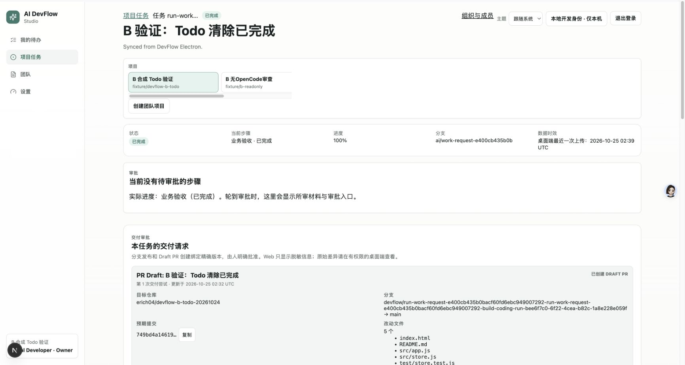
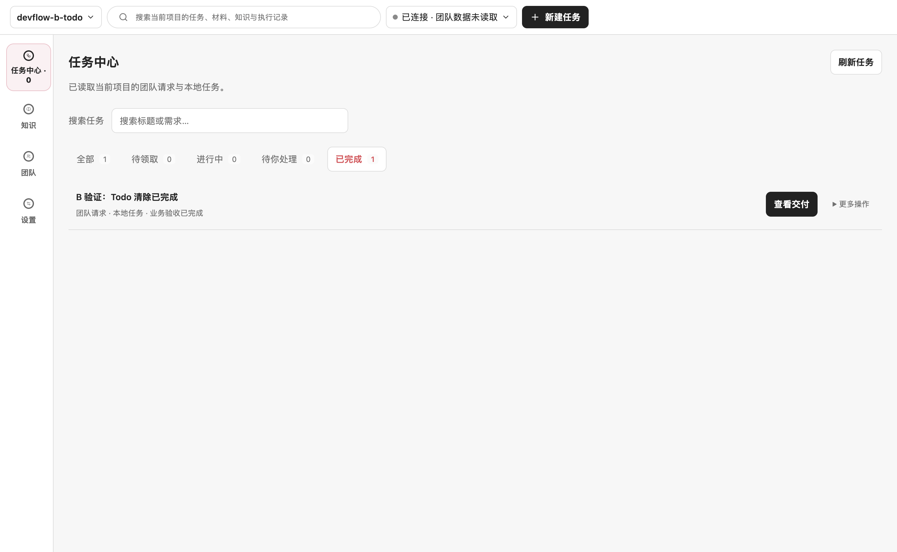
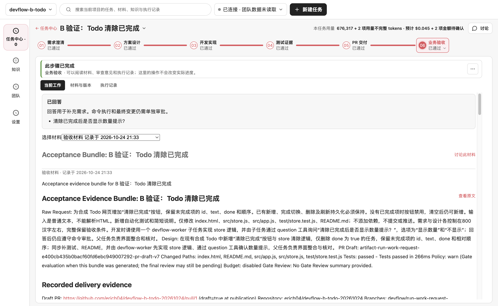

# B 工作包交付与最终验收（2026-10-24）

B 包 #237、#245、#226、#182 的开发与本次约定的真实验收均已完成。独立 Todo 已通过真实 GitHub App 创建草稿 PR，Web 业务验收完成，Electron 任务中心显示已完成；重启后结果与费用记录不变。开发成果在 [PR #254](https://github.com/erich04/ai-devflow-studio/pull/254)，尚未合并、关闭 issue 或发布。

本报告接续 [10 月 23 日真实验收记录](devflow-b-real-20261023.md)。旧报告中的 App 配置阻塞已解除，历史失败、取消、未知费用和原始材料仍保留。日期按 America/Chicago；最终交付和重启的 UTC 时间为 2026-10-25。

## 范围与证据

| 需求 | 本次结论 | 证据 |
| --- | --- | --- |
| #237 受控公开文档、父子任务、问答、权限、取消、恢复、用量 | 完成 | [真实编码、失败与恢复记录](devflow-b-real-20261023.md)；本报告的完成后重启和用量核对 |
| #245 Markdown 默认展示、原文及保存 | 完成 | [独立组件和真实 Electron 验收](issue-245-proposal-markdown-20261023.md)；真实模型方案原文/Markdown 切换；交付旧材料保持原文 |
| #226 无 OpenCode 时的内置只读审查 | 完成 | [独立无 OpenCode 场景](issue-226-native-review-20261023.md)；本次业务验收再次使用 native-agent，与 OpenCode 编码配置独立 |
| #182 Web 创建、Electron 领取、六阶段、真实交付和业务验收 | 完成 | 同一 Run 的独立测试、真实 App 草稿 PR、Web 审批、任务中心完成状态、重启回读 |

真实模型使用已授权 DeepSeek Flash。独立 Postgres、合成 Todo、B 专用 profile/API/Web/费用账本均沿用 10 月 23 日环境。协议夹具和 Electron smoke 中的合成模型结果单独记录，不冒充真实模型结果。验证用凭据适配也不代表系统钥匙串、签名安装包或生产部署已经验收。

## 真实 GitHub 交付

用户确认后，仅为现有 **DevFlow V1.5 Sandbox 20260812** App 增加本次私有合成仓库访问，原有五个仓库保留，未扩大 App 的权限类别。复用已有服务端 App 配置，没有新建 App 或私钥。验证启动脚本显式读取指定环境文件，只向 API 传入 App ID 和私钥；Web/Electron 不接收这两项或文件路径，其余源文件设置不会转发。凭据没有提交、截图或写入报告。

真实 Web「设置 › GitHub 仓库」完成安装与仓库绑定后，在真实 Electron 点击准备交付。宿主提交已接收的受管工作树，并对精确提交重新运行标准测试；随后 Web 单独确认仓库、完整 SHA、目标分支、五个改动文件、测试摘要与请求版本，批准后由产品的 GitHub App 发布。

| 项目 | 实际结果 |
| --- | --- |
| 合成仓库 | [erich04/devflow-b-todo-20261024](https://github.com/erich04/devflow-b-todo-20261024)，私有 |
| Workflow Run | `run-work-request-e400cb435b0bacf60fd6ebc949007292` |
| 成功 Coding Run | `coding-run-bee6f7c0-6f22-4cea-b82c-1a8e228e059f` |
| 原始 main | `3add0cf8dda8ba9b7f3cbe4d3343f1a8136cb26b` |
| 交付提交 | `749bd4a1461997231da4eb5d3635f3705b939c06`，一个提交、五个文件 |
| 精确提交测试 | `github-delivery-test-50b3a3d4-b5ed-4435-bff8-262e092bb560`，`npm test` 6/6，266 ms |
| 交付意图 | `github-delivery-intent-e887a55b-7325-4915-92f9-378cd56d603f`，completed |
| Web 交付请求 | `github-delivery-3999bded-66a9-449e-9e20-24e826f16e12`，独立批准后完成 |
| 远端结果 | [Todo PR #1](https://github.com/erich04/devflow-b-todo-20261024/pull/1)，OPEN / draft |
| 远端创建者 | `app/devflow-v1-5-sandbox-20260812` |
| 完成回执 | `2026-10-25T02:32:47.685Z` |

批准前远端只有 main；批准后核对 GitHub 返回的 PR、完整 head SHA、作者、一个提交和五个文件均匹配。未使用个人 token 手动创建交付 PR。准备交付、Web 批准、业务验收是三个独立动作。

五个文件为 `README.md`、`index.html`、`src/app.js`、`src/store.js`、`test/store.test.js`，与已接收 diff 一致。10 月 23 日的真实浏览器行为检查 7/7、宿主独立测试 6/6、工作流测试 6/6仍保留；本次另有上述精确提交测试。逐文件摘要确认四个历史工作树的内容和 diff 均未变化，原始 Todo checkout 仍干净。

## 业务验收与审查意见

在 Electron 生成验收包后，使用真实 DeepSeek 的 native-agent 只读审查，共 8 次请求、85,995 tokens。审查读取并引用四个文件，包含路径、行号和内容摘要。原始 checkout 保持在基线，实际实现由已绑定的受管工作树 diff 和交付提交证明。

审查结果为 **warn**，不是无条件通过。报告保留两项证据提示：验收包未内嵌子问答的答案原文，以及最初编码指令中的“不提交或推送”与后续交付需要说明。操作者分别核验后，在真实 Web Owner 审批意见中记录依据，再批准业务验收：

1. 成功 Coding Run 的问题持久状态为 answered，父/子会话与问题 ID 匹配。10 月 23 日归档的只读 OpenCode 数据库样本包含答案摘要；重新计算 `[["不显示"]]` 的 SHA256 为 `656eb1b1adec6882678e374c53571841b2aa07ba548e91c6f27da568df94f793`，与归档一致。OpenCode 临时数据库已被运行时清理，本次没有把归档样本冒充新查的实时数据库结果。
2. 编码阶段没有自行提交或推送；后续由用户明确授权 GitHub 交付，宿主准备精确提交，并经过独立 Web 交付审批。原始限制及后续授权同时保留，没有重写需求掩盖差异。
3. 完成的受管工作树、远端提交及独立测试相互匹配，原始基线 checkout 不应被编码过程改写。审查的基线引用不冒充交付版本源码。

未修改 Gate 策略、伪造审查通过或绕过审批；沿用既有 warn 策略，由操作者针对实际证据作出批准。审查 ID 为 `agent-review-review-request-77b17627-7800-4ac3-8a41-654690027486-electron`。

最终 Workflow 为 completed、version 11，六阶段的八个节点全部 success。Web 显示“业务验收 · 已完成”和 100%；Electron 任务中心显示全部 1、已完成 1、待领取/进行中/待处理均为 0，“查看交付”可打开六阶段完成页。

## 完成后的重启与用量

关闭并重启本包 API、Web、Electron，保留原数据库 schema、profile、项目、Run 和费用账本。重启前后逐项比较 Run、材料、四个 Coding Run、137 条编码事件、工作树、权限、三份测试、diff、唯一交付意图、审查、阶段用量和工作流事件，整体摘要相同。所有节点仍 success，远端仍只有同一个草稿 PR。

| 对照 | 重启前后共同值 |
| --- | --- |
| 状态 SHA256 | `2c90494319643ae4710a77a48c0671cda8215fc3747323c9b11bfe0c3dcd1cca` |
| 账本 SHA256 | `e4a1af870ac6321d94b007b1272b4887a966b74cc7786bbb3c949ab56625c868` |
| 新模型调用 / 新 Coding Run / 新 Delivery | 均为 0 |
| 活跃编码 / 未结算 started 事件 | 均为 0；历史未知费用仍保留 |
| 其他工作包服务 | 本次重启前后端口归属相同，没有重启其服务 |

任务顶部准确显示 **676,317 tokens + 2 项用量不完整**：编码已知小计 560,225，阶段小计 116,092。52 个编码请求对应 104 个起止事件，逐调用累计与 UI 一致；阶段审查另归入阶段小计。UI 的不完整记录数不能直接等同于网关未知请求数。

B 网关共 **83 次真实请求**，按既定高峰无缓存价保守结算 **¥1.811640**，另保留未知一笔 **¥0.401682**，合计占用 **¥2.213322**；B 的 ¥8 分配还余 **¥5.786678**。这不是提供方账单，也不是 A/B 两包最终总账。旧费用与未知预留 ¥2.639110 未改，A 的新增上限仍为 ¥8，没有借用其额度。验收结束已停止费用网关；重启没有新增调用，没有释放未知预留或重置账本。

## 依赖修复与检查

开发 PR 首次 CI 的生产依赖审计失败，按官方修复版本更新 Next **15.5.28**、Electron **42.11.16** 和 Undici override **7.30.1**，连同 lockfile 独立提交 `1ddfcce`。这些是审计所需的补丁更新，没有替换开发框架。实际 B Web/Electron 已使用更新后的版本完成上述交付与重启。

| 检查 | 实际结果 |
| --- | --- |
| Node / pnpm | 24.18.0 / 9.15.0 |
| frozen-lockfile 安装 | 通过 |
| 生产依赖 audit | 无已知漏洞 |
| 完整 `corepack pnpm verify` | 382 个测试文件通过、2 个跳过；5,100 项通过、16 项跳过；类型与跨平台检查通过 |
| 完整 build | 通过 |
| E2E | 46 通过、1 跳过 |
| 真实 Electron smoke | 任务中心、工作流、审查、权限、测试、持久恢复、Provider 删除通过 |
| App 配置隔离回归 | 3/3；仅显式 API 配置、环境继承过滤、不完整配置拒绝 |
| `1ddfcce` 的 CI | [五项全部通过](https://github.com/erich04/ai-devflow-studio/actions/runs/40154593182)：macOS、Windows、Postgres、Docker smoke、Docker lifecycle |

完整检查对应补丁后的产品代码；最后的验收报告、截图与验证脚本配置隔离变化另经定向检查，不把文档提交冒充又一次完整本地执行。历史百万次读取 soak 的首次超时及后续相同期限通过记录仍见旧报告。

## 历史材料与证据存放

10 月 23 日生成的 PR 包保持原文，因此仍含旧 `fixture/devflow-b-todo` compare 地址和修复前的零费用占位文案。发布的 PR body 也是该批准包的原文，没有事后改写摘要。它们是历史材料，不代表当前交付仓库或当前费用；交付审批的结构化仓库/SHA、真实 App 回执、新验收包的 recorded delivery 以及本报告给出当前事实。新生成包已使用修正后的预算文案，见旧报告的回归记录。

提交动作会改变包含 Git 状态的 sourceTreeDigest，所以旧的两份提交前测试在最终只读采样中不再标记为当前树匹配；其历史有效性保留。当前交付使用绑定 `749bd4a` 的新测试证据，逐文件比较另证实内容不变，未把历史 digest 不同隐藏或误报为当前通过。

原始证据在本 worktree 的 `.tmp/devflow-b-20261023/opencode-1792772386842/`，不提交凭据、数据库或完整模型记录：

- `delivery-prepared-20261024.json`、`delivery-preapproval-proof-20261024.json`、`delivery-after-approval-20261024.json`：准备、批准前远端核对、真实回执。
- `acceptance-review-20261024.json`、`acceptance-question-proof-20261024.json`：真实审查与归档问答核验。
- `evidence-1792896032942-final-delivered/`：用量、逐调用、原始 checkout 和四个工作树内容对照。
- `before-completed-restart.json`、`after-completed-restart.json`：完成后重启的相同摘要及截图。
- 同级 `budget/ledger.json`：独立人民币账本；`gateway-stopped-20261024.json` 记录停止状态。

本包待做的是真实代码评审和依赖 PR 的合并安排，不再有本次约定范围内尚未执行的验收项。#241 → #243 → #244 均仍 OPEN；PR #254 仍以 #244 分支为 base。没有把合成 Todo 草稿 PR 的成功等同于 DevFlow Studio 已发布。
