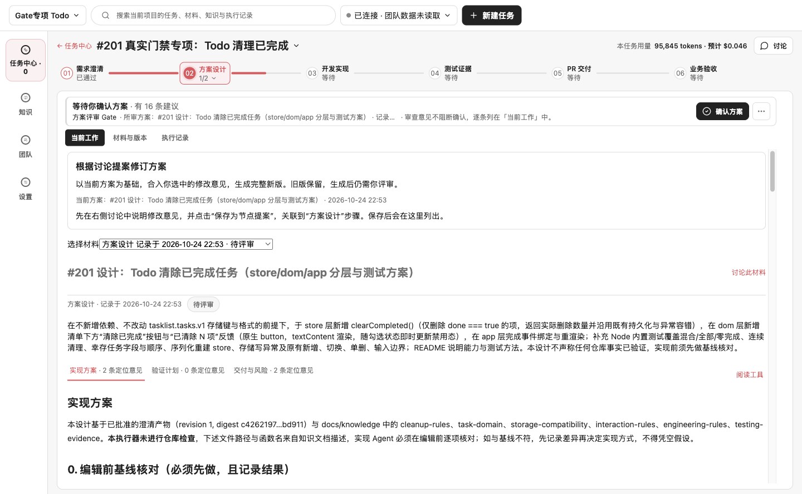

# #201 真实门禁验收与 #202 窗口排查 — 2026-10-24

本轮按用户确认的验收边界执行：**#201 验收当前门禁的保存、恢复、计费和不自动审批契约，通过后关闭；#202 将已修好的结算恢复与仍未定位的意外关窗分开，只保留后者开放。** 不再以逐字复现已经丢失的历史模型响应作为 #201 的关闭前提，也不把“本轮没有关窗”解释为已找到 #202 的根因。

产品基线为 `6606c7ba2182ba79a73ef57cebd1589a038df3de`（PR #256 合并后）。本轮没有改变产品解析、门禁或结算行为；新增的是显式启用的验收观察器、观察器回归测试及证据。执行日期按 America/Chicago 为 10 月 24 日，原始时间线使用 10 月 25 日 UTC。

提交前同步了主干 `a25e6a7`（新增 #241 / #243 / #244 的 OpenCode 编码权限、问答与任务能力）。上述真实模型记录及 5,311 项测试数量对应原验收基线；共享门禁解析、门禁运行时和 Team 调用预算代码在两基线间未改变。同步后的结果单独以 PR 检查为准，不把旧执行结果标成新版本的真实模型验收。

## 真实环境与操作

- macOS、Node.js 24.18.0、pnpm 9.15.0、Electron 42.11.16；独立 Postgres 16、API/Web、Electron 档案与 Todo 副本，未重用用户业务数据库。
- 在真实 Web 界面登录本地开发身份、创建隔离团队项目、保存预算策略并生成配对码；在 Electron 界面配对、保存已有获授权 DeepSeek 凭据、创建任务、生成材料、运行及重新运行审查。模型请求直达 `https://api.deepseek.com`，没有替换模型响应或绕过产品预算检查。
- 使用 `deepseek-flash`、Direct Provider；七次调用使用应用默认的思考开启 / low，最后一次在设置界面切为关闭。门禁执行方式为“只依据材料与知识目录”，不宣称进行了仓库只读核验。
- Todo 中放入六份合成知识文档，涵盖清理规则、任务身份、存储、交互、工程边界、测试证据。未启动编码、发布或合并 Todo 任务；只为进入设计阶段，在界面上明确确认了一次需求 Gate。
- Playwright 驱动真实界面。macOS 遮挡窗口时曾使页面进入 hidden、点击等待超时；启用 CDP focus emulation 后继续正常点击。该设置只用于避免后台帧调度停顿，没有替换应用逻辑、IPC 或模型调用；hidden 不记为窗口关闭。

## #201：验收通过

| 操作 | 真实请求数 | 结果 |
| --- | ---: | --- |
| 生成需求草稿，开启思考 / low | 2 | 首次格式无效并安全失败；界面明确重试后生成成功 |
| 需求 Gate 首次审查及确认后的重新审查 | 2 | 两份有效报告均保存，Gate 仍待确认 |
| 生成设计，开启思考 / low | 1 | 设计保存成功，进入设计 Gate |
| 设计 Gate 首次审查及确认后的重新审查 | 2 | 两份有效报告均保存，Gate 仍待确认 |
| 设计 Gate 关闭思考后的重新审查 | 1 | 第三份有效设计审查报告保存，Gate 仍待确认 |

五次门禁审查全部成功。每次都绑定实际材料摘要和六份知识文档；较长设计按连续分块记录，未丢掉旧报告。重复需求审查期间 Run version 保持 2，重复设计审查期间保持 4；审查本身没有批准 Gate、替换正式设计或进入编码。

首次需求生成失败为真实观察：HTTP 200、`finish_reason=stop`、SSE 完整结束，但正文不是可解析的 JSON。失败有 1,891 输入 / 2,281 输出 tokens，产品记录为已发生费用的失败，未保存正式草稿，窗口保持正常。原始正文和思考文本未落盘，因此不判断是引号、附加文字还是其他语法问题。它属于阶段生成路径，并非本轮五次 Gate 审查之一；不能把失败隐藏，也不能据此声称模型以后不会再返回无效内容。

恢复异常分支由当前运行时及共享模块回归覆盖，包括有限重试、每次实际调用的用量记录、耗尽后的安全失败、失败重审保留原报告、预算阻断不调用模型、失败后允许明确重试。五次真实 Gate 响应都有效，因此**本轮没有触发真实提供方的 Gate 自动恢复分支**；该分支的证据来自确定性回归，不能混称为真实模型触发。

重启前后，Run、节点、材料、五份报告、八条用量记录的完整快照一致（摘要见 JSON 证据）。界面仍显示“等待你确认方案”、95,845 tokens，三个设计审查版本仍可选择。独立 Postgres 有八个对应的调用记录：一个 failed、七个 completed；输入 67,250 / 输出 28,595 tokens，与提供方观察值和本地 SQLite 完全一致。



## #202：结算恢复通过，意外关窗继续开放

真实流程从需求生成失败、明确重试、设计生成到五次 Gate 审查，均未发生意外关窗、渲染进程退出或 WebContents 销毁。最后一次真实结算在 `03:57:26.251Z` 返回 HTTP 200；首次窗口关闭出现在显式重启阶段 `03:58:18.835Z`，之后正常退出，不能计为故障复现。

另在真实 Electron / IPC / SQLite 上复跑 H6；该组使用本机合成模型和受控 Team API，**不使用真实 DeepSeek，不产生模型费用，也不是上面的 Postgres 验收**：

| 条件 | 次数 |
| --- | ---: |
| 正常结算 | 1 |
| HTTP 503 / 连接中断 / 服务端已提交但回执丢失 | 各 8 |
| 延迟 503 / HTTP 200 后正文中断 / 结算期间明确取消 | 各 2 |

31 组全部通过。非取消场景保留有效设计；故障期间费用记录保持可恢复，恢复只重放结算、不新增模型调用、不重复计入同一次用量。取消的两组保持取消状态；之后独立的明确流程重试才各新增一次模型调用，因此共有 33 次本机合成模型调用。所有补结算操作合计新增模型调用为 0。

31 组执行期间没有窗口关闭或渲染器退出，IPC 一直可响应、主进程存活。末尾主动 renderer crash、主动 close 的正对照均被捕获，证明事件采集能够区分这两类退出。它们是测试控制，不能代替历史故障根因。

#202 已更新标题和范围，保留原始历史描述。剩余工作仅为：在下一次意外关窗现场，用同一时间线关联模型、结算、窗口 close/closed、render-process-gone、主进程退出及操作方清理，确定最早异常边界，再做最小复现和修复。当前没有证据把历史事件归因于结算失败，也没有据此修改生产窗口行为。

## 验证、费用与复跑

- 桌面构建、全仓构建、类型检查及跨平台检查通过。
- 最终全仓测试 **5,311 passed / 16 skipped**（401 个测试文件通过、2 个跳过）；观察器 **5/5**，H6 故障矩阵 **31/31**。Postgres 专项中的八次真实调用均已结算。
- 观察器测试覆盖原响应不被观察器失败替换、观察不阻塞原响应、未知用量累计预留、关闭后不得重新开启预算、Electron 退出时封存预算。测试曾先复现观察器 clone 失败干扰请求及原生退出未投递 Node SIGTERM 的问题，再修正观察器；这些不是产品故障。
- 初次退出发现 Electron 原生退出未执行 Node SIGTERM 回调，因此在确认进程退出、八笔用量完整后离线封存了同一账本。最终观察器同时在 Electron `before-quit` 封存，并以新隔离档案的零费用实际退出验证。账本没有重置次数或费用。
- 真实调用保守估算 **¥0.363260**。按 [DeepSeek 官方价格页](https://api-docs.deepseek.com/zh-cn/quick_start/pricing/) 的峰时未命中缓存输入 ¥2 / 百万、输出 ¥8 / 百万计算，忽略缓存及错峰折扣；这不是提供方实际扣费账单。本轮独立硬上限 ¥2，沿用用户累计 ¥20 授权，不新增 ¥20 额度。全部八笔用量明确，无未知请求预留。
- 付费授权已封存；隔离 API/Web、Postgres 与 Electron 已停止，历史费用账本保持封存及原摘要。没有执行新的签名安装包、Windows 真实模型或 OpenCode 验收。

复跑无费用的观察器测试和故障矩阵：

```sh
corepack pnpm exec vitest run scripts/gate-acceptance-bootstrap.test.ts
corepack pnpm --filter @ai-devflow/desktop build
DEVFLOW_H6_STRESS=1 DEVFLOW_H6_REPORT=output/hardening/h6-new-run.json \
  corepack pnpm exec tsx scripts/hardening-settlement-electron.mts
```

真实模型复跑需要新的、明确授权的预算档案，不能重新打开本轮账本。构建桌面后，在独立团队、独立 `DEVFLOW_USER_DATA_DIR` 与 `DEVFLOW_DATA_PROFILE_REGISTRY_PATH` 下，以 `DEVFLOW_GATE_ACCEPTANCE=1`、`DEVFLOW_GATE_ACCEPTANCE_DIR` 启动 `electron scripts/gate-acceptance-bootstrap.cjs`，再由界面完成配对、Provider 配置和上述步骤。观察器固定本轮模型、官方端点、最多 18 次请求和累计 ¥2 预留上限；它不安装到产品默认启动路径。

可审阅的脱敏证据为 [results.json](evidence/gate-201-window-202-20261024/results.json)。本机完整合成数据、状态断言、测试日志与生命周期记录在 `.tmp/gate-201-window-202-20261025/`，界面快照在 `output/playwright/gate-201-window-202-20261025/`；凭据、会话、数据库及原始 Provider 正文未提交。
