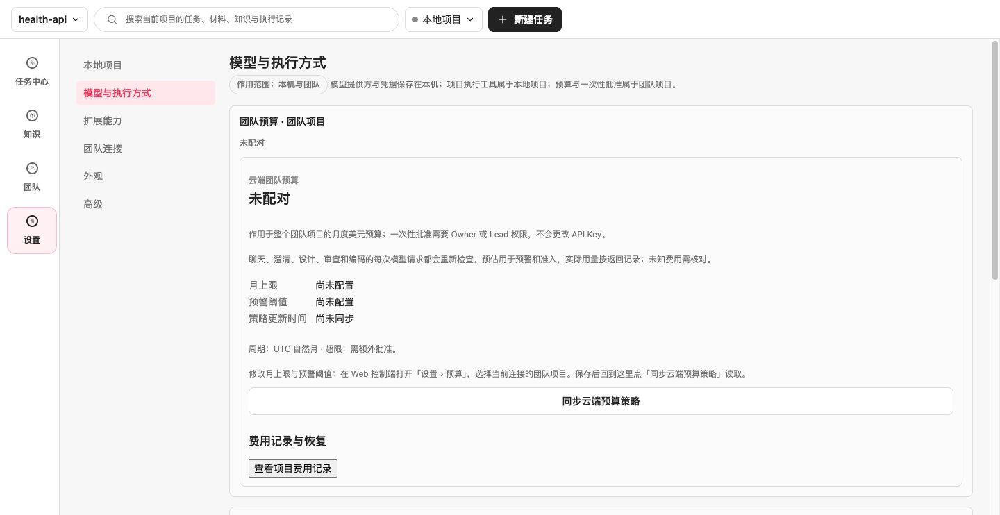
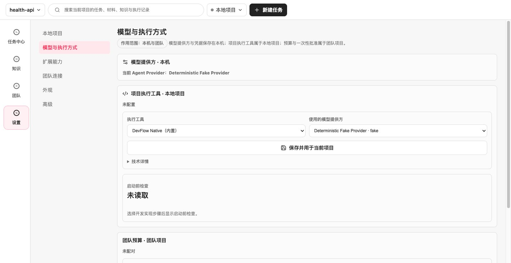
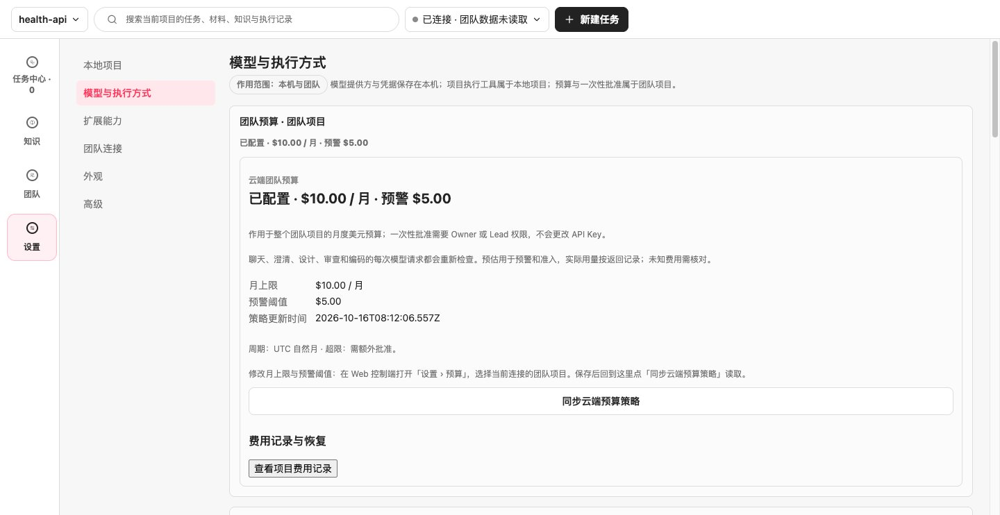
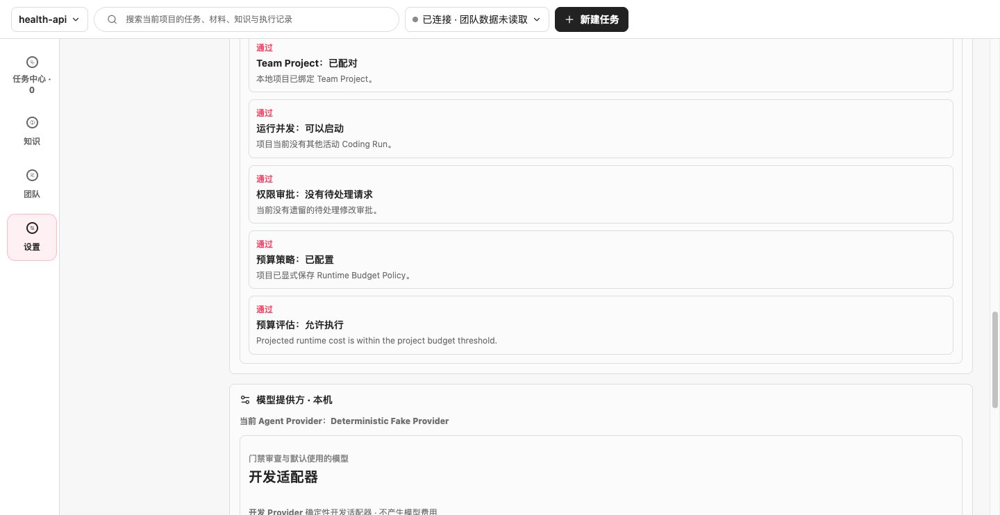
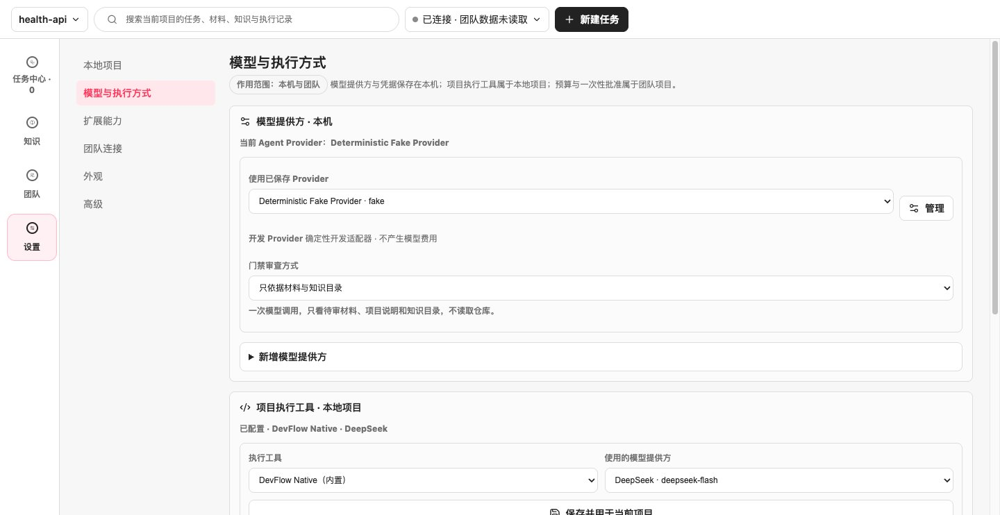
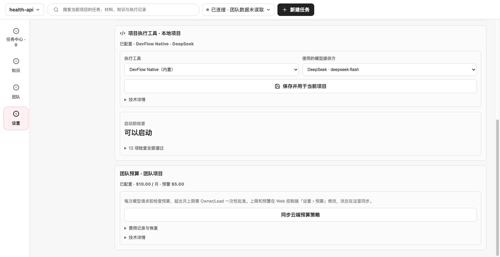
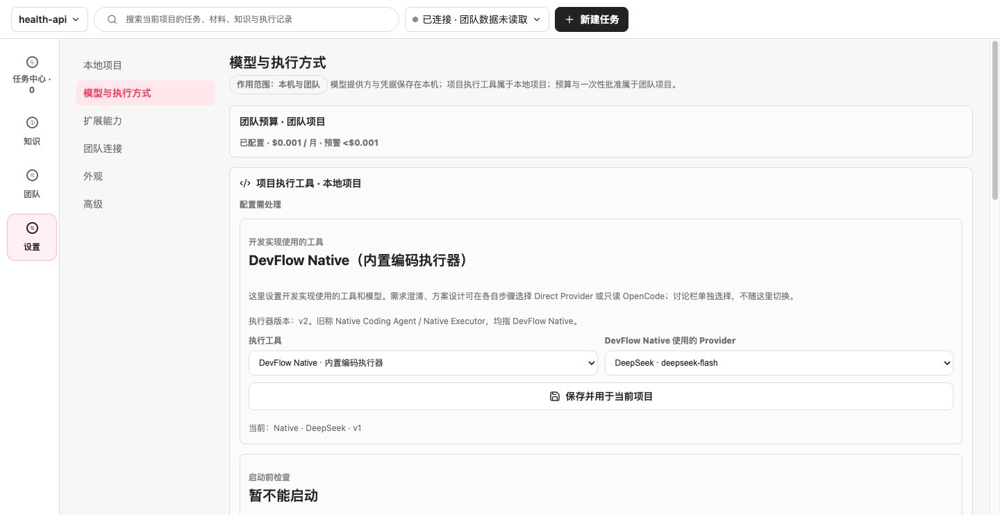
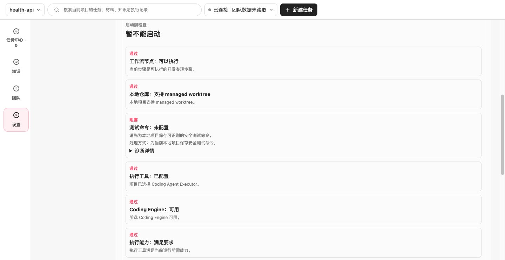
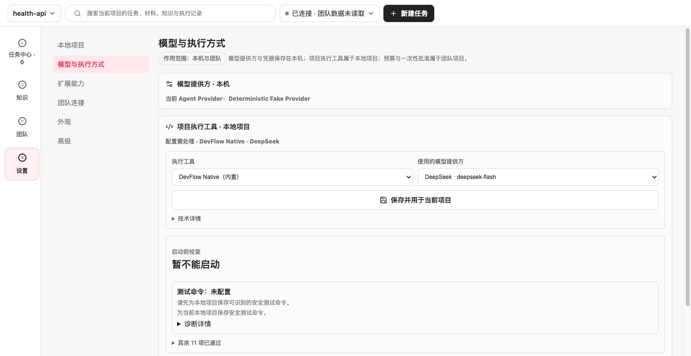

# #227 精简「模型与执行方式」页面：验证记录

- 日期：2026-10-16（America/Chicago）
- 基线：`main` `f8a97da`
- 设计与修复模型：Claude Opus 5.5（Cursor Agent）。按 #227 的要求，本次没有使用 Codex 或 ChatGPT 模型。
- 范围：桌面端「设置 › 模型与执行方式」的信息层级和文案。保存、检测、批准等行为及 IPC 没有改变。

## 改动

| 区域 | 修改前 | 修改后 |
| --- | --- | --- |
| 顺序 | 团队预算 → 执行工具 → 模型提供方 | 模型提供方 → 执行工具 → 团队预算，按依赖顺序排列 |
| 模型提供方 | 标题卡、提供方行与下拉框重复显示名称；新增表单常驻展开 | 下拉框加一行费用和凭据说明；已有提供方时，「新增模型提供方」默认收起 |
| 执行工具 | 标题重复当前工具，另有两段说明、版本和历史名称，以及一行“当前” | 摘要直接显示「已配置 · DevFlow Native · DeepSeek」；版本、旧称和适用范围移到「技术详情」 |
| 启动前检查 | 12 张“通过”卡片逐项列出，部分说明为英文 | 只列出阻塞项和处理方式；通过项折叠为「12 项检查全部通过」；没有中文说明的原始原因放进「诊断详情」 |
| 团队预算 | 状态和金额在摘要、标题、明细中出现 3 次；默认显示两段规则说明和英文检查结果 | 金额只在摘要中出现；规则合并成一行；预算检查正常时不再显示，需要处理时用中文说明；费用记录和策略时间收进折叠区 |
| 预算阻塞 | 只在预算区出现 | 启动前检查的预算阻塞项提供「查看团队预算」，可直接展开预算区 |

必要信息仍然保留：费用（提供方说明行、门禁审查方式说明）、预算上限和一次性批准、密钥只保存在本机、阻塞原因与下一步操作。

## Electron 走查

方法：`scripts/workspace-baseline.mts` 新增 3 个可选样例（不计入默认的 32 个基线样例），在真实 Electron 窗口和隔离数据目录中，以演示 Team API 和确定性运行时准备状态。每个样例先截取默认状态，再展开全部主要区块并按屏截取。没有发出模型请求。

```
corepack pnpm --filter @ai-devflow/desktop build
corepack pnpm exec tsx scripts/workspace-baseline.mts \
  --samples settings-models-unconfigured,settings-models-configured,settings-models-blocked --out out/issue-227/after
```

修改前的截图在同一基线、未改动产品代码时用相同命令生成。

| 状态 | 准备方式 | 默认可见文字（字符） | 全部展开后（字符） | 全部展开所需屏数 |
| --- | --- | --- | --- | --- |
| 未配置 | 已选仓库；未配对团队，未保存执行工具 | 745 → 334 | 1,110 → 524 | 4 → 2 |
| 已配置 | DeepSeek `deepseek-flash`、DevFlow Native、团队预算 $10 / 月（预警 $5） | 114 → 142 | 1,775 → 616 | 6 → 2 |
| 存在阻塞 | 同上，月上限 $0.001，示例仓库没有测试命令 | 1,068 → 365 | 1,789 → 676 | 6 → 2 |

已配置状态的默认文字略有增加，是因为执行工具摘要新增了当前工具和提供方名称。

演示 Team API 对 $0.001 月上限的预算评估仍为允许，因此 Electron 中的阻塞样例只展示了“测试命令未配置”。预算阻塞时的中文状态、诊断折叠和「查看团队预算」入口由组件测试覆盖，见下文。

### 截图

未配置（修改前 / 修改后）：




已配置，全部展开（修改前第 1 屏和第 4 屏可以看到英文检查结果 / 修改后共 2 屏）：






存在阻塞（修改前需滚动才能看到阻塞项 / 修改后首屏可见）：





## 自动化验证

- `apps/desktop/src/App.test.tsx`、`model-settings-view-model.test.ts`、`ModelCostRecovery.test.tsx`：181 项通过。新增断言覆盖：只列出阻塞项且通过项默认折叠；英文预算原因不出现在默认文案中，只保留在折叠的诊断里；没有提供方时新增表单默认展开。
- `tests/e2e/desktop.spec.ts`：32 项通过，包括执行工具检测与保存、Provider 删除与焦点。
- `corepack pnpm test:electron-smoke`：通过，覆盖真实 Electron 中新增、保存、删除 Provider，以及浅色和深色主题下的 Thinking 设置。
- `corepack pnpm verify`：通过。类型检查通过，374 个测试文件、4,906 项测试通过（16 项专用 Postgres 条件测试跳过），跨平台检查通过。

## 基线工具的配套修正

#182 的任务中心上线后，`workspace-baseline` 的导航和选择任务步骤已经失效：主导航名称变为「任务中心 · N」，任务列表也从项目菜单移到了任务中心。本次让 `clickNav` 接受数量后缀，`selectRun` 在任务中心存在时通过「继续任务：标题」打开任务，旧布局路径保持不变。

## 未验证

- 没有使用真实模型或收费 Provider。
- 没有在正式签名安装包中走查。
- 只截取了浅色主题和 1440 宽度；深色主题和窄窗口只由现有 E2E 覆盖布局可达性。
