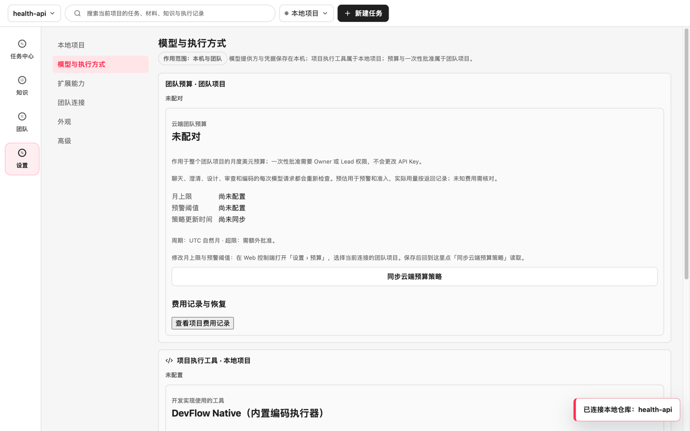
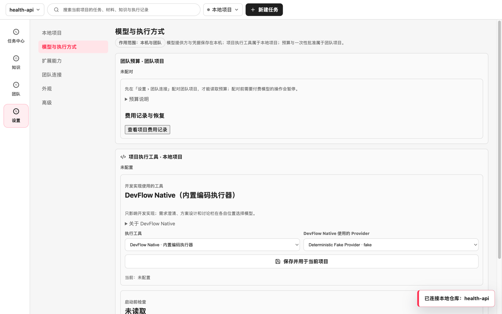
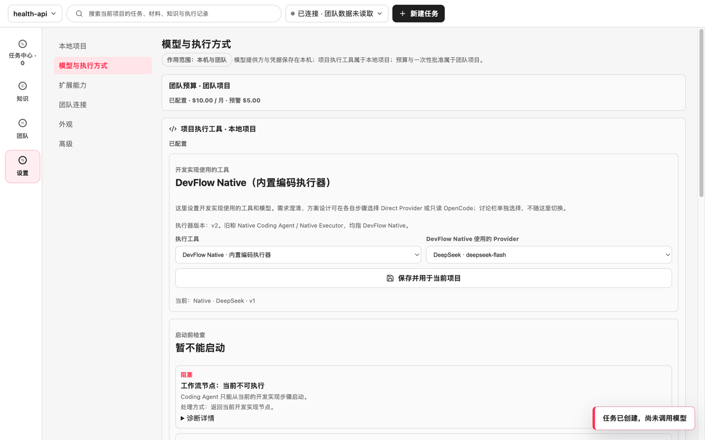
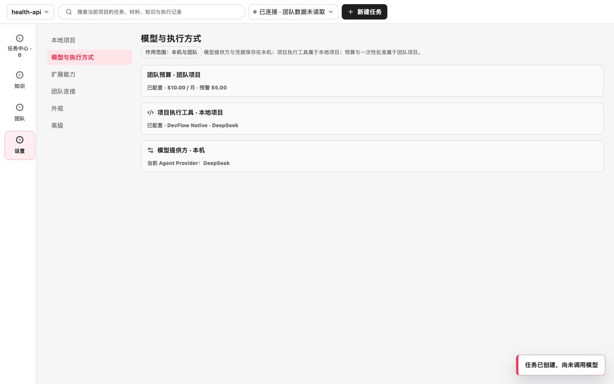
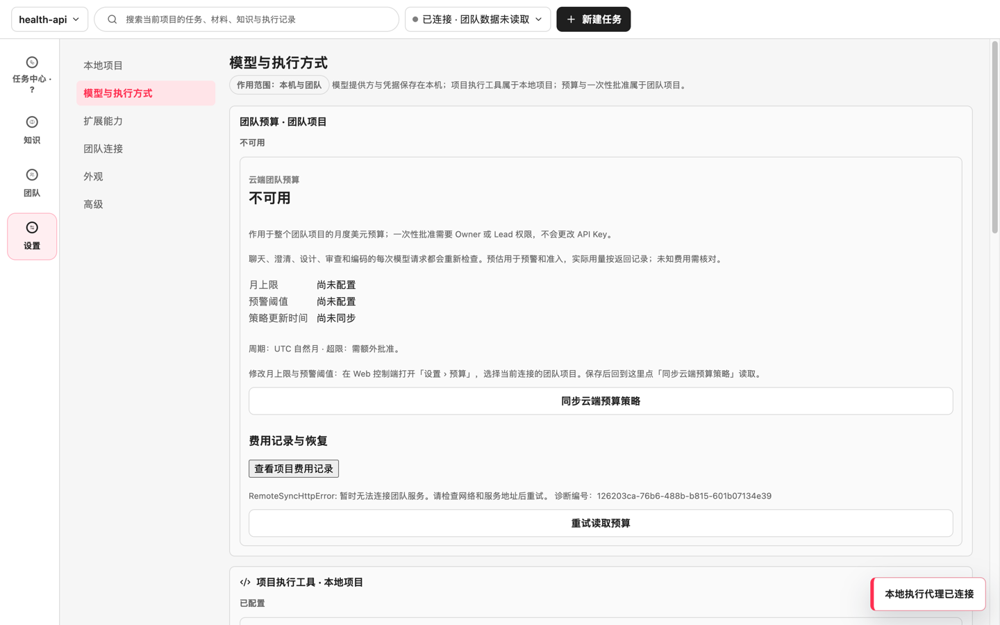
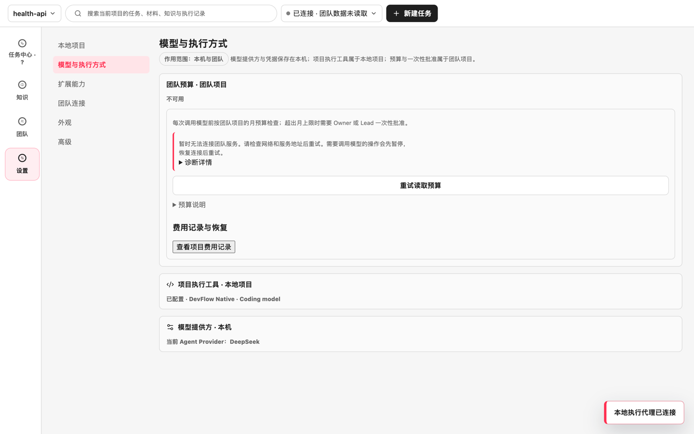
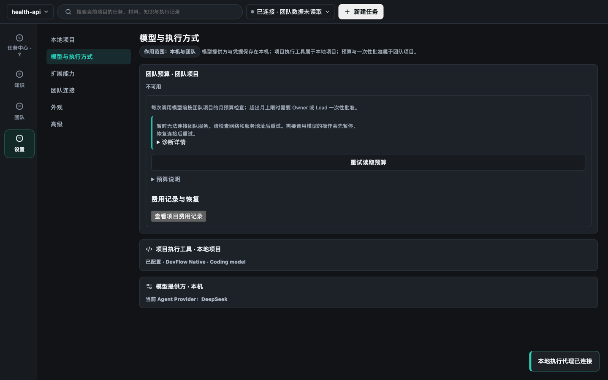

# #227 「模型与执行方式」页面精简验收（2026-10-28）

实施模型：Claude Opus 5.5（Kiro）。全部为本机走查：隔离用户数据目录、内存演示 Team API、本地受控模型服务、外部请求拦截；没有真实模型调用，也没有签名安装包。

## 走查方法

真实 Electron 窗口，1440×900，浅色主题（阻塞状态另拍深色）。修改前使用 `origin/main`（`289a12b`）的构建，修改后使用本分支构建，步骤相同：

| 状态 | 准备方式 |
|---|---|
| A 未配置 | 选择本地仓库；未配对团队、未保存模型、未选执行工具 |
| B 已配置 | 配对团队项目，预算 $10 / 月、预警 $5；保存 DeepSeek（`deepseek-flash`，请求发往本地受控服务）并用于 DevFlow Native；跑一次门禁审查得到真实的预算检查结果 |
| C 存在阻塞 | 在 B 的基础上停止 Team API，再点「同步云端预算策略」：预算无法读取 |

## 首屏可见文字

按 `settings-models` 区域内可见文字统计（去空白后的字符数 / 可见段落数）：

| 状态 | 修改前 | 修改后 |
|---|---|---|
| A 未配置 | 646 字 / 8 段 | 373 字 / 4 段 |
| B 已配置 | 901 字 / 17 段 | 98 字 / 0 段 |
| C 存在阻塞 | 1227 字 / 21 段 | 203 字 / 2 段 |

## 主要变化

- 已配置时三个分区收起，摘要直接给出状态：预算金额、执行工具与模型（如“已配置 · DevFlow Native · DeepSeek”）、当前模型提供方。
- 修改前，已配置的项目执行工具仍会展开 12 项启动前检查，只因为任务不在开发实现步骤。修改后只有未配置或有本页可处理的问题时才展开；通过的检查和要到开发实现步骤才评估的检查收进「全部检查」。
- 预算检查用中文说明；英文原文（如 `Projected runtime cost is within the project budget threshold.`）收进「预算说明」。超预警、需批准或不可用的结果在卡片中单独突出。
- 预算无法读取时：不再把未知金额显示为“尚未配置”；去掉 `RemoteSyncHttpError:` 前缀，诊断编号收进「诊断详情」；「同步云端预算策略」与「重试读取预算」合并为一个按钮。
- 执行工具说明缩为一句；执行器版本与旧称收进「关于 DevFlow Native」。

保留在首层的必要信息：未配对时的下一步、超出月上限需 Owner/Lead 批准、一次性批准入口、预算不可用时付费操作会暂停、费用记录入口。

## 截图

| 状态 | 修改前 | 修改后 |
|---|---|---|
| A 未配置 |  |  |
| B 已配置 |  |  |
| C 存在阻塞 |  |  |

深色主题的阻塞状态：

## 自动验证

- `corepack pnpm typecheck`、`vitest run`（410 个文件、5514 项通过，16 跳过）、`test:cross-platform` 通过。
- `test:electron-smoke` 通过。`test:workbench-conversation-electron-smoke` 首次在启动阶段报 `Execution context was destroyed, most likely because of a navigation`（脚本第 182 行，进入页面之前），单独重跑通过，`externalProviderCalled: false`。
- 新增组件测试：正常预算检查只显示中文、英文原文在折叠说明中；预算无法读取时的提示、单一重试按钮和折叠诊断。

## 与 #238 的合并

#238 把“执行器版本：v2。旧称…”一行换成「Native 版本」选择框。两边改到相邻的两行，合并时取 #238 的选择框，保留本分支的一句话说明即可；选择框本身已去掉旧称。
